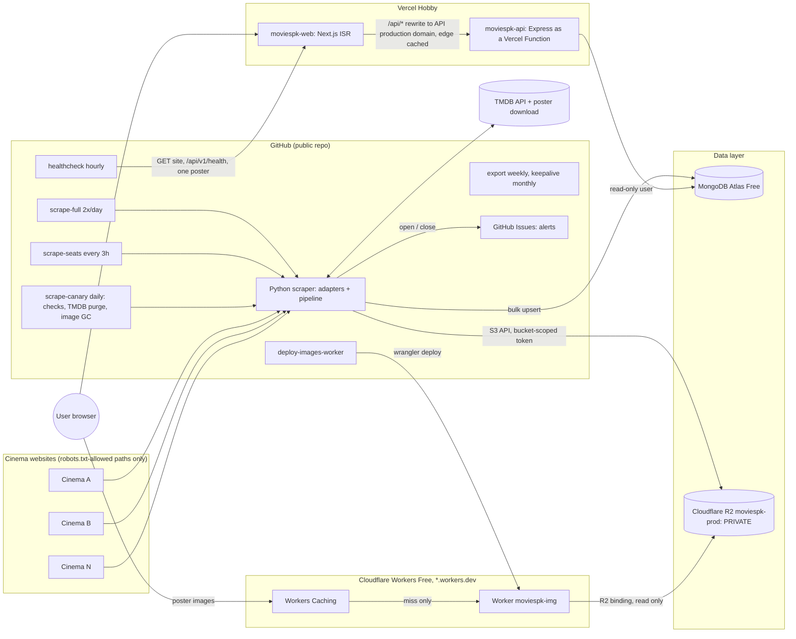
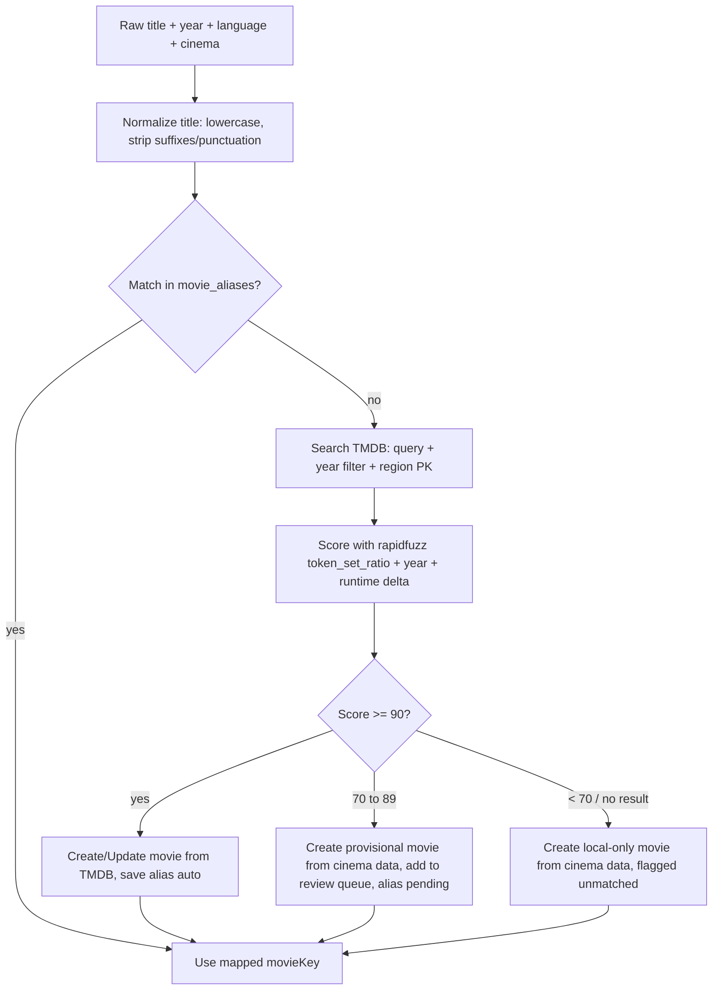
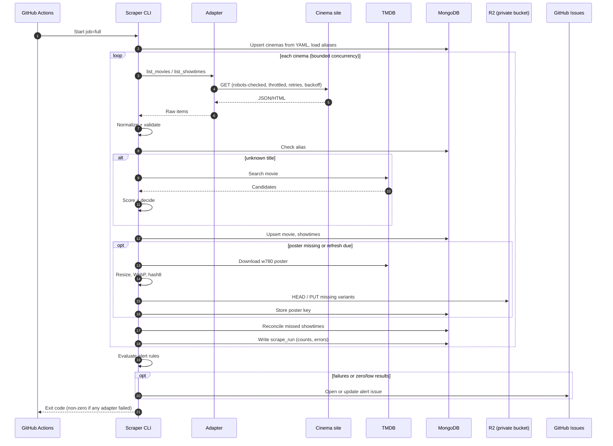
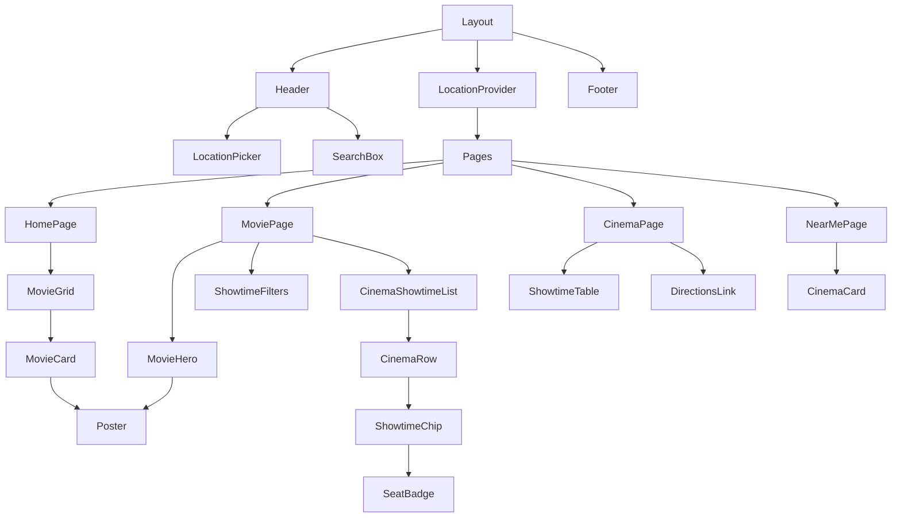
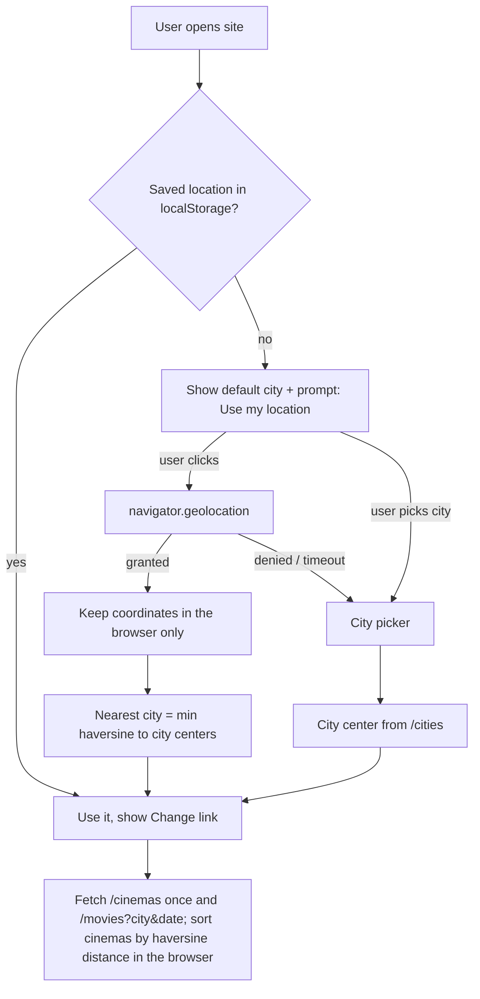
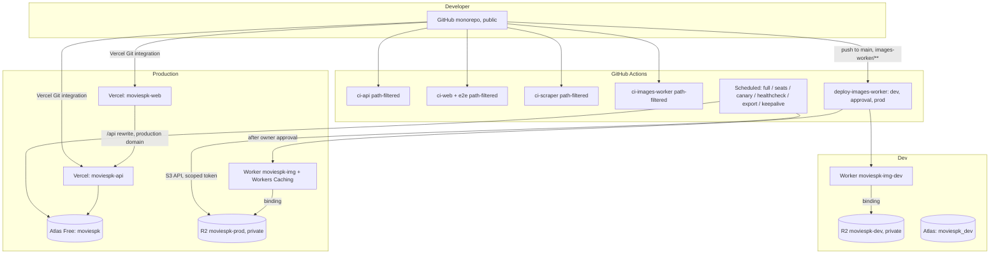

# MoviesPK — Architecture Document

> Location-based cinema showtimes and movie information platform for Pakistan.
> Status: **Draft v1.2** (2026-11-23).
> - v1.0 was based on decisions confirmed on 2026-11-22.
> - v1.1 added the corrections from the infrastructure, cinema-viability and legal audit of 2026-11-23 (`docs/infrastructure-and-legal-audit.md`, `docs/cinema-viability-audit.md`).
> - **v1.2** adds owner decisions OD9 and OD10 and rewrites every section that still described the v1.0 design, so that this document matches `plan.md` v2.1.
>
> Product name: **MoviesPK** (owner decision OD1, 2026-11-22; "CineNear" is dropped).
>
> **Audit amendments and owner decisions (2026-11-23).** Every other accepted decision is unchanged.
> - **Scraping policy:** robots.txt is **respected**. ADR-11 is corrected, and ADR-0001 is the governing record. See §5.4 and §12.3.
> - **Commercial status: PERSONAL / NON-COMMERCIAL** (owner confirmation, 2026-11-23). There is no revenue, no paid feature and no commercial use. The project runs on Vercel Hobby and TMDB's free non-commercial API with the required attribution.
> - **Legal risk R1:** an acknowledged operational/policy risk for a non-commercial project (§16). **A formal legal assessment is not a prerequisite for implementation or launch**, and is not a project task. None has been carried out, and the project claims no legal clearance.
> - **Infrastructure (2026-11-22):** owner decisions OD2 (no custom domain), OD4 ($0 budget), OD6 and OD7 (Express API on Vercel) are in §10. Verified third-party limits are in §10.7.
> - **OD9 and OD10 (2026-11-23):**
>   - **Cloudflare R2 is reinstated** for poster storage. A payment method is allowed on the Cloudflare account **for R2 only**.
>   - Posters are served by a **Cloudflare Worker on its free `*.workers.dev` URL**. It reads a **private** bucket through an R2 binding and is fronted by **Workers Caching**.
>   - Workers stays on the **Free** plan. No custom domain, no Cloudflare zone/DNS/CDN/WAF, no public bucket, no Cache API.
>   - Recorded as **ADR-18** (§3) and `docs/adr/0009-reinstate-r2-and-worker-image-delivery.md`.
>   - **Superseded again:** OD6 (R2 dropped); the R2 and "TMDB image CDN" parts of ADR-13; and every v1.1 statement that Workers are not used or that posters are hotlinked from TMDB.
>   - OD4 now reads: $0 for everything except R2, which is expected to cost $0 but has no hard spend cap.
> - **OD11 (owner clarification, 2026-11-23):** the owner accepts the R2 free allowances and the residual spend risk (no hard cap; $0 is expected but not guaranteed), and approves R2 + Worker subject to the remaining verification items. The design stays simple:
>   - no extra providers, databases, storage tiers or paid services to avoid limits;
>   - basic usage monitoring and write protection only;
>   - no Referer protection;
>   - no paid upgrade unless measured usage justifies it;
>   - image base URL and storage stay configurable (§6.4).
> - §4, §6, §7, §8, §9, §10 and §11 have been rewritten to match `plan.md` v2.1. **`plan.md` remains the source of owner decisions**; any remaining disagreement is a defect to fix.

## Table of Contents

1. [Overview](#1-overview)
2. [Requirements](#2-requirements)
3. [Decision Log](#3-decision-log)
4. [High-Level System Architecture](#4-high-level-system-architecture)
5. [Data Collection Layer](#5-data-collection-layer)
6. [Data Storage Layer](#6-data-storage-layer)
7. [Backend / API Design](#7-backend--api-design)
8. [Frontend Design](#8-frontend-design)
9. [Location-Based Logic](#9-location-based-logic)
10. [Infrastructure and Deployment](#10-infrastructure-and-deployment)
11. [Observability and Reliability](#11-observability-and-reliability)
12. [Security and Legal Considerations](#12-security-and-legal-considerations)
13. [Testing Strategy](#13-testing-strategy)
14. [Repository and Folder Structure](#14-repository-and-folder-structure)
15. [Scalability and Future Enhancements](#15-scalability-and-future-enhancements)
16. [Risks and Mitigations](#16-risks-and-mitigations)
17. [Implementation Roadmap](#17-implementation-roadmap)
18. [Open Questions](#18-open-questions)

---

## 1. Overview

### 1.1 Summary
MoviesPK aggregates movies, showtimes and seat availability from Pakistani cinemas into one location-aware website.
- **Collection:** a Python scraper on GitHub Actions collects data from each cinema's site on a schedule, respecting robots.txt, and normalizes it.
- **Storage:** the data is stored in MongoDB Atlas (free cluster). Poster images are stored in a **private Cloudflare R2 bucket** and served by a **Cloudflare Worker on `*.workers.dev`** with Workers Caching.
- **Serving:** an Express REST API runs as a Vercel Function. It serves a Next.js (React) frontend on Vercel Hobby through a same-origin rewrite.
- **Location:** users find cinemas near them through browser geolocation or a city picker. Distances are computed in the browser.

### 1.2 Goals
- One place to see what is playing near the user, with showtimes and seat status.
- Fully autonomous data refresh: showtimes about 2x/day, seat status about every 3 hours.
- Fast, SEO-friendly, mobile-first experience.
- **$0 expected running cost.** R2 is the only service with a payment method, and its use stays inside the free allowance (`plan.md` §7.4).
- Easy to add a cinema: one adapter plus one config entry.

### 1.3 Architectural Principles
| Principle | Meaning in this project |
|---|---|
| Decouple collection from serving | The scraper and the API share only the database (and the scraper writes images that the Worker serves). A scraper failure never takes the site down; it only makes data stale. |
| Adapter per source | Each cinema's fragility is isolated behind one interface. |
| Idempotent pipeline | Re-running any job gives the same state, with no duplicates. |
| Fail loudly, degrade gracefully | Silent breakage (zero results) is treated as a failure. The UI shows "last updated" instead of hiding stale data. Missing images become placeholders. |
| Cache at the edge | Data changes a few times a day. Vercel's edge absorbs most API traffic and hides function cold starts. Workers Caching and the browser absorb poster traffic. |
| Free-tier first, with seams for growth | Accounts, notifications and booking links are designed in as seams, not built in v1. |

---

## 2. Requirements

### 2.1 Functional Requirements
| ID | Requirement |
|---|---|
| F1 | Discover nearby cinemas via browser geolocation or manual city/area selection. |
| F2 | Movie detail pages: title, poster, genre, duration, language, rating, synopsis, trailer link (if available). |
| F3 | Showtimes by cinema, movie and date (date, time, cinema, hall/screen, format, language). |
| F4 | Seat availability status per showtime (available / filling fast / sold out / unknown) with a "last updated" timestamp. Optional per cinema (ADR-0001). |
| F5 | Search and filters: genre, language, cinema, time window, date, format (2D/3D/IMAX). |
| F6 | Automatic collection with no manual entry. Past showtimes are removed. |
| F7 | Image delivery from R2 through a Worker on `*.workers.dev` with Workers Caching (no custom domain, no CDN zone). |
| F8 | Each showtime links to the cinema's own booking page (deep link). |
| F9 | Public `/status` page showing scraper health per cinema. |

### 2.2 Non-Functional Requirements
| Category | Target |
|---|---|
| Performance | API p95 under 300 ms on an edge-cache hit and under 1,500 ms on a miss including a cold start (`plan.md` §3.2). Largest Contentful Paint under 2.5 s on a mid-range phone on 4G. |
| Availability | 99% for the site (best effort on free tiers). Stale data is acceptable; downtime is not. Images degrade to placeholders. |
| Data freshness | Showtimes under 12 h old. Seat status under 3–4 h old for shows in the next 24–48 h. |
| Scalability | v1: 10–25 cinemas, up to 15 cities, about 50k page views/month. Design supports 100+ cinemas without re-architecture. |
| Cost | **$0 expected; R2 is the only service with a payment method; target spend $0** (OD4 as revised by OD9). $0 is not guaranteed; the owner accepts the residual R2 risk (OD11). No domain (OD2). |
| Commercial status | **Personal / non-commercial** (confirmed by the owner on 2026-11-23): no ads, affiliate or referral fees, sponsorship, paid features, or client work. This is the basis for using Vercel Hobby ("personal or non-commercial use") and the TMDB free API. If the purpose or usage ever changes, hosting, TMDB licensing and R1 must be reassessed before the change. |
| Maintainability | New cinema in about 1 day. Adapter breakage isolated and alerted within 1 scrape cycle. |
| Privacy | The website never sends the user's coordinates to any server. The API's `/cinemas/nearby` accepts only snapped coordinates and logs no query strings. |

### 2.3 Constraints
- Fixed stack: MERN (Next.js as the React framework), Python scraper, MongoDB Atlas, Cloudflare R2 (images only; delivered by a Workers Free Worker).
- Scheduling on GitHub Actions in a public repository.
- Free-tier limits: Atlas Free (512 MB storage, 500 connections); Vercel Hobby; Workers Free (100,000 requests/day). R2 is the only billable service (§10.7).
- Public repo: no secrets and no sensitive config in git.

### 2.4 Assumptions (not asked during consultation)
- A1: All times are stored in UTC and shown in PKT (UTC+5, no DST).
- A2: Cinema list and adapter config are public YAML in the repo.
- A3: Free-tier terms are as of the last known state and must be re-verified (see section 18).
- A4: Cinemas expose showtimes publicly, without login, for about the next 3–7 days. *(Partly true: most publish 2–5 days; §18.1.)*
- A5: Seat status is reduced to categories. Exact seat maps are not stored.
- A6: Movie matching covers mainly Hollywood, Bollywood and major Pakistani releases that TMDB lists. Missing titles are handled via manual override.

---

## 3. Decision Log

ADR style. The original status for ADR-01 to ADR-17 is **Accepted** (2026-11-22). Later changes are recorded as short history notes in the "Current status" column. The full text of superseded wording is in git history and `docs/archive/`.

| ID | Decision | Options considered | Choice (current) | Rationale | Consequences | Current status |
|---|---|---|---|---|---|---|
| ADR-01 | Scope | 1–2 cities / Pakistan-wide 10+ / multi-country | Pakistan-wide, 10+ cinemas | User wants broad coverage. | More adapters; the adapter framework and health tooling matter early. Roll out cinema by cinema. Minimum launch: 5 verified venues. | Accepted |
| ADR-02 | Scraping strategy | Playwright for all / static HTML only / hybrid / defer | Hybrid per-cinema adapters. Preference order: JSON/XHR, then static HTML, then Playwright. | Lightest and most robust per site. Playwright only when unavoidable. | Needs per-site investigation. Playwright is installed only if some adapter needs it. | Accepted |
| ADR-03 | Seat freshness | 2x/day only / 3-hourly seats job / on-demand / drop | Full schedule 2x/day plus seats-only job every 3 h for the next 48 h | Credible seat data at $0. Fits Actions minutes. | Three scheduled scrape workflows. Seat status shows "as of HH:MM". | Accepted; seats are optional per cinema (ADR-0001) |
| ADR-04 | Future scope | Accounts, notifications, booking, i18n | Design seams for accounts/favorites and notifications | User choice. | Reserve `users` and `favorites` collection names and an inert `req.user?` slot. Not built in v1. | Accepted |
| ADR-05 | Scraper runtime | VPS+cron / GitHub Actions / cloud containers / hybrid | GitHub Actions, public repo | Free, with run history and failure emails. Public repo means free standard-runner minutes. | Cron jitter (minutes), datacenter IPs may be blocked, 6 h job limit, state must live in MongoDB (runners are ephemeral). A blocked cinema is dropped; no proxy or VPS (OD4). | Accepted (fallback amended 2026-11-22) |
| ADR-06 | Movie matching | TMDB+fuzzy+override / fuzzy only / TMDB+OMDb | TMDB + fuzzy match + `movie_aliases` override (manual entries in `aliases.yml`) | Canonical metadata and clean dedupe. | Needs a TMDB API key (free). A low-confidence queue needs occasional human review. | Accepted |
| ADR-07 | Frontend rendering | Vite SPA (+prerender) / Next.js SSR/ISR / SPA only | Next.js (React) with SSR/ISR for public pages | SEO for movie and city pages. | An extra Node runtime to host (Vercel). The statement says "React"; Next.js is React, and Express stays the separate API. | Accepted |
| ADR-08 | Budget | ~$0–10 / ~$20–50 / flexible | **$0 for everything except Cloudflare R2**, which is expected to cost $0 inside its free allowance but has no hard cap (OD4 as revised by OD9) | User choice. | No paid fallback for any other service. R2 has explicit controls (`plan.md` §7.4). Accept cold starts (mitigated by edge caching) and Atlas Free limits. | History: "near-zero, $0–10/month" (2026-11-22) → "absolute $0" (OD4, 2026-11-22) → current (OD9, 2026-11-23) |
| ADR-09 | App hosting | Vercel+free API host / one VPS / Cloudflare | Vercel Hobby for web and API, as two projects. The API is zero-config Express running as a Vercel Function, and the web project reaches it through a same-origin `/api/*` external rewrite to the API's **production** domain, which Vercel's CDN caches. Cloudflare is **not** in front of the API or the site. Cloudflare is used only for R2 and the Workers Free image Worker (ADR-18). | No card-free API host without sleep was found; Cloudflare in front of the API would need a domain (OD2). | Hobby is non-commercial only, and exceeding a limit pauses the account; it is never billed (§10.7). Scraping must never run on Vercel ("Scrapers" are never fair use). | **Superseded in part** by OD7 (2026-11-22; original: Render/Railway/Fly behind Cloudflare) and by ADR-18 (2026-11-23; Cloudflare's role limited to images) |
| ADR-10 | Location | Browser geo + city picker + Nominatim / Google / manual | Browser geolocation, then city picker. Cinema coordinates are **entered by hand** in `cinemas.yml` (`location: [lng, lat]`) and map-checked. Distances are computed in the browser. | 10–25 fixed locations do not justify a geocoder; OSM accuracy in Pakistan varies. | No Nominatim, no geocoding code. `$geoNear` remains for API consumers. | **Superseded in part** (`plan.md` A9, 2026-11-22; original: Nominatim geocode-once with override) |
| ADR-11 | Scraping etiquette/legal | Respect robots / per-site flag / ignore + private repo / ignore + public | **RESPECT robots.txt** for every request, checked per endpoint (`docs/adr/0001-respect-robots-txt.md`, Accepted 2026-11-22). Public repo. Per-cinema `enabled` kill switch. If robots.txt disallows a required path, the adapter is disabled unless written authorization from the cinema is recorded (`robots_policy: permission_granted` + `permission_ref`). `robots_policy: ignore` is rejected by config validation. | Good-faith conduct; lower takedown and blocking exposure; most candidate sites allow the paths needed (`docs/cinema-viability-audit.md`). | The cinema list can shrink, with a GO/NO-GO gate at five verified venues. Seat status becomes optional per cinema. The policy risk is reduced, not removed (R1, §16). | **Corrected 2026-11-23**: the original "ignore robots.txt everywhere" is withdrawn |
| ADR-12 | API and caching | REST+CDN / REST+Redis / GraphQL | REST + Zod, no Redis. Vercel CDN short TTLs through the cross-project rewrite (`Vercel-CDN-Cache-Control`, verified §10.7) and bounded cache keys (`plan.md` §11.2). Images are cached separately by Workers Caching on the Worker's `workers.dev` URL and by browsers (ADR-18). | Read-mostly data, $0, simple. | Up to a few minutes of staleness. Short TTLs; no purge in v1. | **Superseded in part** by OD7 (2026-11-22; original: Cloudflare CDN with purge) and by ADR-18 (2026-11-23; image caching) |
| ADR-13 | Retention and images | TTL 7d / archive / delete now; custom domain / r2.dev | TTL-delete past showtimes about 7 days after start (**unchanged**). Images: R2 (private) with WebP variants and immutable hashed filenames, delivered per **ADR-18**. The DB stores keys only. | Fits Atlas Free 512 MB. | No history or analytics. TMDB terms apply (attribution, non-commercial, 6-month cache limit), enforced by refresh and purge (§6.4). | **Superseded in part** by ADR-18 (2026-11-23). History: "R2 on a custom domain behind Cloudflare CDN" (2026-11-22) → "no R2; TMDB image CDN" (OD6, 2026-11-22) → R2 + Worker (OD9/OD10) |
| ADR-14 | Observability | Actions emails / health records + webhooks / full stack | Per-run health docs in MongoDB, **GitHub Issues** alerts opened by the workflows, an hourly health-check workflow, the `/status` page; Sentry optional and off by default | Catches silent breakage at $0 with no extra service. | Small amount of custom code. | **Superseded in part** (`plan.md` A11, 2026-11-22; original: Telegram/Discord webhook, UptimeRobot, Sentry) |
| ADR-15 | Repo layout | Monorepo / 2 repos / 3 repos | Single public monorepo with path-filtered CI (`scraper/`, `api/`, `web/`, `images-worker/`, `shared/`) | Shared schema and docs, free minutes. | The API, web and Worker code are public. Never commit secrets. | Accepted (`images-worker/` added 2026-11-23) |
| ADR-16 | Environments | Dev+Prod / Dev+Staging+Prod / Prod only | Dev (local MongoDB or the Atlas `moviespk_dev` database, R2 bucket `moviespk-dev`, Worker `moviespk-img-dev`) and Prod. Vercel preview deploys act as staging for the web. | Budget fit. | No staging API. The scraper `--dry-run` mode and a canary reduce the risk. | Accepted (details updated 2026-11-23) |
| ADR-17 | Testing | Fixtures+canary+API+e2e / fixtures+API / minimal | Pytest on fixtures per adapter, scheduled live canary, Vitest/Jest + Supertest, Playwright e2e for 3 flows plus image checks, Vitest Workers pool for the Worker | Right-sized for a scraper-heavy system. | Fixtures must be refreshed when sites change. | Accepted |
| **ADR-18** | **Image storage and delivery** | (1) public `r2.dev`; (2) Vercel rewrite to a public bucket; (3) custom domain on a Cloudflare zone; (4) no R2 (TMDB hotlinking); (5) private bucket + Worker on `workers.dev` + Workers Caching | **(5).** Bucket `moviespk-prod` (dev `moviespk-dev`) is **private**. Worker `moviespk-img` on `*.workers.dev` (Workers Free) with **one** R2 binding to the images bucket, an allow-listed path, GET/HEAD only, immutable headers, and **Workers Caching** (`cache.enabled`, `cross_version_cache = true`). The old Cache API is not used. TMDB posters only. | Keeps the bucket private and the headers under our control; no domain (OD2); hits bypass the Worker and R2; the Worker Free limit also caps R2 reads (≤ 3.1M Class B/month). | One extra component (Worker, deploy token, Cloudflare account audit). R2 has no hard spend cap (controls in §10.7 and `plan.md` §7.4). Images fail to placeholders at 100,000 requests/day, without billing. Workers Caching has no published GA label (R17). | **Accepted 2026-11-23** (OD9, OD10; `docs/adr/0009-reinstate-r2-and-worker-image-delivery.md`); free allowances and residual risk accepted by OD11 |

### Stack validation
No serious problem was found with the fixed stack. Two flags were raised and resolved (ADR-03 for seat freshness, ADR-07 for SEO).

---

## 4. High-Level System Architecture



There is no Cloudflare CDN, DNS, WAF or zone; no Render/Railway/Fly; no Telegram/Discord; no Nominatim; and no map tiles.

### Component Descriptions
| Component | Technology | Responsibility |
|---|---|---|
| Scraper | Python 3.12, httpx, tenacity, selectolax/BeautifulSoup, Playwright (only if needed), Pydantic v2, rapidfuzz, pymongo, structlog, Pillow, boto3 | Fetch (robots-checked), parse, normalize, validate, match movies, upsert, process and upload posters to R2, reconcile, report health, open alert issues, TMDB purge and image cleanup. |
| Scheduler | GitHub Actions cron + `workflow_dispatch` | Runs the scrape, canary, health-check, export, keepalive and Worker-deploy workflows; stores run logs; sends failure emails. |
| MongoDB Atlas (Free) | MongoDB 7.x/8.x | System of record for cinemas, movies, showtimes, scrape runs, aliases. |
| Cloudflare R2 | S3-compatible, Standard storage, private | Poster objects (three WebP widths, immutable hashed names). Written only by the scraper; read only by the Worker binding. |
| Image Worker | Cloudflare Worker `moviespk-img` on `*.workers.dev`, Workers Free, Workers Caching | Serves allow-listed poster paths with immutable headers. |
| Express API | Node 20+, Express 4/5, Zod, native `mongodb` driver, helmet, pino | Read-only public REST API (v1). Validation, cache headers, geo queries for API consumers. |
| Next.js web | Next.js (App Router), React, Tailwind CSS, TanStack Query | ISR pages for SEO; client-side location, distance, filters; image URLs from `NEXT_PUBLIC_IMAGE_BASE`. |
| Observability | MongoDB health docs, GitHub Issues, hourly health-check workflow, `/status` | Detect and report failures. Sentry optional, off by default. |

---

## 5. Data Collection Layer

### 5.1 Scraper Architecture
- Language and tools: Python 3.12. HTTP via `httpx` (HTTP/2, retries via `tenacity`). Parsing via `selectolax` (fast) or `BeautifulSoup`. `Playwright` is installed only for adapters that declare `fetch_mode: browser`.
- Validation: Pydantic v2 models for the normalized schema.
- Matching: `rapidfuzz` for fuzzy title matching.
- Images: `Pillow` for resize and WebP conversion; `boto3` (S3-compatible API) for R2 upload with a bucket-scoped token.
- Package layout: one installable package with a CLI: `python -m moviespk_scraper run --job {full|seats|canary|export} [--cinema ID] [--dry-run] [--offline DIR] [--rebuild-images]`.

### 5.2 Adapter Pattern
Each cinema has one adapter class plus a config entry. The framework owns everything generic (HTTP client, robots checks, throttling, retries, logging, health reporting). The adapter owns only site-specific parsing.

```python
# Interface (illustrative only; the binding contract is plan.md §10.1)
class CinemaAdapter(Protocol):
    adapter_id: str
    fetch_mode: Literal["json", "html", "browser"]
    def list_showtimes(self, ctx, cinema, days=7) -> list[RawShowtime]: ...
    def list_movies(self, ctx, cinema) -> list[RawMovie]: ...
    def fetch_seat_status(self, ctx, cinema, show) -> RawSeats | None: ...   # only if seats_allowed
```

Per-cinema config (public YAML, no secrets; full rules in `plan.md` §8.3):
```yaml
- id: cinepax-lahore-packages
  chain: cinepax
  adapter: cinepax
  fetch_mode: json
  base_url: https://example-cinema.pk
  name: "Cinepax Packages Mall"
  address: "Packages Mall, Walton Rd, Lahore"
  city: lahore
  location: [74.3587, 31.4697]   # [lng, lat], entered by hand and map-checked; required
  min_delay_ms: 1500
  max_concurrency: 1
  seats_allowed: false
  robots_policy: respect          # or permission_granted + permission_ref
  evidence: { checked_at: 2026-11-23, robots_sha256: "…", terms_url: "…", terms_sha256: "…", endpoints: [ { path: "/api/movies", allowed: true } ] }
  enabled: true
```
Chains with many branches share one adapter, parameterized by branch.

### 5.3 Jobs and Scheduling
| Job / workflow | Schedule (UTC; PKT = UTC+5) | Scope | Writes |
|---|---|---|---|
| `full` (`scrape-full.yml`) | `7 2,14 * * *` (07:07 and 19:07 PKT) | All enabled cinemas: movies, showtimes for the next 7 days, poster processing and upload | movies, showtimes, cinemas, scrape_runs, R2 |
| `seats` (`scrape-seats.yml`) | `37 */3 * * *` | Seat-enabled cinemas; showtimes starting in the next 48 h; seat status only | `showtimes.seats`, scrape_runs |
| `canary` (`scrape-canary.yml`) | `23 4 * * *` | Robots/terms re-check, structural probe per adapter, count vs 7-run median, staleness, Atlas and R2 storage, digest, TMDB 6-month purge (daily), orphan-image cleanup (day 1 of each month) | scrape_runs, movies (purge), R2 (deletes), issues |
| `cleanup` (inside `full`) | With `full` | Mark showtimes not seen for 2 full runs as `cancelled`. The TTL index deletes them 7 days after start. | showtimes |
| `healthcheck.yml` | `17 * * * *` | Site, API and one poster | issues |
| `export.yml` | `41 3 * * 0` | Weekly `mongoexport` artifact (60-day retention) | artifact |
| `keepalive.yml` | monthly | REST enable for scheduled workflows; maintenance issue | issues |

Notes:
- GitHub cron can be delayed by minutes to tens of minutes. All logic uses "as of" timestamps and never assumes exact run times.
- `full` and `seats` share the `scrape` concurrency group with `cancel-in-progress: false`. A `seats` run that fires during `full` waits as pending and starts afterwards (`plan.md` §10.5). Every workflow has `timeout-minutes` and `workflow_dispatch`.
- GitHub disables scheduled workflows in public repos "when no repository activity has occurred in 60 days" (verified 2026-11-23). GitHub does **not** define "repository activity", so no single keepalive mechanism is guaranteed to work. The defence has several layers: monthly maintenance activity by a human, an explicit workflow re-enable call, health monitoring and freshness alerts. See §10.5 and §11.4.
- Concurrency inside a run: a small thread/async pool across different cinemas. Strictly sequential and delayed within one cinema.

### 5.4 Access Policy and Politeness Controls
(Decision: **robots.txt is respected** — ADR-11 as corrected, governed by `docs/adr/0001-respect-robots-txt.md`.)
- **robots.txt compliance (mandatory):**
  - The HTTP client fetches and parses each host's robots.txt once per run.
  - It checks every URL, including JSON/XHR and seat endpoints, against the group for the scraper's User-Agent before sending the request.
  - A disallowed URL raises `RobotsDisallowedError` and the request is never sent. The run status is `blocked` and an alert is raised.
  - Following RFC 9309: a 4xx on robots.txt means allow; a 5xx or network failure means disallow for that run (fail safe).
  - `Crawl-delay` is honored when it is larger than `min_delay_ms`.
- **No silent override.** `robots_policy: ignore` is rejected by config validation. If robots.txt disallows a path the adapter needs, that adapter is **disabled** (`enabled: false`). It can be re-enabled only when written authorization from the cinema is recorded (`robots_policy: permission_granted`, `permission_ref`).
- **Per-cinema kill switch:** `enabled: true|false` in `cinemas.yml`. It is checked before any request and works with the purge procedure (§11.4, §12.3).
- **Identity:** a descriptive User-Agent with a contact URL and the project email. No spoofed browser UA.
- **Rate:**
  - Conservative per-site delays: `min_delay_ms`, default 1500 ms, plus jitter.
  - **Maximum concurrency of one per cinema host.**
  - At most 3 different hosts in parallel.
  - Conditional requests (ETag / If-Modified-Since) where supported.
- **Backoff:**
  - Exponential backoff on 429 and 5xx. **`Retry-After` is honored**, up to 120 s, after which the attempt counts as a failure.
  - A per-site circuit breaker stops the adapter for the rest of the run after 5 consecutive failures.
- Prefer allowed internal JSON endpoints, which are lighter than rendering pages. Seats job: only shows starting within 48 h, and only where the seat endpoint is robots-allowed.
- **No login bypass, no CAPTCHA bypass, no paywall or cookie-wall bypass.** A site that needs any of these is excluded.
- **No personal data collection.** Adapters parse only cinema, movie and showtime fields. Fixtures and debug artifacts are trimmed and token-stripped, and never taken from disallowed paths.
- If a site blocks GitHub runner IPs, the adapter is marked `blocked` and an alert is raised. The response is polite adjustment or dropping the cinema. A paid proxy or VPS is not used ($0 budget, `plan.md` OD4). Evading a block is never acceptable.

### 5.5 Normalization and Validation Pipeline
1. **Fetch**: raw payload kept in memory. On parse failure, the raw payload is saved to a debug artifact (GitHub Actions artifact, 7-day retention) for fixture creation.
2. **Parse** (adapter): raw dicts to `RawMovie` and `RawShowtime`.
3. **Normalize**: trim and unicode-normalize titles. Strip format and language suffixes ("(2D)", "[Urdu]", "IMAX") into structured fields. Parse local times in PKT to UTC. Map languages and genres to a controlled vocabulary.
4. **Validate** (Pydantic): required fields, time within a sane range, `end > start`, no showtimes in the past, duration 30–300 min. Invalid rows are dropped and counted. Too high an invalid rate fails the adapter.
5. **Match movie**: see 5.6.
6. **Upsert**: natural-key upserts (see section 6). `updatedAt`, `lastSeenAt` and `movies.lastShowingAt` are set.
7. **Images** (`plan.md` §10.3 step 5a). This step runs for matched movies with no poster, or whose 7-day TMDB refresh is due:
   - download the TMDB `w780` poster, with a content-type check and a 5 MB cap;
   - resize to 185/342/780, convert to WebP and strip metadata;
   - `hash8` = first 8 hex of SHA-256 of the w780 WebP bytes;
   - if the key stem is unchanged, do nothing; otherwise HEAD then PUT each missing variant, with `Content-Type` and immutable `Cache-Control` metadata, a 1 MB object cap and 200 uploads per run;
   - store the key only after all three exist.
   A failure leaves the movie without a new poster and is retried next run. **It never fails the cinema run.**
8. **Reconcile**: showtimes not seen for this cinema and date range in this full run have `missCount` incremented. After 2 misses they are marked `cancelled`. (Avoids deleting a showtime because of one bad scrape.)
9. **Health**: write the `scrape_runs` doc (counts, durations, errors, image counts). Evaluate alert rules.

### 5.6 Movie Matching (TMDB)

- Aliases are cached permanently, so each unique title hits TMDB once.
- A human fixes wrong matches by adding an entry to `scraper/config/aliases.yml` through a PR (`scripts/review_aliases.py` helps). The alias takes precedence over auto-matching.
- Movies are keyed by `tmdbId` where available, or by `localKey` (a slug of the normalized title and year) otherwise.
- TMDB attribution is required (logo plus the API Terms §3 notice; see §12.3). TMDB use is non-commercial only. Ads or any other revenue count as commercial and need a separate written agreement. TMDB data must not be cached longer than 6 months (verified 2026-11-23, §10.7); see §6.4 for refresh and purge. The scraper throttles TMDB calls, including poster downloads, to 5 requests per second or fewer and backs off on `429`.

### 5.7 Scrape Run Flow


### 5.8 Error Handling
| Failure | Handling |
|---|---|
| Network timeout / 5xx | Retry with backoff (3 attempts), then mark the adapter run `failed` for this cinema. Other cinemas continue. |
| 429 / block (403) | Back off, honor `Retry-After`, trip the circuit breaker, mark `blocked`, alert. |
| robots.txt disallows a needed URL | `RobotsDisallowedError` before any request; run `blocked`; alert; no override. |
| Layout change (parse errors, missing selectors) | The adapter raises `SchemaDriftError`. Raw payload saved as an artifact. Existing data is left untouched. Alert. |
| Zero results where the previous run had many | Treated as failure, not as "all shows removed". Reconcile is skipped for that cinema. |
| TMDB down | Use the alias cache. Unknown titles become provisional movies and are re-matched in the next run. |
| Poster download or R2 upload failure | The movie is saved without a new image key. Retried next run. The cinema run status is not affected. |
| Mongo failure | Job fails fast and alerts. Idempotency makes re-runs safe. |

---

## 6. Data Storage Layer

### 6.1 MongoDB Collections (database `moviespk`; dev `moviespk_dev`)

Design stance: reference movies and cinemas from showtimes (not embedded), because the query patterns are "showtimes for movie X in city Y on date D" and "showtimes at cinema Y". Small, rarely changing display data (cinema name/city, movie title/poster key) is **denormalized into showtimes** to avoid `$lookup`s on hot paths. The binding field list is `plan.md` §8.1.

#### 6.1.1 `cinemas`
| Field | Type | Notes |
|---|---|---|
| `_id` | string | Stable slug, e.g. `cinepax-lahore-packages` |
| `chain` | string | `cinepax`, `universal`, ... |
| `name` | string | |
| `city` | string | Slug, e.g. `lahore` |
| `address` | string | |
| `location` | GeoJSON Point `{type:"Point", coordinates:[lng,lat]}` | From YAML `location: [lng, lat]`; required; inside Pakistan's bounding box |
| `phone` | string? | Optional |
| `websiteUrl` | string | |
| `bookingUrlTemplate` | string? | |
| `facilities` | string[] | e.g. IMAX, Recliner |
| `enabled` | bool | |
| `seatsEnabled` | bool | |
| `lastScrapedAt` | date | |
| `health` | `{status, lastSuccessAt, lastRunAt}` | Denormalized from `scrape_runs` for `/status` |
| `createdAt`, `updatedAt` | date | |

There is no `image` field: cinema images are not copied (`plan.md` Q12, default no). There is no `locationSource` field, because coordinates always come from YAML.

Example:
```json
{
  "_id": "example-cinema-lahore",
  "chain": "example",
  "name": "Example Cinema – Lahore",
  "city": "lahore",
  "address": "Packages Mall, Walton Rd, Lahore",
  "location": { "type": "Point", "coordinates": [74.3587, 31.4697] },
  "websiteUrl": "https://example-cinema.pk",
  "facilities": ["IMAX", "Recliner"],
  "enabled": true,
  "seatsEnabled": false,
  "lastScrapedAt": "2026-11-22T14:05:00Z",
  "health": { "status": "ok", "lastSuccessAt": "2026-11-22T14:05:00Z", "lastRunAt": "2026-11-22T14:05:00Z" }
}
```

#### 6.1.2 `movies`
| Field | Type | Notes |
|---|---|---|
| `_id` | ObjectId | |
| `tmdbId` | number? | Unique (partial index on existence) |
| `localKey` | string | Slug of normalized title and year. Unique. |
| `slug` | string | URL slug, unique |
| `title`, `originalTitle` | string | |
| `year` | number | |
| `synopsis` | string | Plain text, at most 2,000 chars |
| `genres` | string[] | |
| `runtimeMin` | number | |
| `languages` | string[] | |
| `rating` | `{certification?, tmdbScore?}` | Local certification such as U/UA/A if the cinema provides it |
| `poster` | `{key, width, height}` or null | `key` = stem `movies/{movieId}/poster-{hash8}`; the variants are `{key}-w185.webp`, `-w342.webp` and `-w780.webp`; `width`/`height` = w780 intrinsic size (aspect ratio) |
| `trailerUrl` | string? | |
| `releaseDate` | date? | |
| `matchStatus` | enum | `matched` / `provisional` / `unmatched` |
| `nowShowing` | bool | Maintained by the scraper |
| `lastShowingAt` | date | Last date with an active showtime; drives the TMDB purge |
| `tmdbRefreshedAt` | date? | Last TMDB details and poster refresh |
| `createdAt`, `updatedAt` | date | |

#### 6.1.3 `showtimes`
| Field | Type | Notes |
|---|---|---|
| `_id` | string | Deterministic natural key: `sha1(cinemaId|movieKey|startsAtUtcISO|hall|format)`, where `movieKey` = `tmdbId` or `localKey` |
| `cinemaId` | string | Ref |
| `movieId` | ObjectId | Ref |
| `startsAt` | date (UTC) | |
| `endsAt` | date? | |
| `hall` | string? | |
| `format` | enum | `2D` / `3D` / `IMAX` / `4DX` / `OTHER` |
| `language` | string | |
| `seats` | `{status, available?, total?, asOf?}` | `status` is `available` / `filling` / `sold_out` / `unknown` |
| `bookingUrl` | string? | Deep link to the cinema page |
| `status` | enum | `active` / `cancelled` |
| `missCount` | number | Reconciliation counter |
| `lastSeenAt` | date | |
| `cinema` | `{name, city}` | Denormalized (location not denormalized; the client has it) |
| `movie` | `{title, slug, posterKey, genres, runtimeMin}` | Denormalized |
| `expireAt` | date | `startsAt + 7d`, drives the TTL index |

Example:
```json
{
  "_id": "9c1d...e7",
  "cinemaId": "example-cinema-lahore",
  "movieId": { "$oid": "665f0a0c2f1b7c0012ab34cd" },
  "startsAt": "2026-11-23T15:30:00Z",
  "hall": "Screen 2",
  "format": "2D",
  "language": "English",
  "seats": { "status": "filling", "available": 38, "total": 120, "asOf": "2026-11-22T12:00:00Z" },
  "bookingUrl": "https://example-cinema.pk/book/12345",
  "status": "active",
  "missCount": 0,
  "lastSeenAt": "2026-11-22T14:05:00Z",
  "cinema": { "name": "Example Cinema – Lahore", "city": "lahore" },
  "movie": { "title": "Example Movie", "slug": "example-movie-2026", "posterKey": "movies/665f0a0c2f1b7c0012ab34cd/poster-a1b2c3d4", "genres": ["Action"], "runtimeMin": 128 },
  "expireAt": "2026-11-30T15:30:00Z"
}
```
Denormalized `cinema` and `movie` fields are refreshed by the scraper whenever the source doc changes. Because both change rarely, the staleness window is short.

#### 6.1.4 `movie_aliases`
| Field | Type | Notes |
|---|---|---|
| `_id` | string | Normalized alias title |
| `movieKey` | number or string | `tmdbId` or `localKey` |
| `source` | enum | `auto` / `manual` / `pending` (manual entries come from `aliases.yml`) |
| `confidence` | number | |
| `cinemaId` | string? | Optional scoping |
| `createdAt` | date | |

#### 6.1.5 `scrape_runs`
| Field | Type | Notes |
|---|---|---|
| `_id` | ObjectId | |
| `job` | enum | `full` / `seats` / `canary` |
| `cinemaId` | string | |
| `startedAt`, `finishedAt` | date | |
| `status` | enum | `ok` / `partial` / `failed` / `blocked` / `drift` |
| `counts` | `{movies, showtimes, upserted, invalid, cancelled, imagesUploaded, imagesFailed}` | |
| `errors` | `[{type, message, url}]` | Truncated (≤ 300 chars, at most 20) |
| `githubRunId` | string | Link back to the Actions log |
| `expireAt` | date | TTL, 30 days |

#### 6.1.6 Reserved for future scope (not created in v1)
`users`, `favorites`, `alert_subscriptions`. The API reserves an inert auth slot (`req.user` optional).

### 6.2 Indexes
| Collection | Index | Purpose |
|---|---|---|
| cinemas | `{ location: "2dsphere" }` | `/cinemas/nearby` (`$geoNear`) for API consumers |
| cinemas | `{ city: 1, enabled: 1 }` | City listing |
| movies | `{ tmdbId: 1 }` unique partial; `{ localKey: 1 }` unique; `{ slug: 1 }` unique | Matching and lookup |
| movies | text index on `title`, `originalTitle` | Search |
| movies | `{ lastShowingAt: 1 }` | TMDB purge query |
| showtimes | `{ cinemaId: 1, startsAt: 1 }` | Cinema schedule, seats job, reconcile |
| showtimes | `{ movieId: 1, startsAt: 1 }` | Movie schedule |
| showtimes | `{ "cinema.city": 1, startsAt: 1, status: 1 }` | City-wide queries |
| showtimes | `{ expireAt: 1 }` with `expireAfterSeconds: 0` | **TTL delete** |
| movie_aliases | `_id` (alias) | Lookup |
| scrape_runs | `{ cinemaId: 1, startedAt: -1 }`; TTL on `expireAt` | Health and cleanup |

Geo note: the **website** computes distances in the browser from the full cinema list (100 or fewer documents) and never sends coordinates. The `2dsphere` index and `$geoNear` stay for API consumers of `/cinemas/nearby`. They run on the small `cinemas` collection, so no geo index is needed on `showtimes`.

### 6.3 Retention and Size
- Showtimes: TTL deletes about 7 days after the start time. Estimate: 25 cinemas × 6 screens × 6 shows × 14 days of retained and upcoming data ≈ 13k docs ≈ 10–15 MB, well within Atlas Free's 512 MB.
- `scrape_runs`: 30 days. Movies and cinemas are kept. TMDB-derived movie fields are purged 90 days after the last showtime (§6.4).
- Atlas Free (formerly M0) limits, verified 2026-11-23 (§10.7):
  - 500 connections maximum.
  - 100 operations per second; operations above that are queued.
  - 10 GB in and 10 GB out per rolling 7 days; above that the network is throttled.
  - Backups are a private preview only.
  - The cluster is paused after 30 days with zero connections.
- Weekly export: a weekly `mongoexport` of `cinemas`, `movies` and `movie_aliases` as a GitHub Actions artifact with **60-day retention**. The maximum is 90 days; 60 keeps exported TMDB data under 6 months old (§6.4). Human corrections also live in YAML in git. No backup is stored in R2 (`plan.md` §19).

### 6.4 Image Storage and Delivery (Cloudflare R2 + Worker)
Decision record: ADR-18 / `docs/adr/0009-reinstate-r2-and-worker-image-delivery.md`. The full specification is in `plan.md` §11.3.

**Bucket layout** (one **private** bucket per environment: `moviespk-prod`, `moviespk-dev`):
```
movies/{movieId}/poster-{hash8}-w185.webp
movies/{movieId}/poster-{hash8}-w342.webp
movies/{movieId}/poster-{hash8}-w780.webp
```
- **Naming:** `hash8` is the first 8 hex chars of the SHA-256 of the processed w780 WebP bytes, shared by the three variants. Filenames are immutable. Each object stores `Content-Type: image/webp` and `Cache-Control: public, max-age=31536000, immutable` as HTTP metadata. A changed image gets a new key.
- **Referencing:** MongoDB stores keys only (`poster.key` = stem). The frontend builds `NEXT_PUBLIC_IMAGE_BASE + "/" + key + "-w{185|342|780}.webp"`, with `NEXT_PUBLIC_IMAGE_BASE = https://moviespk-img.<account>.workers.dev/img`. Changing the delivery host needs no data migration.
- **Serving:** Worker `moviespk-img` on `*.workers.dev` (Workers **Free**), fronted by **Workers Caching** (`cache.enabled = true`, `cross_version_cache = true`).
  - **One** R2 binding (`IMAGES`) to the images bucket of its environment.
  - GET/HEAD only (else 405).
  - Path allow-list `^/img/movies/[a-f0-9]{24}/poster-[a-f0-9]{8}-w(185|342|780)\.webp$`. Anything else, and any query string, gets a 404 without touching R2.
  - 200 responses carry `image/webp`, the immutable `Cache-Control` and the R2 ETag. 404 responses carry `Cache-Control: public, max-age=60`.
  - Cache hits do not run the Worker (§10.7), and R2 is read only on a miss.
  - The old Cache API is not used. No Referer check: hits bypass the Worker.
- **Access:**
  - Buckets have **no public access of any kind**: no `r2.dev`, no custom domain, no CORS policy.
  - The scraper uses an R2 token scoped to Object Read & Write on one bucket. The Worker uses its binding, not a token.
  - The CI deploy token covers Workers Scripts only.
  - The Vercel projects hold no Cloudflare credentials.
- **No backups in R2.** If backups are ever moved to R2, they need a separate private bucket that is never bound to the Worker.
- **Lifecycle** (database-driven; no R2 lifecycle rules):
  - TMDB-derived posters and fields are purged daily for movies with no showtime for **90 days**. The worst-case age is 98 days, within TMDB's 6-month limit.
  - A monthly job deletes orphaned objects (stems not referenced in `movies`, older than 7 days).
- **Billing — three separate things** (`plan.md` §7.4):
  - *Platform limits [V]:* R2 is the only billable service, with no hard spend cap. Reads are bounded by the Worker's Free daily limit.
  - *Expected usage (planning estimate):* about 1% of the free allowances; replaced by measured values in the monthly usage log.
  - *Accepted residual risk (OD11):* usage above the allowance would be billed; the owner accepts this. Controls are deliberately basic: scoped tokens, no credentials in frontend code, upload caps, and a usage record with a 1 GB alert. There is no automatic stop, no extra provider and no paid plan by default.
- **Configurability:** the image host is one variable (`NEXT_PUBLIC_IMAGE_BASE`). The Worker's bucket is one binding per environment. Scraper storage access is one S3-compatible module configured by `R2_*` variables. The key layout is defined once in `shared/constants`.

---

## 7. Backend / API Design

### 7.1 Principles
- Public, read-only REST API, versioned under `/api/v1`. Writes happen only through the scraper (direct database access).
- Stateless. Safe to scale horizontally or to restart.
- Responses are cache-friendly (explicit cache headers, ETag).

### 7.2 Project Structure
```
api/
  src/
    app.ts                  # express app (default export for Vercel zero-config): helmet, cors, pino-http
    server.ts               # local dev only (app.listen)
    config/                 # env parsing (Zod)
    db.ts                   # cached MongoClient (maxPoolSize 5, maxIdleTimeMS 60000)
    schemas/                # Zod schemas matching shared/schemas
    routes/                 # cinemas, movies, search, status, meta (cities), health
    middleware/             # validate, cacheHeaders (policies.ts), errorHandler, notFound
    lib/                    # PKT date helpers, errors
  test/
```

### 7.3 Endpoints
Binding definition: `plan.md` §9.1. All parameters are validated with Zod, and unknown parameters return 400 without a DB call.

| Method | Path | Parameters | Response summary |
|---|---|---|---|
| GET | `/api/v1/health` | none | `{status, db, version}` for health checks; `no-store` |
| GET | `/api/v1/cities` | none | Cities with a center point |
| GET | `/api/v1/cinemas` | `city?` (enum) | All enabled cinemas with `location`, `health`, `lastScrapedAt` (the website loads all once) |
| GET | `/api/v1/cinemas/nearby` | `lat`, `lng` (at most 2 decimals, multiples of 0.05, inside Pakistan), `radiusKm` ∈ {5, 10, 25, 50}, `limit` ≤ 50 | Cinemas with `distanceKm`, sorted by distance (for API consumers; the website does not call it) |
| GET | `/api/v1/cinemas/:id` | none | Cinema details |
| GET | `/api/v1/cinemas/:id/showtimes` | `date` (YYYY-MM-DD, PKT, today…today+7) | Showtimes grouped by movie |
| GET | `/api/v1/movies` | `city` (required), `date` | Now-showing movies in the city on that date, with genres, languages, formats, cinema IDs and `poster {key, width, height}`; filters run client-side |
| GET | `/api/v1/movies/:slug` | none | Movie detail |
| GET | `/api/v1/movies/:slug/showtimes` | `city` (required), `date` | Showtimes grouped by cinema; the client sorts by distance |
| GET | `/api/v1/search` | `q` (2–40 chars), `city?` | Movies and cinemas matching `q` (at most 20) |
| GET | `/api/v1/status` | none | Per-cinema scraper health and last-updated times |

### 7.4 Sample Request / Response

**Nearby cinemas (API consumers; snapped coordinates)**
```
GET /api/v1/cinemas/nearby?lat=31.5&lng=74.35&radiusKm=10&limit=5
```
```json
{
  "data": [
    {
      "id": "example-cinema-lahore",
      "name": "Example Cinema – Lahore",
      "city": "lahore",
      "address": "Packages Mall, Walton Rd, Lahore",
      "location": { "lat": 31.4697, "lng": 74.3587 },
      "distanceKm": 3.4,
      "lastUpdatedAt": "2026-11-22T14:05:00Z"
    }
  ],
  "meta": { "count": 1, "radiusKm": 10, "generatedAt": "2026-11-22T14:10:00Z" }
}
```

**Movie showtimes in a city**
```
GET /api/v1/movies/example-movie-2026/showtimes?city=lahore&date=2026-11-23
```
```json
{
  "data": {
    "movie": { "slug": "example-movie-2026", "title": "Example Movie", "poster": { "key": "movies/665f0a0c2f1b7c0012ab34cd/poster-a1b2c3d4", "width": 780, "height": 1170 } },
    "cinemas": [
      {
        "cinemaId": "example-cinema-lahore",
        "name": "Example Cinema – Lahore",
        "showtimes": [
          {
            "id": "9c1d...e7",
            "startsAt": "2026-11-23T15:30:00Z",
            "localTime": "20:30",
            "hall": "Screen 2",
            "format": "2D",
            "language": "English",
            "seats": { "status": "filling", "asOf": "2026-11-22T12:00:00Z" },
            "bookingUrl": "https://example-cinema.pk/book/12345"
          }
        ]
      }
    ]
  },
  "meta": { "date": "2026-11-23", "generatedAt": "2026-11-22T14:10:00Z", "dataAsOf": "2026-11-22T14:05:00Z" }
}
```
The API returns image **keys**. Clients build URLs with the public image base documented on `/about`.

**Error format** (all errors):
```json
{ "error": { "code": "VALIDATION_ERROR", "message": "lat must be a multiple of 0.05", "details": [ { "path": "lat" } ] } }
```

### 7.5 Cross-Cutting Concerns
| Concern | Approach |
|---|---|
| Validation | Zod schemas per route (`query`, `params`) via a `validate()` middleware. Unknown parameters, non-canonical coordinates, out-of-range dates and oversized `q` → 400 **without a DB call**. Parsed primitives only (NoSQL-injection safe). |
| Payload bounds | No pagination needed for the bounded lists; payload caps per `plan.md` §9.1 (for example at most about 300 showtimes per city-day response). |
| Caching | Edge TTL via `Vercel-CDN-Cache-Control` (the highest-priority header on Vercel): 300 s + `stale-while-revalidate` 600 s + `stale-if-error` 86400 s on showtime and movie lists; 3600 s on cinemas, cities and movie details; 600 s on search. Browsers get `Cache-Control: public, max-age=60`. `no-store` on `/health`. `x-vercel-enable-rewrite-caching: 1` is also sent as a safeguard. **Cache-key hygiene:** the website requests per city and date only and never sends coordinates (`plan.md` §11.2). |
| Cache freshness after scrapes | Short TTLs are the only mechanism; no purge. Worst case is about 20 min (edge TTL + SWR + ISR). |
| Rate limiting | One **Vercel Firewall** rate-limit rule (Hobby allows 1 within 3 custom rules) on `/api/*` per IP, about 300 requests per 60 s, returning 429. No in-memory rate limiter (ineffective on serverless). |
| Error handling | A central error handler maps known errors to the standard format. Unknown errors are logged (pino, with a request ID) and return 500 without internals. |
| Security headers | `helmet`, a strict CORS allow-list (the site origin), no request bodies. |
| Cold-start mitigation | Vercel edge caching and Next.js ISR. No uptime pinger. |

---

## 8. Frontend Design

### 8.1 Stack
Next.js (App Router) with TypeScript, Tailwind CSS and TanStack Query (client data). **No map library and no map tiles in v1.** Each cinema has a "Directions" link to OpenStreetMap with its coordinates. Plain `` with the pre-sized WebP variants from the image Worker; **no `next/image` optimization and no Vercel Image Optimization**. `next-intl` only if i18n is added later.

### 8.2 Pages and Routes
| Route | Rendering | Purpose |
|---|---|---|
| `/` | ISR (300 s) plus client enhancement | Landing: location prompt, now-showing grid for the default city (Lahore) |
| `/{city}` (e.g. `/lahore`) | ISR (300 s) | City page: now showing, cinemas, SEO landing |
| `/movies/[slug]` | ISR (3600 s) | Movie details; showtimes loaded client-side for the chosen city and date, sorted by distance |
| `/cinemas/[id]` | ISR (300 s) | Cinema page: info, "Directions" link, today's showtimes with a date switcher |
| `/near-me` | Client-rendered, `noindex` | Nearest cinemas and their showtimes (computed in the browser) |
| `/search` | Client-rendered, `noindex` | Search and filters |
| `/status` | ISR (300 s) | Scraper health, and "last updated" per cinema |
| `/about`, `/privacy` | Static | Data sources, robots policy, TMDB attribution, the public image base, "Contact and data removal" (project email); privacy (location stays on the device; images load from Cloudflare) |

SEO: server-rendered titles and meta tags, JSON-LD (`Movie`, `MovieTheater`, `ScreeningEvent`), `sitemap.xml` generated from API data, `robots.txt`, canonical URLs, clean slugs. Per-user location results (`/near-me`) are `noindex`.

### 8.3 Component Hierarchy (key parts)


### 8.4 State and Data Fetching
- **Server components** fetch static-ish data (movie, cinema, city lists) with ISR, server-side through `API_ORIGIN` (the API's production domain).
- **Client side:** TanStack Query for city/date data (`/movies?city&date`, `/movies/:slug/showtimes?city&date`) via the same-origin `/api/v1` rewrite. Stale time is about 2 min.
- **Location state:** a `LocationProvider` stores `{lat, lng, city, source}` in memory plus `localStorage` (the user's own browser only). Coordinates are **never sent in any request**. Filters live in the URL query string, so pages are shareable.
- **Styling:** Tailwind with a small design-token layer. Mobile-first. Dark mode via `prefers-color-scheme`.

### 8.5 Location Flow

- Geolocation is requested only after a user action (not on load).
- No IP-geolocation third party (privacy and cost). The fallback is the city picker with the default city (Lahore).
- Distances are labelled "approx. straight-line distance".

### 8.6 Performance Strategy
- ISR for public pages and a Vercel-edge-cached API with a bounded key space.
- **Posters:**
  - pre-sized WebP variants (w185, w342, w780) served by the image Worker;
  - cached by **Workers Caching** on the Worker's `workers.dev` URL and in the user's browser (`max-age=31536000, immutable`);
  - `srcset` with explicit width/height, `loading="lazy"` below the fold and `decoding="async"`;
  - `fetchpriority="high"` only for the single hero poster;
  - `onError` → a local placeholder SVG.
- **Per-page image budget** (`plan.md` §11.3.4): at most 18 poster requests per page view; w780 only on the movie hero; no prefetching of off-screen posters.
- No map bundle (no map in v1).
- Budget: under 200 KB JS on the landing route (gzipped).
- Core Web Vitals checked with Lighthouse CI. Analytics off by default.

---

## 9. Location-Based Logic

1. **Input:** the browser provides `lat,lng` (kept in the browser only), or the user picks a city, which maps to a stored city center (`/cities`).
2. **Website (client-side):**
   - The site loads all enabled cinemas once (`/cinemas`, 100 or fewer documents, each with `location`).
   - It computes the nearest city (minimum haversine distance to the city centers) and uses that city's slug for data requests.
   - It sorts cinemas and showtime groups by haversine distance to the user.
   - **No coordinates leave the device.**
3. **API consumers (server-side):** `GET /cinemas/nearby?lat&lng&radiusKm` with coordinates snapped to a 0.05° grid runs a geo query on the small `cinemas` collection:
```js
db.cinemas.aggregate([
  { $geoNear: {
      near: { type: "Point", coordinates: [lng, lat] },
      distanceField: "distanceMeters",
      maxDistance: radiusKm * 1000,
      query: { enabled: true },
      spherical: true
  }},
  { $limit: limit }
])
```
4. **Showtime queries** are per city and date (`{ "cinema.city": city, startsAt: { $gte: dayStartUtc, $lt: dayEndUtc }, status: "active" }`) or per cinema (`{ cinemaId, startsAt … }`), using the indexes in §6.2.
5. **Date handling:** the `date` parameter is interpreted in PKT. The API converts to a UTC range. The default is "today in PKT", and "now" is used as the lower bound for today so that past shows are hidden.
6. **Distance:** straight-line distance (haversine), labeled as approximate. Travel time via routing is a future enhancement.
7. **Cinema coordinates:** entered by hand in `cinemas.yml` (`location: [lng, lat]`), map-checked when the cinema is added, and validated at config load against Pakistan's bounding box (lng 60.8–77.9, lat 23.6–37.1). A cinema without valid coordinates fails config validation and is not published. There is no geocoding service.
8. **Cities:** a small static `cities.yml` list (name, slug, center, default radius) maintained in the repo and served through `/cities`.

---

## 10. Infrastructure and Deployment

### 10.1 Hosting per Component
Revised 2026-11-23. This covers owner decisions OD2, OD4, OD6 and OD7 (2026-11-22), and OD9 and OD10 (2026-11-23), with the limits verified in §10.7. The stack is MERN plus a Python scraper, with R2 for images.

| Component | Host | Tier / notes (verified 2026-11-23 unless marked) |
|---|---|---|
| Web (Next.js) | Vercel Hobby, project `moviespk-web` | Free, no card. **Non-commercial use only** (Vercel Terms). Rewrites `/api/:path*` to the API project's **production** domain in every environment. |
| API (Express) | Vercel Hobby, project `moviespk-api` | Zero-config Express as a single Vercel Function. 300 s maximum duration, 2 GB / 1 vCPU. Read-only DB user. **Never runs scraping** (the Fair Use Guidelines list "Scrapers" as never fair use). |
| Database | MongoDB Atlas Free (formerly M0) | Free, 512 MB, 500 connections, 100 ops/s. One free cluster per project. Paused after 30 days with zero connections. No card needed to provision. |
| Image storage | Cloudflare R2, buckets `moviespk-prod` / `moviespk-dev`, **private** | **The only service with a payment method** (Cloudflare account, R2 subscription only, OD9). Free each month: 10 GB-month, 1M Class A, 10M Class B; no hard spend cap. |
| Image delivery | Cloudflare Worker `moviespk-img` (dev `moviespk-img-dev`) on `*.workers.dev`, **Workers Free**, Workers Caching | 100,000 requests/day; Error 1027 beyond, never billed. No zone, no custom domain (OD2, OD10). |
| API CDN / WAF | Vercel CDN and Vercel Firewall (Hobby) | Edge caching of rewrite responses. **1 rate-limit rule** within **3 custom rules** per project. DDoS mitigation on all plans. No Cloudflare CDN, DNS or WAF. |
| Scraper | GitHub Actions (public repo) | Standard-runner minutes free for public repos. 6 h per job. Cron can be delayed or dropped under load. 60-day inactivity disable. |
| Alerts / monitoring | GitHub Issues opened by workflows; hourly health-check workflow; Vercel usage emails; Cloudflare budget alert if available | $0 (`plan.md` §18). Sentry optional, off by default. |
| Domain | None in v1 (OD2) | The site runs on `*.vercel.app` and images on `*.workers.dev`. |

### 10.2 Deployment Diagram


### 10.3 Environments
| Env | Web | API | DB | Images | Scraper |
|---|---|---|---|---|---|
| Dev (local) | `next dev` | `npm run dev` (`server.ts`) | Local Mongo container or the Atlas `moviespk_dev` database | `wrangler dev` against `moviespk-dev`; Worker `moviespk-img-dev` | `--dry-run`/`--offline`, or against the dev DB and dev bucket (`environment: dev`) |
| Preview ("staging") | Vercel preview per PR; `API_ORIGIN` = the API **production** domain (Deployment Protection covers non-production URLs) | API previews are protected and tested directly, not through web previews | Prod (read-only API user) | May use `moviespk-img-dev` | Not run |
| Prod | Vercel production | Vercel production | Atlas `moviespk` | `moviespk-prod` via `moviespk-img` | Scheduled workflows (`environment: production`) |

Atlas Free allows one free cluster per project. Dev uses a separate `moviespk_dev` database and user on the same free cluster, or a local Mongo container.

### 10.4 Containerization
- **API:** no container. Vercel zero-config Express builds from `api/`.
- **Scraper:** runs on `setup-python` with a pip cache in Actions. A Dockerfile for local parity is optional. Playwright is installed only in the job variant that needs it.
- **Image Worker:** no container; Wrangler bundles and deploys it.
- **Docker Compose (dev):** `mongo` only.

### 10.5 CI/CD
| Pipeline | Trigger (path filter) | Steps |
|---|---|---|
| `ci-scraper` | `scraper/**` | Ruff, mypy, pytest on fixtures (Mongo service container), pip-audit, gitleaks |
| `ci-api` | `api/**`, `shared/**` | ESLint, tsc, Vitest/Jest + Supertest (with `mongodb-memory-server`) |
| `ci-web` | `web/**`, `shared/**` | ESLint, tsc, build, Playwright e2e (against a mocked API, image requests intercepted), Lighthouse CI |
| `ci-images-worker` | `images-worker/**` | ESLint, tsc, Vitest with the Workers pool. **No secrets.** |
| `deploy-images-worker` | push to `main`, `images-worker/**`; `workflow_dispatch` | `wrangler deploy --env dev` → smoke test → approval (`images-approval` environment, owner) → `wrangler deploy`. Uses a scoped deploy token from environment `production`, exported only in the deploy steps. |
| Web and API deploy | push to `main` | Vercel Git integration (previews on PRs) |
| `scrape-full`, `scrape-seats`, `scrape-canary` | cron + manual | See section 5.3. Environment `production` secrets (DB, TMDB, R2 token). |
| `export` | Weekly cron | `mongoexport` of `cinemas`, `movies`, `movie_aliases` → Actions artifact (60-day retention) |
| `keepalive` | Monthly cron (and `workflow_dispatch`) | Calls `PUT /repos/{owner}/{repo}/actions/workflows/{id}/enable` (documented REST endpoint, needs `actions: write`) for every scheduled workflow, and opens or updates a monthly **maintenance issue** assigned to the owner. **It does not rely on bot commits.** GitHub does not document bot commits or workflow runs as "repository activity", and events from `GITHUB_TOKEN` do not trigger workflows. A monthly **human** maintenance commit (dependency bumps, fixture refresh, closing the maintenance issue) provides the actual activity. |
| `healthcheck` | Hourly cron | Site, API and one poster from the Worker. The canary job checks data freshness separately (§11.2). |

### 10.6 Environment Variables and Secrets (names only)
Stored in GitHub environments and Vercel project settings. Never in git. Commit only `.env.example`. The binding list is `plan.md` §6.3.

| Variable | Where | Used by |
|---|---|---|
| `MONGODB_URI_SCRAPER` | GitHub env `production` / `dev` | scraper |
| `MONGODB_URI_API` | Vercel `moviespk-api` | api |
| `MONGODB_DB` | GitHub variable; Vercel | scraper, api |
| `TMDB_API_KEY` | GitHub env | scraper |
| `SCRAPER_USER_AGENT` | GitHub variable | scraper |
| `GITHUB_TOKEN` | built-in | alerts, keepalive |
| `R2_ACCOUNT_ID` | GitHub env variable | scraper (S3 endpoint); Worker deploy (as `CLOUDFLARE_ACCOUNT_ID`, step-local) |
| `R2_ACCESS_KEY_ID`, `R2_SECRET_ACCESS_KEY` | GitHub env `production` (prod bucket only) / `dev` (dev bucket only) | scraper (`full`, `canary`) |
| `R2_BUCKET` | GitHub env variable (`moviespk-prod` / `moviespk-dev`) | scraper |
| `CF_WORKERS_DEPLOY_TOKEN` | GitHub env `production` only | `deploy-images-worker` (as `CLOUDFLARE_API_TOKEN`, step-local) |
| `API_ORIGIN` | Vercel `moviespk-web` (all environments) | rewrite target, server fetches (API production domain) |
| `NEXT_PUBLIC_SITE_URL` | Vercel `moviespk-web` | canonical URLs, sitemap |
| `NEXT_PUBLIC_IMAGE_BASE` | Vercel `moviespk-web` | image URL builder, CSP `img-src` |
| `NEXT_PUBLIC_IMAGES_ENABLED` | Vercel `moviespk-web` | image kill switch |
| `CORS_ALLOWED_ORIGINS` | Vercel `moviespk-api` | api |
| `NODE_ENV`, `LOG_LEVEL` | Vercel | api |
| `SENTRY_DSN_API`, `SENTRY_DSN_WEB` | Vercel (only if Sentry is enabled) | api, web |

*Superseded variables:*
- From v1.0: `MONGODB_URI` (split into `MONGODB_URI_SCRAPER` and `MONGODB_URI_API`), `R2_BACKUP_BUCKET`, `CDN_BASE_URL`, `NEXT_PUBLIC_CDN_BASE_URL`, `NEXT_PUBLIC_API_BASE_URL` (the site uses the relative `/api/v1`), `CLOUDFLARE_ZONE_ID` and any zone or purge token, `NOMINATIM_USER_AGENT`, `ALERT_WEBHOOK_URL`, `PORT`.
- From v1.1: `NEXT_PUBLIC_TMDB_IMAGE_BASE` and `NEXT_PUBLIC_POSTERS_ENABLED` (replaced by `NEXT_PUBLIC_IMAGE_BASE` and `NEXT_PUBLIC_IMAGES_ENABLED`).
- The R2 variables removed in v1.1 are **restored** (OD9), scoped to the scraper. The Worker needs no variables; its bucket binding is in `images-worker/wrangler.jsonc`.
- **The Vercel projects receive no Cloudflare credentials.**

Least privilege: the API uses a MongoDB user with read-only access to `moviespk`. The scraper uses a separate read/write user. Both are restricted by Atlas network access. Atlas Free does not support network peering or private endpoints, and both GitHub runners and Vercel use dynamic IPs, so `0.0.0.0/0` is required (MongoDB's Vercel integration docs say so). Strong random passwords, TLS and per-user scoping are therefore essential.

#### 10.6.1 MongoDB connection strategy (Atlas Free: 500 connections)
There is no API or scraper code in the repository yet (checked 2026-11-23), so there was no existing client code to audit. The rules below are binding for implementation:

| Component | Rule | Reason |
|---|---|---|
| API (Vercel Function) | Create **one** `MongoClient` at module scope, outside the request handler, and reuse it across invocations (memoize the connect promise). Never connect per request. Set `maxPoolSize: 5`, `minPoolSize: 0` and `maxIdleTimeMS: 60000`. Set `serverSelectionTimeoutMS` to about 5000 so the API fails fast. | MongoDB's serverless guidance is to create the client once outside the handler and set `maxIdleTimeMS=60000`. The driver's default pool is 100 per client, and many concurrent function instances × 100 could exhaust the 500-connection cap. MongoDB gives no recommended pool size for serverless; 5 is our choice. |
| Scraper (GitHub Actions) | Use one `MongoClient` per process for the whole run with `maxPoolSize: 5`. Use `bulk_write` batches. Close the client at exit. | Concurrency is at most 3 hosts in parallel, so 5 connections are enough. PyMongo's default pool is 100. |
| Credentials | Use separate users: `moviespk_api` (`read`) and `moviespk_scraper` (`readWrite`), plus a separate dev user. Store them in separate secret stores (Vercel vs GitHub environment). | Least privilege; a leak of one credential is contained. |
| Budget | Worst case is about (concurrent API instances × 5) + 5 (scraper) + 5 (canary). Alert if Atlas metrics show more than 300 connections (60%). | Leaves headroom under 500. |

### 10.7 Verified Third-Party Limits (verified 2026-11-23)
All figures below come from official provider documentation fetched on 2026-11-23. For Vercel, Atlas, GitHub and TMDB, quotes, confidence levels and full evidence are in `docs/infrastructure-and-legal-audit.md`. For Cloudflare they are in `docs/free-tier-verification.md`, which uses the same row IDs. Free tiers change, so re-verify every quarter (`plan.md` Z5). [U] marks an unverified item, with the task that resolves it.

**Vercel Hobby**

| Item | Verified value | Source |
|---|---|---|
| Function invocations | 1,000,000 / month (the older 100,000 figure is obsolete) | vercel.com/docs/plans/hobby |
| Active CPU / provisioned memory | 4 CPU-hrs / 360 GB-hrs per month | vercel.com/docs/plans/hobby |
| Fast Data Transfer / Fast Origin Transfer / CDN requests | 100 GB / 10 GB / 1,000,000 per month | vercel.com/docs/plans/hobby |
| ISR reads / writes | 1M / 200k per month | vercel.com/pricing |
| Function duration and size | 300 s default and maximum; 2 GB / 1 vCPU fixed | vercel.com/docs/functions/configuring-functions/duration |
| Over the limit | Paused, never billed. Wait until 30 days have passed. | vercel.com/docs/plans/hobby |
| Firewall | WAF and DDoS mitigation available on all plans | vercel.com/docs/vercel-firewall |
| Custom firewall rules | Up to 3 per project | vercel.com/docs/vercel-firewall/vercel-waf |
| Rate-limit rules | 1 per project, counted within the 3 custom rules. Fixed window of 10 s–10 min, keyed by IP or JA4 | vercel.com/docs/vercel-firewall/vercel-waf/rate-limiting |
| Rate-limit included requests | 1,000,000 allowed requests per month. No per-request charge on Hobby (the $0.50 per 1M price is Pro only) | same, and vercel.com/pricing |
| External rewrite to another Vercel project | Supported. Target the **production domain**, because Standard Deployment Protection covers non-production URLs. The proxy timeout is 120 s. | vercel.com/docs/routing/rewrites; vercel.com/docs/deployment-protection |
| Caching of rewritten responses | Honors upstream `Cache-Control`, `CDN-Cache-Control` and `Vercel-CDN-Cache-Control`, in that order of increasing priority. `s-maxage` is stripped from the browser response only when `Cache-Control` is the only cache header. | vercel.com/docs/routing/rewrites; vercel.com/docs/caching/cache-control-headers |
| Rewrite caching opt-in | On by default for projects created on or after 2026-04-06. Older projects need the dashboard setting or `x-vercel-enable-rewrite-caching: 1`. | vercel.com/docs/routing/rewrites |
| Instant Rollback | Available on Hobby, **only to the immediately previous deployment**. Production domain auto-assignment stays off until a deployment is promoted. | vercel.com/docs/instant-rollback |
| Firewall configuration rollback | A separate feature: audit log → restore. No plan restriction stated (confidence: medium). | vercel.com/docs/vercel-firewall/vercel-waf |
| Commercial use | "personal or non-commercial use" only. **The current official pages give no definition of "commercial".** | vercel.com/legal/terms |
| Fair use | "Scrapers" and "Proxies and VPNs" are listed as **never fair use** | vercel.com/docs/limits/fair-use-guidelines |

MoviesPK configuration:
- **Cache headers:** the API sends `Vercel-CDN-Cache-Control` (per-route TTL; for lists `max-age=300, stale-while-revalidate=600, stale-if-error=86400`) plus `Cache-Control: public, max-age=60` on GET responses, and `no-store` on `/health`. It also sends `x-vercel-enable-rewrite-caching: 1` as a safeguard; whether Vercel reads it from the upstream response is tested in P1-16 [U].
- **Rewrite:** `moviespk-web` rewrites `/api/:path*` to `https://moviespk-api.vercel.app/api/:path*` (the production domain, in every web environment).
- **Rate limiting:** one WAF rate-limit rule on `/api/*` per IP, about 300 requests per 60 s; the value is tuned in P3-03.
- **Verification:** `x-vercel-cache` must show `HIT` on the second request (P0-05, P1-16).
- **Scraping location:** scraping stays on GitHub Actions and never runs on Vercel.
- **Images are not served through Vercel** (no rewrite, no function, no Image Optimization).

**MongoDB Atlas Free (formerly M0)**

| Item | Verified value | Source |
|---|---|---|
| Connections | 500 maximum | mongodb.com/docs/atlas/reference/free-shared-limitations |
| Storage | 0.5 GB (512 MB) | same |
| Throughput | 100 ops/s. Excess operations are queued with a 1 s cooldown per connection. | same |
| Data transfer | 10 GB in and 10 GB out per rolling 7 days. Throttled above that. | same |
| Free clusters | One per Atlas project | same |
| Inactivity | Paused after 30 days with zero connections (reduced from 60 days, changelog 2025-11-19). Warning email 7 days before. | mongodb.com/docs/atlas/release-notes/changelog |
| Card to register | Not required by any official page. Sign-up is by email, GitHub or Google; **no explicit statement** (medium confidence). | mongodb.com/docs/atlas/tutorial/create-atlas-account |
| Card to provision Free | "No credit cards are required to provision a cluster" (MongoDB resources page). The Vercel integration docs say the same. | mongodb.com/resources/basics/databases/cloud-databases/free-cloud-database |
| Card to upgrade | Yes. Atlas asks for payment information, and billing starts. Moving from Free to dedicated deletes the cluster and its snapshots. | mongodb.com/docs/atlas/scale-cluster |
| Backups | Private preview only | free-shared-limitations |

**GitHub Actions (public repository)**

| Item | Verified value | Source |
|---|---|---|
| Minutes | Free for standard GitHub-hosted runners in public repos | docs.github.com/en/actions/administering-github-actions/usage-limits-billing-and-administration |
| Artifact and log retention | Default 90 days; settable from 1 to 90 days for public repos. Per-artifact `retention-days` cannot exceed the repo setting. MoviesPK uses 60 days for exports and 7 days for debug artifacts. | docs.github.com (managing GitHub Actions settings for a repository; store-and-share-data) |
| Job and run limits | 6 h per job; 35 days per workflow run; 20 concurrent jobs on Free | docs.github.com/en/actions/reference/limits |
| Schedules | Default branch only. Minimum interval 5 min. Can be delayed under high load (the start of every hour is busy) and **may be dropped**. | docs.github.com/en/actions/reference/workflows-and-actions/events-that-trigger-workflows |
| 60-day rule | "In a public repository, scheduled workflows are automatically disabled when no repository activity has occurred in 60 days." | same |
| "Repository activity" | **UNRESOLVED.** GitHub does not define it. Neither a workflow run alone nor a bot commit is documented as resetting the timer. | — |
| Notifications | Scheduled-workflow notifications go to the user who last modified the cron syntax | same |
| Re-enable | `PUT /repos/{owner}/{repo}/actions/workflows/{workflow_id}/enable`, or `gh workflow enable` | docs.github.com/en/rest/actions/workflows |

**TMDB**

| Item | Verified value | Source |
|---|---|---|
| Rate limit | The old 40 requests / 10 s limit was removed on 2019-12-16. An upper limit "somewhere in the 40 requests per second range" applies and can change. Respect a `429`. | developer.themoviedb.org/docs/rate-limiting |
| Images | URL = `base_url` + `file_size` + `file_path`, with the first two taken from `/configuration`. Example URLs on `image.tmdb.org` are documented. | developer.themoviedb.org/docs/image-basics |
| Hotlinking | Not specifically addressed in the official terms. Using TMDB "as an image hosting service for banner advertisements, graphics, etc." is prohibited. *(MoviesPK no longer hotlinks; posters are downloaded and served from R2.)* | themoviedb.org/api-terms-of-use |
| Attribution | Use the TMDB logo, less prominent than the MoviesPK logo, plus the notice "MoviesPK uses TMDB and the TMDB APIs but is not endorsed, certified, or otherwise approved by TMDB." | api-terms-of-use §3 |
| Commercial | Not permitted without a separate written agreement. Revenue "including from advertising" counts as commercial. TMDB decides in its sole discretion. | api-terms-of-use §2.A |
| Caching | Do not cache "any information obtained through or from TMDB" for **longer than 6 months**. Purge everything if the licence ends. | api-terms-of-use §1.C–D |

MoviesPK TMDB rules:
- **Throttle:** at most 5 requests per second from the scraper (API calls and poster downloads), with backoff on 429.
- **Image base URL:** read `/configuration` weekly, falling back to `https://image.tmdb.org/t/p/`.
- **Image size:** download only the listed `w780` size; MoviesPK produces its own w185/w342/w780 WebP variants.
- **Metadata and poster refresh:** at least every 7 days while a movie is now showing. Purge TMDB-derived fields and R2 posters 90 days after the last showtime (worst case 98 days). Export artifacts are kept for 60 days (worst case 158 days). Both stay inside the 6-month limit.
- **Attribution:** in the footer and on `/about`.

**Cloudflare R2** (`docs/free-tier-verification.md` §1–§2)

| Item | Verified value | Source |
|---|---|---|
| Free allowance | Each month: 10 GB-month storage, 1,000,000 Class A, 10,000,000 Class B; Standard storage only. Permanence not stated [U, Z5]. | developers.cloudflare.com/r2/pricing/ |
| Prices above it | $0.015/GB-month; $4.50/M Class A; $0.36/M Class B; usage rounded up to the next billing unit | same |
| Egress | Free for every storage class | same |
| Operation classes | Class A: ListObjects, PutObject, CopyObject, …; Class B: GetObject, HeadObject; Free: DeleteObject | same |
| Payment method | Required: an R2 subscription through checkout, plus a primary payment method | developers.cloudflare.com/r2/get-started/ ; …/billing/get-started/create-billing-profile/ |
| Spend cap | **None for R2.** Spending limits cover Workers and Durable Objects only. | developers.cloudflare.com/workers/platform/spend-management/ |
| Budget alerts | Email only, account-wide usage-based spend, informational. Whether R2 is included is not stated [U, P0-12]. | developers.cloudflare.com/billing/manage/budget-alerts/ |
| Token scoping | Object Read & Write / Object Read tokens can be scoped to chosen buckets | developers.cloudflare.com/r2/api/tokens/ |
| Metadata | PutObject stores `Content-Type` and `Cache-Control`; the binding exposes `writeHttpMetadata()` and `httpEtag` | …/r2/api/s3/api/ ; …/r2/api/workers/workers-api-reference/ |
| Binding `get()` | Returns null for a missing key; body is a ReadableStream. Billing as Class B is assumed, not stated [U, P1-22]. | …/r2/api/workers/workers-api-reference/ |
| Privacy | Buckets are never publicly accessible by default | …/r2/buckets/public-buckets/ |
| `r2.dev` | Rate-limited, development only, no cache (**not used**) | same |

**Cloudflare Workers Free and Workers Caching** (`docs/free-tier-verification.md` §3–§6)

| Item | Verified value | Source |
|---|---|---|
| Daily requests | 100,000 per day on Workers Free, reset at midnight UTC | developers.cloudflare.com/workers/platform/limits/ |
| Over the limit | Error 1027; further operations fail. No overage billing on Free is described (no charge: inferred). | same; …/workers/platform/pricing/ |
| CPU / memory / size | 10 ms CPU per request; 128 MB; 64 MiB uncompressed | …/workers/platform/limits/ |
| Subrequests | R2 calls count as subrequests: 50 per invocation, plus 1,000 "to internal services" (the Worker makes 1) | same |
| Workers Caching | "available today to every Worker on any plan"; launched 2026-07-06. No GA/beta label found [U, P0-11]. | developers.cloudflare.com/workers/cache/ ; blog.cloudflare.com/workers-cache/ |
| Enabling | `cache.enabled = true` (Wrangler ≥ 4.69.0); `cross_version_cache` (Wrangler ≥ 4.107.0) | …/workers/cache/configuration/ |
| Cache key | Entrypoint + path + query + Worker version (by default) + `ctx.props`; **not the host**. Works on `workers.dev`. | …/workers/cache/cache-keys/ ; …/workers/cache/ |
| TTL headers | `Cloudflare-CDN-Cache-Control` > `CDN-Cache-Control` > `Cache-Control`; `Set-Cookie`/`private`/`no-store` bypass | …/workers/cache/configuration/ |
| Status header | `Cf-Cache-Status`: HIT, MISS, EXPIRED, REVALIDATED, UPDATING, STALE, BYPASS | …/workers/cache/debugging/ |
| HITs | Do not run the Worker and use no CPU, but "count as requests". Whether they count toward the Free daily limit is inferred [U, P1-22]. | …/workers/platform/pricing/ |
| Size | Free-plan size limit applies to all plans at launch (512 MB per the blog) | …/workers/cache/limitations/ |
| Cache API | Functional `cache` operations are documented for custom domains; independent of Workers Caching. **Not used.** | …/workers/runtime-apis/cache/ |
| Payment method / plan change | Whether Workers Free needs a card, and confirmation that a card added for R2 does not switch the account to Workers Paid: not stated [U, P0-12] | …/workers/platform/pricing/ |
| `workers.dev` | URL `<worker>.<subdomain>.workers.dev`; `workers_dev = false` disables the route; Cloudflare recommends a route or custom domain for production | …/workers/configuration/routing/workers-dev/ |
| Deploy token | "Edit Cloudflare Workers" template, scoped down; MoviesPK uses Workers Scripts Write only [U, P1-20] | …/workers/ci-cd/external-cicd/github-actions/ |

MoviesPK Cloudflare rules:
- Payment method on the Cloudflare account for **R2 only**.
- Workers on the **Free** plan.
- Forbidden: any zone, DNS, CDN, WAF, cache rule, Workers Paid, Images, Stream, Argo or Cache Reserve.
- Buckets private.
- No Cache API.
- Monthly audit (`plan.md` §18.2).

---

## 11. Observability and Reliability

### 11.1 Logging
- Scraper: structured JSON logs (`structlog`) with `job`, `cinemaId`, `phase`, `durationMs`. Per-cinema summary at the end of each run in the Actions log and in `scrape_runs` (including image counts).
- API: `pino` with request IDs. Paths only; no query strings, so no coordinates are logged. Sentry optional.
- Web: no tracker or analytics by default.
- Image Worker: no request logging in code. Cloudflare's dashboard request metrics are used for the weekly and monthly checks.

### 11.2 Health and Alerting
Alerts are **GitHub Issues** opened by the workflows with `GITHUB_TOKEN`, deduplicated per (cinema, type) and auto-closed on recovery.

| Signal | Rule | Channel |
|---|---|---|
| Adapter failed / blocked / drift / robots refusal | Any occurrence in a run | Issue `[alert] <cinema>: <type>` |
| Zero or low results | `showtimes` count below 50% of the 7-run median for that cinema, after a 7-run warm-up | Issue |
| robots path newly disallowed / terms changed | Canary re-check | Issue |
| Staleness | Cinema `lastSuccessAt` older than 18 h (full) or 6 h (seats) | Issue (checked by the canary job) |
| Workflow failure | Any non-zero exit | GitHub email (to the last editor of the cron) |
| Site or API down | `/health` or `/` fails 2 consecutive hourly checks | Issue `[alert] site: down` |
| **Images down** | One poster fails 2 consecutive hourly checks. **Error 1027 means the Workers Free daily limit (100,000 requests/day) was reached; it resets at 00:00 UTC; no billing.** | Issue `[alert] images: down` |
| Image uploads failing / cap reached | Failures in 2 consecutive runs; 200 uploads in one run | Issue |
| R2 storage | Size recorded daily; over 1 GB → alert (no automatic stop) | Issue `[alert] r2: storage` |
| R2 spend | Cloudflare budget alert at $1 (if available, `plan.md` U-CF3) | Cloudflare email |
| Unmatched movies | New `provisional` or `unmatched` movies | Daily digest issue |
| Atlas storage | Above 70% of 512 MB | Issue from the canary job |

Alert issues include the cinema, error type, a link to the GitHub run, and the last good time. Deduplication: one open issue per (cinema, type); a comment only on a state change or after 24 h.

### 11.3 `/status` Page
Shows per cinema: status (ok / degraded / failed), last successful update, and the last 7 runs' result. Gives users and you the same visibility, and acts as a public "data as of" indicator.

### 11.4 Failure Scenarios and Recovery
| Scenario | Impact | Recovery |
|---|---|---|
| A cinema redesigns its site | That cinema's data goes stale. The last good data stays visible with an "as of" label. | Alert, download debug artifact, update the fixture and adapter, redeploy, re-run via `workflow_dispatch --cinema X`. |
| A cinema blocks GitHub IPs | Same | Add a delay or lower frequency, or use a different allowed endpoint. If persistent, drop the cinema. No proxy or VPS (OD4). |
| GitHub schedule delayed or skipped | Data a few hours older | Seat status shows "as of". The staleness alert fires if beyond thresholds. Manual re-run. |
| Scheduled workflows disabled (60 days inactivity) | All scraping stops | **Prevention:** a monthly human maintenance commit, plus the `keepalive` workflow, which re-enables workflows through the REST API and opens a maintenance issue. **Detection:**<br>- the hourly health check (if it is still running), and the canary staleness alert (full over 18 h);<br>- `/status` showing "last updated";<br>- GitHub's notification to the user who last edited the cron.<br>**Recovery:**<br>1. `gh workflow list --all` to find disabled workflows.<br>2. `gh workflow enable scrape-full.yml` (repeat for each scheduled workflow), or Actions tab → workflow → "Enable workflow".<br>3. `gh workflow run scrape-full.yml` to refresh data immediately.<br>4. Confirm that the `scrape_runs` and `/status` timestamps update.<br>5. Push a maintenance commit. |
| Scheduled run delayed or dropped by GitHub | Data older than nominal | GitHub documents that scheduled runs may be delayed or dropped under load. Crons run off the hour; staleness alert; manual `workflow_dispatch`. |
| Atlas Free paused/unavailable | API 5xx on cache misses; the edge serves cached responses for a while (`stale-if-error`) | Wait or restore. Manual cluster resume if paused for inactivity. |
| Data corruption / bad deploy | Wrong data | Idempotent re-scrape rebuilds showtimes. Restore movies, cinemas and aliases from the weekly export artifact. |
| API cold start | First request slow | Vercel edge cache; Next.js ISR serves stored HTML. |
| TMDB rate limit/outage | New movies get provisional records; new posters wait | Alias cache, retry next run. |
| **Worker Free daily limit reached** | Images return Error 1027 until 00:00 UTC; placeholders shown; **no billing** | Health-check issue; check for hotlinking or bots; tighten the per-page image budget if organic; kill switch if needed (`plan.md` §18.4). |
| R2 outage or failed Cloudflare payment | Images missing | Frontend placeholder (`onError`). Uploads retried next run. |
| Workers Caching or `workers.dev` policy change | Images slower, failing or differently priced | `NEXT_PUBLIC_IMAGES_ENABLED=false`; evaluate the documented escape hatch with an ADR (`plan.md` §11.3.7). |
| Unexpected R2 usage or a token leak | Possible charge | Kill procedure: kill switch → disable the `workers.dev` route → revoke tokens → delete objects if needed (`plan.md` §18.4). |

---

## 12. Security and Legal Considerations

### 12.1 Security
- **Secrets:** only in GitHub environments and Vercel project settings. The repo is public, so enable GitHub secret scanning and push protection. Use pre-commit `gitleaks`. Rotate on any suspected leak.
- **Cloudflare credentials:**
  - The scraper's R2 token is scoped to Object Read & Write on one bucket (prod and dev tokens are separate).
  - The Worker deploy token covers Workers Scripts Write only, with no zones and no R2. It is stored only in the GitHub `production` environment, and the production deploy needs owner approval.
  - The Worker uses its R2 binding, not a token.
  - Vercel holds no Cloudflare credentials.
- **Public repo hygiene:** forks cannot access secrets. Scheduled workflows and `workflow_dispatch` run only on the main repo, and `pull_request` workflows never use secrets. Restrict who can trigger the production environment.
- **API:** read-only public endpoints. Zod validation. NoSQL-injection-safe because query params are parsed and typed (never passed as raw objects into Mongo queries). Helmet, strict CORS, one Vercel Firewall rate-limit rule, no request bodies.
- **Image Worker:** GET/HEAD only, strict path allow-list, query strings rejected, no secrets, private bucket.
- **Database:** least-privilege users. A read-only user for the API. Network access `0.0.0.0/0` is unavoidable on Atlas Free, so use strong credentials and TLS.
- **Dependencies:** Dependabot (npm, pip, GitHub Actions), `npm audit` and `pip-audit` in CI; all actions pinned by SHA.
- **Frontend:** CSP header (`img-src 'self' https://<worker host> data:`), no inline user-generated HTML. Escape any scraped text (synopsis, titles) and never use `dangerouslySetInnerHTML` with scraped content.
- **Scraped content as untrusted input:** sanitize text, strip HTML, and cap lengths before storing. Downloaded images are re-encoded with a pixel limit and size caps.

### 12.2 Privacy (user location)
- The website never sends coordinates to any server; distance is computed in the browser. The API's `/cinemas/nearby` (for API consumers) accepts only 0.05°-snapped coordinates and logs no query strings.
- Geolocation is requested only on explicit user action. A saved location lives only in the user's browser.
- No third-party trackers or analytics by default; no cookies.
- Poster images are loaded from Cloudflare (`workers.dev`), which receives the user's IP address and the page origin as for any web request. This is disclosed on `/privacy`.

### 12.3 Scraping Legality and Terms of Service
> **This section is not legal advice and is not a legal clearance.**
> - MoviesPK is a personal, non-commercial project (owner confirmation, 2026-11-23). The owner has decided to proceed on that basis.
> - A formal legal assessment is **not** a prerequisite for implementation or launch, and none has been carried out.
> - The background references in `docs/infrastructure-and-legal-audit.md` §7 are kept for information only.
> - The safeguards below are **operational** requirements, and they are mandatory.

- **Decision on record (ADR-11 as corrected; ADR-0001):** robots.txt is **respected** for every request, and the repository is public. A cinema whose required paths are disallowed is **disabled** unless written authorization from that cinema is recorded. robots.txt is never silently overridden.
- **Per-cinema evidence**, recorded before an adapter is enabled (`docs/cinema-viability-audit.md`; `plan.md` P0-08):
  - date checked;
  - robots.txt result for each endpoint used;
  - terms-of-service URL and a short summary of any clause on automated access or copying;
  - a hash of the robots.txt and terms text.
  The verdict is Allowed, Unclear or Disallowed. Unclear and Disallowed cinemas are not scraped. The daily canary re-checks robots.txt and the terms hash.
- **Legal and technical risk areas** (identified, not resolved; sources in the audit report):
  - *Electronic access (PECA 2016):*
    - s.3 (unauthorized access) and s.4 (unauthorized copying or transmission of data) both require "dishonest intention". s.5 covers interference.
    - s.2 deems access to an information system or data "available for open access by the general public" to be authorized.
    - The definition of "unauthorized access" also covers access "in violation of the terms and conditions of the authorization". This is one reason recorded terms are reviewed per cinema, and a prohibitive clause leads to exclusion.
    - The PECA (Amendment) Act 2025 did not change ss.3–8 or these definitions, as far as the consolidated text shows. It moved blocking powers (s.37) to the new Social Media Protection and Regulatory Authority.
  - *Website terms of service:* some cinema terms may restrict copying or automated access. No Pakistani authority on browsewrap enforceability was found. Terms are recorded per cinema, and a prohibitive clause is treated as **Unclear**, so the cinema is excluded until reviewed.
  - *Copyright (Copyright Ordinance 1962):*
    - Compilations of data are protected as literary works, but s.3(3) says the copyright "shall not extend to data or other material itself".
    - Showtime facts are re-presented in MoviesPK's own arrangement. Cinema text and artwork are not copied.
    - Posters are artistic works owned by studios or distributors. They are obtained through the TMDB API under TMDB's terms, re-encoded, stored in R2 for at most about 6 months, and served by the image Worker. TMDB does not claim ownership of them, which is a residual risk.
  - *Personal data:* Pakistan has no enacted data-protection law; the bill is still in draft. Regardless, MoviesPK collects no personal data from cinema sites and stores no user data. User coordinates stay in the browser.
  - *Unauthorized access:* no login, no CAPTCHA, paywall or cookie-wall bypass, and no evasion of IP blocks. Only publicly reachable, robots-allowed URLs are requested.
  - *Contact and removal requests:* the "Contact and data removal" section on `/about` (linked from the footer) gives the project email. The removal procedure: kill switch → purge → confirm within 20 min of cache expiry → reply → record. Target: action within 1 working day.
  - *Public repository exposure:*
    - Target URLs and methods are visible.
    - Fixtures and debug artifacts are trimmed, token-stripped and never taken from disallowed paths.
    - Artifacts are retained for at most 60 days (exports) and 7 days (debug artifacts).
    - The repository holds code and configuration only. It contains no scraped page copies beyond trimmed fixtures, and no images.
  - *TMDB licensing:* non-commercial use with attribution only. A 6-month cache limit, enforced by refresh and purge (§6.4). TMDB can terminate at any time. See §10.7.
- **Technical safeguards (mandatory, all retained):**
  - respect robots.txt;
  - per-cinema `enabled` kill switch;
  - descriptive User-Agent with contact details;
  - conservative delays;
  - **maximum concurrency of one per cinema**;
  - exponential backoff;
  - respect `Retry-After`;
  - no login bypass, no CAPTCHA bypass, no paywall bypass;
  - no personal-data collection;
  - a contact and data-removal section on `/about`;
  - prompt response to complaints.
  The implementation details are in §5.4.
- **Attribution:** the TMDB logo, less prominent than the MoviesPK mark, and the notice from TMDB API Terms §3: "MoviesPK uses TMDB and the TMDB APIs but is not endorsed, certified, or otherwise approved by TMDB." Shown in the footer and on `/about`.

---

## 13. Testing Strategy

| Layer | Tooling | What is tested |
|---|---|---|
| Scraper unit/fixture | pytest, respx, botocore Stubber, saved HTML/JSON fixtures in `scraper/tests/fixtures/{cinema}/{date}/` | Each adapter parses fixtures into the expected normalized objects. Snapshot-style assertions. Normalizer, validator, matcher (with a mocked TMDB), reconcile logic, HTTP client (robots, retries, throttle), and the image step (caps, widths, hash stability, no S3 call when unchanged, failure isolation) have unit tests. |
| Scraper integration | pytest with a Mongo service container | Idempotent upserts (running twice gives the same state), the reconcile `missCount` logic, TTL fields, alias re-linking. |
| Image integration | pytest against the dev R2 bucket (manual dispatch, `environment: dev`) | Re-running the image step creates no duplicates; objects carry the immutable headers; purge and orphan selection. |
| Images Worker unit | Vitest + `@cloudflare/vitest-pool-workers` | Allow-list, 405, query-string 404, missing object 404, R2 error 503, headers, no R2 call on rejected requests. Workers Caching is not exercised locally. |
| Images Worker live | curl scripts against `moviespk-img-dev` | `Cf-Cache-Status` MISS→HIT, header checks, 404 caching, the load probe. |
| Live canary | Scheduled workflow (daily) | Real request per adapter plus a robots/terms re-check. Checks structure and count against the median. This detects drift without waiting for the next full run. Never part of PR CI, because it depends on the network. |
| API | Vitest/Jest + Supertest + `mongodb-memory-server` | Validation errors (unknown parameters, `lat[$ne]`), `$geoNear` ordering and radius, date and PKT boundaries, cache headers, the error format, no query strings in logs. |
| Contract | `shared/schemas` (JSON Schema) | The same sample payloads validate in Pydantic and Zod. |
| Frontend unit | Vitest + React Testing Library | Location provider, haversine sort, nearest city, filter state, `SeatBadge`, date handling, image URL builder and kill switch. |
| E2E | Playwright (against the built web app and a mocked API) | Three flows: (1) allow geolocation, then see nearby cinemas and showtimes; (2) deny geolocation, pick a city, open a movie and see showtimes; (3) apply filters and see them reflected in the URL and results. Plus: no request contains coordinates; the per-page image budget; the placeholder on error; zero image requests with the kill switch. |
| Non-functional | Lighthouse CI, autocannon on the API | LCP and bundle budget. API p95 under load, with and without cache. Quota projection (Vercel, Worker, R2). |
| Fixture refresh | Script `scripts/capture_fixture.py` | When an adapter breaks, capture the new page and add it as a new fixture (keep the old one for regression). |

Quality gates: CI must be green before merging to `main`. Path-filtered so scraper changes don't run web e2e.

---

## 14. Repository and Folder Structure

Single public monorepo (`moviespk/`):

```
moviespk/
├── README.md
├── architecture.md
├── plan.md
├── project_statement.md
├── .gitignore
├── .env.example
├── docker-compose.yml          # mongo only
├── .github/
│   ├── workflows/
│   │   ├── ci-scraper.yml
│   │   ├── ci-api.yml
│   │   ├── ci-web.yml
│   │   ├── ci-images-worker.yml
│   │   ├── deploy-images-worker.yml
│   │   ├── scrape-full.yml
│   │   ├── scrape-seats.yml
│   │   ├── scrape-canary.yml
│   │   ├── healthcheck.yml
│   │   ├── export.yml
│   │   └── keepalive.yml
│   └── dependabot.yml
├── scraper/
│   ├── pyproject.toml
│   ├── config/
│   │   ├── cinemas.yml
│   │   ├── cities.yml
│   │   └── aliases.yml
│   ├── src/moviespk_scraper/
│   │   ├── cli.py
│   │   ├── core/              # http client, robots, throttle, retry, circuit breaker, logging, config
│   │   ├── adapters/
│   │   │   ├── base.py
│   │   │   ├── registry.py
│   │   │   └── <cinema_or_chain>.py
│   │   ├── models/            # Pydantic: RawMovie, RawShowtime, normalized models
│   │   ├── pipeline/          # normalize, validate, match, upsert, reconcile, seats, canary
│   │   ├── services/          # tmdb, images, r2, alerts, health
│   │   └── db/                # mongo client + repositories
│   └── tests/
│       ├── fixtures/<cinema>/<date>/
│       ├── adapters/
│       ├── pipeline/
│       ├── integration/
│       └── integration_r2/    # dev bucket, manual dispatch only
├── api/
│   ├── package.json
│   ├── tsconfig.json
│   ├── src/ (see section 7.2)
│   └── test/
├── web/
│   ├── package.json
│   ├── next.config.js         # rewrite, headers (CSP from NEXT_PUBLIC_IMAGE_BASE)
│   ├── tailwind.config.ts
│   ├── src/
│   │   ├── app/               # routes: /, [city], movies/[slug], cinemas/[id], near-me, search, status, about, privacy
│   │   ├── components/
│   │   ├── features/          # location, showtimes, filters
│   │   ├── lib/               # api client, images (URL builder), time, seo helpers
│   │   └── styles/
│   ├── public/                # placeholder-poster.svg, TMDB logo
│   └── e2e/                   # Playwright
├── images-worker/
│   ├── package.json
│   ├── tsconfig.json
│   ├── wrangler.jsonc         # name moviespk-img, workers_dev, cache, one R2 binding per env
│   ├── vitest.config.ts
│   ├── src/index.ts
│   └── test/
├── shared/
│   ├── schemas/               # JSON Schema of API contracts
│   └── constants/             # genres, languages, formats, poster widths
├── scripts/
│   ├── capture_fixture.py
│   ├── snapshot_evidence.py
│   ├── review_aliases.py
│   ├── purge_cinema.py
│   ├── restore_export.py
│   ├── check_image_cache.sh
│   ├── seed_dev.py
│   └── create_indexes.js
└── docs/
    ├── adding-a-cinema.md
    ├── runbook.md             # incident recovery steps
    ├── free-tier-verification.md
    ├── infrastructure.md
    ├── archive/               # superseded plan versions
    └── adr/                   # repository ADR series (0001, 0007, 0008, 0009, ...)
```

---

## 15. Scalability and Future Enhancements

There is no paid upgrade path in this plan (`plan.md` Z3). Growth is handled inside the free tiers, or with a new owner decision and ADR.

| Growth area | How the architecture handles it |
|---|---|
| More cinemas/cities | Add an adapter and a config row. The chain-level adapters amortize cost. Increase scraper job parallelism. If runs approach the 6 h limit, shard by cinema through a GitHub Actions matrix. |
| More traffic | Vercel edge caching and ISR absorb most reads within Hobby quotas. Posters: immutable browser caching and Workers Caching. The Workers Free daily limit (100,000 requests) is the image ceiling; near it, tighten the per-page image budget. Beyond the free tiers, a re-plan with an owner decision is needed; no paid tier is pre-approved. |
| Data volume | TTL retention keeps size flat. R2 storage stays around 0.1 GB (purge and cleanup). |
| Blocked IPs | Polite adjustments or drop the cinema. No proxy or VPS. |
| User accounts / favorites (ADR-04 seam) | Add `users`, `favorites` collections, an auth provider (Auth.js or Clerk or custom JWT), and a protected API router. The `req.user` slot is reserved. |
| Notifications (ADR-04 seam) | Add `alert_subscriptions`. After each `full` run, a "diff" step emits events (new movie, new showtimes at a favorite cinema) to a Mongo-backed job collection. Delivery through web push or email. |
| Ticket booking | Phase 1: deep links (already in `bookingUrl`). Real booking needs cinema partnerships and payment integration. This is a separate system. |
| Multi-language (Urdu) | Add i18n in Next.js (`next-intl`) with RTL support. Translated movie fields via TMDB `translations`. |
| Mobile app | The REST API is already client-agnostic. Reuse it from React Native or a PWA. |
| Better distance | Routing API for travel time and a "leave by" hint. |
| Data quality | An admin UI for alias review and cinema coordinate fixes. |
| Official data | Pursue cinema data partnerships/feeds to replace scrapers. This would remove most breakage risk and much of the policy risk. |

---

## 16. Risks and Mitigations

The full register, with triggers and contingencies, is `plan.md` §20. Plan IDs are given in brackets where they differ.

| # | Risk | Likelihood | Impact | Mitigation |
|---|---|---|---|---|
| R1 | **Third-party website policy / terms exposure** (acknowledged operational and policy risk). A cinema could object to automated collection, change its robots.txt or terms, or send a removal request. Posters are third-party artwork obtained through TMDB and stored in R2 for at most about 6 months. This is a non-commercial project that collects only public, robots-allowed factual data, so R1 is not a reason to stop development. | Low | Medium | **Treatment: ACCEPTED** by the owner, who has confirmed the non-commercial purpose and proceeds on that basis (2026-11-23). No formal legal assessment has been carried out, none is required for implementation or launch, and no legal clearance is claimed. The response to any objection is operational: disable the source and remove the data. Safeguards (mandatory):<br>- respect robots.txt and disable an adapter on disallow;<br>- per-cinema kill switch;<br>- descriptive User-Agent;<br>- conservative delays;<br>- concurrency of one per cinema;<br>- backoff and `Retry-After`;<br>- no login, CAPTCHA or paywall bypass;<br>- no personal data;<br>- factual data only and no cinema artwork;<br>- booking link-outs;<br>- "Contact and data removal" on `/about` and a response within 1 working day;<br>- non-commercial;<br>- approach cinemas for permission or feeds over time.<br>Reassess if the project's purpose or usage changes (for example monetization), or if a formal notice is received. |
| R2 | **Scraper breakage** from site redesigns (10+ independent sites) | High | High | Adapter isolation, fixtures and drift detection, daily canary, alerts, last-good data kept visible with "as of". Budget regular maintenance time (plan around a few hours per month per few sites). |
| R3 | **Blocking** (GitHub datacenter IPs, WAF, rate limits) | Medium–High | High | Polite throttling, preferring JSON endpoints, circuit breakers, `blocked` alerts. A blocked cinema is dropped; no proxy or VPS. |
| R4 | **Stale or wrong seat data** (3 h refresh, GitHub cron delays) | High | Medium | "As of" label, category-level status, booking deep links as the source of truth, refresh restricted to near-term shows, seats optional per cinema. |
| R5 | **Silent data errors** (wrong movie match, wrong coordinates, timezone bugs) | Medium | Medium | Confidence thresholds, alias YAML, daily digest of unmatched titles, PKT conversion tests, map-checked coordinates and the bounding-box check. |
| R6 | **Free-tier limits or policy changes** (Atlas Free size/connections, Vercel Hobby non-commercial terms, Workers Free and Workers Caching, R2 allowance, GitHub schedule limits) | Medium | Medium | Quarterly re-verification (§10.7, `plan.md` Z5). Storage and usage monitoring. Degrade rather than pay; any new paid item needs an owner decision. |
| R7 | **Cost overruns** | Low | Medium | Every service except R2 is hard-stop (no card or Free plan). R2: reads capped by the Workers Free limit (≤ 31% of the Class B allowance); writes only through a bucket-scoped token with size and count caps; usage record; budget alert if available; monthly check (`plan.md` §7.4). Residual R2 risk accepted by the owner (OD11). See R15. |
| R8 | **GitHub schedules disabled, delayed or dropped** (60-day inactivity, whose "activity" GitHub does not define; high load; outages) | Medium | Medium | Monthly human maintenance commit; `keepalive` workflow that re-enables workflows through the REST API and opens a maintenance issue; staleness alerts; manual dispatch; recovery steps in §11.4. |
| R9 | **API cold starts** on Vercel Functions hurt UX | Medium | Low | Edge caching, ISR HTML, a cached Mongo client. No pinger. |
| R10 | **Atlas Free has no backups** and manual corrections could be lost | Medium | Medium | Manual corrections live in YAML in git; weekly export artifact (60 days); the rest is re-derivable by scraping. |
| R11 | **Secrets leak** in a public repo | Low | High | Secret scanning and push protection, gitleaks, scoped credentials, and environment-gated workflows. |
| R12 | **TMDB coverage gaps / terms** for regional films; TMDB-derived data kept beyond 6 months | Medium | Low | Provisional/local-only movies, alias YAML, attribution, non-commercial use, 7-day refresh, 90-day purge, 60-day export retention. |
| R13 | **Too few viable cinemas** under robots.txt and the no-login, no-browser-bypass rules | Low (21 verified on 2026-11-23; runner reachability still untested) | High | Count verified venues individually; the **minimum is five VERIFIED VIABLE venues** (not lowered). Fewer than five means **NO-GO**. Seek written permission or feeds to add venues. |
| R14 | **Vercel Hobby pause** on quota exhaustion (no overage billing; the pause lasts until 30 days have passed) or a termination "with or without notice" | Medium | High | Bounded cache keys, rewrite edge caching, 1 WAF rate-limit rule, weekly usage review, no scraping on Vercel, images not served through Vercel |
| R15 | **R2 unexpected charges** (no hard spend cap) [plan R20] | Low | Medium | **Accepted by the owner (OD11).** Same controls as R7; kill procedure; delete objects (free). No paid plan or other provider unless measured usage justifies it. |
| R16 | **Worker Free daily request limit exhausted**: images fail with Error 1027 until 00:00 UTC and placeholders are shown; no billing [plan R21] | Low | Medium | Per-page image budget (≤ 18 per view, w780 only on the hero); immutable browser caching; rejected query strings and unknown paths; forecast 9.2% (peak 27.5%); health-check alert. |
| R17 | **Workers Caching feature maturity or policy change** (no GA label found) [plan R22] | Medium | Medium | Immutable keys; the Worker works without the cache (reads stay bounded by the daily limit); kill switch; escape hatch via ADR. |
| R18 | **`workers.dev` policy change** (Cloudflare recommends a route or custom domain for production) [plan R23] | Low | Medium | Keys only in the DB; one variable holds the host; kill switch; escape hatch via ADR. A custom domain stays out of scope unless OD2 changes. |
| R19 | **R2 token or Cloudflare deploy token leak** [plan R24] | Low | High | Bucket-scoped R2 token; Workers-Scripts-only deploy token in the `production` environment; never in PR workflows; SHA-pinned actions; revoke first, then rotate. |
| R20 | **Hotlinking raises Worker requests** [plan R25] | Medium | Low | No Referer check (cache hits bypass the Worker); weekly request graph; requests cannot bill; R16 handling if needed. |

**Three biggest risks:** R2 (scraper breakage at scale), R3 (IP blocking of GitHub runners), R14 (Vercel Hobby pause). R1 is acknowledged and managed operationally. The image risks (R15–R20) are bounded: none of them can take the site down, because images degrade to placeholders.

---

## 17. Implementation Roadmap

The binding task list, estimates and calendar are in `plan.md` §14–§16: 85.5 working days, 102.6 d with contingency, about 26.9 weeks for one developer and about 21.6 weeks for two, starting 2026-11-30. The phases:

### Phase 0 — Foundations and investigation (plan: 10.0 d)
Deliverables:
- repo skeleton, CI, Dependabot, push protection;
- Atlas, Vercel, TMDB and GitHub environments with no payment method;
- **Cloudflare account with R2 only and Workers Free** (verification re-check, private buckets, scoped tokens, budget alert);
- shared schemas and the index script;
- cinema investigation docs and evidence from the viability audit;
- the runner reachability probe;
- the remaining platform checks (rewrite cache HIT);
- ADR-0008 and gate G0.

### Phase 1 — One cinema end to end (plan: 26.0 d)
Deliverables:
- HTTP client (robots, throttle, retries), config, CLI;
- the first adapter and fixtures;
- normalizer, validator, TMDB matcher (5 req/s);
- upsert, reconcile, health and GitHub Issues alerts;
- `scrape-full` on schedule;
- API skeleton and first endpoints on Vercel; web shell with the rewrite and an edge-cache HIT;
- **images-worker** scaffold, implementation, CI deploy, cache-HIT test and load probe;
- **scraper image pipeline** and its dev-bucket integration test.

### Phase 2 — Multi-cinema and operations (plan: 26.5 d)
Deliverables:
- adapters for the approved cinemas;
- gated seats job;
- canary (robots/terms, probe, staleness, storage, digest);
- alias review tool;
- weekly export (60-day retention);
- keepalive (REST enable + maintenance issue + human commit);
- blocked-site handling (drop, no proxy);
- hourly health check including one poster;
- **TMDB purge, R2 usage record and orphan cleanup**;
- a 3-day unattended run.

### Phase 3 — API completion and frontend (plan: 17.5 d; can overlap with Phase 2)
Deliverables:
- remaining endpoints and cache-policy hardening;
- the Firewall rule;
- web foundation with the image URL builder and kill switch;
- location provider and client-side distance;
- home, city, movie, cinema, near-me and search pages;
- SEO;
- `/status`, `/about`, `/privacy`;
- Playwright e2e, **image e2e checks**, Lighthouse CI.

### Phase 4 — Launch (plan: 5.5 d + watch week)
Deliverables:
- production configuration and the Z1 audit (payment method only on Cloudflare for R2; Workers Free);
- security headers and CSP;
- the load and quota test (Vercel, Worker, R2);
- runbook and the adding-a-cinema guide;
- incident and rollback drill, **including the image kill procedure**;
- soft launch and watch week (real phone over mobile data).

Launch material describes MoviesPK as a personal, non-commercial project and does not claim legal clearance.

### Phase 5 — Post-launch (ongoing)
Adapter maintenance, alert digests, the weekly and monthly routines (including the R2 usage and Worker request checks), the quarterly free-tier re-verification, and deciding whether to start the accounts/notifications seams.

---

## 18. Open Questions

### 18.1 Assumptions made without asking
| # | Assumption | Status |
|---|---|---|
| A1 | Times stored in UTC and shown in PKT. | Confirmed by design. |
| A2 | Cinema config YAML is public in the repo. | Any cinema you want kept out of the public config? |
| A3 | Free-tier limits and terms. | **Mostly resolved 2026-11-23.** Vercel Hobby, Atlas Free, GitHub Actions, TMDB, Cloudflare R2, Workers Free and Workers Caching are verified against official docs (§10.7, `docs/free-tier-verification.md`). The remaining UNRESOLVED items are in 18.2. Render/Railway/Fly, Nominatim, OSM tiles and Cloudflare zones/CDN/WAF are not used. Re-verify every quarter. |
| A4 | Cinemas expose public showtimes for roughly the next 3–7 days without login. | **Partly true (2026-11-23):** no login is needed at any verified venue, but most publish only **2–5 days** ahead (Cinepax 2–3, Cue 7). The UI must show only the dates that are published. |
| A5 | Seat status is categorical (available / filling / sold out / unknown). Seat maps are not stored. | Confirmed by design. |
| A6 | TMDB covers most titles. Others handled via the alias YAML. | Confirm. |
| A7 | Default city for the landing page. | Lahore (`plan.md` Q2). |
| A8 | API host. | **Resolved:** Vercel Hobby (OD7). |
| A9 | The "filling fast" threshold (30% of seats or fewer left) is computed only when the cinema exposes counts. | `plan.md` Q15. |
| A10 | Alert channel. | **Resolved:** GitHub Issues (ADR-14). |
| A11 | Poster source. | **Resolved (OD9/OD10):** TMDB posters downloaded by the scraper, stored in private R2 and served by the image Worker; placeholder for unmatched movies. Cinema images are not used (`plan.md` Q12, default no). |

### 18.2 Unresolved items
Resolved items are listed once with their resolution; open items say which task closes them.

1. **Product name:** MoviesPK (OD1). Resolved.
2. **Target cinema list: GO.** `docs/cinema-viability-audit.md` (2026-11-23) records:
   - **21 VERIFIED VIABLE venues** on 3 independent adapters: Cinepax JSON, Vista HTML (Universal, CineStar), and the Arena/CineGold platform;
   - 5 conditionally viable, 3 excluded, 6 needing manual review.
   The minimum of **five VERIFIED VIABLE venues** is unchanged.
   Recommended first five: Cinepax Packages Mall (Lahore), Cinepax WTC (Islamabad), Cinepax Ocean Mall (Karachi), Universal Emporium (Lahore), CineStar Township (Lahore).
   Still open: the runner reachability probe (P0-09) for each venue.
3. **Legal review:** **not required** for implementation or launch. The owner has confirmed the project is personal and non-commercial and proceeds on that basis (2026-11-23; `plan.md` OD8). No legal clearance is claimed. Optional at any time: approach cinemas for permission or official feeds. This is needed only for conditionally viable venues such as Cue.
4. **IP-block fallback budget:** none. A blocked cinema is dropped (OD4). Resolved.
5. **Alias review owner:** who reviews low-confidence movie matches, and how often (default: owner, weekly; `plan.md` Q4).
6. **Custom domain:** none in v1 (OD2). Resolved.
7. **Adapter maintenance capacity:** how much ongoing time is available for scraper repairs (risk R2; `plan.md` Q5)?
8. **Atlas dev environment:** a separate `moviespk_dev` database on the same free cluster, or local Mongo. Resolved.
9. **Map tiles:** no map in v1 (`plan.md` D6). Resolved.
10. **UNRESOLVED: GitHub "repository activity".** GitHub does not define it, and it is not documented whether a workflow run or a bot commit resets the 60-day timer. Mitigated by the layered approach in §10.5 and §11.4.
11. **Commercial status: PERSONAL / NON-COMMERCIAL**, confirmed by the owner on 2026-11-23. Vercel's official pages do not define "commercial", but MoviesPK fits the plain wording "personal or non-commercial use": no ads, affiliate or referral fees, sponsorship, paid features, or client work. The project is not assumed to become commercial. Any future change of purpose triggers a reassessment of hosting, TMDB licensing and R1. Resolved.
12. **UNRESOLVED (medium confidence): firewall configuration rollback on Hobby** and **the Atlas card requirement at registration.** Neither is stated explicitly by the provider. Confirm when the accounts are created (P0-04, P0-05).
13. **TMDB hotlinking:** no longer relevant. Posters are downloaded and served from R2 (OD9/OD10); the TMDB 6-month rule applies instead (§6.4). Resolved.
14. **To test empirically (P0-05, P1-16):** that the cross-project rewrite returns `x-vercel-cache: HIT`, and that GitHub runners can reach each viable cinema.
15. **UNRESOLVED — Cloudflare** (`docs/free-tier-verification.md` §7):
    - Workers Caching GA/beta status (P0-11);
    - whether Workers Free needs a card, and confirmation that adding a card for R2 does not move the account to Workers Paid (P0-12);
    - whether the budget alert covers R2 (P0-12);
    - whether binding reads are billed as Class B (P1-22);
    - whether cache HITs count toward the Free daily limit (assumed yes; P1-22);
    - 404 caching (P1-21);
    - the zone-less deploy token (P1-20).
16. **Owner choices on images** (`plan.md` Q8, Q9, Q11–Q14), each with a default:
    - `cross_version_cache` (default true);
    - Referer check (decided: not built, OD11);
    - backups (default Actions artifact);
    - cinema images (default no);
    - billing-alert threshold and purge N (defaults $1 and 90 days);
    - Worker and subdomain names (default `moviespk-img`).
