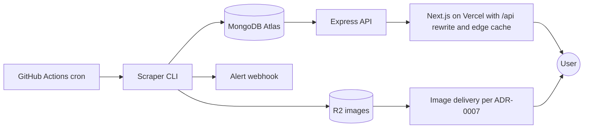
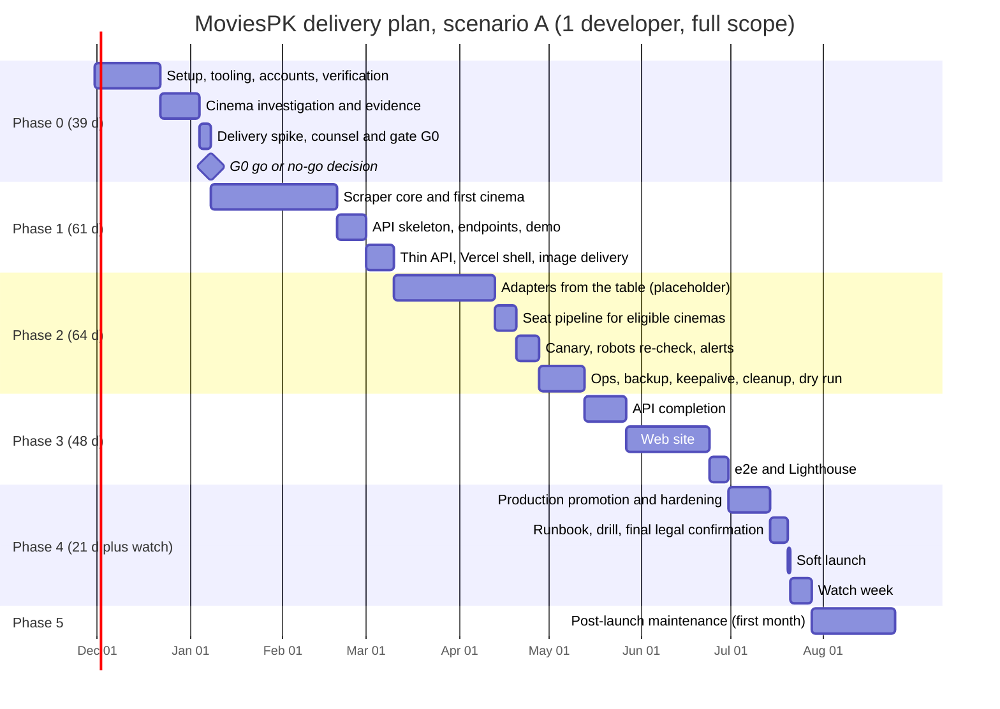
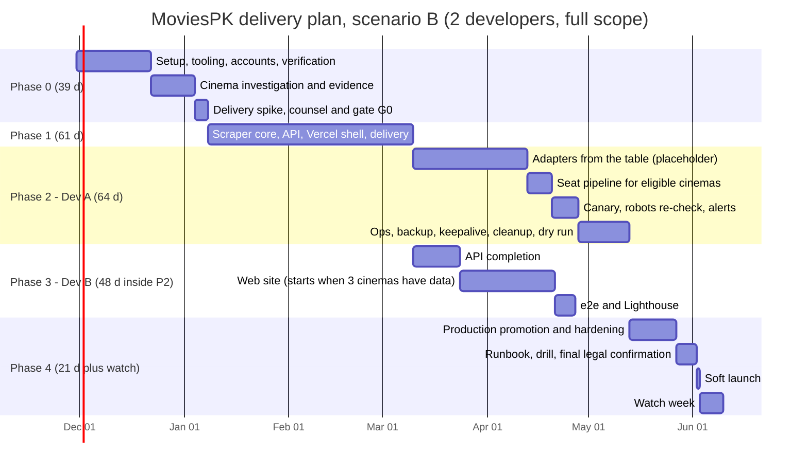
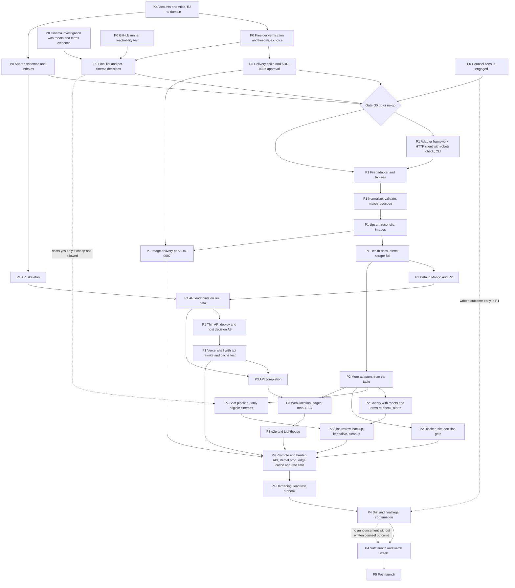

# MoviesPK — Implementation Plan

> Status: Draft v1.2 · Date: 2026-11-22 · Source documents: `project_statement.md`, `architecture.md` (Draft v1.0, ADR-01 to ADR-17 Accepted).
> `architecture.md` is the source of truth, with these exceptions: **ADR-11 (ignore robots.txt) is superseded by `docs/adr/0001-respect-robots-txt.md`** (owner decision, 2026-11-22), and, **pending owner approval, parts of ADR-09, ADR-12 and ADR-13 are superseded by `docs/adr/0007-no-custom-domain-v1-delivery.md`** (v1 runs without a custom domain). `architecture.md` is not edited yet; the spots to change later are in section 15. **Product name: MoviesPK (decided). Domain: none in v1 (decided).** No other Accepted ADR is changed.
> Task IDs use `P<phase>-<nn>`. Architecture references look like "§5.3" (section) or "ADR-05". Repo ADR files use "ADR-0001" style (series in `docs/adr/`), which is separate from the architecture's "ADR-NN".

## Revision history

| Version | Date | Changes |
|---|---|---|
| 1.2 | 2026-11-22 | **Owner decisions:** (1) product name is **MoviesPK**, "CineNear" dropped: U1 and C1 marked resolved; "confirm before buying the domain" wording removed; to-do added to change `project_statement.md` (not edited here). (2) **No custom domain in v1**: U6 closed; P0-08 re-scoped (no DNS or custom domain); "register domain" row and domain budget line removed; U11/U12 resolved to the GitHub repo URL plus a project email address. |
| | | **No-domain delivery design (proposed, needs approval):** new `docs/adr/0007-no-custom-domain-v1-delivery.md` (API proxied through a Next.js `/api/*` rewrite; image delivery options (a) Worker on workers.dev, (b) TMDB images directly, (c) r2.dev, with recommendation (a)). Plan assumes the recommended options as a working baseline until approved. Findings from a 2026-11-22 documentation search are in the ADR and must be re-verified in P0-09 / P0-18. |
| | | **Tasks:** P0-08 re-scoped (1.0 d, unchanged); P0-09 1.5 → 2.0 d (extra verification items); **new** P0-18 (1.0 d) delivery spike and ADR-0007 finalization; **new** P1-23 (1.5 d) Vercel shell with `/api` rewrite and cache test; **new** P1-24 (1.0 d) image delivery per ADR-0007; P1-22 re-scoped (no Cloudflare, 2.0 d unchanged); P3-04 1.0 → 1.5 d (client-IP attribution behind the proxy); P4-02 re-scoped to edge-cache and rate-limit hardening (0.5 d unchanged); P4-01, P4-04 re-scoped; **new** P5-08 optional custom domain later (not in totals). |
| | | **Timeline arithmetic (section 7):** effort 106.5 d → **111.0 d** (P0 17.0 → 18.5, P1 26.5 → 29.0, P3 22.5 → 23.0); with 20% buffer 133.2 d; one developer about **34.3 weeks (240 days, watch ends 2027-07-28)**; two developers about 27.4 weeks (192 days); minimum viable launch about 32.4 weeks (one developer) and 25.6 weeks (two). Both Gantt charts, milestones, progress tracker and budget updated. |
| | | **Other:** Cloudflare DNS, cache rules, rate-limit rule, purge, `CLOUDFLARE_API_TOKEN` and `CLOUDFLARE_ZONE_ID` removed from the baseline; `API_ORIGIN` and `NEXT_PUBLIC_SITE_URL` added (section 14.2); takedown "purge Cloudflare cache" step replaced by TTL expiry; risks N3, N6, N9 reworded and N12 to N14 added; section 9.1 (adding a custom domain later) added; section 15 extended (ADR-09, ADR-12, ADR-13, §10.1, §10.6, §5.3). |
| 1.1 | 2026-11-22 | **Policy:** ADR-11 superseded; robots.txt is respected (`robots_policy: respect`), see ADR-0001. Required amendments to `architecture.md` listed in section 15. |
| | | **Timeline:** phase durations recomputed from task sums (106.5 d of effort, about 33 weeks for one developer; v1.0 stated 9–13 weeks but its tasks summed to about 99 d); table with 20% buffer; second scenario for two developers; both Gantt charts rebuilt; milestones M0–M9 re-dated; minimum viable launch option (5 cinemas) with its own timeline (section 7). |
| | | **Phase 0:** investigation template extended with robots/terms evidence and verdicts; investigation split into P0-10, P0-11, P0-14, P0-15 (about one week); counsel consult moved here (P0-16); go/no-go gate G0 added (P0-17). |
| | | **Phase 1:** robots check in the HTTP client (P1-01); `robots_policy` and evidence fields in the config schema (P1-03); thin API deployed early (P1-22); API host decision A8 moved to the end of Phase 1. |
| | | **Phase 2:** P2-01..P2-08 replaced by an adapter template plus a per-cinema table (P2-02..P2-08 retired); seat pipeline (P2-09, P2-10) is gated per cinema and optional; canary warm-up period; daily robots/terms re-check (P2-19); concrete keepalive mechanism (P2-16); orphan-image cleanup (P2-20). |
| | | **Phase 4:** legal task P4-10 reduced to a final confirmation; P4-01 and P4-02 only harden the early deploy. |
| | | **Other:** C7, A8, A9, U3 changed; U13 and U14 added; risks R1, N10, N11; launch checklist, dependency map, budget and progress tracker updated; approved non-ADR items from old section 14 folded into the plan. |
| 1.0 | 2026-11-22 | First version. |

## Table of Contents

1. [Project Summary](#1-project-summary)
2. [Conflicts, Assumptions and Open Questions](#2-conflicts-assumptions-and-open-questions)
3. [Guiding Rules for Whoever Implements the Plan](#3-guiding-rules-for-whoever-implements-the-plan)
4. [Prerequisites and Accounts Checklist](#4-prerequisites-and-accounts-checklist)
5. [Phased Implementation Plan](#5-phased-implementation-plan)
   - [Phase 0 Foundations](#phase-0--foundations)
   - [Phase 1 One cinema end to end](#phase-1--one-cinema-end-to-end)
   - [Phase 2 Multi-cinema and seats](#phase-2--multi-cinema-and-seats)
   - [Phase 3 API completion and frontend](#phase-3--api-completion-and-frontend)
   - [Phase 4 Hardening and deployment](#phase-4--hardening-and-deployment)
   - [Phase 5 Post-launch](#phase-5--post-launch)
6. [Cross-Cutting Workstreams](#6-cross-cutting-workstreams)
7. [Milestones and Timeline](#7-milestones-and-timeline)
8. [Dependency Map](#8-dependency-map)
9. ["Adding a New Cinema" Procedure](#9-adding-a-new-cinema-procedure)
10. [Risk Register and Contingencies](#10-risk-register-and-contingencies)
11. [Budget Tracker](#11-budget-tracker)
12. [Launch Checklist and Go/No-Go Criteria](#12-launch-checklist-and-gono-go-criteria)
13. [Progress Tracker](#13-progress-tracker)
14. [Proposed Changes (need approval)](#14-proposed-changes-need-approval)
15. [Required amendments to architecture.md](#15-required-amendments-to-architecturemd)

---

## 1. Project Summary

**Goal.** One website where a user in Pakistan sees which movies are playing at cinemas near them, with showtimes (PKT) and a seat-status category, with data refreshed automatically and no manual entry. Running cost target is $0–10/month (ADR-08).

**In scope (v1).**
- Public website: browse by location (browser geolocation or city picker), movie pages, cinema pages, search and filters (genre, language, cinema, time window, date, format), `/status` page.
- Automated scraping of 10+ cinema sites (ADR-01) where robots.txt and terms allow it (ADR-0001); hybrid adapters (ADR-02). Fewer sites are acceptable if some are excluded (see the minimum viable launch in section 7).
- Storage in MongoDB Atlas M0 and images in Cloudflare R2, served through the delivery URL approved in ADR-0007 (no custom domain in v1; the DB stores keys only, so a domain can be added later by configuration).
- Read-only Express REST API under `/api/v1`.
- Scheduled autonomous refresh: `full` 2x/day, `seats` every 3 h (only for cinemas where seat data is cheap and allowed), daily `canary` (ADR-03, ADR-05).
- Booking deep links (`bookingUrl`) to each cinema's own page (F8).

**Out of scope (v1).** Ticket booking and payments; user accounts, favorites, personalized recommendations; push/email notifications; Urdu i18n; routing-based travel time; admin UI. The accounts and notifications seams (ADR-04) are *reserved only*: `req.user` middleware slot, reserved collection names `users`, `favorites`, `alert_subscriptions` (not created), and a documented job-queue seam.

**Fixed stack.** Python 3.12 scraper (httpx, tenacity, selectolax/BeautifulSoup, Pydantic v2, rapidfuzz, Pillow, boto3, structlog; Playwright only if an adapter needs it) · GitHub Actions (public repo) · MongoDB Atlas M0 (7.x) · Cloudflare R2 (account only; no DNS zone or CDN rules without a domain; a Worker only if ADR-0007 option (a) is approved) · Node 20+ / Express / Zod / helmet / pino · Next.js 14/15 App Router (React) + Tailwind + TanStack Query + MapLibre or Leaflet · Vercel (web) · Render/Railway/Fly (API, chosen at the end of Phase 1) · Sentry, UptimeRobot, Vercel Analytics.

**Three layers.**
1. **Scraper** (`scraper/`): a CLI (`python -m moviespk_scraper run --job {full|seats|canary} [--cinema ID] [--dry-run]`) with one adapter per cinema or chain. A shared pipeline fetches (checking robots.txt first), parses, normalizes, validates, matches movies to TMDB, geocodes cinemas, upserts, reconciles, uploads images and writes health docs, then sends alerts.
2. **Storage**: MongoDB Atlas database `moviespk` (collections `cinemas`, `movies`, `showtimes`, `movie_aliases`, `scrape_runs`) is the only coupling between scraper and API. Cloudflare R2 holds WebP images; the DB holds keys only.
3. **MERN app**: a stateless read-only Express API (`api/`) plus a Next.js site (`web/`) using ISR for SEO and client-side TanStack Query for location-dependent data. The API is reached through a same-origin `/api/*` rewrite on the Next.js site so Vercel's edge cache can serve it (ADR-0007, proposed).

---

## 2. Conflicts, Assumptions and Open Questions

### 2.1 Conflicts and Resolutions

Rule applied: `architecture.md` wins over `project_statement.md`.

| # | Statement says | Architecture says | Resolution in this plan |
|---|---|---|---|
| C1 | Title "MoviesPK", but body text says "CineNear". | Uses MoviesPK; asks to confirm (§18.2 item 1). | **RESOLVED by the owner (2026-11-22): the name is MoviesPK; "CineNear" is dropped.** Use MoviesPK everywhere (repo, package names, bucket names, UI). **To-do (not done here): change the remaining "CineNear" mentions in the body of `project_statement.md` to "MoviesPK".** |
| C2 | Frontend "React.js". | Next.js (React) with SSR/ISR (ADR-07). | Build `web/` with Next.js App Router. It is React, and Express stays the separate API. Needs a Node runtime on Vercel. |
| C3 | Scheduler "such as cron, GitHub Actions, or a cloud scheduler". | GitHub Actions on a public repo (ADR-05). | Use GitHub Actions workflows only. No cron host. Mitigate cron jitter, 60-day inactivity disable (`keepalive.yml`), ephemeral runners (all state in Mongo), and the 6 h job limit. |
| C4 | Runs "twice per day". | `full` 2x/day plus `seats` every 3 h for the next 24–48 h plus daily `canary` (ADR-03). | Implement three scheduled workflows plus weekly `backup` and monthly `keepalive`. Seat status is always shown with "as of HH:MM". |
| C5 | Outdated records "removed or archived". | TTL delete about 7 days after start; no archive (ADR-13). | Delete via TTL index on `showtimes.expireAt` (`startsAt + 7d`). No archive and no history in v1. `scrape_runs` use a 30-day TTL. Reconcile marks vanished shows `cancelled` after 2 misses before TTL removal. |
| C6 | Out of scope: accounts, booking. | Design seams only (ADR-04). | Build nothing user-facing. Reserve names, middleware slot (`req.user` optional) and an ADR note. Booking is a deep link only (`bookingUrl`, F8). |
| C7 | Seat availability "available or sold out" for every cinema. | Four values: `available` / `filling` / `sold_out` / `unknown` plus `asOf` (F4, §6.1.3). | Use the four-value enum. `filling` is only computed when the cinema exposes counts (A9). **Seat data is optional per cinema:** the seat pipeline is built only for cinemas where Phase 0 found cheap seat data and the seat endpoint is allowed by robots.txt. "Showtimes only, seats `unknown`" is an accepted outcome (no seat badge claims, UI shows "Seat status not available"). |
| C8 | Scraping tools "Requests, BeautifulSoup, Selenium/Playwright". | httpx + selectolax/BeautifulSoup; Playwright only if needed (ADR-02). | Follow the architecture. Playwright is installed only in the workflow variant for `fetch_mode: browser` adapters. |
| C9 | Storage of "URLs or keys" of images. | Keys only; frontend builds `https://cdn.<domain>/` + key (§6.4). | Store keys only. The frontend builds image URLs as `NEXT_PUBLIC_CDN_BASE_URL` + key, where the base is the delivery URL approved in ADR-0007 (no custom domain in v1). Adding a domain later changes only that value. (ADR-0007 option (b), TMDB images directly, would break "keys only" for TMDB art and is not the recommendation.) |
| C10 | "Cities/areas" input, no detail. | Static `cities.yml` served via `/cities` (§9.8). | Maintain `scraper/config/cities.yml` and serve it from the API. |
| C11 | (internal to architecture) Bucket layout lists `backups/` inside the prod bucket, while §6.4 Access says use a separate private bucket. | Private bucket `moviespk-backups`. | Use the separate private bucket `moviespk-backups`. Do not create `backups/` in `moviespk-prod`. |
| C12 | (internal) Config uses `location_override` (YAML, §5.2); ADR-10 calls it `locationOverride`. | Same concept. | YAML key `location_override`; DB field `locationSource: manual`. Do not add a `locationOverride` DB field. |
| C13 | (internal) §6.3 says a weekly dump covers `cinemas`, `movies`, `movie_aliases`; §6.4 also mentions a monthly orphan-image cleanup but no workflow file exists in §14. | | Weekly dump as written. Orphan-image cleanup is **approved (v1.1)** as `.github/workflows/cleanup-images.yml` (task P2-20). |
| C14 | (owner decision, 2026-11-22) | ADR-11: ignore robots.txt everywhere. | **Superseded** by `docs/adr/0001-respect-robots-txt.md`: respect robots.txt (`robots_policy: respect`). `architecture.md` is not edited; section 15 lists the spots to amend later. The plan follows the ADR-0001 policy. |

### 2.2 Open Questions, with Recommended Defaults

"Owner" = who answers. "By" = phase gate that must not be passed without an answer. Work proceeds on the default until answered.

**Assumptions A1–A11 (§18.1)**

| # | Item | Recommended default (work proceeds on this) | Owner | Answer needed by |
|---|---|---|---|---|
| A1 | UTC storage, PKT display | Confirmed by design. UTC in DB, PKT (UTC+5, no DST) at the API boundary and UI. | Owner | P0 (confirm) |
| A2 | Public cinema YAML | Public `scraper/config/cinemas.yml`. Contains URLs, addresses, robots/terms evidence hashes, no secrets. Any cinema the owner wants kept out is simply left out of the repo list. | Owner | P0 |
| A3 | Free-tier limits and terms | Verify all (see §4.2). Assume current free tiers until verified; stop and re-plan if a hard blocker appears. | Me (research) + Owner (account checks) | P0 (gate G0) |
| A4 | Public showtimes 3–7 days, no login | Validate per cinema in P0 investigation. A cinema requiring login or CAPTCHA is excluded (§5.4). A cinema whose robots/terms verdict is Unclear or Disallowed is handled by the rules in P0-11 (ADR-0001). | Me | P0 |
| A5 | Categorical seats, no seat maps | Confirmed. Store `seats.status` + optional `available/total` + `asOf`. | Owner (confirm) | P1 |
| A6 | TMDB covers most titles | Accept. Unmatched become `provisional`/`unmatched`, fixed through `movie_aliases`. | Me | P1 |
| A7 | Default city | **Lahore** (also the default for the landing page and `CF-IPCity` fallback). | Owner | P3 |
| A8 | API host | Decide at the **end of Phase 1** (task P1-22, thin API deploy). Default shortlist order: Render, Fly, Railway; choose by current free-tier sleep/hours and terms. Phase 4 only hardens it. | Owner + Me | End of P1 (P1-22) |
| A9 | "Filling fast" threshold; seat data optional | `filling` when `available/total <= 30%`; `sold_out` when `available == 0`; `unknown` if the cinema gives no counts or categories, or if seat data is not cheap or its endpoint is not allowed by robots.txt. If the cinema exposes only a category, map it directly. **`unknown` for every show of a cinema is an accepted outcome.** | Owner | P2 (thresholds); P0 (per-cinema seat decision) |
| A10 | Alert channel | **Telegram** (single channel; bot token in `ALERT_WEBHOOK_URL`-style URL). Discord is a drop-in alternative since only a URL is stored. | Owner | P1 (first alert) |
| A11 | Poster source | TMDB first, cinema image fallback. Cinema posters only when TMDB art is unavailable (§12.3). | Owner | P1 |

**Unresolved items 1–9 (§18.2)**

| # | Item | Recommended default | Owner | Answer needed by |
|---|---|---|---|---|
| U1 | Product name | **RESOLVED (owner, 2026-11-22): MoviesPK.** "CineNear" is dropped. To-do: update `project_statement.md` body text (see C1). | Owner | Done |
| U2 | Target cinemas and first-release cities | Start with **Lahore and Karachi** (largest cinema density) plus Islamabad if chains overlap. List finalized from the P0 investigation, ordered by "easy JSON first". Only cinemas with an Allowed verdict (or documented permission) are listed. | Owner + Me | P0 exit (gate G0) |
| U3 | Legal consult (copyright of posters/synopses, Pakistani rules on automated access) | **Short counsel consult in Phase 0 (P0-16) or early Phase 1**, not at the end. Counsel is engaged before gate G0 closes. A written counsel outcome is still required before any public announcement (checked again in P4-10). Optionally approach cinemas for permission or feeds (see U14). Replaces the v1.0 "hard gate at P4" wording; ADR-11 itself is superseded by ADR-0001. | Owner | P0 (engage); early P1 (consult done); P4 (final confirmation) |
| U4 | IP-block fallback budget | Approve up to **$5/month** (VPS runner or proxy) in advance, used only when the §10 decision point fires. | Owner | P2 (by the blocked-sites gate) |
| U5 | Alias review owner and cadence | The owner reviews weekly using the digest. Pre-launch: daily during P2. | Owner | P2 |
| U6 | Custom domain and registrar | **CLOSED (owner, 2026-11-22): no custom domain and none planned for now. This is the v1 baseline; the plan assumes no domain anywhere.** The web site runs on the free `*.vercel.app` address. The design stays open to adding a domain later (section 9.1; config only because the DB stores image keys). Reopen only if the owner decides to buy one. | Owner | Done (closed) |
| U15 (new) | **No-domain delivery design (ADR-0007)** | Approve, change or reject: (B) API proxied through a Next.js `/api/*` rewrite; (C) image delivery option (a) Worker on workers.dev (recommended), (b) TMDB images directly, or (c) `r2.dev`. Also approve the new technology if (a) (section 14.2). Working baseline until answered: B and (a). | Owner | P0 (before gate G0, task P0-18) |
| U7 | Adapter maintenance capacity | Plan for about 4 h/month per 3 cinemas (R2). If less than that is available, shrink the cinema list at P2. | Owner | P2 |
| U8 | Atlas dev environment | Default: local Mongo container for day-to-day dev (Docker Compose). A second Atlas project (M0) only if a cloud dev DB is needed for the dev-scheduled workflow. | Me + Owner | P0 |
| U9 | Map tiles | Default: use a free-tier MapLibre-compatible provider key (public tile key, no secret). Do not use OSM public tiles in production. Decide in P0 free-tier check; implement in P3. | Owner | P3 start |
| U10 | Repo license (approved in v1.1, not an ADR change) | Pick an explicit license (e.g. MIT or "all rights reserved" notice) before the first public commit (P0-01). A public repo with no license is not "open". | Owner | P0 |
| U11 | Takedown and contact email address | No domain, so no domain mailbox. Use a **dedicated project email address** (a free mailbox, not a personal one; the owner picks it) for the `/takedown` page and the scraper User-Agent. Not written into the public repo until the owner chooses it. | Owner | **P1 start** (needed by P1-01 for the User-Agent; was P3) |
| U12 | Public project page URL for User-Agent | **RESOLVED:** the public GitHub repo URL (no domain needed). Example form: `MoviesPK/<version> (+<GitHub repo URL>; <project email>)`. | Owner | Done (default accepted; confirm with the repo URL at P0-01) |
| U13 (new) | **Launch scope: full scope or minimum viable launch** | Choose between (a) full scope: 10+ cinemas at launch, about 33 weeks for one developer; (b) minimum viable launch: 5 cinemas in Lahore and Karachi first, the rest added after launch (section 9), about 31 weeks for one developer. See section 7 for both timelines. Recommended: decide at gate G0 when the real number of viable cinemas is known. | Owner | P0 exit (gate G0) |
| U14 (new) | Policy for cinemas with an Unclear or Disallowed verdict | Default: **exclude**. Alternatives per cinema: owner approaches the cinema for permission or a feed (then `robots_policy: permission_granted` with a written reference), or counsel gives a written view. A cinema is never scraped silently. Decision recorded per cinema in P0-11. | Owner | P0 (P0-11) |

---

## 3. Guiding Rules for Whoever Implements the Plan

1. **Follow `architecture.md`.** Do not change a decision without recording a new ADR in `docs/adr/` (`NNNN-title.md`: context, decision, consequences, status). Names (collections, fields, endpoints, env vars, workflow files, folders) must match the architecture exactly.
2. **The repo is public. Never commit secrets.** Commit only `.env.example` (variable names with empty values). Enable GitHub secret scanning and push protection and the pre-commit `gitleaks` hook from the very first commit. If a secret leaks, rotate it first, then clean up.
3. **Every job must be idempotent.** Re-running any job gives the same state. Use deterministic keys (`showtimes._id = sha1(cinemaId|movieId|startUtc|hall|format)`).
4. **Fail loudly on zero results.** Zero results where the previous run had many is a failure, not "everything removed". **Never delete data because of one bad scrape** (reconcile is skipped on failure; `missCount` needs 2 full-run misses).
5. **Work cinema by cinema and vertical slice by vertical slice.** Each task produces something demonstrable. Always keep `main` deployable.
6. **Time:** store UTC, display PKT, and test the boundaries (23:30 PKT, midnight, "today in PKT").
7. **Privacy:** never store or log coordinates server-side. Round client coordinates to 2 decimals.
8. **Untrusted input:** treat scraped text as hostile. Strip HTML, cap lengths, never use `dangerouslySetInnerHTML`.
9. **Respect robots.txt (ADR-0001) and keep the politeness controls always on:** `robots_policy: respect` is the default; the HTTP client refuses disallowed paths. A cinema whose verdict is Unclear or Disallowed is never scraped silently (excluded, permission obtained, or counsel's written view). Politeness controls: descriptive User-Agent, `min_delay_ms`, `max_concurrency=1` per site, jitter, backoff, circuit breaker.
10. **Definition of Done (any task):** code + tests + docs updated + CI green + the checklist item ticked in this file (and the progress tracker updated at phase level).
11. **Small tasks.** If a task exceeds about 2 days, split it before starting.
12. **Don't invent technology.** Anything not in the architecture goes through §14 first.

---

## 4. Prerequisites and Accounts Checklist

### 4.1 Accounts and decisions the project owner must create

Secret names are listed for what to record (store only in GitHub Actions secrets / Vercel / API host settings; never in git).

| # | Account / item | What to create | Record as (secret/variable names only) | Needed by |
|---|---|---|---|---|
| 1 | GitHub repo | Public repo `moviespk`; enable secret scanning + push protection, Dependabot, branch protection on `main` (require CI), GitHub environment `production` with restricted triggers | (none) | P0 |
| 2 | MongoDB Atlas | Prod project + M0 cluster, DB `moviespk`; dev DB (U8): local Mongo or second project with `moviespk_dev`. Users: `scraper` (readWrite) and `api` (read-only). Network access `0.0.0.0/0` (M0 constraint), strong passwords | `MONGODB_URI`, `MONGODB_DB` (separate values for scraper and api users, and per environment) | P0 (dev), P1 (prod) |
| 3 | ~~Cloudflare zone~~ (removed in v1.2) | **Not needed:** a zone, cache rules, a rate-limit rule and cache purge require a custom domain (none in v1). A Cloudflare **account** is still needed for R2. If ADR-0007 option (a) is approved, a Workers deploy token is needed (see 14.2). | `CLOUDFLARE_ZONE_ID` and `CLOUDFLARE_API_TOKEN` are **removed** from the baseline; a Workers deploy token (name to be set in P1-24) only if option (a) | — |
| 4 | Cloudflare R2 | Buckets `moviespk-prod` (access per ADR-0007: private with a Worker binding for option (a); public `r2.dev` only for option (c)), `moviespk-dev`, `moviespk-backups` (private). Scoped API tokens: scraper write token (prod and dev buckets), backup token (backups bucket only). No `cdn.<domain>` in v1. | `R2_ACCOUNT_ID`, `R2_ACCESS_KEY_ID`, `R2_SECRET_ACCESS_KEY`, `R2_BUCKET`, `R2_BACKUP_BUCKET`, `CDN_BASE_URL` (the approved delivery URL) | P0 |
| 5 | ~~Domain~~ (removed in v1.2) | **None.** No domain is registered or assumed (U6 closed). Web address: the free `*.vercel.app` address Vercel assigns (the exact name depends on availability). | (none) | — |
| 6 | TMDB | Free API key; read their terms (commercial use, attribution) | `TMDB_API_KEY` | P1 |
| 7 | Sentry | Two projects: `moviespk-api`, `moviespk-web` (free tier) | `SENTRY_DSN_API`, `SENTRY_DSN_WEB` | P3 (API from P1 optional) |
| 8 | Alert channel | Telegram bot + chat (or Discord webhook) | `ALERT_WEBHOOK_URL` | P1 |
| 9 | Vercel | Hobby account, import repo, root dir `web/`; check Hobby non-commercial terms; the production address is the free `*.vercel.app` one. The site is first deployed in P1-23 (shell with the `/api` rewrite), not only in P3 | `NEXT_PUBLIC_API_BASE_URL` (relative `/api/v1`), `NEXT_PUBLIC_CDN_BASE_URL`, `NEXT_PUBLIC_SITE_URL` (public values), `API_ORIGIN` (server-side, the API host URL; see 14.2) | P1 (shell, P1-23), P3 (preview), P4 (prod) |
| 10 | API host | Render/Railway/Fly account (chosen at the end of Phase 1, A8, task P1-22) | `CORS_ALLOWED_ORIGINS`, `PORT`, `NODE_ENV`, `LOG_LEVEL`, plus `MONGODB_*`, `CDN_BASE_URL`, `SENTRY_DSN_API` | End of P1 |
| 11 | UptimeRobot | Free account, monitor on `/api/v1/health` | (none) | P4 |
| 12 | User-Agent strings | Contact = the GitHub repo URL plus the project email (U11, U12); no domain | `SCRAPER_USER_AGENT`, `NOMINATIM_USER_AGENT` | P1 |
| 13 | Map tile provider | Free-tier key if needed (U9) | `NEXT_PUBLIC_MAP_TILE_URL` (public; approved in v1.1, see §15 for the `architecture.md` §10.6 amendment) | P3 |
| 14 | Lawyer | Pakistani counsel for a short consult (copyright of posters/synopses, automated access rules; U3) | (none) | P0 (engaged before gate G0); early P1 (consult done); P4 (final confirmation) |

### 4.2 "Verify free-tier limits and terms" checklist (A3)

Record each finding (date, link, limit, verdict) in `docs/free-tier-verification.md`. Any "No" is a decision point for the owner.

- [ ] **Atlas M0:** storage 512 MB, connection limit, ops/sec, no backups, pause-on-inactivity behavior, number of free clusters per project/org, network access rule for GitHub runners and PaaS hosts.
- [ ] **Cloudflare R2:** free storage and operation allowance, free egress; **without a domain:** `r2.dev` public-access limits (rate limit, no caching; dev only per Cloudflare), whether a bucket can be kept private and served through a Worker binding.
- [ ] **Cloudflare Workers (only for ADR-0007 option (a)):** Free plan request cap (the 2026-11-22 search found 100,000 requests/day, error 1027 beyond it; 10 ms CPU), how `workers.dev` addresses are treated, Cache API behavior on `workers.dev`, whether R2 binding reads are billed as operations, paid-plan price.
- [ ] **Vercel rewrites and CDN (ADR-0007 part B):** do external rewrites cache API responses by upstream `Cache-Control` / `CDN-Cache-Control` for **this project** (the 2026-11-22 search: on by default for projects created on or after 2026-04-06; otherwise a setting or header); the `x-vercel-cache` header name; Hobby bandwidth and transfer limits for proxied API traffic; whether request logs keep query strings (privacy: rounded coordinates); which header carries the client IP to the API host; cache purge options on Hobby.
- [ ] **API host with proxied traffic:** the chosen host's terms and limits when all traffic comes from Vercel; spin-down behavior (Render free: the 2026-11-22 search found 15 min idle spin-down, about 1 min restart, 750 hours/month; Fly and Railway not yet checked).
- [ ] **TMDB images (ADR-0007 option (b)):** whether hotlinking `image.tmdb.org` is allowed, caching rules, and commercial-use terms (the 2026-11-22 search found free non-commercial use with attribution and no hotlinking statement).
- [ ] **Vercel Hobby:** non-commercial restriction vs. this project (does the site count as commercial? ads/affiliates?), ISR limits, function/bandwidth limits, Analytics free quota.
- [ ] **API host (Render/Railway/Fly):** sleep behavior, monthly hours, RAM, Docker support, deploy hooks, whether an uptime pinger is allowed by their terms, price of the first paid tier ($5–7).
- [ ] **GitHub Actions:** public-repo minutes unlimited for standard runners, cron jitter, 60-day inactivity auto-disable (and **exactly what counts as activity today**: does a scheduled no-op commit to a dedicated branch count, or is the enable-workflow API call needed; record the chosen keepalive mechanism for P2-16), 6 h job limit, artifact retention (7 days used), concurrency groups, environment protection rules on public repos.
- [ ] **Nominatim:** usage policy (1 req/s, descriptive User-Agent, caching, no heavy use).
- [ ] **TMDB:** commercial-use terms, attribution text, rate limits, image usage rules.
- [ ] **Map tiles:** OSM public tile policy vs. production traffic; chosen provider's free quota and attribution (U9).
- [ ] **Sentry free:** event quota, data scrubbing for location params.
- [ ] **UptimeRobot free:** interval (5 min), commercial use.
- [ ] ~~Domain/registrar~~ removed in v1.2 (no custom domain; U6 closed). Only if a domain is ever added: price and the section 9.1 checklist.

---

## 5. Phased Implementation Plan

**Team assumption (used for all estimates):** 1 full-stack developer at about 25–30 h/week (about 4 productive days/week; 1 d = about 6.5 focused hours), with the owner available for decisions and accounts. Task estimates are single numbers in working days (d), sized 0.5–2 d. **Phase durations are the exact sums of their task estimates** (v1.1); section 7 adds the 20% buffer, calendar weeks, a two-developer scenario (only Phase 2 and Phase 3 truly run in parallel) and the minimum viable launch option. Task estimates were not shrunk to make the date look better.

**Conventions.** *Files* use the §14 repo structure. *Tests* name the §13 layer: "Scraper unit/fixture", "Scraper integration", "Live canary", "API", "Contract", "Frontend unit", "E2E", "Non-functional", "Fixture refresh".

---

### Phase 0 — Foundations

**Objective.** A safe, empty-but-wired monorepo, provisioned cloud accounts, verified free-tier terms, and a researched cinema list **with recorded robots.txt and terms evidence for every cinema**, a runner-reachability result, counsel engaged, and an owner-approved list, so Phase 1 can start only after a go/no-go gate (G0).
**Duration.** 18.5 working days of effort (sum of P0-01 to P0-18; v1.1 was 17.0, plus 0.5 in P0-09 and 1.0 for the new P0-18); 22.2 d with the 20% buffer, about 5.55 calendar weeks. The cinema investigation (P0-10, P0-11, P0-14, P0-15) is 5.5 d, about one week of effort. Counsel and account waiting time is calendar time, not effort.
**Prerequisites.** GitHub, Atlas and Cloudflare (R2) accounts. The product name (MoviesPK) and the no-domain baseline are already decided (U1 resolved, U6 closed).
**Dependencies on earlier phases.** None.
**Execution order inside Phase 0.** P0-01 to P0-09 (setup and verification) can run alongside the investigation. Recommended order: P0-01..P0-09, P0-12, P0-13 (setup), then P0-10, P0-11, P0-14, P0-15 (investigation, about one week), P0-16 (counsel, started early because of waiting time), P0-18 (delivery spike and ADR-0007, after P0-08 and P0-09), P0-17 (gate).

- [ ] **P0-01 Create repo and skeleton** (0.5 d)
  - Description: public repo with the §14 folder structure and empty placeholders.
  - Files: `README.md`, `.gitignore`, `docs/adr/0000-template.md`, `docs/adr/0001-respect-robots-txt.md` (already written; supersedes architecture ADR-11), `docs/adr/0002-record-architecture-decisions.md`, `scraper/`, `api/`, `web/`, `shared/schemas/`, `shared/constants/`, `scripts/`, `docs/`, copies of `architecture.md`, `project_statement.md`, `plan.md`, plus the license file (U10, approved in v1.1).
  - Notes: `.gitignore` covers `.env`, `.env.*` (except `.env.example`), `node_modules`, `.venv`, `__pycache__`, `*.pem`, `.next`. README states the product name, the layers and the "never commit secrets" rule.
  - Accept: repo public, branch protection on `main`, README renders, secret scanning + push protection enabled (Settings → Code security).
  - Tests: none (verify by pushing a dummy fake token in a scratch branch and confirming push protection blocks it, then deleting the branch).

- [ ] **P0-02 Pre-commit with gitleaks** (0.5 d)
  - Description: `.pre-commit-config.yaml` with gitleaks, ruff, ESLint/Prettier hooks (hooks for tools not yet configured are added when those tools land).
  - Files: `.pre-commit-config.yaml`, `.gitleaks.toml` (allow-list `.env.example` placeholders), CI job `gitleaks` in each CI workflow (see P0-06).
  - Notes: run gitleaks on the whole history at first commit. Document `pre-commit install` in README.
  - Accept: committing a file containing a fake AWS-style key is rejected locally and in CI.
  - Tests: manual negative test, recorded in the PR.

- [ ] **P0-03 Scraper tooling** (0.5 d)
  - Description: Python 3.12 package skeleton with lint/type/test config.
  - Files: `scraper/pyproject.toml`, `scraper/src/moviespk_scraper/__init__.py`, `scraper/tests/test_smoke.py`.
  - Notes: dependencies per §5.1 (httpx, tenacity, selectolax, beautifulsoup4, pydantic v2, rapidfuzz, Pillow, boto3, structlog, pymongo, PyYAML); dev: ruff, mypy (strict for `pipeline/` and `models/`), pytest, pytest-cov, mongomock, pip-audit. Playwright as an optional extra `[browser]`, not a default dependency.
  - Accept: `ruff check`, `mypy`, `pytest` pass locally; `python -m moviespk_scraper --help` prints usage.
  - Tests: Scraper unit (smoke).

- [ ] **P0-04 API and web tooling** (1 d)
  - Description: Node projects with ESLint, `tsc`, Prettier, test runners, no application logic.
  - Files: `api/package.json`, `api/tsconfig.json`, `api/.eslintrc*`, `web/package.json`, `web/next.config.js`, `web/tailwind.config.ts`, `web/tsconfig.json`, `.prettierrc`, `.editorconfig`.
  - Notes: Node 20 LTS (`.nvmrc`), TypeScript strict. API: Jest + Supertest + `mongodb-memory-server`. Web: Vitest or Jest + React Testing Library, Playwright dev dependency. Pin versions; record Express 4 vs 5 and Next.js 14 vs 15 choices in ADR-0003 (version pins are not a re-decision of any Accepted ADR).
  - Accept: `npm run lint`, `npm run typecheck`, `npm test` pass in both packages on a clean checkout.
  - Tests: smoke tests per package.

- [ ] **P0-05 `.env.example` and Docker Compose** (1 d)
  - Description: dev environment parity for api, web, mongo, optional MinIO.
  - Files: `.env.example`, `docker-compose.yml`, `api/Dockerfile` (multi-stage, Node 20-alpine, non-root, healthcheck on `/api/v1/health`), `scraper/Dockerfile` (Python 3.12-slim, Playwright layer optional via build arg).
  - Notes: `.env.example` lists every name from §10.6 (values empty), **except** `CLOUDFLARE_API_TOKEN` and `CLOUDFLARE_ZONE_ID`, which are removed because there is no zone without a domain (§15): `MONGODB_URI`, `MONGODB_DB`, `R2_ACCOUNT_ID`, `R2_ACCESS_KEY_ID`, `R2_SECRET_ACCESS_KEY`, `R2_BUCKET`, `R2_BACKUP_BUCKET`, `CDN_BASE_URL`, `TMDB_API_KEY`, `NOMINATIM_USER_AGENT`, `SCRAPER_USER_AGENT`, `ALERT_WEBHOOK_URL`, `SENTRY_DSN_API`, `SENTRY_DSN_WEB`, `NEXT_PUBLIC_API_BASE_URL`, `NEXT_PUBLIC_CDN_BASE_URL`, `NEXT_PUBLIC_SITE_URL` and `API_ORIGIN` (v1.2, see 14.2), `NEXT_PUBLIC_MAP_TILE_URL` (public; approved in v1.1), `CORS_ALLOWED_ORIGINS`, `PORT`, `NODE_ENV`, `LOG_LEVEL`. Compose services: `mongo`, `api`, `web`, `minio` (optional profile). Dev DB name `moviespk_dev`.
  - Accept: `docker compose up mongo` starts; `docker compose build api` succeeds; no secret values in the repo.
  - Tests: none (manual verification; CI builds the API image in P0-06).

- [ ] **P0-06 CI skeletons with path filters** (1 d)
  - Description: three CI workflows that run on the correct paths only, plus Dependabot.
  - Files: `.github/workflows/ci-scraper.yml` (paths `scraper/**`: ruff, mypy, pytest, pip-audit), `ci-api.yml` (paths `api/**`, `shared/**`: ESLint, tsc, Jest, npm audit), `ci-web.yml` (paths `web/**`: ESLint, tsc, build, Playwright e2e later), `.github/dependabot.yml` (npm for `api`, `web`; pip for `scraper`; github-actions).
  - Notes: add a `gitleaks` step to each. `pull_request` workflows never reference production secrets. Cache pip and npm. Make "CI green" a required status for `main`.
  - Accept: a trivial PR touching only `scraper/**` triggers only `ci-scraper`; all three jobs pass on an empty skeleton; PR from a fork would have no secrets.
  - Tests: CI is the test.

- [ ] **P0-07 Provision MongoDB Atlas** (0.5 d)
  - Description: prod cluster (M0), DB users, network access; dev option per U8.
  - Files: `docs/infrastructure.md` (non-secret record: region, project names, user names), GitHub secrets set.
  - Notes: users `moviespk_scraper` (readWrite on `moviespk`) and `moviespk_api` (read on `moviespk`). Choose the region closest to the API host. Dev: local Mongo via Compose.
  - Accept: scraper user can write a test doc to `moviespk_dev` (or local), API user write is rejected; connection works over TLS from a throwaway GitHub Actions run.
  - Tests: manual connectivity script (no secrets printed).

- [ ] **P0-08 Cloudflare account, R2 buckets and tokens (no domain)** (1 d)
  - Description: three R2 buckets and scoped tokens. **No DNS zone, custom domain or `cdn.<domain>`** (none in v1; U6 closed). How images are delivered publicly is decided in ADR-0007 and tested in P0-18.
  - Files: `docs/infrastructure.md` (bucket names, token scopes, delivery option once approved; no secret values).
  - Notes: create `moviesPK` buckets `moviespk-prod`, `moviespk-dev`, `moviespk-backups`; scraper write token (prod and dev buckets) and backup token (backups bucket only). Keep **all** buckets non-public until ADR-0007 is approved; upload a test object (`cdn-test/hello.webp`) with `Cache-Control: public, max-age=31536000, immutable` to `moviespk-dev` and confirm the private bucket is not readable anonymously. Do not enable `r2.dev` on `moviespk-prod` (option (c) is only a documented fallback).
  - Accept: buckets and tokens exist with least privilege; anonymous read of `moviespk-backups` and `moviespk-prod` fails (until a delivery option is enabled); the test object has the immutable cache header.
  - Tests: manual `curl -I` evidence pasted into `docs/infrastructure.md`.

- [ ] **P0-09 Free-tier and terms verification (A3)** (2.0 d)
  - Description: execute the checklist in §4.2 and write the results, including the **GitHub keepalive mechanism** needed by P2-16 and the **no-domain items added in v1.2** (Cloudflare Workers Free limits, `r2.dev` limits, Vercel external-rewrite caching, Hobby transfer limits, query-string logging, client-IP header, API-host terms for proxied traffic, TMDB image terms). Nothing is taken from memory: each finding has date, source link and verdict. The 2026-11-22 documentation search summarized in ADR-0007 is only a starting point.
  - Files: `docs/free-tier-verification.md`, `docs/adr/0004-free-tier-findings.md` if anything changes the plan.
  - Notes: each item gets date, source link, limit and verdict (OK / risk / blocker). Pay special attention to Vercel Hobby commercial terms, API host sleep/hours, M0 connection limit (API + scraper share it), map tiles. For GitHub Actions, verify against current GitHub documentation what counts as repository activity for the 60-day auto-disable rule, then **choose and record one keepalive mechanism**: (a) a scheduled workflow that makes a no-op commit (or a timestamp-file commit) to a dedicated `keepalive` branch, or (b) a scheduled workflow that calls the enable-workflow REST API for the other scheduled workflows with a narrowly scoped token. Write the choice, the evidence link and the date in `docs/free-tier-verification.md`.
  - Accept: every checklist item ticked with a verdict; blockers escalated to the owner; the keepalive mechanism is named and justified.
  - Tests: none.

- [ ] **P0-10 Cinema site investigation template and first batch** (2 d)
  - Description: finalize the investigation template below (including the **robots/terms evidence block**) and investigate the first batch of candidate cinemas. The full candidate list is at least 14 cinemas so that 8–10+ viable ones remain after exclusions; P0-11 finishes the rest.
  - Files: `docs/cinema-investigation/<cinema-or-chain>.md` (one per cinema or chain), summary table in `docs/cinema-investigation/README.md`.
  - Notes: use browser DevTools (Network tab) first to find JSON/XHR endpoints (ADR-02 preference: JSON → static HTML → Playwright). Do the investigation with a polite request rate and the planned User-Agent. **Check robots.txt for the specific endpoints and paths the adapter would call (movie list, showtime list, seat status), not only for the site root,** and read the terms-of-service page. Do not save full raw pages in the public repo beyond what is needed (see risks N1 and N2 in §10); never save content from a path that robots.txt disallows. A cinema with a login or CAPTCHA requirement is excluded.
  - Accept: every candidate in this batch has a completed template, a robots.txt/terms verdict (Allowed / Unclear / Disallowed) and a technical verdict (Go / Go with caveats / No-go).
  - Tests: none.

  **Per-cinema investigation template (copy per cinema):**

  | Field | Value to record |
  |---|---|
  | Cinema / chain name, branches, cities | |
  | Website URL(s) and the page holding showtimes | |
  | Data source type | JSON/XHR · static HTML · needs browser (`fetch_mode: json / html / browser`) |
  | Endpoint(s) and URL patterns | (method, path, params, auth cookies needed? yes/no) |
  | Anti-bot behavior | Cloudflare/Akamai challenge? CAPTCHA? rate limits observed? UA sensitivity? Blocks datacenter IPs? (test from a GitHub Actions run, not only from home) |
  | Showtime horizon | Days visible ahead (target ≥3, ideal 7) |
  | Seat data availability | None · category only · counts (available/total) · full seat map; which request returns it; one request per show? |
  | Movie data on site | Poster, synopsis, genre, runtime, language, certification available? |
  | Language/format markers | How "(2D)", "[Urdu]", "IMAX" appear in titles |
  | Time format | Local time text? timezone assumptions? midnight rollover shows? |
  | Branch structure | One site for all branches? branch id parameter? shared adapter feasible? |
  | Booking deep link | Pattern for `bookingUrl` or `bookingUrlTemplate` |
  | Address and coordinates | Address text; whether OSM geocode looks right; `location_override` needed? |
  | Estimated adapter effort | S (≤1 d) / M (1–2 d) / L (>2 d) |
  | Verdict and rollout order | Go / caveats / No-go; ranking |
  | Login or CAPTCHA required? | If yes: exclude (§5.4) |
  | **Evidence: date checked** | Date (YYYY-MM-DD) and who checked |
  | **Evidence: robots.txt result per endpoint** | One row per endpoint or path the adapter will call (movie list, showtime list, seat status, images if fetched from the cinema): path, User-Agent group that applies, Allowed / Disallowed, and any `Crawl-delay`. Site-root result alone is not enough. |
  | **Evidence: terms page link** | URL of the terms of service (and privacy/legal page if relevant) |
  | **Evidence: what the terms say** | Short factual note (2–5 lines): automated access, copying of content, use of data, any contact for permission. Quote only a short phrase; no long copies. |
  | **Evidence: saved copy or hash** | `sha256` of the robots.txt text and of the terms text, plus the dated copy path (`docs/cinema-investigation/evidence/<cinema>/<date>/robots.txt` and `terms.txt` if the terms allow keeping a copy; otherwise the hash only). Produced by `scripts/snapshot_evidence.py` (P0-15). The hashes are copied into `cinemas.yml` (`robots_sha256`, `terms_sha256`, `terms_url`, `robots_checked_at`). |
  | **Verdict (robots/terms)** | **Allowed** (robots allows every needed path and terms do not prohibit) · **Unclear** (terms ambiguous, silent, or robots partly unclear) · **Disallowed** (robots disallows a needed path or terms prohibit automated access). Seats are judged separately: a seat endpoint can be Disallowed while showtimes are Allowed. |
  | **Seat decision** | `seats: yes` only if seat data is cheap (see "Seat data availability") AND the seat endpoint is Allowed. Otherwise `seats: no` (showtimes only, seats `unknown`). This is an accepted outcome, not a failure. |
  | **GitHub runner reachability** | Result of the P0-14 test (reachable / blocked / challenge) and date |

  **Rules for Unclear and Disallowed cinemas (ADR-0001):** a cinema whose verdict is Unclear or Disallowed is handled by exactly one of: (1) **excluded** from the list (default, U14); (2) the **owner approaches the cinema** for permission or a feed, and the cinema stays out of the list until written permission is recorded (then `robots_policy: permission_granted` with `permission_ref`); (3) **counsel gives a written view** (P0-16) and the owner accepts it. **Never scrape such a cinema silently.** The chosen route is recorded per cinema in the final list (P0-11).

- [ ] **P0-11 Second investigation batch and final cinema list with per-cinema decisions** (2 d)
  - Description: finish the remaining candidates with the same template, then produce the final list: every cinema gets a recorded **decision**, the rollout order (easiest JSON chain first) is set, and the first adapter is picked.
  - Files: `docs/cinema-investigation/README.md` (final table with rollout order and per-cinema decision), `scraper/config/cinemas.yml` (draft entries, `enabled: false`, `robots_policy: respect`, evidence fields), `scraper/config/cities.yml` (name, slug, center `[lng,lat]`, default radius; Lahore, Karachi, plus others in the list).
  - Notes: **per-cinema decision** column values: Include · Include without seats · Exclude (Unclear/Disallowed) · Seek permission or feed (owner action, listed as pending) · Counsel view requested. Rollout order rule: (1) Allowed + JSON with a long horizon and cheap, allowed seat data, (2) chains with many branches (best reuse), (3) static HTML, (4) browser-only, (5) blocked or pending permission. Choose as the first cinema one that is Allowed, JSON, stable and has clear titles. Also fill the **Phase 2 adapter table** (P2-01) from this list: source type, effort S/M/L, verdict, seats yes/no, blockers, estimated days. Owner signs off (U2, U13, U14).
  - Accept: final list with a decision for every candidate approved by the owner; no cinema with an Unclear or Disallowed verdict is marked Include without permission or a counsel view on file; the first adapter named; the P2-01 adapter table filled; `cinemas.yml` validates against the config schema (once P0-12 lands and P1-03 adds the robots fields).
  - Tests: none.

- [ ] **P0-12 Shared schemas and constants** (1.5 d)
  - Description: single definition of the data model for Python (Pydantic) and Node (Zod) so contracts do not drift.
  - Files: `shared/schemas/` (JSON Schema or Zod definitions for API contracts: `Cinema`, `Movie`, `Showtime`, `SeatStatus`, `ErrorResponse`, endpoint response envelopes `{data, meta}`), `shared/constants/` (genres, languages, formats `2D/3D/IMAX/4DX`, seat statuses `available|filling|sold_out|unknown`, `matchStatus`, scrape run statuses `ok|partial|failed|blocked|drift`), `scraper/src/moviespk_scraper/models/` (Pydantic: `RawMovie`, `RawShowtime`, `SeatStatus`, normalized `Cinema`, `Movie`, `Showtime`, `ScrapeRun`, `CinemaConfig`; `CinemaConfig` includes `robots_policy` (`respect` | `permission_granted`), `permission_ref`, `terms_url`, `terms_sha256`, `robots_sha256`, `robots_checked_at`, `seat_evidence_ok`; the value `ignore` is rejected).
  - Notes: field names exactly as §6.1 (`startsAt`, `endsAt`, `expireAt`, `missCount`, `lastSeenAt`, `matchStatus`, `nowShowing`, `locationSource`, `bookingUrlTemplate`). Pick one tool for contract generation (JSON Schema as the common source if simple) and document it in ADR-0005. Controlled vocabulary lists are shared via `shared/constants`.
  - Accept: a sample document from §6.1.3 validates in both Pydantic and Zod; vocabularies are identical on both sides (checked by a small test that loads the shared constants).
  - Tests: Scraper unit (model validation), API (schema parse), Contract (same fixtures parse in both).

- [ ] **P0-13 `create_indexes.js` and `seed_dev.py` stub** (0.5 d)
  - Description: one idempotent script that creates all §6.2 indexes.
  - Files: `scripts/create_indexes.js`, `scripts/seed_dev.py` (placeholder: inserts 2 demo cinemas and a few showtimes into the dev DB).
  - Notes: indexes: `cinemas {location:"2dsphere"}`, `cinemas {city:1,enabled:1}`; `movies {tmdbId:1}` unique sparse, `{localKey:1}` unique, `{slug:1}` unique, `{nowShowing:1,genres:1}`, text on `title`,`originalTitle`; `showtimes {cinemaId:1,startsAt:1}`, `{movieId:1,startsAt:1}`, `{"cinema.city":1,startsAt:1,status:1}`, `{expireAt:1}` with `expireAfterSeconds:0`; `movie_aliases` by `_id`; `scrape_runs {cinemaId:1,startedAt:-1}` and TTL on `expireAt` (30 d). Use `createIndex` (idempotent) and print what exists.
  - Accept: running twice against local Mongo shows no errors and the expected index list; the TTL index reports `expireAfterSeconds: 0`.
  - Tests: Scraper integration (a pytest that runs the script against a Mongo test container, or manual run recorded).

- [ ] **P0-14 GitHub runner reachability test** (1 d)
  - Description: for every candidate with an Allowed (or pending-permission) verdict, test one polite fetch of the adapter's main endpoint **from a GitHub Actions runner**, not from the home network, to find datacenter-IP blocking early (risk R3, decision D3a).
  - Files: `.github/workflows/probe-reachability.yml` (temporary, `workflow_dispatch` only, on a scratch branch; removed or kept disabled afterwards), results in each `docs/cinema-investigation/<cinema>.md` ("GitHub runner reachability" row) and the summary table.
  - Notes: one request per endpoint, planned User-Agent, robots.txt checked first (same path rules as the future client). Record HTTP status, any challenge page, and the date. No secrets needed. Do not test cinemas whose verdict is Disallowed or Unclear without permission.
  - Accept: every Allowed candidate has a reachability result; the count of reachable cinemas is in the summary table (feeds gate G0).
  - Tests: none (the run itself is the evidence).

- [ ] **P0-15 Evidence snapshot script** (0.5 d)
  - Description: a small script that fetches a cinema's robots.txt and terms page, computes SHA-256 hashes, writes a dated copy where allowed, and prints the result per endpoint path.
  - Files: `scripts/snapshot_evidence.py`, `docs/cinema-investigation/evidence/` (output folder), usage in `docs/cinema-investigation/README.md`.
  - Notes: uses stdlib `urllib.robotparser` and the planned User-Agent; one request per file; reused later by the canary robots/terms re-check (P2-19). The hash is computed over normalized text (whitespace runs collapsed) so trivial changes do not cause alerts.
  - Accept: running it for one cinema writes robots/terms hashes and a per-path Allowed/Disallowed table; running it twice gives the same hashes on unchanged pages.
  - Tests: Scraper unit (hash normalization, path check against a sample robots.txt).

- [ ] **P0-16 Counsel consult (short)** (1 d effort, calendar time waiting on counsel)
  - Description: a short consult with Pakistani counsel on (1) copyright in posters, synopses and other cinema-provided content, (2) rules on automated access to public websites (for example PECA 2016), (3) the robots-respect policy and the per-cinema Unclear/Disallowed handling (ADR-0001), (4) wording of `/takedown` and `/privacy`. Engage counsel during Phase 0 and finish early in Phase 1.
  - Files: `docs/legal-log.md` (non-confidential summary: date, topic, outcome; full advice off-repo), `docs/legal-questions.md`.
  - Notes: 1 d is preparation and call time; waiting for the answer is calendar time and does not block the start of Phase 1, but **counsel must be engaged before gate G0 closes** and a **written outcome is needed before any public announcement** (confirmed in P4-10). This is not legal advice.
  - Accept: counsel engaged (engagement recorded); question list sent; written summary received by early Phase 1, or the expected date recorded; any change it implies is recorded as an ADR or plan change.
  - Tests: none.

- [ ] **P0-17 Phase 0 review and go/no-go gate (G0)** (1 d)
  - Description: confirm deliverables and the gate criteria below, tick the tracker, and record the owner's go/no-go decision, including the scope choice (U13).
  - Files: `plan.md`, `docs/infrastructure.md`, `docs/cinema-investigation/README.md`.
  - Accept: see the gate criteria; decision and date recorded in `docs/adr/` or the investigation README.

- [ ] **P0-18 No-domain delivery spike and ADR-0007 finalization** (1 d; runs before P0-17)
  - Description: measure the delivery options in `docs/adr/0007-no-custom-domain-v1-delivery.md`, record the findings with P0-09, update the ADR from Proposed to a decision, and get the owner's approval (U15).
  - Files: `docs/adr/0007-no-custom-domain-v1-delivery.md` (final), `docs/free-tier-verification.md` (findings), `docs/infrastructure.md`, a throwaway `spike/` branch (Worker and Next.js rewrite samples; not merged).
  - Notes: (1) **Images:** serve the P0-08 test object through option (a) (a minimal Worker with an R2 binding on a `workers.dev` address) and option (c) on the dev bucket only; record response headers (`Cache-Control`, cache status), latency, 429 behavior if any, and whether the `workers.dev` address works for a browser ``. Option (b): record TMDB's terms findings only, no hotlinking test against production data. Estimate the Worker request count: images per page × expected page views per day versus the free daily cap (use the free-tier finding from P0-09). (2) **API proxy:** a throwaway Next.js project on `*.vercel.app` with a rewrite to a stub API; check that an `s-maxage` or `CDN-Cache-Control` response is cached (header evidence), which header carries the client IP, and whether the query string appears in Vercel logs. (3) Fill the ADR's decision section; list what changed from the recommendation and why.
  - Accept: measured results for options (a) and (c) and the rewrite proxy are in `docs/free-tier-verification.md`; the ADR is updated; the owner has approved or changed the design (U15) and the new technology (section 14.2) if option (a); `CDN_BASE_URL` shape and `API_ORIGIN` are decided.
  - Tests: none (the measurements are the evidence).

**Deliverables.** Repo skeleton, tooling, pre-commit + gitleaks, secret scanning, Docker Compose, `.env.example`, CI skeletons, Atlas and R2 ready (no domain, no DNS zone), the image delivery option and API proxy design decided (ADR-0007), `docs/free-tier-verification.md` (with the keepalive mechanism), per-cinema investigation docs with robots.txt and terms evidence, runner-reachability results, final cinema list with per-cinema decisions and rollout order, the filled Phase 2 adapter table, counsel engaged, shared schemas, `create_indexes.js`.

**Exit criteria and go/no-go gate G0 (nothing in Phase 1 starts until this passes).**
- [ ] At least **8–10 viable cinemas** (Go or Go with caveats, with verdict Allowed or documented permission). For the minimum viable launch (U13): at least 5 viable cinemas in Lahore and Karachi.
- [ ] At least **5 cinemas verified reachable from a GitHub Actions runner** (P0-14).
- [ ] **Every cinema in the list has recorded robots.txt and terms evidence** (date, per-endpoint robots result, terms link and note, saved hash or dated copy, verdict) and a per-cinema decision.
- [ ] The owner has **approved the final list** (U2) and chosen the scope (U13).
- [ ] **Counsel has been engaged** (P0-16).
- [ ] All CI workflows green on an empty skeleton; path filters verified.
- [ ] Push protection demonstrably blocks a fake secret; gitleaks hook active.
- [ ] **Image delivery and API proxy design approved (ADR-0007, U15) and demonstrated:** a test object is served over the approved delivery URL with a long immutable `Cache-Control`; a rewrite from the `*.vercel.app` test site to a stub API shows edge caching; backups bucket private.
- [ ] §4.2 checklist complete (including the no-domain items); no unresolved blocker (or owner has decided how to proceed); keepalive mechanism recorded.
- [ ] First adapter chosen, rollout order approved.
- [ ] Shared schemas validated in both languages; `create_indexes.js` runs cleanly.
- [ ] Answers to U2, U10, U13, U14, U15 recorded (U1 and U6 are already resolved; U11 email chosen before P1-01).

**If gate G0 fails, re-scope (owner decides; record as an ADR or in the investigation README):**
1. Fewer than 8–10 viable cinemas but at least 5 in Lahore and Karachi → choose the **minimum viable launch** (section 7) and add the rest after launch (section 9).
2. Fewer than 5 viable → widen the candidate list (another investigation batch, about 2–3 d), approach Unclear cinemas for permission or feeds (U14), or ask counsel for a view on specific Unclear cinemas.
3. Fewer than 5 reachable from GitHub runners → try polite fixes per cinema (slower delay, other endpoint); if still blocked, decide on the proxy/VPS fallback (U4, D3c) before Phase 1.
4. Seat data not cheap or not allowed anywhere → accept **showtimes only** at launch and drop P2-09 and P2-10 (saves 3.5 d).
5. Counsel not yet engaged → do not start Phase 1; the consult is short, so engage first.

**Phase risks.**
| Risk | Mitigation |
|---|---|
| Fewer than 8–10 viable cinemas after investigation (robots/terms exclusions shrink the list, N10) | Widen candidate list now; owner decides whether to launch with fewer (ADR-01 is a goal, not a blocker) or chooses the minimum viable launch; record in `docs/adr/`. |
| A3 finds a blocker (e.g., Vercel Hobby non-commercial) | Escalate immediately; options (paid tier or other host) need owner approval and an ADR, not a silent change. |
| Delivery option not approved, or its free limits are unfavorable (no domain) | P0-18 measures before the decision; fall back through the options in ADR-0007; use `moviespk-dev` and local MinIO meanwhile; `r2.dev` is never enabled on production without an explicit owner acceptance of the documented risk. |
| Investigation from home IP hides datacenter blocking | Dedicated task P0-14: test fetches from a GitHub Actions run (temporary workflow on a branch). |
| Counsel answer arrives late | Engage in Phase 0 (P0-16); only the engagement is a gate criterion; the written outcome is needed before announcement, and early Phase 1 is the target. |
| Terms or robots.txt text changes between investigation and launch | Hashes stored in `cinemas.yml`; the canary re-check (P2-19) alerts on change. |

---

### Phase 1 — One cinema end to end

**Objective.** One real cinema flows from website to MongoDB and R2 through the complete pipeline (robots.txt respected), with health docs, alerts and a minimal API on a schedule, and a **thin API deployed early** to the chosen host, reached through a Vercel `/api` rewrite on the free `*.vercel.app` address, with the approved image delivery in place (no custom domain). This proves the architecture before scaling to many adapters.
**Duration.** 29.0 working days of effort (sum of P1-01 to P1-24; v1.1 was 26.5, plus P1-23 at 1.5 d and P1-24 at 1.0 d); 34.8 d with the 20% buffer, about 8.7 calendar weeks.
**Prerequisites.** Phase 0 exit (gate G0 passed); TMDB key (P1-10), alert webhook (P1-16), User-Agent decision (U12); counsel consult finished or its date recorded (P0-16).
**Dependencies.** P0-10/11 (first adapter chosen, evidence recorded), P0-12 (models), P0-13 (indexes), P0-14 (reachability).

- [ ] **P1-01 HTTP client with robots.txt check** (1.5 d)
  - Description: single httpx-based client used by every adapter. **It checks robots.txt before any request and refuses disallowed paths** (ADR-0001).
  - Files: `scraper/src/moviespk_scraper/core/http.py`, `core/robots.py`, `core/throttle.py`, `core/retry.py`, `core/logging.py`.
  - Notes: HTTP/2; `tenacity` retries (3 attempts) on timeouts/5xx with exponential backoff and jitter; honor `Retry-After` on 429; per-host throttle from `min_delay_ms` plus random jitter (and `Crawl-delay` from robots.txt if larger); `max_concurrency=1` per cinema; descriptive User-Agent read from `SCRAPER_USER_AGENT`; conditional requests (ETag/If-Modified-Since) where supported, with a tiny in-run cache; structlog JSON logs with `job`, `cinemaId`, `phase`, `durationMs`. **robots.txt:** fetched once per host per run through the same throttled client and cached for the run (stdlib `urllib.robotparser`); every request path is checked against the User-Agent group; a disallowed path raises `RobotsDisallowedError` with a clear message (cinema id, URL, matching rule) and no network request to that path is made; robots.txt 404/other 4xx means allowed (RFC 9309); robots.txt 5xx or unreachable means treat as disallowed for this run (fail safe) and report `blocked`. `robots_policy: respect` is the default; `permission_granted` skips the check only when `permission_ref` is set; `ignore` is rejected at config load (P1-03).
  - Accept: against a local mock server (pytest httpx mock), the client retries 5xx, waits on 429 with `Retry-After`, never exceeds one request per `min_delay_ms`; a disallowed path raises `RobotsDisallowedError` without any request to that path; robots.txt is fetched once per run per host.
  - Tests: Scraper unit.

- [ ] **P1-02 Circuit breaker** (0.5 d)
  - Description: per-site breaker that stops an adapter run after N consecutive failures and reports `blocked` on 403/429 patterns.
  - Files: `core/circuit_breaker.py`, integrated in `core/http.py`.
  - Notes: N configurable in `cinemas.yml` (default 5). States: closed/open for the duration of one run (runners are ephemeral). Raises a typed `BlockedError`.
  - Accept: after N failures subsequent calls raise immediately without network I/O.
  - Tests: Scraper unit.

- [ ] **P1-03 Adapter framework: base, registry, config loader** (1 d)
  - Description: the `CinemaAdapter` protocol and discovery.
  - Files: `adapters/base.py` (protocol with `cinema_id`, `fetch_mode`, `list_movies`, `list_showtimes`, optional `fetch_seat_status`), `adapters/registry.py` (name → class), `core/config.py` (loads and validates `config/cinemas.yml` and `config/cities.yml` with Pydantic `CinemaConfig`: `id`, `chain`, `adapter`, `fetch_mode`, `base_url`, `min_delay_ms`, `max_concurrency`, `address`, `city`, `location_override`, `seat_refresh`, `enabled`, a `branch` param for chains, and the robots/terms fields: **`robots_policy`** (`respect` default, or `permission_granted` with `permission_ref`; **`ignore` is rejected** per ADR-0001), `terms_url`, `terms_sha256`, `robots_sha256`, `robots_checked_at`).
  - Notes: typed exceptions `SchemaDriftError`, `BlockedError`, `RobotsDisallowedError`, `ParseError`. A config with an unknown adapter fails at load time. `seat_refresh: true` is only valid when `seat_evidence_ok: true` is set (seat data is cheap and the seat endpoint is allowed, recorded in P0), so the seats track stays gated.
  - Accept: a dummy adapter registered in tests can be loaded and executed by the framework; invalid YAML gives a readable error; `robots_policy: ignore` fails validation with a message pointing to ADR-0001; `permission_granted` without `permission_ref` fails.
  - Tests: Scraper unit.

- [ ] **P1-04 CLI** (1 d)
  - Description: `python -m moviespk_scraper run --job {full|seats|canary} [--cinema ID] [--dry-run]`.
  - Files: `cli.py`, `__main__.py`.
  - Notes: `--dry-run` fetches and runs normalization, validation and matching but performs no DB or R2 writes and prints a summary (counts, sample rows). Exit code non-zero if any adapter failed. Jobs `seats` and `canary` stubs raise "not implemented" until Phase 2. Bounded concurrency across different cinemas (thread/async pool), sequential within one.
  - Accept: `run --job full --cinema <id> --dry-run` runs end to end against fixtures (via an offline flag or mock transport) and exits 0.
  - Tests: Scraper unit (CLI via `typer`/`argparse` test runner — use stdlib `argparse` to avoid a new dependency).

- [ ] **P1-05 `capture_fixture.py` and first-cinema fixtures** (1 d)
  - Description: tool and data to test the adapter offline.
  - Files: `scripts/capture_fixture.py`, `scraper/tests/fixtures/<cinema>/<date>/` (movies list, showtimes list, seat response if any).
  - Notes: the script fetches through the same HTTP client (so robots.txt is enforced and disallowed paths cannot be captured), saves the response bodies with the URL manifest. Keep fixtures minimal (strip unrelated HTML, remove user-specific tokens/cookies; see risk N1). **Fixtures must never include content from a robots-disallowed path.** Folder name = capture date (YYYY-MM-DD).
  - Accept: fixtures exist for at least one date with at least two movies and several showtimes spanning midnight PKT if available.
  - Tests: Fixture refresh (the script itself is the process).

- [ ] **P1-06 First adapter** (2 d)
  - Description: adapter for the first cinema (JSON preferred) implementing `list_movies` and `list_showtimes` (seats later in P2 unless trivial).
  - Files: `adapters/<cinema_or_chain>.py`, `scraper/config/cinemas.yml` entry (set `enabled: true` for dev), `scraper/tests/adapters/test_<cinema>.py`.
  - Notes: parse to `RawMovie`/`RawShowtime`; raise `SchemaDriftError` on missing required keys; save the raw payload as a debug artifact on parse failure (workflow uploads `debug/` artifact, 7-day retention; see risk N2; **debug artifacts never include content from a robots-disallowed path**, which the HTTP client cannot fetch anyway). Handle branch parameter if the chain has several branches.
  - Accept: adapter parses fixtures into the expected normalized objects (snapshot assertions); a missing-field fixture raises `SchemaDriftError`.
  - Tests: Scraper unit/fixture.

- [ ] **P1-07 Normalizer (PKT → UTC)** (1 d)
  - Description: step 3 of §5.5.
  - Files: `pipeline/normalize.py`, `tests/pipeline/test_normalize.py`.
  - Notes: trim and unicode-normalize (NFKC) titles; strip format/language suffixes ("(2D)", "[Urdu]", "IMAX") into `format` and `language`; parse local time text as PKT (`Asia/Karachi`) to UTC datetimes; map languages and genres to the controlled vocabulary in `shared/constants`; shows after midnight belong to the previous business day only for display, not storage; compute `expireAt = startsAt + 7d`.
  - Accept: table-driven tests including 23:30 PKT (stored as 18:30Z same day), 00:15 PKT (stored as 19:15Z previous day), suffix stripping, Unicode (Urdu/accented) titles.
  - Tests: Scraper unit.

- [ ] **P1-08 Validators (Pydantic)** (0.5 d)
  - Description: step 4 of §5.5.
  - Files: `pipeline/validate.py`, tests.
  - Notes: required fields, `endsAt > startsAt`, no showtimes in the past, start within a sane window, runtime 30–300 min; drop invalid rows and count them; fail the adapter when the invalid rate exceeds a threshold (default 20%, configurable); sanitize text (strip HTML, cap lengths).
  - Accept: invalid rows are counted in `counts.invalid`; invalid rate above the threshold raises a failure for that cinema.
  - Tests: Scraper unit.

- [ ] **P1-09 Mongo client and repositories** (1 d)
  - Description: DB access layer.
  - Files: `db/client.py`, `db/repositories.py` (cinemas, movies, showtimes, movie_aliases, scrape_runs).
  - Notes: reads `MONGODB_URI`, `MONGODB_DB`; bulk upserts via `bulk_write` with ordered=False; fail fast on connection error (Mongo failure → job fails, §5.8).
  - Accept: repositories work against local Mongo; connection failure exits quickly with a clear error.
  - Tests: Scraper integration (`mongomock` or Mongo service container).

- [ ] **P1-10 TMDB service, matcher and aliases** (2 d)
  - Description: §5.6 flow.
  - Files: `services/tmdb.py`, `pipeline/match.py`, `tests/pipeline/test_match.py`.
  - Notes: normalize title (lowercase, strip suffixes/punctuation); look up `movie_aliases` (`_id` = normalized alias) first; else TMDB search with year filter and region `PK`; score with `rapidfuzz.fuzz.token_set_ratio` plus year and runtime delta; thresholds: **≥90** → matched, create/update movie from TMDB, alias `source: auto`; **70–89** → `provisional` from cinema data, alias `source: pending`; **<70/no result** → `unmatched` local-only movie. Movies keyed by `tmdbId` or `localKey` (slug of normalized title + year); unique `slug`. TMDB down → rely on alias cache; unknown titles become `provisional` and are re-matched next run. Manual alias (`source: manual`) always wins. Set `matchStatus` and `nowShowing`.
  - Accept: scenarios pass with a mocked TMDB: exact match (≥90), fuzzy (70–89), no result (<70), alias hit with no TMDB call, TMDB outage; each unique title triggers at most one TMDB call per run.
  - Tests: Scraper unit with mocked TMDB.

- [ ] **P1-11 Geocoder with caching and `location_override`** (1 d)
  - Description: §9.7.
  - Files: `services/geocode.py`, tests.
  - Notes: Nominatim, max 1 req/s, `NOMINATIM_USER_AGENT`; result cached in `cinemas.location`/`locationSource` so it is called only on first sight or address change; `location_override: [lng, lat]` wins (`locationSource: manual`); coordinates outside Pakistan's bounding box are rejected (not published); a cinema without a valid location is not published (`enabled`-for-display false until fixed); Nominatim failure keeps previous coordinates.
  - Accept: override wins; invalid/outside-bbox result leaves cinema unpublished; no network call for an already-geocoded cinema.
  - Tests: Scraper unit (mocked Nominatim).

- [ ] **P1-12 Upsert with deterministic IDs** (1 d)
  - Description: step 6 of §5.5.
  - Files: `pipeline/upsert.py`, tests.
  - Notes: showtime `_id = sha1("cinemaId|movieId|startUtc|hall|format")`; set `updatedAt`, `lastSeenAt`, `missCount: 0` on seen; fill denormalized `cinema{name,city,location}` and `movie{title,slug,poster,genres,language,runtimeMin}`; refresh denormalized fields when the source doc changes; `expireAt = startsAt + 7d`; cinema `lastScrapedAt`.
  - Accept: running the pipeline twice on the same fixture gives identical DB state (no duplicate docs, same counts).
  - Tests: Scraper integration (idempotency).

- [ ] **P1-13 Reconcile with `missCount`** (1 d)
  - Description: step 8 of §5.5.
  - Files: `pipeline/reconcile.py`, tests.
  - Notes: for the cinema and date range covered by this *full* run, increment `missCount` on active showtimes not seen; at 2 misses set `status: cancelled`. **Skip reconcile when the adapter failed or returned zero where the previous run had many.** Past showtimes are left to the TTL index.
  - Accept: one missed run does not cancel; two do; a failed/zero-result run changes nothing.
  - Tests: Scraper integration.

- [ ] **P1-14 Image pipeline to R2** (2 d)
  - Description: step 7 of §5.5, §6.4 layout.
  - Files: `services/images.py`, `services/r2.py`, tests.
  - Notes: for new/changed poster URLs: download (via the HTTP client), Pillow resize to variants `w185`, `w342`, `w780` (poster) and `w1280` (backdrop), convert to WebP, hash8 = first 8 chars of SHA-256 of the processed bytes, upload to R2 with `Cache-Control: public, max-age=31536000, immutable` using boto3 against `R2_*` env; keys per §6.4 (`movies/{movieId}/poster-{hash8}-w342.webp`); store `{key,width,height}` only. Prefer TMDB images (A11). R2 failure → save movie without image, retry next run.
  - Accept: a run uploads variants to the dev bucket, re-running uploads nothing new (same hash), DB holds keys only.
  - Tests: Scraper unit (Pillow output), integration (mocked S3 or MinIO).

- [ ] **P1-15 `scrape_runs` health docs and result semantics** (1 d)
  - Description: step 9 of §5.5.
  - Files: `services/health.py`, tests.
  - Notes: one `scrape_runs` doc per cinema per job: `job`, `cinemaId`, `startedAt`, `finishedAt`, `status` (`ok|partial|failed|blocked|drift`), `counts {movies, showtimes, upserted, invalid, cancelled}`, `errors [{type,message,url}]` (truncated), `githubRunId` (from `GITHUB_RUN_ID`), `expireAt = now+30d`. Update `cinemas.health {status, lastSuccessAt, lastAlertAt}` (`lastAlertAt` is the alert de-duplication field, approved in v1.1; see §15). A `RobotsDisallowedError` produces status `blocked` with error type `RobotsDisallowedError`. Zero-results rule per §5.8.
  - Accept: each outcome (ok/partial/failed/blocked/drift) is produced by a corresponding unit test; `health` reflects the last run.
  - Tests: Scraper unit + integration.

- [ ] **P1-16 Alert webhook** (1 d)
  - Description: Telegram (or Discord) alert on adapter failure/blocked/drift and zero-results.
  - Files: `services/alerts.py`, tests.
  - Notes: message contains cinema, error type, link to the GitHub run (`GITHUB_SERVER_URL/GITHUB_REPOSITORY/actions/runs/GITHUB_RUN_ID`) and last good time; de-duplicate to one per cinema per 6 h unless the state changes (state kept in `cinemas.health.lastAlertAt`, approved in v1.1); `ALERT_WEBHOOK_URL` from env; webhook failure must not fail the job.
  - Accept: a forced adapter failure posts exactly one message to a test channel; a repeat within 6 h is suppressed; a state change posts again.
  - Tests: Scraper unit.

- [ ] **P1-17 `scrape-full` workflow (dev, then prod)** (1.5 d)
  - Description: scheduled and manual execution.
  - Files: `.github/workflows/scrape-full.yml`, `docs/runbook.md` (stub).
  - Notes: cron `0 2,14 * * *` UTC (07:00 and 19:00 PKT); `workflow_dispatch` with optional `cinema` input; `concurrency: group: scrape-full`, `timeout-minutes: 40`; `environment: production` for prod secrets; first run against dev DB/bucket (dev environment secrets), then switch to prod; uploads the `debug/` artifact on failure (retention 7 days); `pip` cache; runs `python -m moviespk_scraper run --job full`. Do not use `pull_request` triggers for this workflow.
  - Accept: manual dispatch writes data to dev; the scheduled run triggers at least once on its own; failure of an adapter produces a non-zero exit and a webhook message.
  - Tests: Live run observed (not a CI test).

- [ ] **P1-18 API skeleton** (1.5 d)
  - Description: Express app wiring with config, DB, middleware.
  - Files: `api/src/app.ts`, `server.ts`, `config/` (Zod env parsing for `MONGODB_URI`, `MONGODB_DB`, `PORT`, `NODE_ENV`, `LOG_LEVEL`, `CDN_BASE_URL`, `CORS_ALLOWED_ORIGINS`), `db/`, `middleware/validate.ts`, `errorHandler.ts`, `notFound.ts`, `lib/errors.ts`, `lib/geo.ts`, `lib/pagination.ts`.
  - Notes: helmet, compression, CORS allow-list, pino-http with request IDs; **never log query strings containing `lat`/`lng`** (use a custom serializer); graceful shutdown; standard error format `{error:{code,message,details}}`; read-only Mongo user.
  - Accept: server boots against Compose Mongo; unknown route returns the standard 404 error; logs contain no coordinates.
  - Tests: API (error format, log redaction).

- [ ] **P1-19 `/health` and `/cinemas/nearby`** (1 d)
  - Description: first two endpoints (§7.3, §9).
  - Files: `api/src/modules/meta/`, `modules/cinemas/` (routes, controller, service, Zod schema).
  - Notes: `/health` returns `{status, db, version}` with `Cache-Control: no-store`. `/cinemas/nearby?lat&lng&radiusKm&limit` uses `$geoNear` on `cinemas` (spherical, `query: {enabled:true}`, `maxDistance=radiusKm*1000`); `radiusKm` default 15, max 50; range-check coordinates; return `distanceKm` and `lastUpdatedAt`; `s-maxage=120, stale-while-revalidate=600`.
  - Accept: seeded cinemas return in distance order; radius excludes far cinemas; invalid lat → 400 `VALIDATION_ERROR`.
  - Tests: API (`$geoNear` ordering and radius, validation, headers).

- [ ] **P1-20 `/movies` and `/movies/:slug/showtimes`** (1.5 d)
  - Description: now-showing list and per-movie showtimes near a point.
  - Files: `modules/movies/`, `modules/showtimes/`, `lib/dates.ts`.
  - Notes: `date` is interpreted in PKT → UTC day range; default "today in PKT" with `startsAt >= now` for today; join step: `$geoNear` ids then `showtimes.find({cinemaId:{$in}, startsAt:{$gte,$lt}, status:'active', movieId})`; group by cinema sorted by distance; response includes `localTime` (PKT "HH:mm"), `seats {status, asOf}`, `bookingUrl`. `/movies` supports `city`, `lat/lng/radiusKm`, `genre`, `language`, `date`, `q`, `sort`, `page`, `limit` (full filter set in P3).
  - Accept: sample request in §7.4 returns the documented shape for the seeded data; 23:30 PKT and 00:15 PKT shows land on the correct PKT day.
  - Tests: API (PKT boundaries, grouping), Contract (response matches shared schema).

- [ ] **P1-21 End-to-end demo and docs** (0.5 d)
  - Description: run the whole chain locally and record it.
  - Files: `README.md` (quickstart), `docs/runbook.md` (first scrape-run notes).
  - Accept: scraper → dev Mongo + R2 → local API → `curl` shows real showtimes with a working poster URL built from `CDN_BASE_URL` (the dev delivery URL; the production option is set up in P1-24).
  - Tests: manual.

- [ ] **P1-22 Thin API deploy on the chosen host (no Cloudflare), and API host decision (A8)** (2 d)
  - Description: deploy a minimal API (`/api/v1/health`, `/api/v1/cinemas/nearby`) to the chosen host at the host's own URL (no domain, no Cloudflare), so cold starts, CORS and Atlas connectivity are tested early. Edge caching is tested in P1-23. Phase 4 then only hardens this deployment.
  - Files: `.github/workflows/deploy-api.yml` (first version: build image, trigger host deploy, smoke test `/api/v1/health`), `docs/adr/0008-api-host.md` (host decision note), `docs/infrastructure.md` (host, region, URL, no secrets), `docs/free-tier-verification.md` (measurements).
  - Notes: **choose the host here (A8)** from `docs/free-tier-verification.md`: shortlist Render, Fly, Railway by sleep/hours/terms, including their terms for traffic that arrives only through a Vercel proxy (P0-09). Deploy from `api/Dockerfile` with the read-only Mongo user. Measure: cold-start time after idle (Render free is reported to spin down after 15 minutes; verify), first-request latency, CORS preflight from a `*.vercel.app` origin (use a placeholder in `CORS_ALLOWED_ORIGINS` until the web app exists), Atlas connection from the host (M0 network access). The deployed API serves only the two endpoints plus the rest of the P1-18..P1-20 skeleton that is ready; no secrets in git.
  - Accept: `https://<host-url>/api/v1/health` answers 200; `/api/v1/cinemas/nearby` returns seeded or real data using the read-only user; cold-start time and first-request latency are recorded; a disallowed origin is rejected by CORS; A8 decision recorded.
  - Tests: smoke test in the workflow; Non-functional (curl evidence in `docs/infrastructure.md`); API (CORS).

- [ ] **P1-23 Vercel shell with `/api` rewrite and edge-cache test** (1.5 d)
  - Description: deploy a minimal Next.js shell (one placeholder page) to the free `*.vercel.app` address with the `/api/*` rewrite to the API host (ADR-0007 part B), and test caching, rate-limit IP attribution and logging through it.
  - Files: `web/next.config.js` (rewrite `/api/:path*` to `${API_ORIGIN}/api/:path*`), `vercel.json` only if needed for cache headers, `docs/infrastructure.md`, `docs/performance.md` (first measurements), `docs/free-tier-verification.md`.
  - Notes: set `API_ORIGIN` in Vercel; the API sends `Cache-Control: public, s-maxage=120, stale-while-revalidate=600` (P1-19) and, if P0-18 showed it is needed, `CDN-Cache-Control` for the edge TTL. Check: (1) the second identical `/api/v1/cinemas/nearby` request is a Vercel edge cache HIT (use the cache-status response header found in P0-18) and does not reach the API host; (2) the rewrite-caching setting applies to this project (project age or setting, per P0-18); (3) which header carries the client IP to the API host, and that `express-rate-limit` keyed on it limits one client and not all users at once (set the Express trust-proxy value accordingly); (4) rounded coordinates in the query string: inspect Vercel's request log content and retention; if they are kept, record the privacy decision (risk N12); (5) a request straight to the API host URL still works but is rate limited. Browser calls use the same origin, so CORS is not exercised for them.
  - Accept: cache HIT shown with header evidence; client-IP attribution test passes (two clients limited independently); log findings recorded with a privacy decision; the placeholder site is reachable on `*.vercel.app`; the results are in `docs/performance.md` (these replace the Cloudflare numbers the architecture assumed).
  - Tests: Non-functional (curl evidence); API (trust-proxy and rate-limit key).

- [ ] **P1-24 Image delivery per ADR-0007** (1 d)
  - Description: put the approved image delivery in place so `NEXT_PUBLIC_CDN_BASE_URL` + key works for the poster uploaded in P1-14. If option (a): a small Worker on `workers.dev` with an R2 binding; if (c): enable `r2.dev` on the chosen bucket with the risk recorded; if (b): the TMDB path handling in P1-14 (changes pipeline step 7; re-estimate before starting).
  - Files: option (a) `workers/image-proxy/` (Worker source, `wrangler.toml`, no secrets) and a deploy workflow or manual step documented in `docs/runbook.md`; `docs/infrastructure.md`; `.env.example` (`CDN_BASE_URL`).
  - Notes: the Worker serves `GET /<key>` from R2 with `Cache-Control: public, max-age=31536000, immutable`, returns 404 for unknown keys, allows only keys under `movies/` and `cinemas/` (never `backups/` or `debug/`), and does not list the bucket. Record the Worker free request cap and the expected daily image requests (P0-18) in `docs/capacity.md`. The Worker deploy token (new secret) lives only in GitHub secrets. Only builds if ADR-0007 is approved (U15); the technology is listed in section 14.2.
  - Accept: a poster uploaded by the pipeline in dev loads in a browser from `CDN_BASE_URL` + key with the immutable cache header; `moviespk-backups` and non-image prefixes are not reachable; swapping `CDN_BASE_URL` is the only change needed to move to another base URL.
  - Tests: Non-functional (curl evidence); Scraper integration (key shape).

**Deliverables.** Adapter framework, HTTP client with robots.txt check, CLI, first adapter + fixtures, normalizer, validators, TMDB matcher, geocoder, upsert/reconcile, image pipeline, `scrape_runs` docs, alerts, `scrape-full` workflow, API skeleton with four endpoints, thin API deployed on the chosen host, Vercel shell with the `/api` rewrite and edge-cache measurements, image delivery per ADR-0007, API host decision (A8).

**Exit criteria (gate).**
- [ ] The HTTP client demonstrably refuses a robots-disallowed path (unit test plus a dry-run against a mock) and `robots_policy: ignore` is rejected at config load.
- [ ] Thin API is live on the chosen host; cold start, CORS and Atlas connectivity measured and recorded; A8 decided. The `*.vercel.app` rewrite shows an edge cache HIT, client-IP rate limiting works through the proxy, and the logging/privacy finding is recorded (P1-23).
- [ ] Counsel consult (P0-16) finished, or its expected date recorded.
- [ ] `scrape-full` ran on schedule at least twice unattended (dev, then prod) and produced consistent data.
- [ ] Re-running a job produces no duplicates and no state change (idempotency test green).
- [ ] A forced failure and a forced zero-result both alert and leave data untouched.
- [ ] Poster served from the approved delivery URL (`CDN_BASE_URL` + key) with long-cache headers; DB stores keys only (P1-24).
- [ ] API returns correct PKT-bounded showtimes for the first cinema; no coordinates in logs.
- [ ] Unit/integration/API tests green in CI; coverage on pipeline modules reviewed.
- [ ] Time-per-cinema estimate recorded (feeds the "about 1 day per cinema" goal).

**Phase risks.**
| Risk | Mitigation |
|---|---|
| First site blocks GitHub runner IPs | Investigated in P0-10; if it still blocks, switch the first cinema to the next in rollout order and record the incident for the R3 decision point. |
| TMDB mismatches create wrong movies (R5) | Thresholds 90/70, `provisional` queue, alias table, daily digest (P2). |
| Nominatim returns bad coordinates for Pakistani addresses | `location_override` and bounding-box check; owner verifies the first cinema on a map. |
| Timezone bugs | Table-driven PKT/UTC tests in normalizer and API. |
| M0 connection limits | Small pools in both scraper and API; scraper runs sequential per cinema. |
| Free API host cold starts or Atlas network rules break the early deploy | That is the purpose of P1-22: found in Phase 1, not Phase 4; fall back to the next host in the shortlist or the $5 plan (R9). |
| robots.txt of the first cinema disallows a needed path after the investigation | The client refuses it; switch the first cinema to the next in rollout order and record the incident (N11). |

---

### Phase 2 — Multi-cinema and seats

**Objective.** Cover all cinemas on the approved list (10+ for full scope, 5 for the minimum viable launch), add seat-status refresh **only for cinemas where it is cheap and allowed**, the daily canary with robots/terms re-checks, staleness alerts, alias review, backups, keepalive and image cleanup; resolve blocked sites.
**Duration (formula).** Phase 2 effort = **Σ(days in the adapter table below) + 14.5 d (non-adapter tasks P2-09 to P2-20)**. The adapter table is filled at the end of Phase 0 (P0-11). Until then the plan uses a placeholder of 8 rows × 2 d = 16 d, giving **30.5 d** (36.6 d with the 20% buffer, about 9.15 calendar weeks). Replace the placeholder with the real sum when the table is filled. If no cinema qualifies for seat data, subtract 3.5 d (P2-09 + P2-10).
**Prerequisites.** Phase 1 exit. U4 (fallback budget) and U5 (alias reviewer) answered; A9 (thresholds) confirmed; adapter table filled (P0-11).
**Dependencies.** P1 framework and pipeline.

**Adapter task template (P2-01).** The template below applies to **every row** of the adapter table. Each row is one task of at most 2 d (an L-sized cinema is split into two rows, for example "fetch and parse" and "branches and edge cases"). The **1 d per cinema** figure (0.5 d for another branch of an existing chain) is a **target**, not the basis of the estimate; the estimate is the sum of the table.

- [ ] **P2-01 Adapter template and adapter table** (effort = Σ of the table rows; placeholder 16 d = 8 rows × 2 d)
  - Description (per row): implement the adapter for the cinema or chain, parameterize by branch, add branch entries to `cinemas.yml` with the robots/terms evidence fields from Phase 0.
  - Files (per row): `adapters/<chain>.py`, `scraper/config/cinemas.yml`, `scraper/tests/fixtures/<chain>/<date>/`, `scraper/tests/adapters/test_<chain>.py`, `docs/cinema-investigation/<chain>.md` updated.
  - Notes: follow the §9 "Adding a New Cinema" procedure. Only cinemas with verdict **Allowed** (or `permission_granted` with a reference) get a row marked Include. Set `seat_refresh: true` (and `seat_evidence_ok: true`) only if the row says seats = yes and after P2-09; set `enabled: true` only after a clean `--dry-run`; geocode each branch and eyeball coordinates on a map (override if wrong). Playwright-needed adapters use a separate `fetch_mode: browser` job variant in the workflow and `pip install .[browser]` + `playwright install chromium` only in that variant. Fixtures contain no content from robots-disallowed paths (N1).
  - Accept (per row): `--dry-run --cinema <id>` produces valid showtimes; fixtures cover at least one multi-branch case (if the chain has branches) and a midnight-crossing show (if one exists); the adapter passes `ci-scraper`; the HTTP client's robots check passes for every path the adapter calls.
  - Tests (per row): Scraper unit/fixture; Scraper integration for the first run of the chain.

**Adapter table.** *To be filled at the end of Phase 0 (P0-11).* One row per cinema or chain. "Seats" means seat data is cheap AND the seat endpoint is Allowed (otherwise `no`: showtimes only, seats `unknown`). Estimated days ≤2 per row; the S/M/L column is S ≈ 0.5–1 d, M ≈ 1–1.5 d, L ≈ 1.5–2 d per row (split bigger work into two rows). "Status" values: Not started / Adapter WIP / Fixtures done / Enabled / Blocked / Dropped.

| ID | Cinema / chain (branches) | Source type | Effort S/M/L | Robots/terms verdict | Seats yes/no | Blockers | Est. days | Status |
|---|---|---|---|---|---|---|---|---|
| A01 | First cinema (adapter built in P1-06) | | | | | | 0 (done in P1) | Enabled (P1) |
| A02 | *(fill from P0-11)* | | | | | | | Not started |
| A03 | *(fill from P0-11)* | | | | | | | Not started |
| A04 | *(fill from P0-11)* | | | | | | | Not started |
| A05 | *(fill from P0-11)* | | | | | | | Not started |
| A06 | *(fill from P0-11)* | | | | | | | Not started |
| A07 | *(fill from P0-11)* | | | | | | | Not started |
| A08 | *(fill from P0-11)* | | | | | | | Not started |
| A09 | *(fill from P0-11)* | | | | | | | Not started |
| A… | add rows as needed | | | | | | | |
| | **Σ Est. days (placeholder: 8 rows × 2 d)** | | | | | | **16** | |

Chain adapters count once, but each branch is a config entry with its own `location_override` check. **Retired IDs:** P2-02 to P2-08 (the v1.0 generic "adapter batch" tasks) are replaced by the table rows A02… and are not reused. Other Phase 2 task IDs are unchanged.

- [ ] **P2-09 Seat-status pipeline (gated, optional per cinema)** (2 d)
  - Description: `fetch_seat_status` support in the framework and in each adapter whose table row says **seats = yes**. **Build this only for cinemas where Phase 0 found cheap seat data AND the seat endpoint is allowed by robots.txt.** Every other cinema ships showtimes only with seats `unknown`, which is an accepted outcome.
  - Files: `adapters/base.py` (optional method), `pipeline/seats.py`, adapters, `shared/constants` (seat enum), tests.
  - Notes: seat status reduced to `available|filling|sold_out|unknown` with optional `available/total` and `asOf` (A5, A9: `filling` at ≤30% left); only showtimes starting within the next 48 h with `status: active`; query by indexed `{cinemaId, startsAt}`; update only `showtimes.seats`; adapters without seat data or without seat permission leave `unknown` and never call a seat endpoint; the config gate `seat_evidence_ok` must be true for `seat_refresh: true`. If the number of qualifying cinemas is zero, this task is dropped (record in the adapter table).
  - Accept: a unit test per seat-capable adapter maps raw seat data to the categories; thresholds table-tested; a cinema with `seat_refresh: false` makes no seat request (test).
  - Tests: Scraper unit/fixture.

- [ ] **P2-10 `seats` job and `scrape-seats` workflow (gated)** (1.5 d)
  - Description: CLI job and schedule, running only for cinemas with `seat_refresh: true`.
  - Files: `cli.py`, `pipeline/seats.py`, `.github/workflows/scrape-seats.yml`.
  - Notes: cron `0 */3 * * *`; `concurrency` group, `timeout-minutes` (e.g. 40), `workflow_dispatch` with `cinema`; writes `scrape_runs` with `job: seats`; request volume check (shows in 48 h × cinemas) so it stays polite: per-site delay applies; if volume per site would exceed the budget, restrict to the next 24 h and record it in the adapter config; seat requests go through the same robots-checking client.
  - Accept: scheduled run updates `seats.asOf` for upcoming shows of seat-enabled cinemas; the UI/API shows "as of HH:MM" data; other cinemas stay `unknown`; no overlap with `scrape-full` data writes (different fields).
  - Tests: Scraper integration (only `seats` fields change), live run observed.

- [ ] **P2-11 Canary job and `scrape-canary` workflow** (2 d)
  - Description: daily structural checks per adapter.
  - Files: `cli.py`, `pipeline/canary.py`, `.github/workflows/scrape-canary.yml`.
  - Notes: cron `30 3 * * *`; per adapter fetch one known page, run structural checks and compare the showtime count to the **7-run median**; write `scrape_runs` with `job: canary`; never part of PR CI. **Warm-up period:** the median needs history, so for the **first 7 runs of a new adapter** (counted from its first `ok` run, tracked from existing `scrape_runs` docs) the canary applies structural checks only and raises **no count-based alerts** (no "low results vs median"); it records `baseline: warming_up (n/7)` in the run doc. After 7 runs the median rule applies. The canary also evaluates the alert rules: staleness (`lastSuccessAt` > 18 h for full, > 6 h for seats), unmatched-movies digest trigger, Atlas storage above 70% of 512 MB (via `dbStats`). The daily robots.txt/terms re-check is the separate task P2-19, run in the same workflow.
  - Accept: breaking a fixture URL in a test branch fires a canary alert; a healthy day posts nothing but writes docs; a new adapter with fewer than 7 runs never fires a count-based alert (test).
  - Tests: Live canary; Scraper unit for the rule evaluation (median, warm-up, staleness, storage).

- [ ] **P2-12 Alert rules complete (§11.2)** (1 d)
  - Description: every alert row in §11.2 implemented once.
  - Files: `services/alerts.py`, `services/health.py`, tests.
  - Notes: adapter failed/blocked/drift (including `RobotsDisallowedError` shown as `blocked`); low results (<50% of 7-run median) **with the warm-up rule: no count-based alerts during the first 7 runs of a new adapter** (same logic as P2-11); staleness; unmatched movies digest (daily); Atlas storage >70%; de-duplication (6 h) via `cinemas.health.lastAlertAt`. API-down alerts come from UptimeRobot in P4.
  - Accept: unit tests per rule with synthetic `scrape_runs`, including a warm-up case (runs 1–7 no count alert, run 8 alerts when below 50% of the median).
  - Tests: Scraper unit.

- [ ] **P2-13 Blocked-site handling and decision gate** (1 d)
  - Description: operational handling for sites that block GitHub IPs.
  - Files: `docs/adr/` (decision record), `cinemas.yml` (`enabled: false`/`blocked` notes), `docs/cinema-investigation/*.md`.
  - Notes: first try polite fixes (slower delay, lower frequency, conditional requests, different endpoint). If still blocked, apply the decision rule in §10 (R3): fallback to a proxy or ~$5 VPS runner (needs U4) running the same CLI for those adapters only, or drop the cinema. No CAPTCHA solving, no credential bypass. This task covers technical blocking only (IP/WAF/rate limits). A cinema that is refused because of robots.txt or terms (`RobotsDisallowedError`, verdict Unclear/Disallowed) is **not** a blocked-site case and is never routed around through a proxy or VPS; it follows the per-cinema decision rules in P0-11.
  - Accept: every cinema is either Enabled, Dropped (with ADR) or Blocked with a recorded decision.
  - Tests: Live run per cinema (from a GitHub runner).

- [ ] **P2-14 Alias review workflow and unmatched-movies digest** (1.5 d)
  - Description: human-in-the-loop for `provisional` and `unmatched` movies.
  - Files: `scripts/review_aliases.py` (list pending, accept/reject/merge via CLI prompts, writes `movie_aliases` with `source: manual`), `docs/runbook.md` section "Alias review", digest sender in `services/alerts.py`.
  - Notes: daily digest lists new `provisional`/`unmatched` movies with cinema and raw title; reviewer (U5) fixes via script or Atlas UI; manual alias always beats auto-match; after a fix the next `full` run re-links showtimes.
  - Accept: fixing an alias re-links the movie on the next run (integration test); the digest posts once per day.
  - Tests: Scraper integration.

- [ ] **P2-15 Weekly backup workflow with restore test** (1.5 d)
  - Description: `mongodump` of `cinemas`, `movies`, `movie_aliases` to the private bucket.
  - Files: `.github/workflows/backup.yml`, `scripts/` backup/restore helper (small Python or shell, not an extra service), `docs/runbook.md` (restore procedure).
  - Notes: weekly cron; output `{yyyy-mm-dd}/{collection}.json.gz` in `moviespk-backups` (private, backup token only); retention managed by a lifecycle rule or a cleanup step.
  - Accept: a **restore into a scratch DB succeeds** and document counts match; the bucket returns 403 publicly.
  - Tests: manual restore drill recorded.

- [ ] **P2-16 Keepalive workflow (concrete mechanism)** (1 d)
  - Description: prevent the 60-day scheduled-workflow auto-disable using the mechanism **chosen and recorded in P0-09** (verified there against current GitHub behavior).
  - Files: `.github/workflows/keepalive.yml`, `docs/runbook.md` (what to do if it stops), `docs/free-tier-verification.md` (mechanism record).
  - Notes: implement exactly one of the two options chosen in P0-09. **Option (a):** a scheduled workflow (monthly cron, more often than every 60 days, for example every 2 weeks) that commits a timestamp or empty commit to a dedicated `keepalive` branch using the built-in `GITHUB_TOKEN` with `contents: write` (no personal token); the commit must be of a kind that GitHub counts as repository activity (verified in P0-09). **Option (b):** a scheduled workflow that calls the REST endpoint that enables a workflow (`PUT /repos/{owner}/{repo}/actions/workflows/{workflow_id}/enable`) for each scheduled workflow, using a narrowly scoped fine-grained token stored as a GitHub secret (rotation recorded in the runbook). Either way the workflow itself must not be the only thing keeping itself alive: the staleness alert (P2-11) is the safety net. If P0-09 found that neither works, record it and rely on a monthly manual dispatch reminder.
  - Accept: runs on schedule; failure notifies; the mechanism, evidence link and date are recorded in `docs/free-tier-verification.md`; a manual dispatch produces the expected repo activity.
  - Tests: manual dispatch.

- [ ] **P2-17 `/status` data and cinema health denormalization** (0.5 d)
  - Description: ensure `cinemas.health` and the last 7 runs per cinema are queryable.
  - Files: `services/health.py`; index `scrape_runs {cinemaId:1, startedAt:-1}` already exists.
  - Accept: a query returns per-cinema status, last success and last 7 run results quickly.
  - Tests: Scraper integration.

- [ ] **P2-18 Phase 2 operations dry run (3 days unattended)** (1 d effort over 3 days)
  - Description: run all schedules for 3 days and review every alert and run doc.
  - Accept: see exit criteria.

- [ ] **P2-19 Canary robots.txt and terms re-check** (1 d)
  - Description: extend the daily canary (P2-11) so it re-checks, for every enabled cinema, the robots.txt result for each path its adapter calls and the hash of the terms text, and **alerts when a previously allowed path becomes disallowed or the terms hash changes**.
  - Files: `pipeline/canary.py`, `services/alerts.py`, reuse of the evidence logic from `scripts/snapshot_evidence.py` (move shared code into `core/robots.py`), tests.
  - Notes: baseline values come from `cinemas.yml` (`robots_sha256`, `terms_sha256`, `terms_url`, `robots_checked_at`). One request each for robots.txt and the terms page per cinema per day, through the polite client. A newly **disallowed path**: alert immediately with the path and the matching rule; the adapter is then refused by the client and shown as `blocked` (the cinema is not scraped on that path until the owner decides: exclude, seek permission, or ask counsel). A **changed terms hash**: alert "terms changed, review" and link the cinema's investigation doc; scraping continues until the owner reviews, unless the owner sets `enabled: false`. A changed robots.txt hash with the same allowed paths is logged but does not alert. After a human review, `scripts/snapshot_evidence.py` refreshes the baseline hashes. The canary also uses the warm-up rule of P2-11 only for count alerts, not for robots/terms alerts (those apply from day 1).
  - Accept: in a test, changing a mocked robots.txt to disallow a used path fires one alert and the client then refuses that path; changing the mocked terms text fires one "terms changed" alert; unchanged pages fire none; alerts are de-duplicated (6 h).
  - Tests: Scraper unit (path and hash comparison), Live canary (observed).

- [ ] **P2-20 Orphan-image cleanup workflow** (0.5 d)
  - Description: monthly cleanup of R2 images not referenced by `movies` or `cinemas` (approved in v1.1; §6.4 of the architecture mentions it).
  - Files: `.github/workflows/cleanup-images.yml`, `scripts/cleanup_orphan_images.py` (dry-run by default), `docs/runbook.md` section.
  - Notes: lists keys under `movies/` and `cinemas/` in `moviespk-prod`, compares them with keys in the database, deletes only keys older than 30 days and not referenced, and writes a summary. `--dry-run` is the default; the workflow passes `--delete` only on the monthly schedule. Uses the scoped R2 scraper token.
  - Accept: a dry run on the dev bucket lists exactly the unreferenced keys; the delete run removes only those; referenced images are untouched.
  - Tests: Scraper unit (set difference, age rule), integration (MinIO or mocked S3).

**Deliverables.** All approved adapters + fixtures (one row per cinema in the adapter table), seats job and workflow for seat-eligible cinemas only, canary with warm-up and robots/terms re-checks, staleness alerts, blocked-site decisions, alias review tool and digest, weekly backup (restore-tested), keepalive (mechanism recorded), orphan-image cleanup.

**Exit criteria (gate).**
- [ ] The approved number of cinemas enabled (10+ for full scope, 5 for the minimum viable launch per U13; or an owner-approved reduced list recorded in `docs/adr/`), all with fixtures, green `ci-scraper`, and recorded robots/terms evidence with verdict Allowed or documented permission.
- [ ] Every cinema either has seat status working (and was eligible: cheap and allowed) or is explicitly `seats: no` (showtimes only, seats `unknown`).
- [ ] 3 consecutive days of unattended `full`, `seats` and `canary` runs with all cinemas `ok` or explained.
- [ ] Data freshness: showtimes < 12 h for all cinemas; seat status < 3–4 h for the next 24–48 h **for seat-enabled cinemas only** (measured from `scrape_runs`).
- [ ] Every §11.2 alert fired in a test and de-duplicated correctly; the canary robots/terms re-check (P2-19) fired in a test; warm-up rule verified.
- [ ] Backup restore verified; keepalive working with the mechanism recorded in P0-09.
- [ ] No unresolved blocked cinema (enabled via fallback, or dropped by ADR).
- [ ] Atlas storage trend projected under 70% at steady state.

**Phase risks.**
| Risk | Mitigation |
|---|---|
| Adapters take longer than 1–2 d each (R2) | The estimate is the table sum, not 1 d per cinema; re-sort by reuse; defer L-sized sites to a later batch; cut the list instead of slipping the phase (owner decides). |
| Multiple blocks on GitHub IPs (R3) | Decision point in §10; U4 budget pre-approved. A robots.txt disallow is **not** an IP block and is never worked around with a proxy. |
| A site changes robots.txt or terms during Phase 2 (N11) | P2-19 alerts; owner decides exclude, permission, or counsel view. |
| Seat requests too heavy or disallowed | Seats are a gated optional track: only cheap and allowed endpoints; otherwise showtimes only, seats `unknown`; limit to 24 h horizon, backoff. |
| M0 ops/connection limits with many cinemas | Bulk writes, small pools, sequential per cinema, check metrics in Atlas. |
| Scheduled-run drift (GitHub cron delays) | All logic uses "as of" timestamps; staleness thresholds include margin. |

---

### Phase 3 — API completion and frontend

**Objective.** Finish the API and ship a fast, SEO-ready, mobile-first Next.js site with the full location flow, map, filters, legal pages and automated tests. Can overlap with Phase 2 once enough data exists.
**Duration.** 23.0 working days of effort (sum of P3-01 to P3-16; v1.1 was 22.5, plus 0.5 in P3-04); 27.6 d with the 20% buffer, about 6.9 calendar weeks. With one developer it runs **after** Phase 2. With two developers it runs in parallel with Phase 2: the API tasks start right after Phase 1, and the web tasks start when ≥3 cinemas have data.
**Prerequisites.** Phase 1 exit; seeded or real data; U7/U9/U11 answered.
**Dependencies.** Shared schemas (P0-12), API skeleton (P1-18), thin API deployment (P1-22), data (P2 progress).

**API tasks**

- [ ] **P3-01 Remaining endpoints** (2 d)
  - Description: all endpoints in §7.3: `/cities`, `/cinemas`, `/cinemas/:id`, `/cinemas/:id/showtimes`, `/movies/:slug`, `/search`, `/status` (plus the earlier four).
  - Files: `api/src/modules/{cinemas,movies,showtimes,search,status,meta}/`.
  - Notes: `/cities` served from `scraper/config/cities.yml` (read at build time or loaded into a cities module via `shared/`); `/cinemas/:id/showtimes?date&movieId` grouped by movie; `/search?q&city` uses the text index on `movies.title/originalTitle` and a name match on cinemas; `/status` returns per-cinema health and the last 7 runs (no secrets, no raw errors beyond type/summary).
  - Accept: each route matches the §7.3 table and the sample shapes in §7.4.
  - Tests: API; Contract.

- [ ] **P3-02 Full `/movies` and `/movies/:slug/showtimes` filters** (1.5 d)
  - Description: genre, language, format, `from`/`to` time window, date, sort, pagination.
  - Notes: `limit` max 50, `page`/`limit` with `meta.total` where cheap; `sort` allow-list; `radiusKm` default 15, max 50; `/movies` returns "cinemas nearby count"; format filter validated against `2D|3D|IMAX|4DX`.
  - Accept: filter combinations return correct subsets; invalid values give 400 in the standard format.
  - Tests: API.

- [ ] **P3-03 Validation, errors, pagination** (1 d)
  - Description: hardening of cross-cutting API concerns (§7.5).
  - Files: `middleware/validate.ts` (Zod `query`/`params`), `errorHandler.ts`, `lib/pagination.ts`.
  - Notes: never pass raw query objects to Mongo (typed, parsed values only → NoSQL-injection safe); unknown errors → Sentry, 500 without internals; request size limits.
  - Accept: injection-style inputs (`lat[$ne]=1`) return 400.
  - Tests: API.

- [ ] **P3-04 Cache headers and rate limiting behind the Vercel proxy** (1.5 d)
  - Description: §7.5 caching and limiting, adapted to v1.2: there is no Cloudflare, so **`express-rate-limit` is the only rate limiter** and the edge cache is Vercel's CDN through the `/api` rewrite (ADR-0007).
  - Files: `middleware/cacheHeaders.ts`, `middleware/rateLimit.ts`, `app.ts` (trust-proxy setting).
  - Notes: list/showtimes `Cache-Control: public, s-maxage=120, stale-while-revalidate=600` (add `stale-if-error` per §11.4; add `CDN-Cache-Control` for the edge TTL if P0-18/P1-23 showed it is needed); movie details and cities `s-maxage=3600`; `/health` `no-store`; ETag; `express-rate-limit` about 120 req/min per client returning 429 with `Retry-After`. **The client key must be the real client IP taken from the forwarded header found in P1-23, with the Express trust-proxy value set to match the number of proxies; otherwise all users share Vercel's IPs and are limited together (risk N14).** Cached responses bypass the API, so the limit applies to cache misses and direct calls to the API host. Optional small in-memory LRU for hot queries; no coordinates in cache logs.
  - Accept: headers verified per route; 121st request in a minute from one client returns 429 while a second client is unaffected (test with forwarded-header fixtures).
  - Tests: API.

- [ ] **P3-05 Sentry in API and auth middleware seam** (0.5 d)
  - Description: Sentry (`SENTRY_DSN_API`) with location param scrubbing; reserve `req.user?` typing and an empty auth middleware slot (ADR-04). No users.
  - Files: `api/src/app.ts`, `middleware/`, `docs/adr/0006-seams.md`.
  - Accept: a thrown error reaches Sentry without coordinates; the middleware slot is documented and inert.
  - Tests: API.

**Web tasks**

- [ ] **P3-06 Web foundation** (1.5 d)
  - Description: layout, design tokens, TanStack Query provider, API client.
  - Files: `web/src/app/layout.tsx`, `src/components/{Header,Footer}`, `src/lib/api.ts`, `src/lib/queryClient.ts`, `src/styles/`, `tailwind.config.ts`.
  - Notes: mobile-first, dark mode via `prefers-color-scheme`; API base from `NEXT_PUBLIC_API_BASE_URL` (the relative `/api/v1`, served by the rewrite created in P1-23; server-side fetches use `API_ORIGIN`); image URLs from `NEXT_PUBLIC_CDN_BASE_URL` + key; typed responses from `shared/schemas`; TMDB attribution component in `Footer` (text per §12.3).
  - Accept: layout renders on phone and desktop; footer has TMDB notice and links to `/about`, `/privacy`, `/takedown`, `/status`.
  - Tests: Frontend unit.

- [ ] **P3-07 `LocationProvider` and location flow (§8.5)** (2 d)
  - Description: geolocation, city picker, persistence.
  - Files: `web/src/features/location/{LocationProvider.tsx,LocationPicker.tsx,useLocation.ts}`.
  - Notes: state `{lat,lng,city,source}` in memory + `localStorage` (try/catch, user's browser only); geolocation requested **only after a user click**; **round to 2 decimals before any use or API call**; denied/timeout → city picker; city centers from `/cities`; default city Lahore (A7); optionally use `CF-IPCity` to preselect.
  - Accept: the flow in §8.5 works for granted, denied, timeout and saved-location cases; no unrounded coordinates in network calls or storage.
  - Tests: Frontend unit (all branches), E2E flows 1 and 2.

- [ ] **P3-08 Home and city pages** (1.5 d)
  - Files: `web/src/app/page.tsx`, `web/src/app/[city]/page.tsx`, `src/components/{MovieGrid,MovieCard}`.
  - Notes: ISR `revalidate` about 300 s; server-fetched now-showing grid for the default or city; `generateStaticParams` from `/cities`; client enhancement for location; explicit image width/height and `srcset` using the R2 variants.
  - Accept: pages render with real data; LCP target measured later in P3-16.
  - Tests: Frontend unit; E2E.

- [ ] **P3-09 Movie page** (2 d)
  - Files: `web/src/app/movies/[slug]/page.tsx`, `src/components/{MovieHero,ShowtimeFilters,CinemaShowtimeList,CinemaRow,ShowtimeChip,SeatBadge}`, `src/features/showtimes/`.
  - Notes: movie details ISR; showtimes fetched client-side by location via TanStack Query (stale time about 2 min); chips show PKT local time; `SeatBadge` states `available|filling|sold_out|unknown` with "as of HH:MM"; **for a cinema with seats `unknown` for all shows (showtimes only, an accepted outcome), the chip shows no seat badge, and the cinema row shows a neutral "Seat status not available" note**, never a claim of availability; chip links to `bookingUrl` (`rel="noopener noreferrer"`, new tab); filters (date, format, language, time window) in the URL query string.
  - Accept: changing a filter updates URL and results; reload preserves state; seat badges accessible (text + color).
  - Tests: Frontend unit (`SeatBadge`, filter state, date handling); E2E flow 3.

- [ ] **P3-10 Cinema page** (1 d)
  - Files: `web/src/app/cinemas/[id]/page.tsx`, `src/components/ShowtimeTable`.
  - Notes: ISR; cinema info, address, "last updated" from `lastScrapedAt`/`health`, today's showtimes with date switcher; map via dynamic import.
  - Accept: page shows data with "data as of" text.
  - Tests: Frontend unit; E2E.

- [ ] **P3-11 `/near-me`, map and `/search`** (2 d)
  - Files: `web/src/app/near-me/page.tsx`, `web/src/app/search/page.tsx`, `src/features/map/CinemaMap.tsx`, `src/features/filters/`.
  - Notes: client-rendered; MapLibre GL or Leaflet **via `next/dynamic` with `ssr:false`**, loaded only on `/near-me` and cinema pages; tile provider per U9 (not OSM public tiles in production) with attribution; `/near-me` is `noindex`; `/search` queries `/search` and `/movies` with filters in the URL.
  - Accept: map is absent from the landing bundle (checked in bundle analysis); nearby cinemas list matches API ordering.
  - Tests: Frontend unit; E2E flow 1; Non-functional (bundle budget).

- [ ] **P3-12 SEO** (1.5 d)
  - Files: `web/src/app/sitemap.ts`, `robots.ts`, `lib/seo.ts`, page metadata.
  - Notes: server-rendered titles/meta, canonical URLs built from `NEXT_PUBLIC_SITE_URL` (the `*.vercel.app` address in v1; **no URL is hard-coded**, so the URL can change if a domain is added later; the redirect and re-submission steps are in section 9.1 and P5-08), clean slugs; JSON-LD: `Movie` (movie page), `MovieTheater` (cinema page), `ScreeningEvent` (showtimes where practical); `sitemap.xml` generated from API data (cities, movies, cinemas) with absolute URLs from `NEXT_PUBLIC_SITE_URL`; `robots.txt` (pointing to that sitemap URL); `/near-me` `noindex`. Note that a later domain change moves every canonical URL and sitemap entry.
  - Accept: Rich-results validator accepts JSON-LD samples; sitemap lists all public pages.
  - Tests: Frontend unit (metadata helpers), snapshot of JSON-LD.

- [ ] **P3-13 `/status`, `/about`, `/privacy`, `/takedown`** (1.5 d)
  - Files: `web/src/app/{status,about,privacy,takedown}/page.tsx`.
  - Notes: `/status` SSR with short revalidate showing per-cinema status (ok/degraded/failed), last successful update and last 7 runs; `/about` explains data sources, "data as of", that seat status is shown only for cinemas where it is available, that the scraper respects each site's robots.txt, and TMDB attribution; `/privacy` states: coordinates are used per request only, rounded to 2 decimals, not stored or logged; saved location lives in the user's browser; no third-party trackers, cookie-less analytics; `/takedown` gives contact (U11) and the response commitment; wording takes the counsel input from P0-16 and is confirmed in P4-10. Present legal text neutrally and factually.
  - Accept: pages live, linked from the footer, contain the required statements.
  - Tests: Frontend unit (render), E2E smoke.

- [ ] **P3-14 Sentry and analytics in web** (0.5 d)
  - Notes: Sentry browser SDK with scrubbed location data (`SENTRY_DSN_WEB`); Vercel Analytics (cookie-less).
  - Accept: a test error appears in Sentry without coordinates.
  - Tests: manual.

- [ ] **P3-15 Playwright e2e for the three flows** (2 d)
  - Files: `web/e2e/`, `.github/workflows/ci-web.yml` (add e2e step).
  - Notes: run against the built web app and a **mocked API**. Flow 1: grant geolocation → nearby cinemas and showtimes. Flow 2: deny geolocation → pick a city → open a movie → see showtimes. Flow 3: apply filters → reflected in the URL and results. Include a PKT display assertion (e.g., 15:30Z shows 20:30).
  - Accept: all three flows pass in CI.
  - Tests: E2E.

- [ ] **P3-16 Lighthouse CI and performance budgets** (1 d)
  - Files: `web/lighthouserc.json`, CI step.
  - Notes: budgets: JS < 200 KB gzipped on the landing route, LCP < 2.5 s (mid-range phone, 4G simulation); fail CI on budget breach.
  - Accept: CI fails when a budget is exceeded; current numbers recorded in `docs/performance.md`.
  - Tests: Non-functional.

**Deliverables.** Complete API (all §7.3 endpoints, validation, headers, rate limits, standard errors), full Next.js site (all §8.2 routes), location flow, map, SEO, legal pages, e2e and Lighthouse CI.

**Exit criteria (gate).**
- [ ] All endpoints in §7.3 implemented and covered by API tests; contract tests green.
- [ ] All §8.2 routes live on a Vercel preview, using real data.
- [ ] The three e2e flows pass in CI; Lighthouse budgets pass.
- [ ] Privacy checks: network inspector shows 2-decimal coordinates only; no coordinates in API logs or Sentry.
- [ ] TMDB attribution, `/privacy`, `/takedown`, `/status` and `/about` present.
- [ ] Accessibility sanity (keyboard nav, color + text on seat badges, labels on controls).

**Phase risks.**
| Risk | Mitigation |
|---|---|
| Map library weight breaks JS budget | Dynamic import; consider Leaflet if MapLibre exceeds budget. |
| Map tiles policy/cost (U9) | Decide the provider in P0/P3 start; keep tile URL in a public env var. |
| ISR plus client fetch inconsistency | Keep ISR to non-location data; stale time 2 min aligned with `s-maxage`. |
| API cold starts during previews | CDN caching and warm pinger arrive in P4; mock API in e2e. |
| Time-zone display errors | PKT formatting helper with tests, used everywhere. |

---

### Phase 4 — Hardening and deployment

**Objective.** Harden the API deployment that already exists since P1-22, deploy the web app, then complete monitoring, security hardening, runbooks, the final counsel confirmation and a controlled soft launch.
**Duration.** 10.0 working days of effort (sum of P4-01 to P4-11); 12.0 d with the 20% buffer, about 3.0 calendar weeks, **plus a one-week watch period (P4-12)** of 7 calendar days (daily 15–30 min, about 1.5 d of effort absorbed in that week, not added to the sum).
**Prerequisites.** Phase 2 and Phase 3 exits; the API host chosen in P1-22 (A8); counsel's written outcome received or its date recorded (P0-16); U11.
**Dependencies.** All earlier phases.

- [ ] **P4-01 Promote the API deployment to production** (1 d)
  - Description: the host was chosen and the thin API deployed in P1-22 (host URL, no domain). This task only promotes it: full route set, production env, deploy workflow hardening.
  - Files: `.github/workflows/deploy-api.yml`, `docs/infrastructure.md`.
  - Notes: deploy workflow on push to `main` with path `api/**`: build image, trigger host deploy hook/registry, smoke test `/api/v1/health` and one data route; set `CORS_ALLOWED_ORIGINS` (the production `*.vercel.app` origin and the project's own preview pattern only; browser calls are same-origin through the rewrite, so this list mainly guards direct calls), `MONGODB_*` (read-only user), `CDN_BASE_URL`, `SENTRY_DSN_API`, `PORT`, `NODE_ENV=production`, `LOG_LEVEL`. Re-check the free-tier limits recorded in P0-09 and P1-22 for the actual load.
  - Accept: the deployed API answers every §7.3 endpoint using the read-only DB user; a failed smoke test blocks the deploy.
  - Tests: smoke test in workflow; API.

- [ ] **P4-02 Edge-cache and rate-limit hardening through the Vercel proxy** (0.5 d)
  - Description: P1-23 set up the `/api` rewrite and tested one route; P3-04 added the limiter. This task verifies all route families in production. There are no Cloudflare rules in v1.
  - Notes: verify edge-cache HIT for each route family (list/showtimes `s-maxage` 120, details and cities 3600, `/health` bypass) using the cache-status header recorded in P1-23; confirm `stale-if-error` and `stale-while-revalidate` behavior; no cache key varies on unrounded lat/lng (the client rounds to 2 decimals); confirm the rate limiter sees real client IPs in production; if short TTLs prove insufficient, use Vercel's cache purge by tag if P0-18 verified it, otherwise accept TTL expiry.
  - Accept: second identical request is an edge HIT on each route family; the 121st request in a minute from one client is limited while another client is not.
  - Tests: Non-functional (curl evidence in `docs/infrastructure.md`).

- [ ] **P4-03 Uptime pinger** (0.5 d)
  - Notes: UptimeRobot monitor on the API host URL `/api/v1/health` (the host's own address, which bypasses the edge cache) every 5 min, alert after 2 consecutive failures to the alert channel; a second monitor on the `*.vercel.app` home page; verify the host's terms permit pinging.
  - Accept: a stopped API instance triggers an alert within 10 minutes.
  - Tests: incident drill (see P4-09).

- [ ] **P4-04 Vercel production deploy** (1 d)
  - Notes: root dir `web/`; **production address is the free `*.vercel.app` URL** (no custom domain); env vars `NEXT_PUBLIC_API_BASE_URL` (`/api/v1`), `NEXT_PUBLIC_CDN_BASE_URL`, `NEXT_PUBLIC_SITE_URL`, `API_ORIGIN`, `SENTRY_DSN_WEB`; ISR revalidate about 300 s; previews on PRs point to the prod read-only API through the same rewrite; confirm Hobby terms from P0-09 (upgrade if non-commercial is violated).
  - Accept: production site loads over HTTPS on the `*.vercel.app` address; ISR revalidation observed after a data change; canonical URLs use `NEXT_PUBLIC_SITE_URL`.
  - Tests: E2E smoke against production URL (read-only).

- [ ] **P4-05 Production secrets and least privilege** (1 d)
  - Notes: GitHub `production` environment with required reviewers/branch restriction (only `main`); separate Atlas users: API read-only, scraper read/write; rotate every credential used during development; R2 tokens scoped per bucket; confirm forks/PRs cannot access secrets; confirm no secrets in history (gitleaks full-history scan).
  - Accept: an audit checklist in `docs/security.md` is fully ticked; API user cannot write (tested).
  - Tests: manual audit; gitleaks CI.

- [ ] **P4-06 CORS allow-list, CSP, security headers** (1 d)
  - Files: `api/src/app.ts`, `web/next.config.js` (headers).
  - Notes: CORS allow-list from `CORS_ALLOWED_ORIGINS` (production and Vercel preview patterns only as needed); CSP for web allowing only own origin (the API is same-origin through the rewrite), the image delivery origin approved in ADR-0007, tile provider, Sentry; no inline scripts if avoidable; helmet on API.
  - Accept: requests from a disallowed origin are rejected; CSP report is clean on all routes; map and images still load.
  - Tests: API (CORS), E2E smoke.

- [ ] **P4-07 Load test and TTL tuning** (1.5 d)
  - Notes: k6 or autocannon against the site's `/api` path (Vercel edge cache) and against the API host directly (miss path); targets carried over from §2.2: p95 < 300 ms on cache hit, < 800 ms on miss. **These targets assumed Cloudflare; the miss path on a free host that spins down (about a minute to restart on Render free, to verify) cannot meet 800 ms, so the baseline measured in P1-23 decides whether the target is kept, re-set, or met with the pinger or a $5 always-on plan (R9).** watch M0 connections and ops/sec; adjust `s-maxage`, ISR revalidate and LRU size; document results in `docs/performance.md`.
  - Accept: targets met or an agreed mitigation (e.g., move API to a $5 always-on plan, R9).
  - Tests: Non-functional.

- [ ] **P4-08 `docs/runbook.md` and `docs/adding-a-cinema.md`** (1.5 d)
  - Notes: runbook covers every §11.4 scenario step by step, alias review, restore from backup, disabling a cinema (`enabled: false`), key rotation, manual re-run (`workflow_dispatch` with `cinema`), takedown response flow. `adding-a-cinema.md` is the §9 procedure of this plan, made generic.
  - Accept: someone who did not write the code can follow it to complete the drill in P4-09.
  - Tests: drill.

- [ ] **P4-09 Incident drill** (1 d)
  - Notes: in a controlled way break one adapter (e.g., alter the selector/URL in a branch run or `workflow_dispatch`), confirm: `drift`/`failed` run doc, one webhook alert, last good data still served with "as of", `/status` shows degraded, recovery by fixing and re-running with `--cinema`; also stop the API instance and confirm the UptimeRobot alert; test a backup restore again.
  - Accept: all expected signals observed and timings recorded in `docs/runbook.md`.
  - Tests: incident drill.

- [ ] **P4-10 Final legal confirmation and takedown rehearsal** (0.5 d effort, calendar time waiting on counsel if the outcome is late)
  - Description: the main counsel consult happened in P0-16 / early Phase 1. This task is the **final confirmation before any public announcement**.
  - Notes: confirm that the written counsel outcome is on file and that nothing changed since (new cinemas added, terms hashes alerted by P2-19, final `/privacy`, `/takedown`, `/about` wording, fixture handling); ask counsel only about open points. Finalize the takedown SLA (e.g., disable within 24 h of a request) and the kill switch procedure (`enabled: false` + purge cache); confirm the per-cinema decision list (P0-11) is current, with no Unclear or Disallowed cinema enabled without permission or a counsel view. Record the outcome in `docs/legal-log.md` and as an ADR note if the policy changes; do not edit architecture.md. This is not legal advice.
  - Accept: written counsel outcome stored (non-confidential summary in repo, full opinion off-repo) and confirmed current; the takedown procedure rehearsed once; the per-cinema decision list re-checked.
  - Tests: procedure rehearsal.

- [ ] **P4-11 Soft launch** (0.5 d)
  - Notes: site live but not announced; no marketing; share with a handful of testers; monitor alerts, `/status`, Sentry, UptimeRobot and Atlas metrics daily.
  - Accept: no unresolved Sev-1 issues.

- [ ] **P4-12 One-week watch period** (daily 15–30 min over 7 days)
  - Notes: record daily: freshness, alerts, unmatched titles, errors, cache hit rate, Atlas storage. Fix issues found; extend the watch if any gate fails.
  - Accept: see exit criteria and the launch checklist (§12).

**Deliverables.** Production API and web (on the `*.vercel.app` address), verified edge caching and rate limiting through the proxy, uptime monitoring, least-privilege secrets, CORS/CSP, load-test report, `docs/runbook.md`, `docs/adding-a-cinema.md`, incident-drill record, legal outcome, soft launch report.

**Exit criteria (gate).** The full Launch Checklist (§12) is satisfied and a go decision is recorded by the owner.

**Phase risks.**
| Risk | Mitigation |
|---|---|
| Free API host sleeps/limits break UX (R9) | Vercel edge cache + pinger + ISR; $5 plan as pre-approved contingency (§11). |
| Counsel's outcome (or the final confirmation) requires changes (R1) | Do not announce until resolved; kill switch ready; the consult started in Phase 0, so surprises should come early. |
| Hobby terms disallow the site | Owner decision on Vercel paid plan or alternate host (new ADR). |
| Cache rules mis-configured serving stale or personalized data | Cache only GET `/api/v1/*`, verify with curl matrix, no user-specific data exists in v1. |

---

### Phase 5 — Post-launch

**Objective.** Keep the product accurate and cheap to run; decide on growth items with evidence.
**Duration.** Ongoing (budget about 4 h/month per 3 cinemas, plus 30 min/week for digests).
**Prerequisites.** Launch (Phase 4 exit).

- [ ] **P5-01 Maintenance routine** — weekly: review `/status`, alerts and Actions failures; monthly: fix breakages, refresh fixtures with `scripts/capture_fixture.py`, review Dependabot PRs, run `pip-audit`/`npm audit`, check `keepalive` ran, rotate any credential that is due; quarterly: re-verify free-tier terms (A3) and restore a backup. Files: `docs/runbook.md`.
- [ ] **P5-02 Digest review cadence** — weekly alias review (U5) from the unmatched-movies digest; target: provisional queue cleared within 7 days; record recurring mismatches to improve normalization rules.
- [ ] **P5-03 Adapter breakage SLA** — acknowledge alerts same day; fix within 3 days; if a cinema breaks twice in a month or needs more than 1 day to fix repeatedly, trigger the R2 decision in §10 (downgrade frequency or drop).
- [ ] **P5-04 Upgrade-trigger watch (architecture §15)** — track monthly in `docs/capacity.md`:

  | Trigger | Threshold | Action |
  |---|---|---|
  | Atlas storage / connections / OPS | storage >70% of 512 MB, or connection/OPS limits binding | Atlas M0 → M10 (about $57/month, verify) |
  | API cold starts hurt UX or traffic grows | p95 targets missed, complaints | API host to always-on (about $5–7/month) |
  | Scraper run time | approaching the 6 h limit | Shard by cinema with a GitHub Actions matrix |
  | Blocked IPs | persistent blocks | Proxy or small VPS runner (same CLI) |
  | Cache invalidation pain | staleness complaints despite short TTLs | Consider Redis (new ADR) |
  | Official data | cinema agrees to feed | Replace scraper with feed adapter |

- [ ] **P5-05 Criteria for starting the accounts/notifications seams (ADR-04)** — start only when **all** are true: (a) ≥3 months of stable operation with data freshness met; (b) a measurable demand signal (for example ≥30% repeat visitors or explicit user requests); (c) free-tier headroom or an approved budget for auth/email/push; (d) maintenance load for adapters under the agreed hours (U7); (e) legal/privacy review of storing personal data. If yes: new ADRs, then `users`, `favorites`, `alert_subscriptions`, a protected API router, a Mongo-backed job collection and a post-`full` diff step (§15).
- [ ] **P5-06 Backlog candidates** — Urdu i18n (`next-intl`, RTL), travel-time routing, admin UI for aliases/coordinates, PWA, cinema partnership outreach.
- [ ] **P5-07 Add the remaining cinemas after launch (minimum viable launch only)** — if the owner chose the 5-cinema launch (U13): add the other approved cinemas one at a time with the "Adding a New Cinema" procedure (section 9), about 1 d each (0.5 d for another branch). Each needs its recorded robots/terms evidence and per-cinema decision before it is enabled; the canary warm-up applies (first 7 runs without count alerts). Unclear or Disallowed cinemas stay excluded unless permission or a counsel view is recorded.
- [ ] **P5-08 Add a custom domain (optional, only if the owner decides)** — follow section 9.1 (about 1.5 d, not in the section 7 totals): buy the domain, switch `CDN_BASE_URL`/`NEXT_PUBLIC_SITE_URL`, add 301 redirects from `*.vercel.app`, update CSP and CORS, re-submit the sitemap, and decide with a new ADR whether to bring Cloudflare DNS and cache rules back.

**Exit criteria.** None (ongoing). Review this section quarterly.

---

## 6. Cross-Cutting Workstreams

### 6.1 Testing (architecture §13, ADR-17)
- [ ] Fixtures per adapter in `scraper/tests/fixtures/<cinema>/<date>/`; snapshot-style assertions; minimum one fixture with a midnight-crossing show and one malformed/drift fixture.
- [ ] Unit tests for normalizer (PKT → UTC), validators, matcher (mocked TMDB, thresholds 90/70), geocoder (mocked), reconcile, **robots.txt handling** (allowed, disallowed, 4xx, 5xx fail-safe, `Crawl-delay`) and config validation of `robots_policy`.
- [ ] Integration tests: idempotent upsert, `missCount`, TTL fields, alias re-linking (`mongomock` or Mongo service container).
- [ ] Live canary daily (`scrape-canary.yml`), never in PR CI.
- [ ] API tests (Jest + Supertest + `mongodb-memory-server`): validation, pagination, `$geoNear`, PKT boundaries, cache headers, error format.
- [ ] Contract tests against `shared/schemas` (both sides parse the same samples).
- [ ] Frontend unit (location picker, filter state, `SeatBadge`, date helpers).
- [ ] Playwright e2e: 3 flows against built web + mocked API.
- [ ] Non-functional: Lighthouse CI, k6/autocannon, bundle budget.
- [ ] Fixture refresh: `scripts/capture_fixture.py`; keep old fixtures for regression; strip tokens/cookies; keep fixtures minimal.
- [ ] Quality gate: required CI on `main`; path-filtered pipelines.

### 6.2 CI/CD (§10.5)

| Workflow file | Trigger | Steps |
|---|---|---|
| `ci-scraper.yml` | PR/push, paths `scraper/**` | checkout, setup-python 3.12 + pip cache, ruff, mypy, pytest (fixtures), pip-audit, gitleaks |
| `ci-api.yml` | paths `api/**`, `shared/**` | Node 20, ESLint, tsc, Jest/Supertest, npm audit, gitleaks |
| `ci-web.yml` | paths `web/**` (and `shared/**`) | ESLint, tsc, build, Playwright e2e (mocked API), Lighthouse CI, gitleaks |
| `deploy-api.yml` | push to `main`, `api/**` | build image, trigger host deploy, smoke `/api/v1/health` |
| Vercel Git integration | push to `main`, PR previews | build and deploy `web/` |
| `scrape-full.yml` | cron `0 2,14 * * *` UTC + dispatch (`cinema` input) | setup, run `--job full`, upload debug artifact on failure; `environment: production`, `concurrency`, `timeout-minutes` |
| `scrape-seats.yml` | cron `0 */3 * * *` + dispatch | run `--job seats` |
| `scrape-canary.yml` | cron `30 3 * * *` + dispatch | run `--job canary`, evaluate alert rules, robots.txt and terms re-check (P2-19) |
| `backup.yml` | weekly cron | `mongodump` key collections to `moviespk-backups` |
| `keepalive.yml` | scheduled (mechanism chosen in P0-09; at least every 2 weeks if option (a)) | prevent auto-disable of scheduled workflows |
| `cleanup-images.yml` | monthly cron (approved v1.1, P2-20) | delete unreferenced R2 images older than 30 days (dry-run by default) |
| `probe-reachability.yml` | manual dispatch, scratch branch, Phase 0 only (P0-14) | one polite fetch per candidate from a GitHub runner |

Rules: pull-request workflows never use production secrets; scheduled workflows run only on the main repo; production environment restricted to `main`.

### 6.3 Observability and Alerting (§11)
- [ ] structlog JSON in scraper (`job`, `cinemaId`, `phase`, `durationMs`); per-cinema summary at run end.
- [ ] pino in API with request IDs; coordinates never logged; Sentry (API, web) with scrubbing.
- [ ] `scrape_runs` health docs; `cinemas.health`; `/status` page.
- [ ] Alert rules (§11.2): adapter failed/blocked/drift (robots refusal shows as `blocked`); zero/low results (<50% of 7-run median, **no count alerts during the 7-run warm-up of a new adapter**); **robots.txt path newly disallowed or terms hash changed (P2-19, new in v1.1)**; staleness (full >18 h, seats >6 h); workflow failure (GitHub email + webhook); API down (2 failed `/health` checks via UptimeRobot); unmatched movies daily digest; Atlas storage >70%.
- [ ] Alert dedupe (one per cinema per 6 h unless state changes); messages include cinema, error type, GitHub run link and last good time.

### 6.4 Security and Secrets (§12.1)
- [ ] Secret scanning + push protection + gitleaks (pre-commit and CI) from the first commit; `.env.example` only.
- [ ] Production secrets only in GitHub environment `production`, Vercel and API host; rotation procedure in `docs/runbook.md`.
- [ ] Least-privilege Mongo users (API read-only); scoped R2 tokens (backup token only for `moviespk-backups`).
- [ ] Dependabot + `npm audit` + `pip-audit` in CI.
- [ ] API: Zod validation, typed queries, helmet, strict CORS, rate limits, size limits.
- [ ] Web: CSP, no `dangerouslySetInnerHTML` with scraped content; scraped text sanitized at ingestion and escaped at render.
- [ ] Debug artifacts and fixtures reviewed for secrets/personal data **and for content from robots-disallowed paths** before commit or upload.

### 6.5 Privacy (§12.2)
- [ ] Coordinates rounded to 2 decimals on the client, before any request or storage; API ignores extra precision.
- [ ] Never stored in DB; never in API logs, Sentry, CDN logs or analytics; test asserts log lines contain no `lat`/`lng`.
- [ ] Geolocation requested only after explicit user action; saved location only in the user's `localStorage`.
- [ ] Rounded coordinates travel in query strings through the Vercel `/api` rewrite: inspect what Vercel logs and keeps (P0-18, P1-23, risk N12) and record the decision; `/privacy` must describe it accurately.
- [ ] No third-party trackers; cookie-less analytics; `/privacy` published.

### 6.6 Legal, Scraping Permission and Takedown Handling (ADR-0001, R1)
Recorded neutrally as a risk to manage, not a judgment. ADR-11 is superseded by `docs/adr/0001-respect-robots-txt.md`.
- [ ] Decision on record: **robots.txt is respected** (`robots_policy: respect` default, `ignore` rejected by config validation), public repo kept (ADR-15).
- [ ] Per-cinema evidence recorded in Phase 0 (P0-10, P0-11, P0-15): date checked, per-endpoint robots result, terms link and note, saved hash or dated copy, verdict Allowed / Unclear / Disallowed.
- [ ] Rule for Unclear and Disallowed cinemas: excluded, or the owner approaches the cinema for permission or a feed (`permission_granted` plus `permission_ref`), or counsel gives a written view. **Never scraped silently.** Decision recorded per cinema (P0-11).
- [ ] The HTTP client refuses disallowed paths (P1-01); the canary re-checks robots.txt and the terms hash daily and alerts on change (P2-19).
- [ ] Built-in politeness and mitigations stay active: descriptive User-Agent with contact URL, `min_delay_ms`, `max_concurrency=1` per site, jitter, backoff, circuit breaker; factual data only; every showtime deep-links to the cinema's booking page; TMDB images preferred; no login/CAPTCHA bypass.
- [ ] Per-cinema kill switch `enabled: false`.
- [ ] `/takedown` page with contact; response SLA agreed (suggested 24 h to disable).
- [ ] **Short counsel consult in Phase 0 / early Phase 1 (P0-16)** on copyright of posters and synopses and Pakistani rules on automated access; **written outcome required before any public announcement**, confirmed in P4-10. Optional outreach to cinemas for permission or feeds.
- [ ] Takedown procedure (no Cloudflare in v1): log request → disable the cinema (`enabled: false`) and remove its showtimes from the database → **wait for edge-cache expiry** (up to `s-maxage` 120 s plus `stale-while-revalidate` 600 s for API responses, and the ISR revalidate window of about 300 s for pages), or purge by tag if Vercel's purge was verified in P0-18 → confirm removal on the live site → delete any cinema-sourced images from R2 (note: browsers may keep immutable images cached) → reply from the project email → record in `docs/legal-log.md`.
- [ ] Fixtures and debug artifacts (N1, N2) never include content from a robots-disallowed path.

### 6.7 Documentation
- [ ] `README.md` (quickstart, architecture overview, no-secrets rule), `docs/adr/` (template + new ADRs), `docs/infrastructure.md`, `docs/free-tier-verification.md`, `docs/cinema-investigation/`, `docs/runbook.md`, `docs/adding-a-cinema.md`, `docs/performance.md`, `docs/capacity.md`, `docs/security.md`, `docs/legal-log.md`, `docs/legal-questions.md`, `docs/adr/0001-respect-robots-txt.md`, `docs/cinema-investigation/evidence/`. (The extra docs and helper scripts beyond architecture §14 are approved in v1.1; see section 14 and 15.)
- [ ] Docs are updated in the same PR as the change (Definition of Done).

---

## 7. Milestones and Timeline

**What changed in v1.1 and v1.2.** The v1.0 text stated 9–13 weeks (45–60 d), but its own tasks added up to about 99 person-days (P0 12.5, P1 24, P2 28.5, P3 22.5, P4 11.5; a P2 figure of 30.5 was quoted in review, the tasks as written sum to 28.5). Phase durations are computed from the task estimates. Task estimates were **not** shrunk to fit a date. **v1.2 adds 4.5 d of effort** because of the no-domain decision (arithmetic: P0 +1.5 = P0-09 +0.5 and new P0-18 +1.0; P1 +2.5 = new P1-23 +1.5 and new P1-24 +1.0; P3 +0.5 = P3-04 1.0 → 1.5; P2 and P4 unchanged; P0-08, P1-22 and P4-02 were re-scoped at the same size; 106.5 + 1.5 + 2.5 + 0.5 = **111.0 d**). The honest result is long: about **34.3 weeks (about 8 months)** for one developer at full scope. Section 7.3 shows the shorter minimum viable launch and what it does and does not save.

### 7.1 Assumptions and the duration table

- Base case: **1 full-stack developer at 25–30 h/week** (about 4 productive days per week; 1 d ≈ 6.5 focused hours); owner available for decisions and accounts. Phases run one after another.
- Buffer: **20%** on every phase for review, rework, waiting on third parties and sickness. Calendar weeks = (task sum × 1.2) ÷ 4 productive days per week.
- Week 1 starts **2026-11-30**. Dates below are calendar days from that start, rounded up, and assume no holidays.
- Task sums are the exact sums of the task estimates in section 5 (checked by a script; see the revision history). Phase 2 uses the **placeholder** of 8 adapter rows × 2 d = 16 d until the adapter table is filled at the end of Phase 0 (P2 duration = Σ table + 14.5 d).

| Phase | Tasks | Sum of task days | Buffer (20%) | Effort with buffer (d) | Calendar duration (1 dev, 4 d/week) |
|---|---|---|---|---|---|
| P0 Foundations (incl. investigation, counsel, delivery spike, gate G0) | P0-01 to P0-18 (18) | 18.5 | 3.7 | 22.2 | 5.55 weeks (39 calendar days) |
| P1 One cinema end to end (incl. thin API deploy, Vercel shell, image delivery) | P1-01 to P1-24 (24) | 29.0 | 5.8 | 34.8 | 8.7 weeks (61 days) |
| P2 Multi-cinema and seats | P2-01 (table) + P2-09 to P2-20 (12 tasks) | 30.5 (= 16 placeholder + 14.5) | 6.1 | 36.6 | 9.15 weeks (64 days) |
| P3 API completion and frontend | P3-01 to P3-16 (16) | 23.0 | 4.6 | 27.6 | 6.9 weeks (48 days) |
| P4 Hardening and deployment | P4-01 to P4-11 (11) + watch P4-12 | 10.0 | 2.0 | 12.0 | 3.0 weeks (21 days) + 1 week watch |
| **Total** | | **111.0** | **22.2** | **133.2** | **about 33.3 weeks + 1 week watch = 34.3 weeks (240 days) → watch ends about 2027-07-28** |

Arithmetic: effort = 18.5 + 29.0 + 30.5 + 23.0 + 10.0 = 111.0 d; × 1.2 = 133.2 d; ÷ 4 d/week = 33.3 weeks; + 1 watch week = 34.3 weeks. Calendar days per phase = effort with buffer ÷ 4 × 7, rounded: P0 38.8 → 39; P1 60.9 → 61; P2 64.05 → 64; P3 48.3 → 48; P4 21.0 → 21; watch 7; total 240 days.

Phase 5 is ongoing and not counted (P5-08, the optional custom domain, is also not counted). The P4-12 watch week is 7 calendar days with about 1.5 d of effort absorbed inside it.

### 7.2 Scenario B: two developers

Only two pairs of work can truly run in parallel: **P2 (scraper adapters) and P3 (API and web)**. Everything else is on the critical path or needs the same person (P0 setup and decisions, P1 is a single vertical slice, P4 is deployment and sign-off). In P1 the API and delivery track (P1-18 to P1-20, P1-22 to P1-24) could be given to the second developer, but that saving is **not counted** here.

- P0 and P1 as in the base case: 39 + 61 = 100 days.
- P2 (Dev A, adapters, seats, canary, ops): 64 days.
- P3 (Dev B): API tasks (P3-01 to P3-05, 6.5 d × 1.2 ÷ 4 × 7 = 14 days) start right after P1; web tasks (P3-06 to P3-14, 13.5 d → 28 days) start when at least 3 cinemas have data (day 114, which is 14 days into P2); e2e and Lighthouse (P3-15, P3-16, 3 d → 6 days) follow. Dev B finishes 48 days after P1, inside P2's 64 days, so **P2 is the longer track (64 days)**.
- P4 and the watch week: 21 + 7 days.
- **Total: 39 + 61 + 64 + 21 + 7 = 192 days ≈ 27.4 weeks → watch ends about 2027-06-10** (48 days, about 7 weeks, earlier than one developer; about 20% faster, not the 25–30% claimed in v1.0).

### 7.3 Minimum viable launch (owner choice, U13)

**Option B, minimum viable launch:** launch with **5 cinemas in Lahore and Karachi**, then add the remaining approved cinemas after launch with the "Adding a New Cinema" procedure (section 9, task P5-07). It trims only the adapter work: the P2 adapter table has 5 rows (5 × 2 d = 10 d worst case, fewer if chains share an adapter), so P2 = 10 + 14.5 = **24.5 d** (29.4 d with buffer, 7.35 weeks, 51 days). Phase 0 still investigates all candidates so the rest can be added later.

| Scenario | Full scope (10+ cinemas) | Minimum viable launch (5 cinemas) |
|---|---|---|
| P2 task sum | 30.5 d (placeholder) | 24.5 d |
| Total task days | 111.0 d | 105.0 d |
| With 20% buffer | 133.2 d | 126.0 d |
| **One developer** | **about 34.3 weeks (240 days = 39 + 61 + 64 + 48 + 21 + 7), ends about 2027-07-28** | **about 32.4 weeks (227 days = 39 + 61 + 51 + 48 + 21 + 7), ends about 2027-07-15** |
| **Two developers** | **about 27.4 weeks (192 days = 39 + 61 + 64 + 21 + 7), ends about 2027-06-10** | **about 25.6 weeks (179 days = 39 + 61 + 51 + 21 + 7), ends about 2027-05-28** (P2 at 51 days is still the longer track than P3 at 48) |

**Honest reading.** The minimum viable launch saves 13 days (240 − 227; under 2 weeks), because the fixed work in Phases 0, 1, 3 and 4 dominates, not the number of adapters. Further levers exist but each changes the product, so none is applied in the numbers above and the owner decides (U13): defer the seat pipeline entirely (saves 3.5 d, P2-09 and P2-10); defer the map and `/near-me` (part of P3-11); add a second developer for P2 and P3 (Scenario B); drop the load test tuning (P4-07, 1.5 d) only with a recorded risk acceptance. Do not rely on "1 day per cinema" to shorten the plan: it is a target, not the estimate.

### 7.4 Milestones

Offsets are weeks from 2026-11-30 and calendar dates. Scenario A = one developer, full scope. Scenario B = two developers, full scope. The Phase 0 gate G0 is a decision point before M1.

| # | Milestone | Phase | One developer (A) | Two developers (B) | Demo-able outcome |
|---|---|---|---|---|---|
| M0 | Foundations ready, gate G0 passed | P0 | Week 5.6, day 39 (2027-01-08) | same | Green CI, secret-scan block demo, delivery design approved (ADR-0007) and a test image served over it, evidence recorded for every cinema, ≥5 reachable from a GitHub runner, counsel engaged, list approved, scope chosen (U13) |
| M1 | First cinema end to end | P1 | Week 11.6, day 81 (2027-02-19) | same | `curl` of the local API returns real showtimes; poster URL from `CDN_BASE_URL`; robots check refuses a disallowed path; scheduled run observed |
| M2 | Pipeline hardened, thin API and Vercel shell live | P1 | Week 14.3, day 100 (2027-03-10) | same | Forced failure/zero-result alerts; idempotency proof; `/health` and `/cinemas/nearby` live on the host; `*.vercel.app` rewrite shows an edge cache HIT; rate limit works per client; image delivery live; host decided |
| M3 | Half the cinemas live | P2 | Week 16.7, day 117 (2027-03-27) | same | About half of the approved cinemas in `/status` with `ok`; seat job running for seat-eligible cinemas |
| M4 | All cinemas + operations | P2 | Week 23.4, day 164 (2027-05-13) | same | All approved cinemas, canary with robots/terms re-check, alias digest, backup restore, 3 clean days |
| M5 | Full API | P3 | Week 25.4, day 178 (2027-05-27) | Week 16.3, day 114 (2027-03-24) | Every §7.3 endpoint passes API tests |
| M6 | Site on preview | P3 | Week 30.3, day 212 (2027-06-30) | Week 21.1, day 148 (2027-04-27) | Vercel preview with all routes, map, filters, e2e green |
| M7 | Production live (private) | P4 | Week 32.3, day 226 (2027-07-14) | Week 25.4, day 178 (2027-05-27) | Prod API (hardened) + web on the `*.vercel.app` address, edge cache HIT on all route families, uptime alert test |
| M8 | Drill and final legal confirmation done | P4 | Week 33.1, day 232 (2027-07-20) | Week 26.3, day 184 (2027-06-02) | Incident drill record, counsel outcome confirmed, takedown rehearsed |
| M9 | Soft launch + watch week complete | P4 | Week 34.3, day 240 (2027-07-28) | Week 27.4, day 192 (2027-06-10) | One quiet week, go/no-go decision |

Milestone arithmetic (Scenario A, days): M0 = 39; M1 = 39 + 42 (P1-01 to P1-17, 20.0 d × 1.2 ÷ 4 × 7) = 81; M2 = 39 + 61 = 100; M3 = 100 + 17 (about half of the 34 d adapter block) = 117; M4 = 100 + 64 = 164; M5 = 164 + 14 (P3-01 to P3-05) = 178; M6 = 164 + 48 = 212; M7 = 212 + 14 (P4-01 to P4-07, 6.5 d → 13.65) = 226; M8 = 226 + 6 (P4-08 to P4-10, 3.0 d → 6.3) = 232; M9 = 212 + 21 + 7 = 240. Scenario B: M5 = 100 + 14 = 114; M6 = 114 + 28 + 6 = 148 (Dev B); M7 = 164 + 14 = 178; M8 = 164 + 20 = 184; M9 = 164 + 21 + 7 = 192.

### 7.5 Gantt chart: Scenario A (one developer, sequential)

One developer at 25–30 h/week, full scope, 20% buffer included. Bars are calendar days; every phase follows the previous one (no parallel tracks). Phase 2 uses the 16 d adapter placeholder.

### 7.6 Gantt chart: Scenario B (two developers, P2 and P3 in parallel)

Dev A carries Phase 2; Dev B carries Phase 3. Phases 0, 1 and 4 stay sequential. Web tasks start on day 114 (2027-03-24), 14 days into Phase 2, when at least 3 cinemas have data.

---

## 8. Dependency Map

Key blocking chains: cinema investigation and evidence → gate G0 → first adapter → pipeline → data in Mongo → API endpoints → thin API deploy → frontend → hardening → launch. Independent tracks that can run in parallel: shared schemas/indexes (with accounts), counsel consult (starts in Phase 0, answer awaited in early Phase 1), API skeleton and thin deploy (with the first adapter), web scaffolding (with Phase 2 adapters; two-developer scenario), backup/keepalive/cleanup (any time after P1). The seat pipeline is a gated optional branch: it exists only for cinemas whose Phase 0 evidence says seat data is cheap and allowed.

---

## 9. "Adding a New Cinema" Procedure

Target: about **1 working day per cinema** (about 0.5 d for another branch of an existing chain). This is a target only; the Phase 2 estimate is the sum of the adapter table. It is also the procedure used after launch for the cinemas left out of the minimum viable launch (P5-07). Reproduced in `docs/adding-a-cinema.md` in Phase 4.

- [ ] **1. Investigate and record evidence (≈2–3 h).** Fill the P0-10 template in `docs/cinema-investigation/<cinema>.md`: find JSON/XHR first, then static HTML, then browser; check login/CAPTCHA (if present, stop and exclude), anti-bot, horizon, seat data, branches, booking link pattern. **Record the robots.txt result for each endpoint the adapter will call, the terms link and note, the saved hashes (`scripts/snapshot_evidence.py`) and the verdict (Allowed / Unclear / Disallowed).** If the verdict is Unclear or Disallowed, stop: exclude the cinema, or the owner seeks permission, or counsel gives a view; never scrape it silently. Decide seats yes/no (cheap AND allowed). Test one fetch from a GitHub runner.
- [ ] **2. Capture fixtures (≈1 h).** `python scripts/capture_fixture.py --cinema <id>`; save under `scraper/tests/fixtures/<cinema>/<date>/`; strip cookies/tokens; keep minimal (movies, showtimes, one seat response; include a midnight show if present).
- [ ] **3. Write the adapter (≈2–3 h).** `scraper/src/moviespk_scraper/adapters/<cinema_or_chain>.py` implementing `list_movies`, `list_showtimes`, optional `fetch_seat_status`; register in `registry.py`; raise `SchemaDriftError` on unexpected structure; reuse chain code for branches.
- [ ] **4. Config entry (≈15 min).** Add to `scraper/config/cinemas.yml` with `id`, `chain`, `adapter`, `fetch_mode`, `base_url`, `min_delay_ms` (start at 1500), `max_concurrency: 1`, `address`, `city`, `location_override` (null unless needed), `seat_refresh` (true only if the evidence allows seats, with `seat_evidence_ok: true`), `robots_policy: respect`, `terms_url`, `terms_sha256`, `robots_sha256`, `robots_checked_at`, `enabled: false`.
- [ ] **5. Tests (≈1–2 h).** Fixture test asserting normalized output; drift fixture test; PKT/UTC edge case; run `ci-scraper` locally.
- [ ] **6. Dry-run (≈30 min).** `python -m moviespk_scraper run --job full --cinema <id> --dry-run`; check counts, invalid rate, match results (provisional/unmatched list), coordinates on a map.
- [ ] **7. Enable (≈30 min).** Real run against dev DB (`--cinema <id>`); verify DB docs, images and `scrape_runs`; set `enabled: true`; PR with CI green; after merge, `workflow_dispatch` `scrape-full` with `cinema=<id>` against prod.
- [ ] **8. Monitor (first 3 days).** Watch `/status`, alerts and the alias digest; fix aliases; confirm the canary baseline (7-run median) builds (**warm-up: no count-based alerts for the first 7 runs**); update the adapter coverage table (Phase 2) and the cinema's investigation doc; if seat data exists, set `seat_refresh: true` and verify `scrape-seats`.

### 9.1 Adding a custom domain later (optional; not in the v1 timeline)

v1 runs with no custom domain (U6 closed). The design keeps a later domain a configuration change, because the database stores image keys only and no URL is hard-coded. Estimated 1.5 d when needed (task P5-08, outside the totals in section 7). Checklist:

- [ ] **1. Buy the domain and decide the layout** (for example `www` for the site, and optionally `cdn` and `api` sub-domains). Add the domain to a Cloudflare zone only if Cloudflare DNS, cache rules, rate limiting or purge are wanted; that needs a new ADR superseding ADR-0007 and bringing back `CLOUDFLARE_ZONE_ID` and `CLOUDFLARE_API_TOKEN`.
- [ ] **2. Images:** point the new image address at R2 or the Worker (a custom domain on the bucket gives caching that `r2.dev` lacks); change `CDN_BASE_URL` and `NEXT_PUBLIC_CDN_BASE_URL`. **No data migration** (keys only); old URLs on `workers.dev` keep working until retired.
- [ ] **3. Web:** add the domain to the Vercel project and make it primary; set `NEXT_PUBLIC_SITE_URL`; update CSP (P4-06) and `CORS_ALLOWED_ORIGINS`.
- [ ] **4. Redirects (SEO):** add permanent (301) redirects from every `*.vercel.app` URL to the same path on the new domain; keep them in place for at least several months. Canonical URLs and `sitemap.xml` switch automatically through `NEXT_PUBLIC_SITE_URL`; re-submit the sitemap in the search consoles.
- [ ] **5. Contact and legal:** the User-Agent contact stays the GitHub repo URL (change only if the project gets a page on the domain); optionally add a domain email for `/takedown` and the User-Agent; update `/privacy` and `/about` if the address is mentioned.
- [ ] **6. Verify:** old and new URLs, image loading, rate limiting and cache headers (re-run the P1-23 and P4-02 checks), and the budget tracker (about $1/month).

---

## 10. Risk Register and Contingencies

### 10.1 Register (R1–R12 from architecture §16, plus new)

| # | Risk | L / I | Trigger signal | Mitigation | Contingency |
|---|---|---|---|---|---|
| R1 | Legal/ToS/copyright exposure (ADR-0001 policy: respect robots.txt) | **L–M** / H (was M / H; lower because most target sites allow scraping and robots.txt is respected, but kept: terms wording, copyright of posters and synopses, and the Unclear sites remain) | Takedown request, legal notice, cease-and-desist, public criticism, terms hash change alert (P2-19) | Robots.txt respected and checked per endpoint; recorded evidence and verdict per cinema; Unclear/Disallowed cinemas excluded or permission/counsel view; low request rates; factual data; deep links to cinema booking; takedown page and kill switch; **early counsel consult (P0-16)** and final confirmation (P4-10); outreach for permission/feeds | Disable the cinema (`enabled: false`) within the agreed SLA; remove its data and wait for edge-cache expiry (no Cloudflare purge in v1); consult counsel; remove the cinema |
| R2 | Scraper breakage from redesigns | H / H | `drift`/`failed` runs, canary alert, zero/low results | Adapter isolation, fixtures, drift detection, daily canary, alerts, last-good data with "as of" | See decision point D2 below |
| R3 | Blocking (GitHub IPs, WAF, rate limits) | M–H / H | `blocked` status, 403/429 patterns, circuit breaker trips | Reachability test from a GitHub runner in P0-14, polite throttling, JSON endpoints, breakers, alerts | See decision point D3 below (proxy/VPS runner or drop) |
| R4 | Stale/wrong seat data (and seat endpoints disallowed or costly) | H / M | Seat `asOf` older than 6 h, user reports, seat path disallowed | Seats are an optional gated track (cheap AND allowed only); "As of" label, categories, deep-link as source of truth, near-term only | Hide seat badge for stale cinemas (show `unknown`); showtimes-only is an accepted outcome; reduce promises in UI copy |
| R5 | Silent data errors (matches, coordinates, timezones) | M / M | Digest growth, user reports, wrong-day showtimes | Thresholds, alias table, digest, PKT tests, coordinate overrides | Fix alias/override; re-run `full` for the cinema; add a regression test |
| R6 | Free-tier limit/policy changes | M / M | Quota warnings, ToS emails, failed deploys | Verify in P0 and quarterly; storage alert; CDN caching | Use the prepared upgrade path (§11) |
| R7 | Cost overruns | L / M | Bills above $10/month | Free tiers, caps, no pay-per-use without caps | Review budget tracker; reduce frequency; owner approval for spend |
| R8 | GitHub schedules disabled/delayed | M / M | Missing `scrape_runs`, staleness alert | `keepalive.yml`, staleness alert, manual dispatch | Manually dispatch; re-enable workflows; consider VPS cron as the last resort |
| R9 | API cold starts | H / M | p95 misses, user reports | Edge cache, ISR, uptime pinger | Move to $5 always-on plan |
| R10 | Atlas M0 no backups | M / M | Data loss event | Weekly dump of critical collections | Restore from backup; re-scrape showtimes |
| R11 | Secrets leak in public repo | L / H | gitleaks alert, GitHub secret-scanning alert | Push protection, gitleaks, scoped credentials, environment gating | Rotate immediately, revoke tokens, purge history if needed, audit logs |
| R12 | TMDB coverage gaps/terms | M / L | Rising `unmatched` count | Provisional/local-only movies, manual overrides, attribution, check terms | Add manual aliases; use cinema-provided data |
| N1 | **Fixtures and docs copy cinema HTML/JSON into a public repo** (copyright/ToS visibility) | M / M | Fixtures contain full pages, images or personal data | Keep fixtures minimal (factual fields only), strip cookies/tokens, no images, **never include content from a robots-disallowed path**, review in PR | Replace with trimmed/synthetic fixtures; scrub history if requested |
| N2 | **Debug artifacts on a public repo** are downloadable by any signed-in GitHub user | M / M | Raw payloads containing tokens or large copyrighted pages in artifacts | Redact tokens before upload, only upload on parse failure, 7-day retention, **never include content from a robots-disallowed path**, or encrypt/omit for sensitive adapters | Delete artifacts; reduce what is saved |
| N3 | **API responses are not edge-cached through the Vercel `/api` rewrite as expected** (rewrite caching depends on project age or a setting; `s-maxage` is consumed by the proxy; `CDN-Cache-Control` may be needed) | M / M | Cache-status header shows MISS on repeated identical requests | Test in P0-18 and P1-23 with header evidence; use `CDN-Cache-Control` or the project setting; re-verify in P4-02 | Fall back to direct calls with CORS and an in-memory LRU (ADR-0007 alternative), or move the API to a $5 always-on host (R9) |
| N4 | **Atlas M0 connection/ops limits** with API + scraper + previews | M / M | Connection errors, throttling | Small pools, read-only API with caching, scraper sequential | Reduce concurrency; upgrade tier |
| N5 | **Single-maintainer bus factor / maintenance capacity** (U7) | M / H | Alert backlog > 3 days | Runbook, docs, adapter-per-file simplicity | Shrink list, reduce frequency, or pause low-value cinemas |
| N6 | **Third parties scraping or abusing the public API** | M / L | Rate-limit spikes | `express-rate-limit` keyed on the real client IP (N14), Vercel edge caching, `User-Agent` logging (no coordinates); the API host URL is public, so direct calls are also limited | Tighten limits; require a lightweight header/token from the proxy if needed (no Cloudflare rules without a domain) |
| N7 | **Bad coordinates from Nominatim** | M / M | Cinema far from expected on map | `location_override`, bounding box, manual check per cinema | Override and re-run; add an alert for large moves |
| N8 | **Map tile policy/cost** | M / M | Tile provider quota warnings | Chosen provider (U9), attribution, lazy load | Switch provider; disable map on `/near-me` list view |
| N9 | **Vercel Hobby non-commercial terms**, now also covering proxied API traffic and its transfer limits | M / M | P0-09 / P0-18 finding | Verify early, including limits for proxied traffic | Paid Vercel plan or alternate host (new ADR) |
| N12 | **Privacy: rounded coordinates in query strings pass through Vercel** and may appear in Vercel request logs (rule: coordinates are not logged server-side) | M / M | P1-23 log inspection shows query strings retained | Client rounds to 2 decimals; inspect log content and retention in P0-18/P1-23; if retained, record the decision with the owner, or move location queries to a POST body or direct API call | Switch the location endpoints to the alternative that avoids query strings, or accept and document in `/privacy` |
| N13 | **Image delivery limits without a domain** (Worker free daily request cap; `r2.dev` rate limit and no caching) | M / M | Worker error 1027, 429 from `r2.dev`, broken images | Measure in P0-18; small WebP variants; immutable cache headers; capacity note in `docs/capacity.md` | Workers paid plan, a custom domain (section 9.1), or option (b) for TMDB art |
| N14 | **Rate limiting sees Vercel's IPs, not users** (API behind the proxy) | M / M | One client's burst blocks everyone, or no one is ever limited | Key on the forwarded client IP with the right trust-proxy value (P1-23, P3-04); test with two clients | Limit on a proxy-signed header, or add a second limit at the Next.js layer (needs approval) |
| N10 | **Cinemas excluded by robots.txt or terms shrink the list below 10** (ADR-01 goal) | M / M | Fewer than 8–10 viable cinemas at gate G0 | Widen the candidate list in P0; seek permission or feeds for Unclear cinemas; counsel view; owner may choose the 5-cinema minimum viable launch (U13) | Launch with fewer cinemas, add after launch (P5-07); record in `docs/adr/` |
| N11 | **robots.txt or terms change after approval** (a cinema starts disallowing a path or changes its terms) | M / M | P2-19 alert: path newly disallowed or terms hash changed | Daily canary re-check; client refuses disallowed paths; baseline hashes in `cinemas.yml` | Owner reviews: exclude the cinema (`enabled: false`), seek permission, or ask counsel; refresh baseline after review |

### 10.2 Top three risks and decision points

**R1 Legal/ToS/copyright exposure** (likelihood lowered in v1.1; the risk is kept)
- D1a (Phase 0, task P0-16; before gate G0 closes): **engage counsel** for a short consult (copyright of posters/synopses, Pakistani rules on automated access); the written answer is expected in early Phase 1.
- D1b (before any public announcement, P4-10): **no public announcement** without a written counsel outcome on file and a rehearsed takedown procedure. This is a final confirmation, not the first consult.
- D1c (any time): on any notice, disable the cinema within 24 h, then decide with counsel whether to keep it. Also on a P2-19 alert (path newly disallowed, terms changed): review within 3 days; the client already refuses a disallowed path.
- D1d (per cinema, Phase 0): a cinema with verdict Unclear or Disallowed is excluded, or the owner seeks permission or a feed, or counsel gives a written view. It is never scraped silently.

**R2 Scraper breakage**
- D2a: a cinema breaks and is not repaired within **3 days** → mark degraded on `/status`, keep last-good data.
- D2b: a cinema breaks **twice in 30 days**, or repair needs more than **1 day** each time → downgrade to `full` once/day without seats; reassess in a week.
- D2c: **≥2 cinemas** are broken simultaneously for more than 5 days, or monthly maintenance exceeds the agreed hours (U7) by 50% → shrink the list by dropping the lowest-traffic cinemas (owner decision, new ADR).

**R3 Blocking**
- D3a (P0): test from a GitHub runner during investigation; cinemas that block on day one are not scheduled until resolved.
- D3b (P2-13): polite fixes tried first (slower delay, different endpoint, fewer requests). If a cinema is still blocked after those attempts → classify as `blocked`. This is about technical blocking only; a robots.txt refusal is never routed around.
- D3c: **≥1 key cinema (top-3 by traffic/chain size) or ≥2 cinemas blocked** → trigger the fallback: run only those adapters from a small VPS runner or proxy (~$5/month, U4) using the same CLI; otherwise drop the cinema.
- D3d: blocking spreads to **≥30%** of cinemas, or the VPS cost would exceed $10/month → pause and ask the owner whether to move all scheduling to a VPS cron (requires a new ADR superseding the runtime part of ADR-05).

---

## 11. Budget Tracker

| Item | Expected monthly cost | Free-tier limit that matters | Upgrade trigger |
|---|---|---|---|
| Domain | **$0: no custom domain in v1 (owner decision)** | n/a | Only if the owner decides to buy one later: about $10–15/year (about $1/month), config change plus redirects (section 9.1) |
| MongoDB Atlas M0 | $0 | 512 MB storage; connection and ops limits; no backups | Storage >70%, connection/ops limits bind → M10 about $57/month (verify) |
| Cloudflare R2 | $0 | Free storage and operation allowance, free egress (verify) | Exceeding free allowance (unlikely at this scale) |
| Cloudflare Free (DNS, CDN, WAF) | **not used in v1** (needs a domain) | n/a | Only if a domain is added (section 9.1) |
| Cloudflare Workers (image delivery, only if ADR-0007 option (a) is approved) | $0 | Free plan request cap (found 100,000/day on 2026-11-22; re-verify in P0-09) | Cap reached → Workers paid plan (verify price, about $5/month) or a custom domain |
| GitHub Actions (public repo) | $0 | Unlimited standard-runner minutes for public repos (verify); 6 h job limit; 60-day inactivity rule | Run time near 6 h → shard with matrix |
| Vercel (web, on `*.vercel.app`, plus the `/api` proxy and edge cache) | $0 | Hobby non-commercial terms, bandwidth/function/transfer limits (now also for proxied API traffic) | Terms disallow use or traffic limits → Vercel Pro (verify) |
| API host (Render/Railway/Fly), chosen at the end of Phase 1 (P1-22) | $0–7 | Free tiers may sleep or limit hours | Cold starts hurt p95 (measured in P1-22) → $5–7 always-on |
| TMDB API | $0 | Rate limits, attribution, commercial terms | Terms require a commercial agreement |
| Nominatim | $0 | 1 req/s, caching required | Self-host or paid geocoder if volume rises |
| Map tiles | $0 | Provider free quota | Quota exceeded → paid tier or self-hosted tiles |
| Sentry (free) | $0 | Event quota | Quota hit → sample/reduce or paid |
| UptimeRobot (free) | $0 | 5-min interval, commercial-use terms | Terms → alternative pinger |
| Telegram/Discord alerts | $0 | n/a | n/a |
| Vercel Analytics | $0 | Free quota | Quota hit → disable or paid |
| **IP-block fallback (proxy or VPS)** | $0 (unbudgeted) → about $5 if triggered | n/a | Trigger D3c (needs U4 approval); never used to bypass robots.txt |
| Legal consult (short, Phase 0 / early Phase 1, plus final confirmation in P4-10) | One-off (outside monthly), now earlier in the schedule | n/a | Owner budget needed for counsel before gate G0 closes |
| Developer time | Not costed in this tracker (1 developer, 25–30 h/week, about 33 weeks full scope; see section 7) | n/a | Second developer or reduced scope changes the timeline, not the monthly running cost |
| **Total expected** | **about $0–7/month** (API host $0–7; no domain cost; + one-off legal; + about $5 only if the Workers paid plan or the IP-block fallback is triggered) | | Review quarterly (P5-01) |

---

## 12. Launch Checklist and Go/No-Go Criteria

**Go only if every "must" box is ticked.** The owner records the decision and date.

Data and operations
- [ ] (must) Data freshness met for 7 consecutive days: showtimes < 12 h for every enabled cinema; seat status < 3–4 h for the next 24–48 h **for seat-enabled cinemas only**.
- [ ] (must) The scope chosen in U13 is met: ≥10 cinemas enabled (full scope) or ≥5 cinemas in Lahore and Karachi (minimum viable launch), or another owner-approved list recorded as an ADR; all with fixtures and green CI.
- [ ] (must) **Seats are not required for every cinema.** Each enabled cinema either has working seat status (it was eligible: cheap and allowed) or is explicitly showtimes only with seats `unknown`, and the UI shows no seat claim for it.
- [ ] (must) **Every enabled cinema has recorded robots.txt and terms evidence** (date, per-endpoint robots result, terms link and note, saved hash or dated copy) with verdict Allowed or documented permission; no Unclear or Disallowed cinema is enabled without permission or a counsel view on file.
- [ ] (must) The daily robots.txt/terms re-check (P2-19) is running with no unreviewed alert; fixtures and debug artifacts contain no content from robots-disallowed paths.
- [ ] (must) Every §11.2 alert verified firing and de-duplicated; incident drill completed.
- [ ] (must) Backup workflow ran; a restore into a scratch DB succeeded.
- [ ] (must) `keepalive.yml` running with the mechanism recorded in P0-09; staleness alert tested.
- [ ] Unmatched/provisional movie queue under control (reviewed within 7 days).
- [ ] Atlas storage under 70% and projected to stay there.

Product and performance
- [ ] (must) All routes in §8.2 live on the production address (the free `*.vercel.app` URL; no custom domain in v1) over HTTPS; `/status` shows real data.
- [ ] (must) Performance budgets met: LCP < 2.5 s (mid-range phone, 4G), landing JS < 200 KB gzipped, API p95 < 300 ms on an edge-cache hit; the miss-path target (architecture: 800 ms) is met **or re-set from the P1-23 and P4-07 measurements with the owner's approval**, because the free host may spin down (the targets were written assuming Cloudflare).
- [ ] (must) The Vercel edge cache shows HIT on API GETs through the `/api` rewrite for every route family; images load from the approved delivery URL with immutable cache headers; `express-rate-limit` is active and limits per real client IP (no Cloudflare rate limit exists in v1).
- [ ] (must) ADR-0007 is approved (U15) and the privacy finding on query-string logging (N12) is recorded.
- [ ] (must) Three e2e flows green against production-like build; Lighthouse CI passing.
- [ ] Accessibility sanity checks done; mobile layout reviewed on a real phone.

Security, privacy, legal
- [ ] (must) Legal pages live: `/privacy`, `/takedown`, `/about`, TMDB attribution; **written counsel outcome on file and confirmed current (U3; consult in P0-16, confirmation in P4-10) before any public announcement**.
- [ ] (must) Takedown procedure rehearsed; per-cinema kill switch tested.
- [ ] (must) All secrets rotated since development; gitleaks clean on full history; push protection on; production environment restricted.
- [ ] (must) Least-privilege Mongo users confirmed (API read-only); CORS allow-list and CSP active.
- [ ] (must) Privacy verified: coordinates rounded to 2 decimals, not stored, not in logs/Sentry/CDN logs.

Documentation and ownership
- [ ] (must) `docs/runbook.md` and `docs/adding-a-cinema.md` written and validated by the drill.
- [ ] (must) Owners named for alias review (U5) and adapter maintenance (U7); fallback budget decision (U4) recorded; per-cinema decisions (U14) recorded.
- [ ] Free-tier verification refreshed within the last 30 days.
- [ ] One-week soft-launch watch completed with no unresolved Sev-1 issues.

---

## 13. Progress Tracker

Update the status column as work proceeds (Not started / In progress / Done).

Durations are the task sums from section 7.1 (effort, not calendar). Calendar duration with the 20% buffer for one developer is in the last column of the table in section 7.1. The Phase 2 figure uses the 16 d adapter placeholder (P2 = Σ adapter table + 14.5 d); update it when the table is filled at the end of Phase 0.

| Phase | Name | Effort (sum of tasks) | With 20% buffer / calendar (1 dev) | Tasks | Status | Started | Finished | Notes |
|---|---|---|---|---|---|---|---|---|
| 0 | Foundations, investigation, counsel, delivery spike, gate G0 | 18.5 d | 22.2 d / 5.55 wk | P0-01 to P0-18 (18) | Not started | | | |
| 1 | One cinema end to end, thin API, Vercel shell, image delivery | 29.0 d | 34.8 d / 8.7 wk | P1-01 to P1-24 (24) | Not started | | | |
| 2 | Multi-cinema and seats (gated) | 30.5 d (16 placeholder + 14.5) | 36.6 d / 9.15 wk | P2-01 (table) and P2-09 to P2-20 (P2-02 to P2-08 retired) | Not started | | | |
| 3 | API completion and frontend | 23.0 d | 27.6 d / 6.9 wk | P3-01 to P3-16 (16) | Not started | | | |
| 4 | Hardening and deployment | 10.0 d (+ 1 wk watch, P4-12) | 12.0 d / 3.0 wk + 1 wk | P4-01 to P4-12 (12) | Not started | | | |
| 5 | Post-launch | ongoing | ongoing | P5-01 to P5-08 | Not started | | | |
| | **Total (P0 to P4)** | **111.0 d** | **133.2 d / about 33.3 wk + 1 wk watch = 34.3 wk** | | | | | Two developers: about 27.4 wk. Minimum viable launch: about 32.4 wk (one developer), 25.6 wk (two). |

| Milestone | Target (1 developer) | Status |
|---|---|---|
| G0 Phase 0 go/no-go gate | End of week 5.6 (day 39) | Not started |
| M0 Foundations ready | Week 5.6 | Not started |
| M1 First cinema end to end | Week 11.6 | Not started |
| M2 Pipeline hardened, thin API and Vercel shell live | Week 14.3 | Not started |
| M3 Half the cinemas live | Week 16.7 | Not started |
| M4 All cinemas + operations | Week 23.4 | Not started |
| M5 Full API | Week 25.4 | Not started |
| M6 Site on preview | Week 30.3 | Not started |
| M7 Production live (private) | Week 32.3 | Not started |
| M8 Drill and final legal confirmation done | Week 33.1 | Not started |
| M9 Soft launch + watch week complete | Week 34.3 | Not started |

---

## 14. Proposed Changes (need approval)

### 14.1 Approved and folded into the plan (v1.1, do not change any ADR)

These items from the v1.0 list were approved by the owner as not changing any ADR. They are now part of the plan; section 15 lists the matching `architecture.md` amendments.

| # | Item | Where it lives in the plan |
|---|---|---|
| 1 | **Repo license** (U10) | P0-01 (license file) |
| 2 | **`NEXT_PUBLIC_MAP_TILE_URL`** (public env var, U9) | P0-05 (`.env.example`), §4.1 row 13, P3-11 |
| 3 | **Alert de-dup field** `cinemas.health.lastAlertAt` | P1-15, P1-16, P2-12 |
| 4 | **Orphan-image cleanup workflow** `cleanup-images.yml` | P2-20 |
| 5 | **Extra docs:** `docs/free-tier-verification.md`, `docs/legal-log.md`, `docs/legal-questions.md`, `docs/performance.md`, `docs/capacity.md`, `docs/security.md`, `docs/infrastructure.md`, `docs/cinema-investigation/` (with `evidence/`) | §6.7 |
| 6 | **Helper scripts:** `scripts/review_aliases.py`, backup/restore helper, `scripts/snapshot_evidence.py`, `scripts/cleanup_orphan_images.py` | P2-14, P2-15, P0-15, P2-20 |

### 14.2 Still proposed (need approval; each changes the stack, a decision or the budget)

Items 1–3 are not built by the plan above; each needs the owner's approval (and an ADR in `docs/adr/` if accepted). Items 4 to 6 are assumed by tasks as a working baseline and are listed so the owner can object or approve; items 5 and 6 depend on ADR-0007 (U15).

1. **Prettier** as the formatter for `api/` and `web/` (the architecture lists only ESLint and tsc). The plan's tooling tasks (P0-02, P0-04) already assume it; approve or remove.
2. **Contract generation tool** (single source for Pydantic and Zod): JSON Schema as the common format is assumed; if a codegen dependency is wanted, it needs approval (decision recorded in ADR-0005).
3. **Fallback runner for blocked sites** (proxy or small VPS): already a documented option in ADR-05/§5.4 but unbudgeted; approval of the $5/month budget (U4) is needed before use. It is for technical blocking only, never for getting around robots.txt.
4. **A `robots_policy: permission_granted` config value with a `permission_ref`** and the evidence fields in `cinemas.yml` (`terms_url`, `terms_sha256`, `robots_sha256`, `robots_checked_at`, `seat_evidence_ok`): a small extension of the §5.2 config, consistent with ADR-0001 but beyond what `architecture.md` lists. Treated as part of the ADR-0001 implementation; listed here so the owner can object.
5. **Cloudflare Worker + Wrangler (new technology, only if ADR-0007 option (a) is approved):** a small Worker on a free `workers.dev` address serving images from a private R2 bucket (P1-24). Not in the architecture; needs approval. A Workers deploy token (new secret, name set in P1-24) lives only in GitHub secrets.
6. **New environment variables and a rewrite (follow from ADR-0007 part B and the no-domain decision):** `API_ORIGIN` (server-side, the API host URL used by the `/api/*` rewrite in `web/next.config.js`) and `NEXT_PUBLIC_SITE_URL` (canonical URLs, sitemap; the `*.vercel.app` address in v1). `NEXT_PUBLIC_API_BASE_URL` becomes the relative `/api/v1`. `CLOUDFLARE_API_TOKEN` and `CLOUDFLARE_ZONE_ID` are removed from the baseline. Pending approval of ADR-0007 part B.

---

## 15. Required amendments to architecture.md

`architecture.md` is **not edited in this revision** (owner instruction). When it is next revised, change the spots below so that it matches ADR-0001 (`docs/adr/0001-respect-robots-txt.md`), the approved items in section 14.1, and (once approved) ADR-0007 (`docs/adr/0007-no-custom-domain-v1-delivery.md`; see 15.3). Until then, this plan and ADR-0001 win over the older text on these points.

### 15.1 Spots required by the ADR-11 supersession

| # | Spot in `architecture.md` | Current text (summary) | Required change |
|---|---|---|---|
| 1 | §3 Decision Log, **ADR-11** row | "Ignore robots.txt everywhere, public repo (user's explicit decision)"; consequence "elevated legal, takedown and IP-block exposure" | Mark ADR-11 **Superseded by ADR-0001**. New choice: respect robots.txt (`robots_policy: respect`), per-cinema evidence and verdicts, Unclear/Disallowed cinemas excluded or permission/counsel view, politeness controls kept, takedown page and kill switch kept. Update the consequences (lower exposure, cinema list may shrink, seats optional). |
| 2 | §5.4 Anti-Blocking Approach | Opening line: "robots.txt is ignored, so politeness must come from other controls" | Replace with: the client **checks robots.txt** (cached per run) and refuses disallowed paths with a clear error; politeness controls remain. Add: a robots refusal is `blocked` (error type `RobotsDisallowedError`) and is never routed around with a proxy or VPS. |
| 3 | §12.3 Scraping Legality and Terms of Service | "Decision on record (ADR-11): robots.txt is ignored for all sites"; implications and mitigations written around that decision; "ability to switch a cinema to `respect robots`" | Rewrite around ADR-0001: robots.txt respected; per-endpoint evidence, terms notes and hashes per cinema; rules for Unclear/Disallowed cinemas; early counsel consult; remove the "ignore" implications; keep the takedown page, kill switch, no login/CAPTCHA bypass and TMDB attribution. |
| 4 | §16 Risks, **R1** | "Legal/ToS exposure from ignoring robots.txt and running a public repo"; likelihood Medium | Rename to legal/ToS/copyright exposure; likelihood **Low–Medium**; mitigation: robots respected, evidence per cinema, early counsel, takedown process and kill switch, outreach for permission or feeds. The three-biggest-risks line keeps R1 but notes the lower likelihood. |
| 5 | §18.2 Unresolved items, **item 3** | "Legal review: consult a Pakistani lawyer on scraping and on the ignore-robots.txt decision (ADR-11)" | Replace with: short counsel consult in Phase 0 / early Phase 1 (copyright of posters and synopses, Pakistani rules on automated access); written outcome required before public announcement; decide whether to approach cinemas for permission or feeds. |

### 15.2 Further spots affected by the same change or by v1.1 approvals

| # | Spot in `architecture.md` | Required change |
|---|---|---|
| 6 | §5.2 per-cinema config example | Add `robots_policy: respect` (allowed values `respect`, `permission_granted` with `permission_ref`; `ignore` rejected) and the evidence fields `terms_url`, `terms_sha256`, `robots_sha256`, `robots_checked_at`, `seat_evidence_ok`. |
| 7 | §5.3 Jobs and Scheduling, `canary` row | Add the daily robots.txt and terms-hash re-check with alerts; add the 7-run warm-up (no count-based alerts for a new adapter). Note the keepalive mechanism chosen in Phase 0 (see item 12). |
| 8 | §5.8 Error Handling table | Add a row: robots.txt disallows the path → `RobotsDisallowedError`, run status `blocked`, no request made, alert. |
| 9 | §6.1.1 `cinemas` and §11.2 | Add `health.lastAlertAt` (alert de-duplication, approved). Add the alert rule "path newly disallowed or terms hash changed". |
| 10 | §1.2 Goals / §2.1 F4 / A9 | Seat status is **optional per cinema**: built only where seat data is cheap and the endpoint is allowed; "showtimes only, seats `unknown`" is an accepted outcome. |
| 11 | §10.5 CI/CD and §14 Repository structure | Add `cleanup-images.yml` (approved orphan-image cleanup), the helper scripts (`review_aliases.py`, backup/restore helper, `snapshot_evidence.py`, `cleanup_orphan_images.py`), `docs/cinema-investigation/`, and the extra docs listed in section 14.1. |
| 12 | §10.5 `keepalive` row and §5.3 note | Replace "monthly cron" with the concrete mechanism chosen in P0-09 (a scheduled no-op commit to a dedicated branch, or the enable-workflow API call) and its schedule. |
| 13 | §10.6 Environment variables | Add `NEXT_PUBLIC_MAP_TILE_URL` (public). |
| 14 | §10.1 API host row ("pick one at Phase 4") | The host is chosen at the end of Phase 1 (thin API deployed early); Phase 4 only hardens it. |
| 15 | §17 Implementation Roadmap | Phase 0: add robots/terms evidence, reachability test, counsel consult and the go/no-go gate. Phase 1: add robots check in the client and the thin API deploy. Phase 2: seats gated, robots re-check in the canary. Phase 4: legal item becomes a final confirmation. Update the duration guidance (the stated 1–2 weeks and 2–4 weeks ranges do not match the task sums; see section 7 of this plan). |
| 16 | §3 ADR-01 (scope) and §1.1 | Note that "10+ cinemas" depends on robots/terms verdicts and may be reduced; a minimum viable launch of 5 cinemas is allowed. |

### 15.3 Further spots affected by the v1.2 decisions (name and no custom domain; ADR-0007 pending approval)

Items 17 to 24 follow from the owner's decisions of 2026-11-22 (product name MoviesPK; no custom domain). The ones marked **(pending ADR-0007)** depend on the owner approving the design options.

| # | Spot in `architecture.md` | Required change |
|---|---|---|
| 17 | §3 **ADR-09** (App hosting: "Cloudflare in front of API", "Cloudflare caching hides API sleep") **(pending ADR-0007)** | Replace "Cloudflare in front of the API" with: the API is proxied through the Next.js site (`/api/*` rewrite) and cached by Vercel's CDN; Cloudflare is used only for R2 (and a Worker if approved). Cold-start hiding now relies on the Vercel edge cache plus the pinger. |
| 18 | §3 **ADR-12** (API and caching: "Cloudflare CDN short TTLs", "purge-by-tag") **(pending ADR-0007)** | Edge cache is Vercel's CDN through the rewrite; TTLs stay short (`s-maxage` 120 s, `stale-while-revalidate` 600 s); `CDN-Cache-Control` may be needed; purge is TTL expiry or Vercel purge by tag if verified. `express-rate-limit` is the only rate limiter (no Cloudflare rule). |
| 19 | §3 **ADR-13** (Retention and images: "R2 on a custom domain behind Cloudflare CDN"; "r2.dev is not for production") **(pending ADR-0007)** | v1 has no custom domain. Image delivery uses the option approved in ADR-0007 ((a) Worker on `workers.dev` recommended, (b) TMDB images directly, or (c) `r2.dev` as a documented risk). The "keys only" rule stays, so a custom domain can be added later by configuration. |
| 20 | §10.1 Hosting table (Cloudflare row "CDN/DNS/WAF", Domain row, API host row) **(pending ADR-0007)** | Cloudflare row: R2 (and optionally Workers) only; no DNS, cache rules or WAF without a domain. Domain row: none in v1 (about $10–15/year if added later). Web: Vercel on `*.vercel.app`. API host row: chosen at the end of Phase 1 (also item 14). |
| 21 | §10.6 Environment variables | Remove `CLOUDFLARE_API_TOKEN` and `CLOUDFLARE_ZONE_ID`. Add `API_ORIGIN` (server-side), `NEXT_PUBLIC_SITE_URL`, and (if option (a)) a Workers deploy token. `NEXT_PUBLIC_API_BASE_URL` is the relative `/api/v1`. `CDN_BASE_URL` is whatever delivery URL is approved (not `cdn.<domain>`). `CORS_ALLOWED_ORIGINS` lists the `*.vercel.app` origins; browser calls are same-origin. |
| 22 | §5.3 Jobs and Scheduling notes | After `full` runs the optional Cloudflare cache purge call is removed; freshness relies on short TTLs and ISR revalidation (about 300 s). Add the User-Agent contact: the GitHub repo URL plus a project email address. |
| 23 | §2.2 Non-functional requirements and §7.5 (cache key hygiene, cold-start mitigation) | The "API p95 under 300 ms on a cache hit and under 800 ms on a miss" targets assumed Cloudflare; re-baseline them from the P1-23 and P4-07 measurements (a free host that spins down cannot meet 800 ms on a cold miss). The cold-start mitigation line uses the Vercel edge cache and the pinger. Add the privacy note that rounded coordinates pass through Vercel (N12). |
| 24 | §12.2 Privacy, §8.2 `/takedown` and §10 (takedown), §18.2 items 1 and 6, Overview note about "CineNear" | §18.2 item 1 (product name) is resolved: MoviesPK. §18.2 item 6 (custom domain) is closed: no domain in v1. Remove the note about "CineNear" in the architecture header. The takedown contact is the project email address. Also `project_statement.md` still says "CineNear" in its body and must be changed to MoviesPK (**to-do; neither file was edited by this revision**). |
