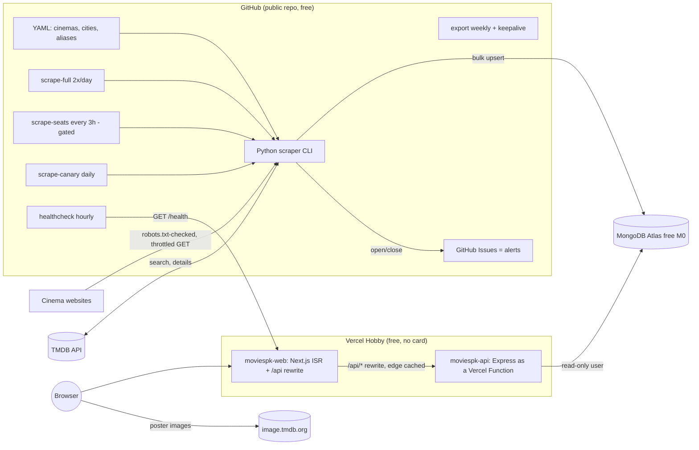
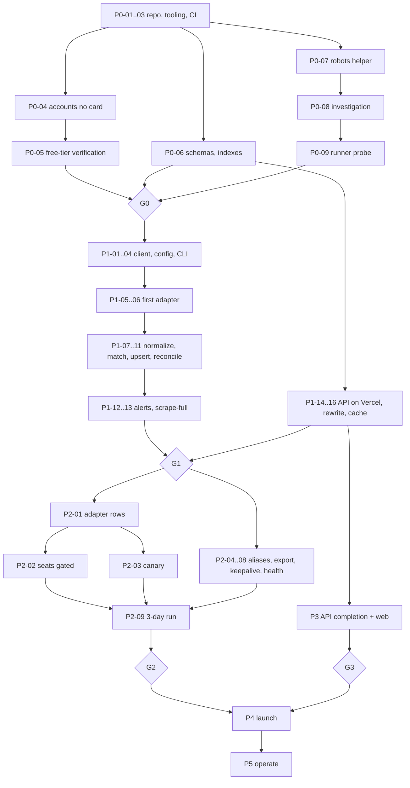

# MoviesPK — Implementation Plan (v2.0, zero-budget)

> **Status:** Draft v2.0 · **Date:** 2026-11-22 · **Supersedes:** plan v1.2 (archived unchanged at `docs/archive/plan-v1.2.md`).
> **Reference documents (not edited):** `project_statement.md`, `architecture.md` (Draft v1.0, ADR-01…ADR-17), `docs/adr/0001-respect-robots-txt.md` (Accepted), `docs/adr/0007-no-custom-domain-v1-delivery.md` (Proposed, never approved; superseded by this plan, see §4).
> **Precedence:** where this plan and `architecture.md` disagree, this plan wins, because it records owner decisions made after the architecture was written (§3.3). Every disagreement is listed in §4 with its reason. The edits needed to bring `architecture.md` and `project_statement.md` in line are listed in §4.3 and are a task (P0-10), not done here.
> **Estimates are planning estimates, not guarantees.**

## Revision history

| Version | Date | Summary |
|---|---|---|
| 2.0 | 2026-11-22 | Full rewrite after an audit against an **absolute $0 budget**. Removed every service that needs a payment method or can bill automatically (Cloudflare R2, Workers, Render/Fly/Railway, VPS/proxy fallback, Atlas upgrades, paid counsel). The API moves to Vercel (zero-config Express). Posters come from TMDB's image CDN. "Near me" is computed in the browser. Alerts use GitHub Issues. Coordinates and manual aliases live in YAML in the repo. Legal steps dropped (owner decision). All tasks renumbered (mapping in Appendix A). Effort 111.0 d → **78.5 d**. One developer about 34.3 weeks → **about 24.9 weeks**. |
| 1.2 and earlier | 2026-11-22 | See `docs/archive/plan-v1.2.md`. |

## Table of contents

1. [Executive summary](#1-executive-summary)
2. [Product objectives and non-goals](#2-product-objectives-and-non-goals)
3. [Requirements, constraints and owner decisions](#3-requirements-constraints-and-owner-decisions)
4. [Audit findings and deviations from the source documents](#4-audit-findings-and-deviations-from-the-source-documents)
5. [Final architecture](#5-final-architecture)
6. [Technology and dependency inventory](#6-technology-and-dependency-inventory)
7. [Absolute $0 cost model](#7-absolute-0-cost-model)
8. [Data model and data flows](#8-data-model-and-data-flows)
9. [API and frontend design](#9-api-and-frontend-design)
10. [Scraping and data collection](#10-scraping-and-data-collection)
11. [Caching and image delivery](#11-caching-and-image-delivery)
12. [Security and privacy](#12-security-and-privacy)
13. [Testing strategy](#13-testing-strategy)
14. [Implementation phases](#14-implementation-phases)
15. [Task-level execution checklist](#15-task-level-execution-checklist)
16. [Dependencies, parallelization and timeline](#16-dependencies-parallelization-and-timeline)
17. [Deployment and rollback](#17-deployment-and-rollback)
18. [Monitoring and operations](#18-monitoring-and-operations)
19. [Backup and recovery](#19-backup-and-recovery)
20. [Risk register](#20-risk-register)
21. [Acceptance criteria and launch readiness checklist](#21-acceptance-criteria-and-launch-readiness-checklist)
22. [Open questions and items still to verify](#22-open-questions-and-items-still-to-verify)
- [Appendix A: v1.2 → v2.0 task mapping](#appendix-a-v12--v20-task-mapping)

---

## 1. Executive summary

MoviesPK is a **non-commercial** website that shows which movies are playing at cinemas near the user in Pakistan. It covers showtimes (PKT) and, where a cinema publishes it cheaply and allows it, a seat-status category. Data is collected automatically from cinema websites twice a day.

**The design, in one paragraph.** A Python scraper runs on **GitHub Actions** in a public repository. It respects each site's robots.txt, normalizes data, matches movies to **TMDB**, and writes to **MongoDB Atlas (free M0)**. A read-only **Express** REST API runs as a Vercel Function (zero-config Express) in one **Vercel Hobby** project. A **Next.js** site runs in a second Vercel Hobby project and reaches the API through a same-origin `/api/*` rewrite. Responses are cached at Vercel's edge with a deliberately small set of cache keys. Posters are loaded from **TMDB's image CDN**; the database stores only the TMDB image path. The user's location never leaves the browser: the site downloads the cinema list (100 or fewer cinemas) and computes distances on the device. Alerts are **GitHub Issues** opened by the workflows. Human-curated data (cinema list, coordinates, manual movie aliases) lives in **YAML in the repo**. The database can therefore be rebuilt by re-scraping, and no paid backup storage is needed.

**Required external services: GitHub, MongoDB Atlas (free), Vercel (Hobby), TMDB API.** None of them needs a payment method, and none is allowed to have one (rule Z1, §7). Exceeding a quota makes a feature pause or degrade. It never creates a charge.

**Effort.** 78.5 working days of tasks, 94.2 d with a 20% contingency. That is **about 24.9 weeks for one developer** at about 4 productive days per week (watch week included), and **about 19.7 weeks for two developers** (§16). A 5-cinema minimum viable launch takes about 22.4 weeks for one developer.

**Verdict: CONDITIONAL GO.** Implementation can start. Three conditions must be met at gate G0 (§14):
1. The Vercel Hobby quotas and abuse controls are verified (P0-05).
2. At least 5 cinemas are viable under robots.txt and reachable from GitHub runners (P0-08, P0-09).
3. The owner confirms the project stays non-commercial.

---

## 2. Product objectives and non-goals

### 2.1 Objectives (from `project_statement.md` §3 and `architecture.md` §2.1)

| ID | Objective | v2.0 delivery |
|---|---|---|
| O1 | Unified site showing movies at cinemas near the user | Browser geolocation or city picker; distance computed client-side; nearest-first lists |
| O2 | Movie details: title, poster, genre, duration, language, rating, synopsis | TMDB metadata (cinema data as fallback); poster from TMDB CDN or placeholder |
| O3 | Schedules (date, time, cinema, hall) and seat availability | Showtimes for every enabled cinema; seat status **only where cheap and allowed** (ADR-0001), otherwise "Seat status not available" |
| O4 | Automatic collection, no manual entry of showtimes | Scraper on GitHub Actions; humans maintain only the cinema list, coordinates and alias corrections (YAML) |
| O5 | Current data through scheduled autonomous updates | `full` 2x/day, `seats` every 3 h for seat-enabled cinemas, daily `canary` |
| O6 | Fast, responsive, mobile-first | ISR pages, edge-cached API, pre-sized TMDB images, JS budget under 200 KB |
| F5 | Search and filters (genre, language, cinema, time, date, format) | City/date list from the API; filters applied in the browser; `/search` endpoint for title search |
| F8 | Booking deep link per showtime | `bookingUrl` link to the cinema's own page |
| F9 | Public `/status` page | Per-cinema health and "data as of" |

### 2.2 Non-goals (v1)

Ticket booking or payments · user accounts, favorites, recommendations · notifications · Urdu i18n · interactive map (replaced by a "Directions" external link, §4.2 D6) · travel-time routing · admin UI · any monetization (ads, affiliate links, paid features). **Monetization is a hard re-plan gate** (§20 R14): Vercel Hobby and the TMDB API are free only for non-commercial use.

The account and notification seams of architecture ADR-04 are kept as **names only** (reserved collections `users`, `favorites`, `alert_subscriptions`; an inert `req.user?` type). Nothing is built.

---

## 3. Requirements, constraints and owner decisions

### 3.1 Functional requirements

F1–F9 of `architecture.md` §2.1 apply, with these changes:
- **F2:** trailer link only if TMDB provides one.
- **F4:** seat status is optional per cinema.
- **F7:** images come from the TMDB CDN instead of R2.
- **F1:** distance is computed client-side.

### 3.2 Non-functional requirements (re-based for a $0 stack)

| Category | Target | How it is measured |
|---|---|---|
| Cost | **Exactly $0/month, $0 one-off.** No payment method on any account. | §7 inventory; P4-01 account audit |
| Performance | Edge-cache hit p95 under 300 ms (from Pakistan or the nearest test location). Cache miss p95 under 1,500 ms including a cold function start. LCP under 2.5 s on a mid-range phone over 4G. Landing JS under 200 KB gzipped. | P3-13 Lighthouse CI, P4-03 load test. The architecture's 800 ms miss target assumed an always-on host behind Cloudflare and is replaced. |
| Availability | Best effort. Stale data is acceptable; downtime is not. The site keeps serving the last good data when the scraper fails. | Hourly health check (P2-08) |
| Freshness | Showtimes: nominal 12 h or less; alert at 18 h. Seats (seat-enabled cinemas only): nominal 4 h or less for shows in the next 48 h; alert at 6 h. Always shown with "as of". | `scrape_runs`, canary (P2-03) |
| Scale | v1: 10–25 cinemas, up to 15 cities, about 50k page views/month within Hobby quotas. Up to about 100 cinemas without redesign. | P4-03 quota projection |
| Maintainability | New cinema in about 1 day (target, not the estimate basis). Breakage alerted within one scrape cycle. One developer can operate it. | §18 runbook, drill P4-05 |
| Privacy | User coordinates never reach the server from the website. The API's `/cinemas/nearby` accepts only coordinates snapped to a 0.05° grid. No coordinates are stored or logged. | P3-12 e2e network assertion, P1-14 log test |

### 3.3 Constraints and owner decisions (binding)

| # | Decision | Date | Source |
|---|---|---|---|
| OD1 | Product name **MoviesPK** ("CineNear" dropped) | 2026-11-22 | plan v1.2 U1 |
| OD2 | **No custom domain.** The site runs on `*.vercel.app`. | 2026-11-22 | ADR-0007 Part A |
| OD3 | **Respect robots.txt** per endpoint; `robots_policy: ignore` is rejected | 2026-11-22 | ADR-0001 |
| OD4 | **Absolute $0 budget**, no exceptions, no paid fallback | 2026-11-22 | this audit |
| OD5 | **PERSONAL / NON-COMMERCIAL project**: no ads, affiliate fees, paid features, revenue or commercial services. **Confirmed again by the owner on 2026-11-23.** The intended platforms are Vercel Hobby and the free non-commercial TMDB API with the required attribution. The project is not assumed to become commercial; a change of purpose is a re-plan gate (R14). | 2026-11-22 (confirmed 2026-11-23) | this audit; owner confirmation |
| OD6 | **Drop Cloudflare R2**; posters from the TMDB image CDN, placeholder if unmatched | 2026-11-22 | this audit |
| OD7 | **Express API on Vercel** (zero-config Express, separate Hobby project) | 2026-11-22 | this audit |
| OD8 | **No formal legal assessment is required** for implementation or launch: no counsel consult, no legal log, no legal launch gate, no legal-review task. The owner has confirmed the non-commercial purpose (OD5) and accepts proceeding on that basis (re-confirmed 2026-11-23). No legal assessment has been carried out, and none is claimed. The operational safeguards stay mandatory: OD3 robots.txt compliance, the per-cinema kill switch, and a simple contact/takedown process. R1 is recorded proportionately (§20). | 2026-11-22 (re-confirmed 2026-11-23) | this audit; owner confirmation |

Fixed technical constraints: MERN (Next.js as the React framework, Express API, MongoDB) and a Python scraper (statement §5, architecture ADR-07). Public monorepo (ADR-15). GitHub Actions as the scheduler (ADR-05). Store UTC, display PKT (UTC+5, no DST).

---

## 4. Audit findings and deviations from the source documents

### 4.1 Audit findings

Severity key: **P0** = must fix before implementation, **P1** = before production, **P2** = should fix, **P3** = optional. Evidence key: **[V]** = verified against provider documentation or official changelog on 2026-11-22; **[S]** = statement in a source document; **[I]** = technical inference; **[U]** = unverified (a P0-05 item).

| # | Sev | Finding | Evidence | Resolution in v2.0 |
|---|---|---|---|---|
| A1 | P0 | Cloudflare R2 requires a payment method on the account before a bucket can be created, and usage above the free allowance (10 GB-month, 1M Class A, 10M Class B ops) is billed automatically with no hard cap. This fails the $0 rule. | [V] Cloudflare billing docs ("primary payment method is required to purchase Cloudflare products"); multiple Cloudflare Community reports of a mandatory card dialog for the R2 subscription. Cloudflare's marketing page says "no credit card required", which conflicts and was treated as weaker. | R2 removed (OD6). The whole image pipeline (Pillow, boto3, Worker, three buckets, orphan cleanup, backup bucket) is removed. |
| A2 | P0 | v1.2 builds in paid items: API host "$0–7", a "$5 VPS/proxy" fallback (U4, D3c), Atlas M10 (about $57), Workers paid plan, Vercel Pro as contingency, and a paid counsel consult. | [S] plan v1.2 §11, §10.2, §4.1 | All removed. Rule Z3: the contingency for any quota or blocking problem is **degrade, defer or drop**, never pay. |
| A3 | P0 | API host shortlist: Fly.io needs a card after a short trial; Railway's free plan is $1 of usage per month. Render free needs no card, but sleeps after 15 min idle with up to about 1 min to wake, has 750 instance-hours/month per workspace, and suspends at the cap. Keeping it awake with a pinger burns nearly all hours (744 h/month) and is a fair-use grey area. | [V] Fly.io trial docs; Railway free-plan docs; Render free-tier docs | API moves to Vercel (OD7): zero-config Express runs as a Vercel Function [V Vercel docs]. One fewer provider, no sleep-fighting, and no cross-provider proxy. |
| A4 | P0 | `express-rate-limit` keeps counters in process memory. On serverless instances each instance has its own counter, so it does not limit anything reliably. In v1.2 it was also keyed behind a proxy (N14). | [I] | Abuse control moves to (1) a bounded cache-key design (§11.2) so almost all reads are edge hits, (2) strict parameter validation that rejects unknown or non-canonical parameters before any DB call, and (3) a Vercel Firewall rule if Hobby offers one [U, P0-05]. In-memory limiting is not used. |
| A5 | P0 | Vercel Hobby has no overage billing. When a limit is exceeded, the feature (or the team) is paused, usually for up to 30 days. That is $0-safe but an availability risk. Hobby is for non-commercial personal use only. | [V] Vercel Hobby plan and fair-use docs, Vercel Blob pricing page | OD5 keeps the project compliant. Quota protection: §11.2 cache-key bounding, no Vercel Image Optimization (§11.3), analytics off, weekly usage check (§18). Risk R7. |
| A6 | P0 | The v1.2 cache key space was effectively unbounded: raw `lat`/`lng` at 2 decimals × `radiusKm` × filters × dates. That means millions of keys, so the edge cache cannot protect the free API or the M0 database. | [I] | The website never sends coordinates. Showtime and movie lists are fetched per city and date (about 15 × 8 keys per endpoint); filters run client-side. `/cinemas/nearby` accepts only 0.05°-snapped coordinates and an enumerated radius. |
| A7 | P1 | Privacy: v1.2 sent rounded user coordinates through Vercel, where request logs may keep query strings (N12, unresolved). | [S] plan v1.2 N12 | Resolved by design. The website computes distance on the device (§9.3). |
| A8 | P1 | Paid legal counsel was a gate at G0 and at launch, which is incompatible with $0. | [S] plan v1.2 P0-16, P4-10 | Dropped (OD8). The residual risk is stated plainly in R1. |
| A9 | P1 | Nominatim geocoding, caching and bounding-box logic is extra code and an extra dependency for 10–25 fixed locations. OSM geocoding accuracy in Pakistan was already flagged as variable. | [S] architecture ADR-10 | Coordinates are entered by hand in `cinemas.yml` and checked on a map (P0-08). Nominatim is removed. |
| A10 | P1 | The map needed a tile provider whose free quota and policy were unverified (U9), and the map is not a statement requirement. | [S] architecture §18.2 item 9 | Map deferred. Each cinema gets a "Directions" external link (OpenStreetMap or Google Maps URL with coordinates). No tiles, no key. |
| A11 | P1 | Monitoring had too many parts: Telegram bot, UptimeRobot (free-plan commercial terms contested in public sources), Sentry, Vercel Analytics. | [V] UptimeRobot help center vs secondary sources disagree | Alerts become GitHub Issues created by the workflows with the built-in `GITHUB_TOKEN`, plus an hourly Actions health check. Sentry and analytics are optional and off by default. |
| A12 | P1 | Backups targeted a private R2 bucket. | [S] architecture §6.3 | Human input lives in YAML in git. The DB is rebuildable by re-scraping. A weekly `mongoexport` is kept as an Actions artifact. All data is public; there is no personal data. |
| A13 | P1 | Atlas free tier facts: one free cluster per project; 100 ops/s cap (excess is queued); a 7-day rolling data-transfer cap; **paused after 30 days without connections** (the 2026 changelog reduced this from 60 days). Network access must be `0.0.0.0/0` because GitHub runners and Vercel use dynamic IPs. | [V] Atlas free-cluster limits page and 2026 changelog; connection cap [U] | Daily scraper connections prevent the pause. Long random passwords and separate least-privilege users. A cached `MongoClient` with `maxPoolSize: 5` in the function. Bulk writes. |
| A14 | P1 | Scheduled workflows in a public repo are disabled after 60 days without repository activity. | [V] GitHub docs | Keepalive (P2-06). What counts as activity is [U] (P0-05). The staleness alert is the safety net. |
| A15 | P1 | TMDB API: free for non-commercial use with attribution; commercial use needs a separate agreement. No explicit term on hotlinking `image.tmdb.org`; a TMDB forum reply says only simultaneous connections are limited. | [V] TMDB developer FAQ and API terms; hotlink [U] | OD5 keeps the project compliant. Attribution in the footer and `/about` (logo plus notice). If TMDB images become unavailable, the placeholder is shown (R12). |
| A16 | P1 | v1.2 effort (111 d, 34 weeks for one developer) was inflated by work that only existed to support paid or extra services. | [S] plan v1.2 §7 | 78.5 d (§16). |
| A17 | P2 | ADR-0007 (Proposed) is now obsolete: a Worker, `r2.dev` and the TMDB-direct options for images, plus a proxy to an external host. | [S] | Superseded by ADR-0008 (written in P0-10), which records this plan's design. ADR-0007 status becomes "Superseded". |
| A18 | P2 | The architecture's contradictions are carried forward: backups inside the prod bucket vs a separate bucket (C11), `location_override` vs `locationOverride` (C12), "CineNear" in the statement body. | [S] | C11 is moot (no buckets). C12: coordinates are now a required YAML field `location: [lng, lat]`. The name fix is listed in §4.3. |
| A19 | P2 | `/takedown` page, `legal-log.md` and legal questions are not needed after OD8. | [S] | A "Contact and data removal" section on `/about` with the project email, plus a runbook procedure (§18.4). |
| A20 | P2 | Showtime TTL of 7 days after start keeps unneeded data, but costs nothing at this scale (about 13k documents, well under 512 MB). | [S] architecture §6.3 | Kept as written, to avoid a needless deviation. |
| A21 | P3 | v1.2 has a progress tracker, two Gantt charts and a budget tracker that duplicate one another. | [S] | Replaced by one timeline table (§16) and the cost model (§7). |
| A22 | P2 | Vercel Image Optimization on Hobby has its own monthly quota and would pause images when exceeded. | [I] (Hobby limits apply to all features [V]; exact image quota [U]) | Not used. Plain `` with TMDB's pre-sized variants (`w185`, `w342`, `w780`) and `srcset`. |
| A23 | P2 | Third-party GitHub Actions referenced by tag in a public repo with secrets are a supply-chain risk. | [I] | Pin every action to a full commit SHA; Dependabot updates them (P0-03). |

### 4.2 Deviations from `project_statement.md` and `architecture.md`

| # | Source says | v2.0 does | Why |
|---|---|---|---|
| D1 | Statement §5.2, §6 item 7, §7: Cloudflare R2 stores images; "fast image delivery through R2" | No R2. TMDB image CDN for matched movies; a static placeholder for unmatched ones. The DB stores `poster.path` (a TMDB path), never a full URL. | A1, OD6. **Consequence:** cinema-supplied posters are not mirrored (this also avoids copying cinema artwork). |
| D2 | Architecture ADR-09: API on Render/Railway/Fly behind Cloudflare | API on Vercel Hobby (zero-config Express) | A3, OD7 |
| D3 | ADR-12, §7.5: Cloudflare CDN, purge API, Cloudflare and `express-rate-limit` rate limiting | Vercel edge cache with bounded keys; no purge (short TTLs); Vercel Firewall if available on Hobby | A4, A6 |
| D4 | ADR-13: R2 on a custom domain, WebP variants, hashed keys | TMDB pre-sized variants; no domain (OD2) | A1, OD2 |
| D5 | ADR-10, §9.7: Nominatim geocoding with override | Hand-entered `location: [lng, lat]` in `cinemas.yml`, map-checked | A9 |
| D6 | §8.1–8.3: MapLibre/Leaflet map on `/near-me` and cinema pages | No map in v1; "Directions" external link | A10 |
| D7 | ADR-14, §11: Telegram/Discord webhook, Sentry, UptimeRobot | GitHub Issues alerts, hourly Actions health check, `/status`; Sentry optional | A11 |
| D8 | §6.3: weekly `mongodump` to a private R2 bucket | YAML source of truth + weekly `mongoexport` artifact | A12 |
| D9 | §9, §7.3: the frontend sends rounded coordinates to the API | The website computes distance client-side; the API's `/cinemas/nearby` still exists (statement §5.2 geospatial requirement) with snapped input | A6, A7 |
| D10 | ADR-08, §2.2: cost $0–10/month; domain is the main cost | Exactly $0; no domain | OD2, OD4 |
| D11 | ADR-11 (ignore robots.txt) | Respect robots.txt (already superseded by ADR-0001) | OD3 |
| D12 | §12.3, §18.2 item 3, plan v1.2: counsel consult, legal gates, `/takedown` page | No legal steps. Contact and removal on `/about`; removal procedure in the runbook. | OD8 |
| D13 | Statement §6 item 4, ADR-03: seat availability for every cinema | Seat status optional per cinema; showtimes-only is an accepted outcome | ADR-0001 |
| D14 | Statement body: "CineNear" | MoviesPK | OD1 |
| D15 | ADR-0007 (Proposed): Worker or `r2.dev` for images; rewrite to an external API host | Superseded | A17 |
| D16 | §2.2: API p95 under 800 ms on a cache miss | Under 1,500 ms on a miss including a cold start (§3.2) | Serverless cold starts on a free plan [I]; to be measured in P1-16 and P4-03 |
| D17 | §15, §16 R3: proxy or VPS for blocked IPs | Blocked cinema is dropped (or retried later with polite changes) | OD4 |

### 4.3 Edits needed later in the reference documents (task P0-10; not done in this revision)

- **`project_statement.md`:** replace "CineNear" with "MoviesPK" (§1, §10). Replace R2 mentions (§4 "storage of media assets", §5.2, §6 item 7, §7 table) with "TMDB image CDN; no media storage". Change "seat availability" to "seat availability where the cinema publishes it". The statement is the owner's document; make the change only with the owner's approval.
- **`architecture.md`:**
  - §1.1/§1.2: $0, no R2, API on Vercel.
  - ADR-08, -09, -10, -11, -12, -13, -14 rows: superseded, pointing to ADR-0001 and ADR-0008.
  - §4 diagram and component table.
  - §5.2 config fields: `location`, robots/terms evidence, `seats_allowed`.
  - §5.3 jobs: remove image upload and geocoding; add canary robots re-check and the warm-up rule.
  - §5.5: remove step 7 images.
  - §5.8: remove the Nominatim and R2 rows; add the robots-refusal row.
  - §6.1: `movies.poster = {source, path}`; remove `image` from `cinemas`; `cinemas.location` comes from YAML.
  - §6.4: remove (R2).
  - §7.3/§7.5: endpoint parameter changes and cache policy.
  - §8: no map; client-side nearby.
  - §10.1/§10.5/§10.6: hosting, workflows, env vars.
  - §11: GitHub Issues alerts.
  - §12.3: no legal steps.
  - §14: folder changes.
  - §15/§16: no paid upgrade path.
  - §18: resolved items.
- **`docs/adr/0007-*`:** set Status to "Superseded by ADR-0008".

---

## 5. Final architecture

### 5.1 Diagram



### 5.2 Components and responsibilities

| Component | Technology | Responsibility | Boundary / contract |
|---|---|---|---|
| Scraper | Python 3.12, httpx, tenacity, selectolax/BeautifulSoup, Pydantic v2, rapidfuzz, pymongo, PyYAML, structlog; Playwright only for `fetch_mode: browser` adapters | Fetch (robots-checked), parse, normalize, validate, match to TMDB, upsert, reconcile, health, alerts | Writes only to MongoDB and GitHub Issues. Reads YAML config. |
| Scheduler | GitHub Actions cron + `workflow_dispatch` | Runs jobs; keeps logs; failure emails | Workflows in `.github/workflows/` |
| Database | MongoDB Atlas free cluster (MongoDB 7/8) | System of record for scraped data; cache of YAML-sourced data | Collections in §8.1. Only coupling between scraper and API. |
| API | Node 20+ (LTS), Express 4 or 5, Zod, native `mongodb` driver, helmet, pino | Read-only REST `/api/v1/*`; validation; cache headers | Separate Vercel project; JSON shapes in `shared/schemas` |
| Web | Next.js (App Router), React, TypeScript, Tailwind CSS, TanStack Query | Pages, location flow, client-side distance and filters, SEO | Separate Vercel project; calls `/api/v1/*` same-origin (rewrite) |
| Images | TMDB image CDN | Poster delivery | URL = `NEXT_PUBLIC_TMDB_IMAGE_BASE` + `/w342` + `poster.path` |
| Alerts | GitHub Issues via REST and `GITHUB_TOKEN` | One open issue per (cinema, alert type); GitHub emails watchers | Labels `alert`, `alert:<type>` |

### 5.3 Main data flows

1. **Collection (`full`).** Load YAML → upsert `cinemas` from YAML → for each enabled cinema (bounded concurrency across cinemas, sequential within one): fetch, parse, normalize, validate → match movies (aliases YAML/DB → TMDB) → bulk upsert movies and showtimes → reconcile → write `scrape_runs` → evaluate alerts → exit code.
2. **Seats.** For seat-enabled cinemas: active showtimes starting within 48 h → fetch seat status → update only `showtimes.seats`.
3. **Read (website).**
   - The browser loads an ISR page.
   - The page fetches `/api/v1/cinemas` (all, cached 1 h) and computes distances locally.
   - It fetches `/api/v1/movies?city=…&date=…` or `/api/v1/movies/:slug/showtimes?city=…&date=…` (cached 5 min) and filters and sorts locally.
   - Posters load from TMDB.
4. **Read (API consumers).** `/api/v1/cinemas/nearby?lat&lng&radiusKm` with snapped parameters uses the 2dsphere index.

### 5.4 Failure behavior

| Failure | Effect | Handling |
|---|---|---|
| A cinema site changes layout | That cinema's data goes stale | `SchemaDriftError` → run `drift`, no reconcile, issue opened, last good data shown with "as of" |
| Site blocks GitHub IPs (403/429/challenge) | Same | Circuit breaker → `blocked` → issue. Polite fixes or drop (no paid proxy). |
| robots.txt newly disallows a needed path | Same | Client refuses → `blocked` with `RobotsDisallowedError` → issue. Owner excludes the cinema or asks it for written permission. |
| TMDB down or rate limited | New titles unmatched | Alias cache; titles become `provisional`; re-matched next run |
| Atlas unavailable or paused | API 5xx on cache misses | Edge `stale-while-revalidate`/`stale-if-error` keeps serving for a while; health check opens an issue; resume the cluster in the Atlas UI |
| Vercel Hobby quota exceeded | Feature or team paused (up to about 30 days) | Prevention §11.2; weekly usage review; if it happens: §18.4 runbook (no paid upgrade) |
| GitHub cron delayed or disabled | Data older than nominal | "As of" labels; staleness issue; keepalive; manual dispatch |
| Bad scraper deploy writes wrong data | Wrong showtimes | Revert the commit; `purge_cinema.py` + re-run (§17.3) |

---

## 6. Technology and dependency inventory

### 6.1 External services (complete list)

| Service | Required? | Used for | Account needs card? |
|---|---|---|---|
| GitHub (public repo, Actions standard runners, Issues) | **Required** | Code, CI, scheduling, alerts, artifacts | No |
| MongoDB Atlas free cluster | **Required** | Database | No [U: confirm at sign-up in P0-04] |
| Vercel Hobby (2 projects in one Hobby account) | **Required** | Web and API hosting, edge cache | No |
| TMDB API + image CDN | **Required** | Movie matching, metadata, posters | No (free API key, non-commercial) |
| Cinema websites | Data source | Showtimes, seats | n/a |
| Sentry Developer plan | Optional, off by default | Error tracking | [U] |
| Free email inbox for project contact (owner's choice) | Required for the contact line | `/about` contact, User-Agent contact | No |

**Removed from v1.2:** Cloudflare (R2, Workers, DNS, WAF), Render, Railway, Fly.io, UptimeRobot, Telegram/Discord, Nominatim, map tile provider, Vercel Analytics, VPS or proxy, paid counsel, custom domain.

### 6.2 Libraries (all open source, $0)

- **Scraper:** `httpx[http2]`, `tenacity`, `selectolax`, `beautifulsoup4`, `pydantic>=2`, `rapidfuzz`, `pymongo`, `PyYAML`, `structlog`. Optional extra `[browser]`: `playwright`. Dev: `ruff`, `mypy`, `pytest`, `pytest-cov`, `respx` (httpx mocking), `mongomock`, `pip-audit`. Robots parsing: stdlib `urllib.robotparser`.
- **API:** `express`, `zod`, `mongodb`, `helmet`, `pino`, `pino-http`. Dev: `typescript`, `eslint`, `vitest` or `jest`, `supertest`, `mongodb-memory-server`.
- **Web:** `next`, `react`, `react-dom`, `tailwindcss`, `@tanstack/react-query`. Dev: `@playwright/test`, `@lhci/cli`, `vitest` or `jest`, `@testing-library/react`.
- **Tooling:** `pre-commit`, `gitleaks`, Dependabot.
- **Local dev:** MongoDB Community via Docker or a native install. Docker Desktop is free for personal and educational use [U: confirm the licence fits the owner]; otherwise use a native MongoDB install or Podman.

**Removed:** Pillow, boto3, Leaflet/MapLibre, `express-rate-limit` (A4), Sentry SDKs as required dependencies.

### 6.3 Configuration and secrets inventory (names only; values never in git)

| Name | Where stored | Used by | Secret? |
|---|---|---|---|
| `MONGODB_URI_SCRAPER` | GitHub environment `production` (and `dev`) | scraper workflows | Yes |
| `MONGODB_URI_API` | Vercel project `moviespk-api` | API | Yes |
| `MONGODB_DB` | GitHub env variable; Vercel env | scraper, API | No |
| `TMDB_API_KEY` | GitHub environment `production` | scraper only | Yes |
| `SCRAPER_USER_AGENT` | GitHub variable | scraper | No (e.g. `MoviesPKBot/1.0 (+<repo URL>; <project email>)`) |
| `GITHUB_TOKEN` | built-in per workflow run | alerts, keepalive | Yes (automatic, scoped per workflow `permissions:`) |
| `API_ORIGIN` | Vercel project `moviespk-web` (server-side) | `/api/*` rewrite target and server fetches | No |
| `NEXT_PUBLIC_SITE_URL` | Vercel `moviespk-web` | canonical URLs, sitemap | No |
| `NEXT_PUBLIC_TMDB_IMAGE_BASE` | Vercel `moviespk-web` | `https://image.tmdb.org/t/p` | No |
| `CORS_ALLOWED_ORIGINS` | Vercel `moviespk-api` | direct cross-origin calls (site origin only) | No |
| `LOG_LEVEL`, `NODE_ENV` | Vercel | API | No |
| `SENTRY_DSN_*` | Vercel (only if Sentry is enabled) | API, web | Low |

Removed: all `R2_*`, `CDN_BASE_URL`, `NEXT_PUBLIC_CDN_BASE_URL`, `CLOUDFLARE_*`, `ALERT_WEBHOOK_URL`, `NOMINATIM_USER_AGENT`, `NEXT_PUBLIC_MAP_TILE_URL`, `PORT` (Vercel sets it).

---

## 7. Absolute $0 cost model

### 7.1 Rules

- **Z1 — No payment method anywhere.** No card, PayPal or wallet is ever added to GitHub, Atlas, Vercel, TMDB or any other account used by MoviesPK. P4-01 audits this, and §18.2 repeats it monthly. A provider that demands one is out of scope.
- **Z2 — Hard-stop services only.** Every required service either has no billing relationship or pauses or rejects usage at its limit. None bills overage.
- **Z3 — Degrade, never pay.** Quota pressure → lengthen TTLs, reduce scrape frequency, drop seat refresh, drop a cinema, or pause a feature. Blocked site → polite changes or drop. No paid upgrade is a contingency in this plan.
- **Z4 — Non-commercial.** No ads, affiliate links, sponsorships or paid features (R14). Starting any of them requires a new plan.
- **Z5 — Re-verify quarterly** (P5 routine). Free tiers change; nothing here is assumed permanent.
- **Z6 — Public repo stays public.** Actions minutes are free for public repos; a private repo would have a capped free allowance [U].

### 7.2 Service inventory with free-tier limits

| Service / component | Purpose | Free-tier limits that matter | Evidence | Charge risk | Decision |
|---|---|---|---|---|---|
| GitHub public repo + Actions (standard runners) | Code, CI, schedules, artifacts | Free minutes for public repos; 6 h per job; cron can be delayed; schedules disabled after 60 days without repo activity; artifact retention configurable (max for public repos [U]) | 60-day rule [V]; minutes and retention [S]/[U] | None without a payment method (Z1) | **Use** |
| GitHub Issues | Alerts | No relevant limit at this volume; REST API rate limits for `GITHUB_TOKEN` [U] | [I] | None | **Use** |
| MongoDB Atlas free cluster (M0) | Database | 512 MB storage; 100 ops/s (excess queued); 7-day rolling transfer cap [V, number U]; one free cluster per project; paused after 30 days without connections; no automated backups; connection cap [U] | [V] Atlas free-cluster limits page and 2026 changelog | None if no card and no upgrade (Z1) | **Use** |
| Vercel Hobby, project `moviespk-web` | Next.js site, ISR, edge cache, rewrite | Non-commercial only [V]; function invocations: the current docs list 1,000,000/month vs 100,000 on an older page [U]; max duration 300 s [V]; bandwidth, ISR and Active CPU quotas [U]; exceeding a limit pauses the feature, usually until 30 days pass [V] | [V] Hobby and fair-use docs | None: Hobby has no overage billing [V] | **Use** |
| Vercel Hobby, project `moviespk-api` | Express as a Vercel Function | Shares the Hobby account's quotas with the web project [V: included usage shared] | [V] Express zero-config docs | None | **Use** |
| Vercel Firewall custom or rate-limit rules | Abuse protection | Availability on Hobby [U] | — | None (no billing on Hobby) | **Use if available**; otherwise rely on §11.2 |
| Vercel Image Optimization, Analytics, Blob | — | Separate Hobby quotas | [V] Blob is paused at the limit | None, but pausing hurts UX | **Not used** |
| TMDB API | Matching, metadata | Free for non-commercial use with attribution; commercial needs an agreement; rate limits [U] | [V] TMDB FAQ and API terms | None (no billing) | **Use** (OD5) |
| TMDB image CDN (`image.tmdb.org`) | Posters | No explicit hotlink term; forum: only simultaneous connections limited [U] | [V] terms silent; forum [U] | None | **Use** with placeholder fallback |
| Cinema websites | Data | robots.txt and terms per site | ADR-0001 | None | **Use** where Allowed |
| Free email inbox | Contact | Provider terms | — | None | **Use** (owner chooses) |
| Sentry Developer plan | Errors | Event quota; card requirement [U] | — | Must be none (Z1) | **Optional, off by default** |
| Docker Desktop (local only) | Dev convenience | Licence scope [U] | — | None for personal/education [U] | Optional; native MongoDB is the fallback |
| Cloudflare R2 | (was images) | Card required; automatic overage billing | [V] (A1) | **Yes** | **Rejected** |
| Cloudflare Workers / `r2.dev` | (was image proxy) | Depends on R2 | [V] | Tied to R2 billing | **Rejected** |
| Render / Railway / Fly.io | (was API host) | Render sleep; Railway $1/month credit; Fly card | [V] (A3) | Render none, but UX risk; Fly yes | **Rejected** |
| UptimeRobot, Telegram, Nominatim, map tiles | (various) | Not needed | — | — | **Removed** |
| VPS / proxy / Atlas M10 / Vercel Pro / Workers paid / counsel / domain | (contingencies) | Paid | [S] | Yes | **Forbidden** (Z1, Z3) |

**Monthly operating cost: $0.00. One-off cost: $0.00.** Developer time is not money spent, but it is the real cost (§16).

### 7.3 Expected usage vs limits (planning estimate; re-checked in P4-03)

| Resource | Estimate at 50k page views/month | Basis |
|---|---|---|
| Vercel function invocations (API + web SSR/ISR) | At least about 75k/month in steady state. It rises with edge-cache misses and with each separate edge location keeping its own cache [U]. Must be measured in P4-03. | 2 Actions health checks/hour plus ISR revalidations of about 200 pages every 5 min only when visited, plus misses |
| Atlas operations | Peak under 20 ops/s during the `full` run (bulk writes); reads only on edge misses | 25 cinemas × about 300 showtimes/run, `bulk_write` batches |
| Atlas storage | Under 30 MB | About 13k showtimes, under 1k movies, `scrape_runs` 30-day TTL |
| Actions minutes | About 1,500–3,000 min/month (free for public repos) | full 2 × 15 min, seats 8 × 5 min, canary 10 min, health 24 × 1 min, per day |

If P4-03 projects any Vercel quota above **50%** at 50k page views/month, apply Z3 before launch: raise `s-maxage`, lengthen ISR, drop the hourly health check to every 3 h.

---

## 8. Data model and data flows

### 8.1 Collections (database `moviespk`; dev `moviespk_dev`)

Field names follow `architecture.md` §6.1 except where marked **(v2)**.

**`cinemas`** (upserted from `scraper/config/cinemas.yml` at the start of every `full` run; YAML wins)
`_id` (slug) · `chain` · `name` · `city` (slug) · `address` · `location` GeoJSON Point **(v2: from YAML `location: [lng, lat]`, required, validated inside Pakistan's bounding box lng 60.8–77.9, lat 23.6–37.1)** · `websiteUrl` · `bookingUrlTemplate?` · `facilities[]` · `enabled` · `seatsEnabled` **(v2)** · `lastScrapedAt` · `health {status, lastSuccessAt, lastRunAt}` · `createdAt`, `updatedAt`. Removed: `image`, `locationSource`, `phone` (optional, keep if available).

**`movies`**
`_id` ObjectId · `tmdbId?` (unique, partial index on existence) · `localKey` (unique: slug of normalized title + year) · `slug` (unique) · `title`, `originalTitle` · `year` · `synopsis` (plain text, at most 2,000 chars) · `genres[]` · `runtimeMin` · `languages[]` · `rating {certification?, tmdbScore?}` · **`poster {source: "tmdb", path}` or null (v2)** · `trailerUrl?` · `releaseDate?` · `matchStatus` (`matched|provisional|unmatched`) · `nowShowing` · `createdAt`, `updatedAt`.

**`showtimes`**
`_id` = `sha1(cinemaId|movieKey|startsAtUtcISO|hall|format)`, where **`movieKey` = `tmdbId` or `localKey` (v2, not the ObjectId, so the key survives a movie being re-created)** · `cinemaId` · `movieId` · `startsAt` (UTC) · `endsAt?` · `hall?` · `format` (`2D|3D|IMAX|4DX|OTHER`) · `language` · `seats {status: available|filling|sold_out|unknown, available?, total?, asOf?}` · `bookingUrl?` · `status` (`active|cancelled`) · `missCount` · `lastSeenAt` · `cinema {name, city}` (denormalized; **v2: location not denormalized**, the client has it) · `movie {title, slug, posterPath, genres, runtimeMin}` (denormalized) · `expireAt` = `startsAt + 7 d`.

**`movie_aliases`**
`_id` (normalized alias) · `movieKey` · `source` (`auto|manual|pending`) · `confidence` · `cinemaId?` · `createdAt`. **(v2) `manual` entries are loaded from `scraper/config/aliases.yml` every run; YAML is the source of truth for manual corrections.**

**`scrape_runs`**
`_id` · `job` (`full|seats|canary`) · `cinemaId` · `startedAt`, `finishedAt` · `status` (`ok|partial|failed|blocked|drift`) · `counts {movies, showtimes, upserted, invalid, cancelled}` · `errors [{type, message (≤300 chars, no headers/cookies), url}]` (at most 20) · `githubRunId` · `expireAt` = now + 30 d.

**Reserved, not created:** `users`, `favorites`, `alert_subscriptions`.

### 8.2 Indexes (`scripts/create_indexes.js`, idempotent)

| Collection | Index | Purpose |
|---|---|---|
| cinemas | `{location: "2dsphere"}` | `/cinemas/nearby` |
| cinemas | `{city: 1, enabled: 1}` | city list |
| movies | `{tmdbId: 1}` unique, partial `{tmdbId: {$exists: true}}`; `{localKey: 1}` unique; `{slug: 1}` unique | matching, lookup |
| movies | text index `{title: "text", originalTitle: "text"}` | `/search` |
| showtimes | `{"cinema.city": 1, startsAt: 1, status: 1}` | city/date lists |
| showtimes | `{movieId: 1, startsAt: 1}` | movie showtimes |
| showtimes | `{cinemaId: 1, startsAt: 1}` | cinema schedule, seats job, reconcile |
| showtimes | `{expireAt: 1}`, `expireAfterSeconds: 0` | TTL delete |
| scrape_runs | `{cinemaId: 1, startedAt: -1}`; `{expireAt: 1}` TTL | status, median |

### 8.3 Repository configuration files (source of truth for human input)

- `scraper/config/cinemas.yml`: `id`, `chain`, `adapter`, `branch?`, `fetch_mode` (`json|html|browser`), `base_url`, `name`, `address`, `city`, `location: [lng, lat]`, `booking_url_template?`, `min_delay_ms` (default 1500), `max_concurrency: 1`, `enabled`, `seats_allowed` (true only if seat data is cheap and its endpoint is robots-Allowed), `robots_policy` (`respect` | `permission_granted`), `permission_ref?` (required with `permission_granted`), `evidence {checked_at, robots_sha256, terms_url, terms_sha256, endpoints: [{path, allowed}]}`. Validation rejects `robots_policy: ignore`, a missing location, coordinates outside the bounding box, and `seats_allowed: true` without an evidence endpoint row for the seat path.
- `scraper/config/cities.yml`: `slug`, `name`, `center: [lng, lat]`, `default_radius_km`.
- `scraper/config/aliases.yml`: `- alias: "<normalized title>"`, `tmdb_id: 123` or `local_key: "..."`, `cinema_id?`, `note`.

### 8.4 Write semantics (idempotency and safety)

- All writes are upserts keyed by deterministic IDs. Re-running a job produces the same state.
- Per cinema, writes happen only after that cinema's fetch and validation succeeded. A failed cinema writes nothing except its `scrape_runs` doc.
- **Reconcile** runs only for a cinema whose `full` run is `ok`. Showtimes in the scraped date range that were not seen get `missCount += 1`; at 2 they become `cancelled`.
- **Zero-result guard:** if a cinema returns 0 showtimes, or fewer than 50% of its 7-run median (after warm-up), the run is `failed` and reconcile is skipped.
- **Invalid-rate guard:** more than 20% invalid rows → `failed`, nothing written for that cinema.
- The seats job updates only `seats.*` fields and never creates or deletes showtimes.
- Denormalized `movie`/`cinema` fields are refreshed by the upsert of each seen showtime. A movie or cinema edit propagates on the next `full` run (12 h at most).

---

## 9. API and frontend design

### 9.1 Endpoints (`/api/v1`, read-only, JSON envelope `{data, meta}`, errors `{error: {code, message, details?}}`)

| Method and path | Parameters (all validated with Zod; unknown parameters → 400) | Cache (`CDN-Cache-Control` / `Cache-Control`) | Notes |
|---|---|---|---|
| `GET /health` | none | `no-store` | `{status, db: "ok"/"down", version}`; DB ping with a 2 s timeout |
| `GET /cities` | none | 3600 s, SWR 86400 | from `cities.yml` (bundled at build) |
| `GET /cinemas` | `city?` (enum) | 3600 s, SWR 86400 | All enabled cinemas with `location`, `health`, `lastScrapedAt`. The website loads all of them once (about 100 or fewer docs). |
| `GET /cinemas/nearby` | `lat`, `lng`: decimals with at most 2 places, multiples of 0.05, inside the bounding box; `radiusKm` ∈ {5, 10, 25, 50}; `limit` ≤ 50 | 3600 s | `$geoNear` on `cinemas`; for API consumers (statement §5.2). The website does not use it. |
| `GET /cinemas/:id` | id slug (≤80 chars, `[a-z0-9-]`) | 3600 s | |
| `GET /cinemas/:id/showtimes` | `date` (YYYY-MM-DD PKT, today…today+7) | 300 s, SWR 600, stale-if-error 86400 | Grouped by movie |
| `GET /movies` | `city` (enum, required), `date` (as above) | 300 s, SWR 600, SIE 86400 | Now-showing movies in the city on that date, each with genres, languages, formats and cinema IDs. Filters are applied client-side. |
| `GET /movies/:slug` | slug | 3600 s | Movie detail |
| `GET /movies/:slug/showtimes` | `city` (required), `date` | 300 s, SWR 600, SIE 86400 | Showtimes grouped by cinema (unsorted by distance; the client sorts) |
| `GET /search` | `q`: 2–40 chars, normalized lowercase and trimmed; `city?` | 600 s | Text index on movies plus a name prefix match on cinemas; at most 20 results |
| `GET /status` | none | 300 s | Per-cinema status and last 7 runs (type and summary only) |

Common rules:
- `date` defaults to "today in PKT". For today, the lower bound is "now" so past shows are hidden.
- Each response includes `meta.generatedAt` and, where relevant, `meta.dataAsOf`.
- Payload caps: `/movies/:slug/showtimes` at most about 300 showtimes per city and day (a city-wide day is far below this).
- No query value is ever passed into MongoDB as an object. Only parsed primitives are used.

### 9.2 API implementation notes

- **Layout:** `api/src/app.ts` exports the Express app as the default export (Vercel zero-config entry). `api/src/server.ts` calls `app.listen` for local dev only.
- **DB:** one module-level `MongoClient` promise reused across invocations (`maxPoolSize: 5`, `serverSelectionTimeoutMS: 5000`), using the read-only user.
- **Middleware:** `helmet()`, JSON body disabled (read-only API), `validate(schema)` per route, `cacheHeaders(policy)`, central `errorHandler`, `notFound`. CORS allows only `CORS_ALLOWED_ORIGINS` (the site origin); browser traffic is same-origin through the rewrite anyway.
- **Logging:** pino with a request ID. Log the path only (no query string). Never log `lat`/`lng`.
- **Cache headers:** use `CDN-Cache-Control` for the edge TTL and `Cache-Control: public, max-age=60` for browsers. Whether the edge honors `CDN-Cache-Control` on both projects is verified in P1-16 [U]. Vercel's docs say rewrites honor upstream cache headers by default for projects created on or after 2026-04-06; the projects will be new.

### 9.3 Frontend

- **Routes:**

  | Route | Rendering | Content |
  |---|---|---|
  | `/` | ISR 300 s | Location prompt, now showing in the default city (Lahore) |
  | `/[city]` | ISR 300 s, `generateStaticParams` from cities | City landing |
  | `/movies/[slug]` | ISR 3600 s | Details. Showtimes load client-side for the chosen city and date, sorted by the user's distance. |
  | `/cinemas/[id]` | ISR 300 s | Info, "Directions" link, today's showtimes with a date switcher |
  | `/near-me` | Client-rendered, `noindex` | Nearest cinemas and their showtimes |
  | `/search` | Client-rendered | Title search plus filters in the URL |
  | `/status` | ISR 300 s | Scraper health |
  | `/about` | Static | Data sources; robots policy; TMDB attribution; "Contact and data removal" with the project email |
  | `/privacy` | Static | Location is processed only on your device; saved location stays in your browser; no trackers or cookies |

- **Location flow:**
  1. Saved location in `localStorage` (wrapped in try/catch) → use it, with a "Change" link.
  2. Otherwise show the default city and a "Use my location" button.
  3. `navigator.geolocation` is called only after the click.
  4. Denied or timed out → city picker.
  5. Coordinates stay in memory and `localStorage`. They are **never sent in any request**. A test asserts this (P3-12).
  6. Nearest city = the minimum haversine distance to the city centers. The data city is the nearest city's slug. Cinemas are sorted by haversine distance to the user, labelled "approx. straight-line distance".
- **Filters:** genre, language, format, cinema, time window and date in the URL query string, applied in the browser to the cached city/date payload. Date changes trigger a new fetch.
- **Images:** ``. A placeholder SVG (local static asset) when `poster` is null or the image fails (`onError`). **Never `next/image` optimization.**
- **Seat badge:** `available | filling | sold_out` show text plus color plus "as of HH:MM PKT". `unknown`, or a cinema without seats, shows no badge, and the cinema row shows "Seat status not available".
- **Booking link:** `bookingUrl` opens in a new tab with `rel="noopener noreferrer"`.
- **SEO:**
  - Metadata and canonical URLs from `NEXT_PUBLIC_SITE_URL`.
  - JSON-LD: `Movie`, `MovieTheater`, `ScreeningEvent`. Serialize with `JSON.stringify` and escape `<` as `<`.
  - `sitemap.ts` (cities, movies, cinemas) and `robots.ts`.
  - `/near-me` and `/search` are `noindex`.
- **Accessibility:** keyboard navigation, labels on all controls, never color-only status.

---

## 10. Scraping and data collection

### 10.1 Adapter contract

```python
class CinemaAdapter(Protocol):
    adapter_id: str
    fetch_mode: Literal["json", "html", "browser"]
    def list_showtimes(self, ctx: RunContext, cinema: CinemaConfig, days: int = 7) -> list[RawShowtime]: ...
    def list_movies(self, ctx: RunContext, cinema: CinemaConfig) -> list[RawMovie]: ...      # may return [] if movie info comes with showtimes
    def fetch_seat_status(self, ctx: RunContext, cinema: CinemaConfig, show: ShowRef) -> RawSeats | None: ...  # only if seats_allowed
```

Adapters only parse. Fetching goes through `ctx.http`, which owns robots checks, throttling, retries, the circuit breaker and logging. Chains share one adapter, parameterized by `branch`.

### 10.2 HTTP client rules (`scraper/src/moviespk_scraper/core/`)

- **robots.txt:**
  - Fetched once per host per run through the same client and parsed with `urllib.robotparser`.
  - Every URL is checked against the group for `SCRAPER_USER_AGENT`. A disallowed URL raises `RobotsDisallowedError` before any request.
  - Per RFC 9309: a 4xx on robots.txt = allow all; a 5xx or network failure = treat as disallowed for this run (fail safe), run status `blocked`.
  - `Crawl-delay` is honored when larger than `min_delay_ms`.
  - `robots_policy: permission_granted` skips the check only when `permission_ref` is set.
- **Throttle:** at least `min_delay_ms` (default 1500) plus 0–500 ms of jitter between requests to the same host; `max_concurrency: 1` per host; at most 3 cinemas in parallel across hosts.
- **Timeouts:** connect 10 s, read 30 s; whole-cinema budget 10 min (then `failed`).
- **Retries:** `tenacity`, 3 attempts on timeouts, connection errors, 502/503/504, with exponential backoff (2 s, 4 s, 8 s) plus jitter. A 429 honors `Retry-After` up to 120 s, then counts as a failure. No retry on other 4xx.
- **Circuit breaker:** 5 consecutive failures for a host → open for the rest of the run → `blocked` if they were 403/429, otherwise `failed`.
- **Conditional requests:** send `If-None-Match`/`If-Modified-Since` only within a run (runners are ephemeral).
- **Identity:** the descriptive User-Agent with the repo URL and contact email. No browser UA spoofing. No CAPTCHA solving. No login, cookie-wall or paywall bypass. A site that needs any of these is excluded.

### 10.3 Pipeline steps (per cinema, `full` job)

1. **Fetch and parse** via the adapter. On a parse failure the raw payload goes to `debug/` as an Actions artifact (retention 7 days, only on failure, at most 2 MB per cinema, after cookie and token stripping, never from a disallowed path).
2. **Normalize:**
   - NFKC, trim and collapse whitespace.
   - Strip format and language markers ("(2D)", "[Urdu]", "IMAX", "3D") into fields.
   - Parse local times as `Asia/Karachi` → UTC.
   - Shows after midnight keep their real calendar date (the PKT date shown is that of `startsAt`).
   - Map genres and languages to `shared/constants` vocabularies (unknown → `OTHER`, logged).
3. **Validate (Pydantic):**
   - Required fields; `startsAt` between now−2 h and now+14 d; runtime 30–300 min if present; `endsAt > startsAt`.
   - Text stripped of HTML; title at most 200 chars; synopsis at most 2,000.
   - Invalid rows are counted. Above a 20% invalid rate → `failed`.
4. **Match movies (§10.4).**
5. **Upsert:** bulk, unordered, by deterministic IDs.
6. **Reconcile:** only on `ok` (§8.4).
7. **Health:** a `scrape_runs` doc per cinema; update `cinemas.health`.
8. **Alerts:** §18.1.
9. **Exit code:** non-zero if any cinema `failed`, `blocked` or `drift` (so GitHub's failure email also fires).

### 10.4 Movie matching (TMDB)

1. Normalize the title: lowercase, strip punctuation and markers, collapse spaces.
2. Look up `movie_aliases` (manual entries from YAML first). On a hit, use it with no TMDB call.
3. Otherwise call TMDB `search/movie` with the query, `year` if known, and `region=PK`. Score candidates with `rapidfuzz.fuzz.token_set_ratio`, +5 if the year matches, −10 if the runtime differs by more than 15 min.
4. Score of 90 or more → `matched`: fetch details (genres, runtime, poster path, overview); alias `auto`.
5. Score 70–89 → `provisional`: the movie is built from cinema data; alias `pending`; listed in the daily digest issue.
6. Below 70, or no result → `unmatched` local movie; listed in the digest.
7. TMDB errors, timeouts or 429 → keep the alias cache; unknown titles become `provisional` and are retried next run. TMDB calls are throttled to at most 20/s (well under typical limits [U]).
8. Each unique normalized title costs at most one search per run. `matched` movies are refreshed from TMDB details at most once every 7 days.

### 10.5 Jobs and schedules (UTC; PKT = UTC+5)

| Workflow | Cron | Scope | `timeout-minutes` | Concurrency group |
|---|---|---|---|---|
| `scrape-full.yml` | `7 2,14 * * *` (07:07 and 19:07 PKT; off the hour to reduce cron congestion) | all enabled cinemas, 7 days ahead | 60 | `scrape` (shared with seats, so they never overlap) |
| `scrape-seats.yml` | `37 */3 * * *` | cinemas with `seatsEnabled`, shows in the next 48 h | 30 | `scrape` |
| `scrape-canary.yml` | `23 4 * * *` | robots/terms re-check, structural probe, staleness, storage, digest | 20 | `canary` |
| `healthcheck.yml` | `17 * * * *` | GET site `/` and `/api/v1/health` (bypassing the cache with a `no-store` request) | 5 | `health` |
| `export.yml` | `41 3 * * 0` | weekly `mongoexport` → artifact | 20 | `export` |
| `keepalive.yml` | mechanism and schedule chosen in P0-05 (at least every 30 days) | prevent the 60-day disable | 5 | `keepalive` |

All scheduled workflows:
- also have `workflow_dispatch` (scrape workflows take an optional `cinema` input);
- run only on the main repo (`if: github.repository == '<owner>/moviespk'`);
- use `environment: production` for secrets;
- set minimal `permissions:` (`contents: read`, plus `issues: write` where alerts are posted).

### 10.6 Seats (optional per cinema)

Seats are enabled only when the investigation shows all of the following:
- (a) seat data exists as counts or a category;
- (b) it costs at most one request per show, or one per cinema-day;
- (c) the seat endpoint is robots-Allowed;
- (d) the number of requests per run per site is at most 150.

Mapping:
- `sold_out` when `available == 0`;
- `filling` when `available/total ≤ 0.30`;
- `available` otherwise;
- a category-only site maps directly;
- anything else → `unknown`.

### 10.7 Data correctness checks

- **Canary structural probe:** one known page per adapter must yield at least 1 showtime and all required fields.
- **Count check:** after 7 `ok` runs (warm-up), fewer than 50% of the median → alert.
- **Cross-field checks in validation:** times, runtime, future window.
- **Daily digest issue:** new `provisional` and `unmatched` titles.
- **Coordinates:** a bounding-box check at config load and a manual map check when adding a cinema.
- **PKT boundary tests** in both scraper and API (23:30, 00:15 and midnight cases).

---

## 11. Caching and image delivery

### 11.1 Layers

1. **Vercel edge cache** for API GETs, via `CDN-Cache-Control`, through the rewrite from the web project to the API project [U, verified in P1-16].
2. **ISR** for pages (300 s or 3600 s).
3. **TanStack Query** in the browser (stale time 120 s).
4. **Browser cache** for TMDB images (TMDB's headers).

### 11.2 Cache-key bounding (abuse and quota protection, A4/A6)

- The website requests only:
  - `/cities`;
  - `/cinemas` (one key per city plus one for all);
  - `/movies?city&date`;
  - `/movies/:slug/showtimes?city&date`;
  - `/cinemas/:id/showtimes?date`;
  - `/status`;
  - `/search?q`.
- Key count, roughly: 15 cities × 8 dates × (1 + number of now-showing movies) ≈ under 20k keys. These are filled only when visited and expire in 5 min.
- Parameters are enums or canonical values. Unknown parameters, non-canonical coordinates, out-of-range dates and oversized `q` get **400 without touching MongoDB**. A random cache-busting parameter therefore costs one function invocation and no DB operation.
- `/search` is the only free-text key. `q` is normalized, at most 40 chars, at least 2. The web debounces at 300 ms and searches client-side first over the loaded movies list; `/search` runs only on submit.
- If P0-05 finds that Hobby includes Firewall rate-limit rules: one rule of about 300 requests per 60 s per IP on `/api/*` (exact value set in P3-03). Without it, the residual risk is a deliberate invocation-exhaustion attack, which would pause the Hobby account. That is accepted (R7) and mitigated by monitoring and the §18.4 runbook.

### 11.3 Images

- URL: `${NEXT_PUBLIC_TMDB_IMAGE_BASE}/{w185|w342|w780}${poster.path}`.
- Only TMDB-matched movies have posters; others show `/placeholder-poster.svg`.
- No mirroring, no resizing, no Vercel Image Optimization, no storage.
- CSP `img-src 'self' https://image.tmdb.org data:`.
- If TMDB changes its image policy: switch `NEXT_PUBLIC_TMDB_IMAGE_BASE` to the placeholder mode (feature flag `NEXT_PUBLIC_POSTERS_ENABLED=false`). No paid storage is introduced (Z3).

### 11.4 Freshness after a scrape

No purge. The worst case is the edge TTL plus SWR (5 + 10 min), plus ISR at most 5 min. Seat badges always show `asOf`, so a cached older value is labelled honestly.

---

## 12. Security and privacy

### 12.1 Secrets and repository

- [ ] GitHub secret scanning and push protection on; `gitleaks` in pre-commit and in every CI workflow; `.env.example` with names only.
- [ ] Secrets only in GitHub environment `production` (restricted to the `main` branch, required reviewer = owner for manual dispatch where supported) and in Vercel project settings.
- [ ] `pull_request` workflows never reference secrets; forks get none (GitHub default).
- [ ] Every third-party action pinned to a commit SHA; Dependabot for `pip`, `npm` and `github-actions`; `pip-audit` and `npm audit --omit=dev` in CI (fail on high or critical).
- [ ] Workflow `permissions:` minimal per job; `GITHUB_TOKEN` default set to read-only at repo level.
- [ ] Leak response: rotate the credential first (Atlas password, TMDB key), then clean up; record it in a GitHub issue (no secret values).

### 12.2 Database

- [ ] Two Atlas users: `moviespk_scraper` (`readWrite` on `moviespk`) and `moviespk_api` (`read` on `moviespk`). Separate dev user on `moviespk_dev`.
- [ ] 32+ character random passwords; TLS (Atlas default); network access `0.0.0.0/0` (unavoidable with Actions and Vercel dynamic IPs; accepted and documented).
- [ ] The API cannot write (tested in P4-01).

### 12.3 API and web

- [ ] Zod validation on every route; unknown parameters rejected; parsed primitives only in queries (NoSQL-injection safe; test `lat[$ne]=1` → 400).
- [ ] `helmet`; CORS allow-list; no request bodies accepted; errors never expose stack traces (500 → generic message plus request ID).
- [ ] Web CSP: `default-src 'self'; img-src 'self' https://image.tmdb.org data:; script-src 'self'` (plus nonces if Next.js needs them); `frame-ancestors 'none'`; `Referrer-Policy: strict-origin-when-cross-origin`.
- [ ] Scraped text is untrusted: stripped of HTML and length-capped at ingestion; React escaping at render; no `dangerouslySetInnerHTML` except JSON-LD with `<` escaped.

### 12.4 Privacy

- [ ] The website never sends user coordinates (e2e network assertion). `/cinemas/nearby` for API consumers accepts only 0.05°-snapped values (about 5 km), and the API logs no query strings.
- [ ] Geolocation only on explicit user action; the saved location stays in the user's browser; no cookies; no analytics or trackers by default.
- [ ] No personal data is collected, stored or exported. Backups and alerts contain only public cinema data.

### 12.5 Scraping conduct and public-repo hygiene

- [ ] ADR-0001 enforced in code (P1-01) and rechecked daily (P2-03).
- [ ] Fixtures: only the fields the adapter parses; no images; no cookies or tokens; never from disallowed paths; reviewed in each PR (template checkbox).
- [ ] Debug artifacts: failure-only, size-capped, token-stripped, 7-day retention.
- [ ] Kill switch: `enabled: false` in `cinemas.yml` plus `scripts/purge_cinema.py` (§18.4).

---

## 13. Testing strategy

| Layer | Tools | What is tested | Where it runs |
|---|---|---|---|
| Scraper unit | pytest, respx | HTTP client: retry/backoff, 429 `Retry-After`, throttle spacing, robots (allow, disallow, 4xx = allow, 5xx = block, Crawl-delay), circuit breaker; config validation (rejects `ignore`, bad coordinates, seats without evidence); normalizer PKT table (23:30, 00:15, midnight, markers, Unicode); validator thresholds; matcher (≥90, 70–89, <70, alias hit = no TMDB call, TMDB outage); seat mapping; alert dedupe; canary rules (median, warm-up, staleness) | `ci-scraper.yml` on PRs |
| Adapter fixture | pytest, saved fixtures in `scraper/tests/fixtures/<adapter>/<YYYY-MM-DD>/` | Each adapter → expected normalized output (snapshot); a drift fixture → `SchemaDriftError`; a midnight-crossing case where one exists | `ci-scraper.yml` |
| Scraper integration | pytest + MongoDB service container (`mongo:7`) in Actions | Idempotency (run twice → identical collection hashes); reconcile (1 miss keeps, 2 misses cancel, failed run changes nothing); zero-result guard; seats job touches only `seats.*`; alias YAML re-link; index script | `ci-scraper.yml` |
| Live canary | scheduled workflow | Real structural probe per adapter plus robots/terms re-check | `scrape-canary.yml` (never in PR CI) |
| API | Vitest/Jest + Supertest + `mongodb-memory-server` | Every route: validation (400 cases incl. unknown parameters, `lat[$ne]`), envelope shape, `$geoNear` order and radius, PKT day boundaries, cache headers per route, 404/500 format, no query string in logs | `ci-api.yml` |
| Contract | `shared/schemas` JSON Schema fixtures | The same sample payloads validate in Pydantic and Zod; vocabularies identical | `ci-api.yml` + `ci-scraper.yml` |
| Frontend unit | Vitest + Testing Library | Location provider branches (granted, denied, timeout, saved, storage throws), haversine sort, nearest-city mapping, filters ↔ URL, `SeatBadge`, PKT formatting, poster fallback | `ci-web.yml` |
| E2E | Playwright against `next build` + a mocked API (route interception) | Flow 1: grant geolocation → nearest cinemas and showtimes. Flow 2: deny → pick a city → open a movie → showtimes. Flow 3: filters → URL and results. Assertion: **no request URL contains the mocked coordinates**. 15:30Z shows as 20:30. | `ci-web.yml` |
| Non-functional | Lighthouse CI; `autocannon` | LCP under 2.5 s (mobile, simulated 4G), JS under 200 KB; edge-hit vs miss latency; quota projection | `ci-web.yml` (Lighthouse); P4-03 manual |
| Deployment and rollback | manual drill with recorded evidence | Vercel rollback, scraper revert plus purge plus re-run, restore from export | P4-05 |

**Quality gates:** required checks on `main` (`ci-*`, gitleaks). Coverage at least 80% lines on `scraper/src/moviespk_scraper/{core,pipeline}` and `api/src` (reported, enforced from P2 on). Path filters: `scraper/**` → `ci-scraper`; `api/**`, `shared/**` → `ci-api`; `web/**`, `shared/**` → `ci-web`.

---

## 14. Implementation phases

| Phase | Goal | Effort (task sum) | Exit gate |
|---|---|---|---|
| **P0 Foundations and investigation** | Safe repo, accounts with no payment methods, verified free tiers, shared schemas, a cinema list with robots evidence and runner reachability | 11.0 d | **G0** below |
| **P1 One cinema end to end** | One real cinema flows through the full pipeline on a schedule into Atlas, served by the API on Vercel through the web rewrite with edge caching | 20.0 d | G1 |
| **P2 Multi-cinema and operations** | All approved cinemas, gated seats, canary, alerts, alias review, export, keepalive, 3 clean unattended days | 25.5 d (16 d adapter placeholder + 9.5 d) | G2 |
| **P3 API completion and frontend** | All endpoints, the full website, SEO, e2e, performance budgets | 17.0 d | G3 |
| **P4 Launch** | Production audit, security headers, load and quota test, runbook, drill, soft launch, watch week | 5.0 d + 1 watch week | §21 launch checklist |
| **P5 Operate** | Maintenance routine (§18.2) | ongoing | — |

**G0 — go/no-go before P1 (owner records the decision in `docs/adr/0008-zero-cost-architecture.md`):**
- [ ] At least 5 viable cinemas (target 10+): robots/terms verdict Allowed (or written permission recorded), technical verdict Go, coordinates entered.
- [ ] At least 5 of them reachable from a GitHub Actions runner (P0-09).
- [ ] P0-05 finished with no blocker: Vercel Hobby quotas recorded; Firewall availability known; rewrite caching between projects tested on a throwaway pair of projects; Atlas sign-up confirmed with no card.
- [ ] No payment method on any account (screenshot or note in `docs/infrastructure.md`).
- [x] Owner confirms non-commercial status (OD5): **done 2026-11-23**.
- G0 is a **technical and practical** gate only. The criteria are viable cinemas, reliable extraction, hosting limits, database capacity, caching and workflow reliability. A formal legal consultation is **not** a G0 condition (OD8).
- [ ] CI green on the skeleton; push protection demonstrably blocks a fake secret.

**If G0 fails:**
- Fewer than 5 viable or reachable cinemas → widen the candidate list (one more 2 d investigation batch), or ask cinemas for written permission. If still under 5, **NO-GO**: the product goal cannot be met within the rules.
- A Vercel quota or terms blocker → re-plan with an ADR (the only $0 candidates are other no-card hosts; no paid option).

**G1:** the `scrape-full` schedule ran unattended at least twice; idempotency test green; a forced failure and a forced zero-result each open exactly one issue and change no data; `/api/v1/movies/:slug/showtimes` returns correct PKT-day data via `https://<web>.vercel.app/api/v1/...` with an edge cache HIT on the second request.

**G2:** approved cinemas enabled; 3 consecutive unattended days with every run `ok` or explained; freshness targets met (§3.2); every alert type fired in a test; export restore verified; keepalive recorded.

**G3:** every endpoint covered by API tests; all routes live on a Vercel preview with real data; e2e and Lighthouse green; network assertion of no coordinates passes.

---

## 15. Task-level execution checklist

Format: **ID — title** · Priority (Must / Should / Could) · Estimate in working days (d) · Depends on. Every task's Definition of Done: code, tests and docs updated in the same PR, CI green, checkbox ticked here. A task over 2 d is split before it starts.

### Phase 0 — Foundations and investigation (11.0 d)

- [ ] **P0-01 — Repository, licence and secret hygiene** · Must · 0.5 d · deps: none
  - Objective: a public monorepo that cannot accidentally leak secrets.
  - Details: create the `moviespk` public repo with folders `scraper/`, `api/`, `web/`, `shared/`, `scripts/`, `docs/`, `.github/`. Add a `LICENSE` (owner choice, Q3), `README.md` (purpose, non-commercial note, no-secrets rule), `.gitignore` (`.env*` except `.env.example`, `node_modules`, `.venv`, `__pycache__`, `.next`), `.env.example` (names from §6.3), `.pre-commit-config.yaml` (gitleaks, ruff, eslint, prettier), `.gitleaks.toml`, a PR template with the fixture-review checkbox. Enable secret scanning and push protection; set the default `GITHUB_TOKEN` permission to read-only; protect `main` (PR + required checks). Copy `architecture.md`, `project_statement.md`, `plan.md` and `docs/adr/*` into the repo.
  - Accept: pushing a fake token on a scratch branch is blocked (evidence in the PR); `pre-commit run --all-files` passes.
  - Tests: manual negative test, recorded.

- [ ] **P0-02 — Tooling for the three packages and local Mongo** · Must · 1.5 d · deps: P0-01
  - Details: `scraper/pyproject.toml` (Python 3.12, deps per §6.2, `[browser]` extra, ruff, mypy strict for `core/` `pipeline/` `models/`, pytest config); `api/` (TypeScript strict, ESLint, test runner, `src/app.ts` default-exporting an Express app with a placeholder `/api/v1/health`, `src/server.ts` for local); `web/` (Next.js App Router, Tailwind, TS strict, ESLint); `.nvmrc` (Node 20 LTS or newer LTS); `docker-compose.yml` with `mongo:7` only (dev DB `moviespk_dev`); `docs/dev-setup.md` (Docker or native MongoDB).
  - Accept: on a clean checkout, `ruff check && mypy && pytest` (scraper), `npm run lint && npm run typecheck && npm test` (api, web) all pass; `docker compose up mongo` works; `python -m moviespk_scraper --help` prints usage.
  - Tests: one smoke test per package.

- [ ] **P0-03 — CI workflows, path filters, Dependabot** · Must · 1.0 d · deps: P0-02
  - Details: `ci-scraper.yml` (ruff, mypy, pytest with a `mongo:7` service, pip-audit, gitleaks), `ci-api.yml`, `ci-web.yml` (lint, typecheck, test, build; e2e and Lighthouse added in P3), path filters per §13, pip and npm caches, all actions pinned by SHA, `.github/dependabot.yml` (pip, npm ×2, github-actions; weekly). Required status checks on `main`.
  - Accept: a PR touching only `scraper/**` runs only `ci-scraper`; all three pass on the skeleton; no workflow on `pull_request` references `secrets.`.
  - Tests: CI itself; `grep -R "secrets\." .github/workflows/ci-*.yml` returns nothing.

- [ ] **P0-04 — Accounts and credentials with no payment method** · Must · 1.0 d · deps: P0-01
  - Details:
    - Atlas: project `moviespk`, free cluster (region nearest Pakistan offered for free, e.g. Mumbai if available), DB users per §12.2, network access `0.0.0.0/0`.
    - Vercel Hobby: projects `moviespk-web` (root `web/`) and `moviespk-api` (root `api/`, Express preset), Git integration on `main` plus previews.
    - TMDB: account and API key (non-commercial).
    - GitHub: environments `production` and `dev` with secrets per §6.3.
    - A project contact email (owner).
    - Record non-secret facts in `docs/infrastructure.md`: account names, regions, project URLs, "payment method: none" per account with the date checked.
  - Accept: the scraper user can write to `moviespk_dev` from a throwaway Actions run; the API user's write is rejected; both Vercel projects deploy the skeleton; no account shows a payment method.
  - Tests: `scripts/check_db_access.py` (prints OK or FAIL, never the URI).

- [ ] **P0-05 — Free-tier and platform verification** · Must · 1.0 d · deps: P0-04
  - Details: for each item, record source link, date, finding and verdict (OK / Risk / Blocker) in `docs/free-tier-verification.md`:
    1. Vercel Hobby quotas: invocations, Active CPU, bandwidth or Fast Data Transfer, ISR reads and writes, edge requests; what is paused when each is exceeded.
    2. Vercel Firewall or WAF rules on Hobby (custom rules, rate limiting, attack challenge mode).
    3. Edge caching of `CDN-Cache-Control` responses from an Express function, and through a rewrite from another Vercel project, tested with two throwaway projects (`x-vercel-cache` HIT evidence).
    4. Whether Vercel request logs store query strings, and their retention.
    5. Vercel instant rollback on Hobby.
    6. Atlas free connection cap and transfer cap.
    7. Actions artifact retention maximum for public repos.
    8. What counts as activity for the 60-day schedule disable, and choice of the keepalive mechanism (a: scheduled commit to a branch; b: enable-workflow REST call with `GITHUB_TOKEN` `actions: write`).
    9. TMDB rate limits and current image-use guidance.
    10. Whether the Sentry free plan needs a card (only if Sentry is wanted).
    11. Docker Desktop licence fit.
  - Accept: every item has a verdict; any Blocker is escalated before G0; the keepalive mechanism is named.
  - Tests: none (evidence document).

- [ ] **P0-06 — Shared schemas, constants and index script** · Must · 1.5 d · deps: P0-02
  - Details: `shared/schemas/*.json` (JSON Schema for `Cinema`, `Movie`, `Showtime`, `SeatStatus`, `ScrapeRun`, response envelopes and `Error`) as the single contract; `shared/constants/*.json` (formats, seat statuses, genres, languages, match statuses, run statuses, cities enum generated from `cities.yml`); Pydantic models in `scraper/src/moviespk_scraper/models/` and Zod schemas in `api/src/schemas/` written to match, plus a contract test; `scripts/create_indexes.js` (§8.2, idempotent, prints the index list); `scripts/seed_dev.py` (2 cinemas, 3 movies, about 30 showtimes across PKT midnight).
  - Accept: §8.1 sample documents validate on both sides; running the index script twice shows no errors and includes the TTL index with `expireAfterSeconds: 0`.
  - Tests: Contract; scraper unit; integration (index script against the service container).

- [ ] **P0-07 — Robots and evidence helper** · Must · 0.5 d · deps: P0-02
  - Details: `scraper/src/moviespk_scraper/core/robots.py` (parse, per-path check, normalized-text SHA-256) and CLI `scripts/snapshot_evidence.py --cinema <id> --paths ...`. It prints per-path Allowed/Disallowed and the robots and terms hashes as a YAML snippet for `cinemas.yml`. It stores no copies of third-party pages in the repo (hashes and short notes only).
  - Accept: two runs on unchanged pages give the same hashes; a sample robots.txt yields the expected per-path verdicts.
  - Tests: scraper unit.

- [ ] **P0-08 — Cinema investigation and final list** · Must · 3.0 d · deps: P0-07
  - Details: investigate at least 14 candidate cinemas or chains (Lahore, Karachi, Islamabad first). One `docs/cinema-investigation/<chain>.md` per chain using this template:

    | Field | Content |
    |---|---|
    | Data source | type (json / html / browser) and endpoints |
    | Login or CAPTCHA? | yes → exclude |
    | Showtime horizon | days ahead |
    | Seat data | none / category / counts; requests per show |
    | Branches | |
    | Booking link | pattern |
    | Branch coordinates | taken from a map by hand, `[lng, lat]` |
    | Robots evidence | per endpoint (from P0-07) |
    | Terms | URL and a 2–5 line factual note |
    | Verdict | Allowed / Unclear / Disallowed |
    | Technical verdict | Go / Caveats / No-go |
    | Effort | S / M / L |

    **Unclear or Disallowed → excluded**, unless the owner obtains written permission (`permission_granted`, `permission_ref`). Produce `docs/cinema-investigation/README.md` (summary and rollout order: JSON with many branches first) and draft `scraper/config/cinemas.yml` (`enabled: false`) plus `cities.yml`. Fill the P2-01 adapter table.
  - Accept: every candidate has both verdicts; every Include row has evidence and coordinates; the first adapter is named.
  - Tests: config validation passes once P1-03 exists (re-run then).

- [ ] **P0-09 — GitHub runner reachability probe** · Must · 0.5 d · deps: P0-07, P0-08
  - Details: a temporary `probe-reachability.yml` (`workflow_dispatch` only, scratch branch, no secrets) that, for each Allowed candidate, checks robots.txt and then makes one GET to its main endpoint with the real User-Agent. Records status, challenge page yes/no and the date in each investigation doc. Delete the workflow afterwards.
  - Accept: every Allowed candidate has a reachability result; the reachable count is in the README.
  - Tests: the run is the evidence.

- [ ] **P0-10 — ADR-0008, document amendments list and gate G0** · Must · 0.5 d · deps: P0-03, P0-05, P0-06, P0-08, P0-09
  - Details: write `docs/adr/0008-zero-cost-architecture.md` (decisions OD4–OD8, the §4.2 deviations, the G0 outcome). Set ADR-0007's status to Superseded (with owner approval). Prepare the §4.3 amendment PR for `architecture.md` and `project_statement.md` for owner review; it may merge later and does not block P1. Run the G0 checklist (§14).
  - Accept: G0 decision and date recorded; scope chosen (full vs 5-cinema launch, Q1).
  - Tests: none.

### Phase 1 — One cinema end to end (20.0 d)

- [ ] **P1-01 — HTTP client: robots, throttle, retries, timeouts** · Must · 1.5 d · deps: P0-07
  - Details: `core/http.py`, `core/throttle.py`, `core/retry.py`, `core/logging.py` implementing §10.2 exactly (robots via `core/robots.py`). structlog JSON fields: `job`, `cinemaId`, `phase`, `url_path`, `status`, `durationMs`.
  - Accept: against respx mocks: 503×2 then 200 succeeds after backoff; 429 with `Retry-After: 3` waits at least 3 s; requests to one host are spaced at least `min_delay_ms`; a disallowed path raises `RobotsDisallowedError` with zero requests to that path; robots.txt is fetched once per host per run; robots 404 → allowed; robots 503 → blocked.
  - Tests: scraper unit.

- [ ] **P1-02 — Circuit breaker and typed errors** · Must · 0.5 d · deps: P1-01
  - Details: `core/circuit_breaker.py`; errors `SchemaDriftError`, `BlockedError`, `RobotsDisallowedError`, `ParseError`, `BudgetExceededError` in `core/errors.py`; per-cinema 10-minute budget.
  - Accept: after 5 failures the next call raises without network I/O; a 403/429 pattern maps to `blocked`.
  - Tests: scraper unit.

- [ ] **P1-03 — Config loading and adapter registry** · Must · 1.0 d · deps: P0-06
  - Details: `core/config.py` loads and validates `cinemas.yml`, `cities.yml`, `aliases.yml` with the §8.3 rules; `adapters/base.py` (the §10.1 protocol); `adapters/registry.py`.
  - Accept: `robots_policy: ignore` fails with a message citing ADR-0001; `permission_granted` without `permission_ref` fails; coordinates outside the bounding box fail; `seats_allowed: true` without a seat evidence row fails; an unknown adapter fails at load.
  - Tests: scraper unit.

- [ ] **P1-04 — CLI** · Must · 1.0 d · deps: P1-03
  - Details: `python -m moviespk_scraper run --job {full|seats|canary|export} [--cinema ID] [--dry-run] [--offline FIXTURE_DIR]` (argparse). `--dry-run` runs everything except DB writes and issue posting, and prints counts and 5 sample rows. Exit codes: 0 = all ok, 1 = any failed/blocked/drift, 2 = config error. Concurrency: at most 3 cinemas in parallel (threads), sequential within one.
  - Accept: `run --job full --cinema <id> --dry-run --offline tests/fixtures/<id>/<date>` exits 0.
  - Tests: scraper unit.

- [ ] **P1-05 — Fixture capture tool and first fixtures** · Must · 0.5 d · deps: P1-01, P0-08
  - Details: `scripts/capture_fixture.py --cinema <id>` fetches through the real client (robots enforced), keeps only the needed responses, strips cookies and tokens, and writes `manifest.json` (URL path → file).
  - Accept: first-cinema fixtures include at least 2 movies and several showtimes (a midnight-crossing show if one exists).
  - Tests: fixture refresh (process).

- [ ] **P1-06 — First adapter** · Must · 2.0 d · deps: P1-03, P1-05
  - Details: `adapters/<chain>.py` → `RawMovie`/`RawShowtime`; raise `SchemaDriftError` on missing keys or selectors; build `bookingUrl` from the template; branch parameterization; debug artifact on parse failure (§10.3).
  - Accept: fixture output equals the snapshot; a drift fixture (key removed) raises `SchemaDriftError`.
  - Tests: adapter fixture.

- [ ] **P1-07 — Normalizer** · Must · 1.0 d · deps: P0-06
  - Details: `pipeline/normalize.py` per §10.3 step 2.
  - Accept: table tests: "Dune (IMAX) [Urdu]" → title "Dune", format IMAX, language Urdu; 23:30 PKT on 2026-12-01 → `2026-12-01T18:30Z`; 00:15 PKT on 2026-12-02 → `2026-12-01T19:15Z`; NFKC and Urdu titles kept.
  - Tests: scraper unit.

- [ ] **P1-08 — Validator and sanitizer** · Must · 0.5 d · deps: P1-07
  - Details: `pipeline/validate.py` per §10.3 step 3 (20% threshold configurable).
  - Accept: invalid rows counted; a 21% invalid fixture fails the cinema; HTML in a synopsis is stripped; lengths are capped.
  - Tests: scraper unit.

- [ ] **P1-09 — TMDB client and matcher** · Must · 2.0 d · deps: P1-07, P0-04
  - Details: `services/tmdb.py` (httpx; key from env; at most 20 req/s; retries on 429/5xx; timeout 10 s) and `pipeline/match.py` per §10.4. Load YAML manual aliases before DB aliases. Store `poster {source: "tmdb", path}` from `poster_path`.
  - Accept: with mocked TMDB: score ≥90 → matched with poster path; 75 → provisional, alias pending; no results → unmatched; alias hit → zero TMDB calls; TMDB 503 → provisional with no crash; one search per unique title per run.
  - Tests: scraper unit.

- [ ] **P1-10 — Repositories, cinema sync and upsert** · Must · 1.5 d · deps: P1-08, P1-09, P0-06
  - Details: `db/client.py` (pymongo, `serverSelectionTimeoutMS=5000`, fail fast); `db/repositories.py`; `pipeline/sync_cinemas.py` (YAML → `cinemas` upsert; a disabled cinema gets `enabled: false` but is not deleted); `pipeline/upsert.py` (§8.1 IDs, denormalized fields, `expireAt`, `lastSeenAt`, `missCount: 0`, `bulk_write(ordered=False)`).
  - Accept: running the fixture pipeline twice against the service container leaves identical collection contents (hash of sorted documents without `updatedAt`); a movie re-created with the same `tmdbId` keeps the same showtime IDs.
  - Tests: scraper integration.

- [ ] **P1-11 — Reconcile and guards** · Must · 1.0 d · deps: P1-10
  - Details: `pipeline/reconcile.py` and the zero-result and invalid-rate guards (§8.4).
  - Accept: 1 miss keeps `active`; 2 misses → `cancelled`; a `failed` or zero-result run changes no showtime; past shows are left to the TTL.
  - Tests: scraper integration.

- [ ] **P1-12 — Run health and GitHub Issues alerts** · Must · 1.5 d · deps: P1-10
  - Details:
    - `services/health.py`: `scrape_runs` documents and `cinemas.health`.
    - `services/alerts.py`, using the GitHub REST API with `GITHUB_TOKEN` and `GITHUB_REPOSITORY`. Issue title: `[alert] <cinemaId>: <type>`, labels `alert`, `alert:<type>`. If an open issue with the same title exists, comment only when the state changes or 24 h have passed; otherwise create one.
    - The body holds the cinema, error type and summary, the run link `${GITHUB_SERVER_URL}/${GITHUB_REPOSITORY}/actions/runs/${GITHUB_RUN_ID}`, and the last success time. It never includes headers, cookies or secrets.
    - Auto-close with a comment on the next `ok` run.
    - Alert posting failures are logged and never fail the job.
    - `--dry-run` prints instead of posting.
  - Accept: a forced failure creates exactly 1 issue; a repeat within 24 h adds no comment; recovery closes it.
  - Tests: scraper unit (mocked GitHub API).

- [ ] **P1-13 — `scrape-full` workflow** · Must · 1.0 d · deps: P1-04, P1-12, P0-04
  - Details: `.github/workflows/scrape-full.yml` per §10.5: `setup-python` with cache, `pip install ./scraper`, run `--job full`, upload `debug/` on failure. `permissions: contents: read, issues: write`. First runs use `environment: dev` with the dev DB, then switch to `production`. Playwright install only in a separate job for `fetch_mode: browser` adapters (added in P2 if needed).
  - Accept: a manual dispatch writes to dev; a scheduled run fires on its own (allow for cron delay); a forced adapter failure gives a non-zero exit, an issue and GitHub's failure email.
  - Tests: live observation recorded in `docs/runbook.md`.

- [ ] **P1-14 — API skeleton on Vercel** · Must · 1.5 d · deps: P0-06, P0-04
  - Details: `api/src/app.ts` (default export), `src/db.ts` (cached client, §9.2), `src/middleware/{validate,cacheHeaders,errorHandler,notFound}.ts`, `src/lib/{dates,errors}.ts` (PKT helpers), pino logger with a path-only serializer, helmet and CORS. Deploy to `moviespk-api`.
  - Accept: `/api/v1/health` returns 200 with `db: "ok"` on the deployed URL; an unknown route gives the standard 404; log lines contain no query string (test); a cold-start timing is recorded in `docs/performance.md`.
  - Tests: API.

- [ ] **P1-15 — First endpoints** · Must · 2.0 d · deps: P1-14
  - Details: `/cities`, `/cinemas`, `/movies?city&date`, `/movies/:slug/showtimes?city&date` per §9.1, with cache headers.
  - Accept: seeded data returns the documented shapes (contract test); 23:30 and 00:15 PKT shows land on the correct PKT date; `date` beyond today+7 → 400; an unknown parameter → 400 with no DB call (spy).
  - Tests: API, Contract.

- [ ] **P1-16 — Web shell, rewrite and edge-cache verification** · Must · 1.0 d · deps: P1-15, P0-05
  - Details: `web/next.config.js` rewrite `/api/:path*` → `${API_ORIGIN}/api/:path*`; a placeholder page listing cities from the API; deploy to `moviespk-web`.
  - Accept: the second identical request to `https://<web>.vercel.app/api/v1/cities` shows a cache HIT header; a miss vs hit latency table is in `docs/performance.md`; if caching through the rewrite fails, apply the P0-05 fallback (the browser calls the API project origin directly with CORS) and record it.
  - Tests: non-functional (curl evidence).

- [ ] **P1-17 — End-to-end demo and quickstart** · Should · 0.5 d · deps: P1-13, P1-16
  - Details: README quickstart (local Mongo, seed, scraper dry run, API, web); runbook stub.
  - Accept: a real first-cinema showtime is visible via the production `/api/v1/movies/...` URL with a TMDB poster path that loads in a browser.
  - Tests: manual.

### Phase 2 — Multi-cinema and operations (25.5 d)

- [ ] **P2-01 — Adapter table rows (one task per row)** · Must · Σ rows (placeholder 16.0 d = 8 rows × 2 d) · deps: P1-13 (each row also depends on its P0-08 evidence)
  - Details per row: adapter (or branch config for an existing chain), fixtures, tests, config entry with evidence and coordinates; enable after a clean `--dry-run` and one dev run; Playwright rows use a separate workflow job with `pip install ./scraper[browser]` and `playwright install --with-deps chromium`.
  - Accept per row: fixture tests green; dry run valid; robots check passes for every path; coordinates checked on a map; `enabled: true` merged.
  - Tests: adapter fixture; integration on the first run of each chain.

  | Row | Cinema / chain (branches) | Source | Effort | Robots verdict | Seats allowed | Est. d | Status |
  |---|---|---|---|---|---|---|---|
  | A01 | first cinema (P1-06) | | | | | 0 | done in P1 |
  | A02–A09 | *fill from P0-08* | | | | | 8 × 2 | not started |
  | | **Σ (placeholder)** | | | | | **16.0** | |

  Replace the placeholder with the real sum at G0 and update §16. A branch of an existing chain is usually 0.5 d.

- [ ] **P2-02 — Seat pipeline, `seats` job and workflow (gated)** · Should · 2.5 d · deps: P2-01 (at least one row with seats allowed), P1-11
  - Details: `fetch_seat_status` in the eligible adapters; `pipeline/seats.py` (active shows in the next 48 h of `seatsEnabled` cinemas; mapping per §10.6; updates only `seats.*` with `asOf`); a request budget of at most 150 per site per run (fall back to 24 h if exceeded, and record it); `scrape-seats.yml` per §10.5. **If no cinema qualifies, drop this task (−2.5 d) and record it.**
  - Accept: a mapping table test (0/120 → sold_out, 30/120 → filling, 31/100 → available); a cinema with `seats_allowed: false` makes zero seat requests; an integration test shows only `seats` fields change.
  - Tests: unit, integration, live observation.

- [ ] **P2-03 — Canary: robots/terms re-check, structural probe, staleness, storage, digest** · Must · 2.5 d · deps: P2-01 (first rows), P1-12
  - Details: `pipeline/canary.py` and `scrape-canary.yml`:
    1. Per enabled cinema, re-check robots per evidence path and the terms hash. A newly disallowed path → alert `robots` (the client already refuses it). A changed terms hash → alert `terms-changed` (scraping continues until the owner reviews, unless the owner sets `enabled: false`). A robots hash change without a verdict change is logged only.
    2. Structural probe: one known page per adapter must parse.
    3. Count rule: below 50% of the 7-run median → alert, **only after 7 `ok` runs** (warm-up).
    4. Staleness: `lastSuccessAt` older than 18 h (full) or 6 h (seats) → alert.
    5. Atlas `dbStats` storage above 70% of 512 MB → alert.
    6. Daily digest issue `[digest] unmatched titles YYYY-MM-DD` listing new provisional and unmatched titles (closed automatically after 7 days).
  - Accept: unit tests for each rule including warm-up (runs 1–7 no count alert, run 8 alerts); a mocked robots change fires once and is deduplicated; a mocked terms change fires once.
  - Tests: unit, live canary.

- [ ] **P2-04 — Alias review tool** · Must · 1.0 d · deps: P1-09
  - Details: `scripts/review_aliases.py` lists pending and unmatched titles from the DB with TMDB candidates; the reviewer picks one; the tool appends to `scraper/config/aliases.yml`, then the reviewer opens a PR. The next `full` run re-links the showtimes. Runbook section "Alias review" (weekly).
  - Accept: an integration test shows that an alias added to the YAML re-links a provisional movie's showtimes on the next run, with no duplicate showtimes.
  - Tests: scraper integration.

- [ ] **P2-05 — Weekly export and restore** · Should · 1.0 d · deps: P1-10
  - Details: `--job export` writes gzip JSON of `movies`, `movie_aliases` and `cinemas` to `export/`; `export.yml` uploads it as an artifact (retention = the public-repo maximum found in P0-05, about 90 days [U]); `scripts/restore_export.py --target-db <name>` (refuses `moviespk` without `--force`).
  - Accept: restoring into `moviespk_restore_test` reproduces the document counts; restore + one `full` run gives a working API.
  - Tests: manual drill recorded in the runbook.

- [ ] **P2-06 — Keepalive** · Must · 0.5 d · deps: P0-05
  - Details: `keepalive.yml` implementing the mechanism recorded in P0-05, scheduled at least every 30 days. If (a): commit `ops/heartbeat.txt` to an unprotected `heartbeat` branch with `contents: write`. If (b): call `PUT /repos/{owner}/{repo}/actions/workflows/{id}/enable` for each scheduled workflow with `actions: write`. Safety nets: the staleness alert plus GitHub's own warning email.
  - Accept: a manual dispatch produces the expected effect; the mechanism and evidence link are in `docs/free-tier-verification.md`.
  - Tests: manual dispatch.

- [ ] **P2-07 — Blocked-site handling (no paid fallback)** · Must · 0.5 d · deps: P2-01
  - Details: for any `blocked` cinema, try a slower delay, a different allowed endpoint and fewer requests. If still blocked after 3 runs, set `enabled: false`, record it in its investigation doc, and remove it from scope. **Never a proxy, VPS or IP rotation.** A robots refusal is never routed around.
  - Accept: every cinema is Enabled or Dropped with a recorded reason.
  - Tests: a live run per affected cinema.

- [ ] **P2-08 — Health-check workflow and `/status` data** · Must · 0.5 d · deps: P1-16, P1-12
  - Details: `healthcheck.yml` (hourly) GETs the site home page and `/api/v1/health`; on 2 consecutive failures it opens a `[alert] site: down` issue and closes it on recovery (state kept as the open issue). Make sure `cinemas.health` and the `scrape_runs` index serve the status query.
  - Accept: pointing the check at a non-existent path in a test dispatch opens an issue; restoring it closes the issue.
  - Tests: manual dispatch.

- [ ] **P2-09 — 3-day unattended operations run** · Must · 1.0 d (spread over 3 calendar days) · deps: P2-01…P2-08
  - Details: run all schedules on production for 3 days; review every run doc and issue; fix or explain each one.
  - Accept: G2 criteria (§14).
  - Tests: observation log in `docs/runbook.md`.

### Phase 3 — API completion and frontend (17.0 d)

- [ ] **P3-01 — Remaining endpoints** · Must · 2.0 d · deps: P1-15
  - Details: `/cinemas/nearby` (snapped input, `$geoNear`, `distanceKm`), `/cinemas/:id`, `/cinemas/:id/showtimes`, `/movies/:slug`, `/search`, `/status` per §9.1.
  - Accept: each route matches its schema; nearby is ordered and radius-limited; non-canonical `lat=31.523` → 400; `/status` exposes no raw error text beyond type and summary.
  - Tests: API, Contract.

- [ ] **P3-02 — Parameter bounding and cache policy hardening** · Must · 1.5 d · deps: P3-01
  - Details: one central `policies.ts` table route → `{schema, cdnTtl, swr, sie}`; reject unknown parameters everywhere; payload caps; `ETag`.
  - Accept: a table test asserts the headers of every route; 100 randomized invalid requests make zero DB calls (spy).
  - Tests: API.

- [ ] **P3-03 — Abuse protection** · Should · 0.5 d · deps: P0-05, P3-02
  - Details: if Hobby supports it, a Vercel Firewall rule on `/api/*` (about 300 req/60 s/IP; tune after P4-03) and documented "attack challenge mode" steps. Otherwise document the residual risk (R7) and the runbook response.
  - Accept: the rule is visible in project settings (screenshot in `docs/infrastructure.md`), or the documented decision.
  - Tests: a burst test from one IP in P4-03.

- [ ] **P3-04 — Web foundation** · Must · 1.5 d · deps: P1-16, P0-06
  - Details: `app/layout.tsx`, Header and Footer (TMDB logo and notice, links to `/about`, `/privacy`, `/status`), Tailwind tokens, dark mode, `lib/api.ts` (typed client; server-side uses `API_ORIGIN`, client-side uses relative `/api/v1`), `lib/images.ts` (TMDB URL builder plus placeholder), `lib/time.ts` (PKT formatting), TanStack Query provider.
  - Accept: renders at 360 px and 1280 px widths; footer content present.
  - Tests: frontend unit.

- [ ] **P3-05 — Location provider and client-side distance** · Must · 1.5 d · deps: P3-04
  - Details: `features/location/{LocationProvider.tsx, useLocation.ts, CityPicker.tsx, distance.ts}` per §9.3: haversine, nearest city, sorting; the geolocation prompt only on click; storage wrapped in try/catch.
  - Accept: unit tests cover granted, denied, timeout, saved and storage-throws; sorting is correct for known coordinates.
  - Tests: frontend unit.

- [ ] **P3-06 — Home and city pages** · Must · 1.5 d · deps: P3-05
  - Details: `app/page.tsx`, `app/[city]/page.tsx` (ISR 300 s, `generateStaticParams`), `MovieGrid` and `MovieCard` (srcset, width and height, lazy loading, placeholder), client-side filters bar (genre, language, format) bound to the URL.
  - Accept: real data renders; filters update the URL and the results; reload keeps the state.
  - Tests: frontend unit.

- [ ] **P3-07 — Movie page** · Must · 2.0 d · deps: P3-05, P3-01
  - Details: `app/movies/[slug]/page.tsx` (ISR 3600 s details) with client showtimes for city and date, sorted by distance; `CinemaShowtimeList`, `ShowtimeChip` (PKT time, booking link), `SeatBadge` per §9.3; date, format, language and time-window filters in the URL.
  - Accept: seat-less cinemas show "Seat status not available"; badges have text and an "as of" time.
  - Tests: frontend unit.

- [ ] **P3-08 — Cinema page and `/near-me`** · Must · 1.0 d · deps: P3-05
  - Details: `app/cinemas/[id]/page.tsx` (info, "Directions" link `https://www.openstreetmap.org/?mlat=<lat>&mlon=<lng>#map=17/<lat>/<lng>`, "data as of", date switcher); `app/near-me/page.tsx` (nearest cinemas with today's showtimes; `noindex`).
  - Accept: the pages render; the directions link opens the right location.
  - Tests: frontend unit.

- [ ] **P3-09 — Search page** · Should · 1.0 d · deps: P3-04, P3-01
  - Details: `app/search/page.tsx`: client-side filtering of the loaded city list first, `/search` on submit; `noindex`.
  - Accept: matching titles and cinemas show; `q` shorter than 2 chars does not call the API.
  - Tests: frontend unit.

- [ ] **P3-10 — SEO** · Should · 1.0 d · deps: P3-06, P3-07, P3-08
  - Details: per-page metadata, canonical URLs from `NEXT_PUBLIC_SITE_URL`, JSON-LD (`Movie`, `MovieTheater`, `ScreeningEvent`) with escaping, `sitemap.ts`, `robots.ts`.
  - Accept: the JSON-LD snapshot test passes; the sitemap lists all cities, now-showing movies and cinemas with absolute URLs.
  - Tests: frontend unit (snapshot).

- [ ] **P3-11 — `/status`, `/about`, `/privacy`** · Must · 1.0 d · deps: P3-01, P3-04
  - Details: content per §9.3. `/about` states: data comes from the cinemas' public sites within their robots.txt rules; times can change, so check the cinema's booking page; seat status only where available; TMDB attribution; non-commercial; contact and data-removal email.
  - Accept: the pages are live and linked; the privacy text matches the actual behavior (no coordinates sent).
  - Tests: frontend unit (render).

- [ ] **P3-12 — Playwright e2e** · Must · 2.0 d · deps: P3-06…P3-11
  - Details: `web/e2e/` with the 3 flows of §13, a mocked API via route interception, the no-coordinates network assertion and the PKT display assertion; add to `ci-web.yml`.
  - Accept: all pass in CI.
  - Tests: E2E.

- [ ] **P3-13 — Lighthouse CI budgets** · Should · 0.5 d · deps: P3-12
  - Details: `web/lighthouserc.json` (mobile, LCP under 2.5 s, total JS under 200 KB gzipped on `/`); a CI step that fails on a breach.
  - Accept: CI fails on an injected oversize bundle; current numbers are in `docs/performance.md`.
  - Tests: non-functional.

### Phase 4 — Launch (5.0 d + watch week)

- [ ] **P4-01 — Production configuration and $0 audit** · Must · 1.0 d · deps: G3
  - Details: production env values on both Vercel projects and in the GitHub `production` environment; rotate every credential used during development; confirm the API DB user cannot write (a test write fails); a full-history gitleaks scan; **confirm "no payment method" on GitHub, Atlas, Vercel and TMDB** and record the date; `docs/security.md` checklist (§12 items).
  - Accept: every checklist item ticked.
  - Tests: manual audit.

- [ ] **P4-02 — Security headers and CSP** · Must · 0.5 d · deps: P4-01
  - Details: `web/next.config.js` headers per §12.3; helmet settings on the API.
  - Accept: all routes load with no CSP violations in the console; TMDB images load; `securityheaders`-style manual check recorded.
  - Tests: E2E smoke against the preview.

- [ ] **P4-03 — Load and quota test** · Must · 1.0 d · deps: P4-01
  - Details: `autocannon` against the edge-cached routes and against a miss path (unique valid dates or cities); measure p95 hit and miss; read the Vercel usage dashboard and Atlas metrics; project monthly usage at 50k page views (§7.3); tune TTLs if a projection exceeds 50% of a quota; test the P3-03 rule if present.
  - Accept: §3.2 performance targets met or adjusted with the owner's sign-off; quota projections under 50%; results in `docs/performance.md` and `docs/capacity.md`.
  - Tests: non-functional.

- [ ] **P4-04 — Runbook and "adding a cinema" guide** · Must · 1.0 d · deps: P2-09
  - Details: `docs/runbook.md` (all §18.3 and §18.4 procedures) and `docs/adding-a-cinema.md` (§18.5).
  - Accept: someone else can follow it in the P4-05 drill without help.
  - Tests: drill.

- [ ] **P4-05 — Incident and rollback drill** · Must · 1.0 d · deps: P4-04
  - Details: (1) break one adapter on a branch and dispatch it → a drift issue, last good data still shown, `/status` degraded, fix, re-run, issue closed; (2) Vercel rollback of the web and API projects to the previous deployment and back; (3) scraper revert plus `purge_cinema.py` plus re-run on dev; (4) restore an export into a scratch DB; (5) the kill switch: disable a cinema and confirm it disappears from the site within 20 min.
  - Accept: all five recorded with timings.
  - Tests: drill.

- [ ] **P4-06 — Soft launch and watch week** · Must · 0.5 d (+ 7 calendar days, about 15 min/day) · deps: P4-02, P4-03, P4-05
  - Details: production live on `*.vercel.app`, shared with a few testers, not announced; log freshness, issues, the unmatched queue, Vercel usage and Atlas metrics each day.
  - Accept: §21 checklist complete; owner records GO.
  - Tests: observation.

### Phase 5 — Operate (ongoing, not in totals)

See §18.2 for the routine. Adding cinemas after launch follows §18.5 (about 1 d each).

---

## 16. Dependencies, parallelization and timeline

### 16.1 Critical path

P0-01 → P0-02 → (P0-06, P0-07 → P0-08 → P0-09) → P0-10/**G0** → P1-01 → P1-03 → P1-05 → P1-06 → (P1-07 → P1-08), (P1-09) → P1-10 → P1-11/P1-12 → P1-13 → **G1** → P2-01 rows → P2-03 → P2-09 → **G2** → P4 → launch.
Off the critical path for one developer, but parallelizable with two:
- the API track P1-14 → P1-15 → P1-16 (only needs P0-04, P0-06);
- all of Phase 3 (needs P1-15 and P1-16; web work can use `seed_dev.py` data before real cinemas arrive);
- P2-04, P2-05, P2-06 (any time after P1).



### 16.2 Effort by phase and category (working days)

Categories attribute each task's estimate to its dominant activity; each task already includes its own tests and docs (Definition of Done).

| Phase | Development | Testing | Integration | Deployment / setup | Documentation / research | **Task sum** | Contingency 20% | **With contingency** |
|---|---|---|---|---|---|---|---|---|
| P0 | 3.0 | 0.5 | 0.0 | 2.5 | 5.0 | **11.0** | 2.2 | 13.2 |
| P1 | 13.0 | 4.0 | 1.5 | 1.0 | 0.5 | **20.0** | 4.0 | 24.0 |
| P2 | 16.0 | 5.0 | 2.0 | 1.0 | 1.5 | **25.5** | 5.1 | 30.6 |
| P3 | 11.5 | 3.5 | 1.0 | 0.5 | 0.5 | **17.0** | 3.4 | 20.4 |
| P4 | 0.5 | 2.0 | 0.0 | 1.5 | 1.0 | **5.0** | 1.0 | 6.0 |
| **Total** | **44.0** | **15.0** | **4.5** | **6.5** | **8.5** | **78.5** | **15.7** | **94.2** |

Task sums check: P0 = 0.5+1.5+1+1+1+1.5+0.5+3+0.5+0.5 = 11.0 · P1 = 1.5+0.5+1+1+0.5+2+1+0.5+2+1.5+1+1.5+1+1.5+2+1+0.5 = 20.0 · P2 = 16+2.5+2.5+1+1+0.5+0.5+0.5+1 = 25.5 · P3 = 2+1.5+0.5+1.5+1.5+1.5+2+1+1+1+1+2+0.5 = 17.0 · P4 = 1+0.5+1+1+1+0.5 = 5.0.

### 16.3 Calendar (start 2026-11-30; about 4 productive days per week, 25–30 h/week; calendar days = effort with contingency ÷ 4 × 7, rounded up per phase; no holidays assumed)

| Scenario | P0 | P1 | P2 | P3 | P4 | Watch | **Total** | **Finish** |
|---|---|---|---|---|---|---|---|---|
| **A: one developer, full scope** (sequential) | 24 d | 42 d | 54 d | 36 d | 11 d | 7 d | **174 days ≈ 24.9 weeks** | **2027-05-23** |
| **B: two developers, full scope** (P3 runs in parallel with P2; Dev B starts P3 right after G1) | 24 d | 42 d | 54 d (Dev A) | 36 d (Dev B, inside P2) | 11 d | 7 d | **138 days ≈ 19.7 weeks** | **2027-04-17** |
| **C: one developer, 5-cinema minimum viable launch** (P2 adapters 4 rows × 2 d = 8 d → P2 17.5 d) | 24 d | 42 d | 37 d | 36 d | 11 d | 7 d | **157 days ≈ 22.4 weeks** | **2027-05-06** |
| **D: two developers, 5-cinema launch** | 24 d | 42 d | 37 d (Dev A) | 36 d (Dev B) | 11 d | 7 d | **121 days ≈ 17.3 weeks** | **2027-03-31** |

Notes:
- In B and D, Dev B could also take the P1 API track (P1-14…P1-16, 4.5 d ≈ 8 calendar days) during P1. That saving is **not** counted, because it depends on early account and schema work being finished.
- P0 and P4 do not parallelize meaningfully: decisions, verification and sign-off are serial.
- Old plan v1.2: 111.0 d / 34.3 weeks (A). The reduction comes from removed services and gates, not from shrinking estimates for the same work.
- The adapter placeholder (16 d) is the largest uncertainty. Each extra L-sized cinema adds about 2 d effort (about 4 calendar days in A).

### 16.4 Milestones (scenario A; scenario B in brackets)

| # | Milestone | Day | Date |
|---|---|---|---|
| M0 | G0 passed | 24 | 2026-12-24 [same] |
| M1 | G1: first cinema end to end on production | 66 | 2027-02-04 [same] |
| M2 | G2: all cinemas and operations | 120 | 2027-03-30 [same] |
| M3 | G3: site complete on preview | 156 | 2027-05-05 [day 102, 2027-03-12] |
| M4 | Production live (private) | 167 | 2027-05-16 [day 131, 2027-04-10] |
| M5 | Watch week done, launch decision | 174 | 2027-05-23 [day 138, 2027-04-17] |

---

## 17. Deployment and rollback

### 17.1 Environments

| Env | Web | API | DB | Scraper |
|---|---|---|---|---|
| Local | `next dev` | `npm run dev` (`server.ts`) | Docker or native `mongo` (`moviespk_dev`) | CLI with `--dry-run`/`--offline` |
| Preview | Vercel preview per PR (`moviespk-web`) | Vercel preview (`moviespk-api`); previews read the **production** DB through the read-only user | prod (read-only) | not run |
| Dev data | — | — | Atlas `moviespk_dev` on the same free cluster (a separate database, separate user) | `environment: dev`, manual dispatch only |
| Production | Vercel production (`moviespk-web`, `*.vercel.app`) | Vercel production (`moviespk-api`) | Atlas `moviespk` | scheduled workflows, `environment: production` |

### 17.2 Deploy procedures

- **Web and API:** merge to `main` → Vercel builds and deploys each project automatically. A post-deploy smoke test (`healthcheck.yml` dispatched by a `deployment_status` event, or a manual dispatch) checks `/`, `/api/v1/health` and `/api/v1/cities`.
- **Scraper:** merge to `main` → the next scheduled run uses the new code. For risky changes: dispatch `scrape-full` with `cinema=<id>` against `environment: dev` first.
- **Indexes:** `node scripts/create_indexes.js` (idempotent), run manually against dev, then prod, after any index change. Schema changes in v1 are **additive only** (new optional fields). No destructive migrations.
- **Config (cinemas, aliases):** a PR to the YAML → merged → applied on the next `full` run (or dispatch).

### 17.3 Rollback

| What broke | Rollback | Time |
|---|---|---|
| Web or API deploy | Vercel dashboard → previous production deployment → "Promote" or "Instant Rollback" (availability on Hobby [U, P0-05]); otherwise `git revert` + automatic redeploy | Minutes |
| Scraper code writing bad data | `git revert`; then `python scripts/purge_cinema.py --cinema <id> --showtimes` (deletes that cinema's showtimes) and dispatch `scrape-full --cinema <id>`; for all cinemas, purge `showtimes` and re-run `full` (idempotent rebuild) | Under 1 h |
| Bad alias or movie merge | Fix `aliases.yml` via PR; dispatch `full` | Under 1 h |
| Bad cinema config | Revert the YAML PR or set `enabled: false`; dispatch `full` | Minutes |
| Lost or corrupted DB | Create indexes; restore the latest export (P2-05); dispatch `full` | Under 2 h |

Rollback is tested in P4-05.

---

## 18. Monitoring and operations

### 18.1 Signals and alerts (all $0)

| Signal | Source | Rule | Channel |
|---|---|---|---|
| Adapter failed / blocked / drift / robots refusal | `scrape_runs` | any occurrence | Issue `[alert] <cinema>: <type>` |
| Low results | canary | below 50% of the 7-run median, after 7-run warm-up | Issue |
| robots path newly disallowed / terms changed | canary | any | Issue |
| Staleness | canary | full over 18 h; seats over 6 h | Issue |
| Workflow failure | GitHub | non-zero exit | GitHub email (to the user who last changed the workflow's schedule [U]) |
| Site or API down | `healthcheck.yml` | 2 consecutive failures | Issue `[alert] site: down` |
| Unmatched or provisional titles | canary | new ones in 24 h | Daily digest issue |
| Atlas storage | canary | over 70% of 512 MB | Issue |
| Vercel quota | Vercel dashboard and emails | approaching or exceeded | Vercel email + weekly manual check |
| Free-tier changes | provider emails | any | Owner inbox; quarterly review |

Deduplication: one open issue per (cinema, type); a comment only on state change or after 24 h; auto-close on recovery.

### 18.2 Routine (owner or maintainer; about 1–2 h/week for 10 cinemas)

- **Weekly:** open alert issues; the `/status` page; the alias digest → review with `review_aliases.py`; the Vercel usage page; Actions failures.
- **Monthly:** fixture refresh for adapters that changed; Dependabot PRs; check the keepalive ran; **confirm no payment method on any account (Z1)**; read provider notices.
- **Quarterly:** redo the free-tier verification (P0-05 checklist); an export restore drill; review adapter maintenance hours (R16).
- **SLA targets** (best effort, single maintainer): acknowledge an alert within 1 day; fix an adapter within 3 days; a cinema broken twice in 30 days → reduce it to `full` once a day or drop it.

### 18.3 Standard procedures (detailed in `docs/runbook.md`)

1. **Adapter drift:** download the debug artifact → capture a new fixture → fix the adapter → PR → dispatch `full --cinema <id>`.
2. **Blocked:** follow P2-07; never a proxy.
3. **robots or terms alert:** if a used path is disallowed → the cinema is already refused; set `enabled: false` unless an alternative allowed path exists; record it. Terms changed → read them; continue or disable; refresh the evidence hashes with `snapshot_evidence.py`.
4. **Staleness across all cinemas:** check whether the workflows are disabled (re-enable), whether the cron is delayed (dispatch manually), and whether the Atlas cluster is paused (resume).
5. **Atlas paused or unavailable:** resume in the Atlas UI; dispatch `full`.
6. **Credential rotation:** Atlas user password → update GitHub environment or Vercel → redeploy the API → verify `/health`.

### 18.4 Emergencies

- **Vercel Hobby quota exceeded or paused:**
  1. Read the Vercel email to see which feature is paused and until when.
  2. Raise the TTLs, disable the hourly health check, check for abuse (Vercel logs).
  3. If the whole account is paused, the site is down until it is restored. **No paid upgrade (Z3).** Post a note in the repo README.
  4. Review the cache-key design before re-enabling.
- **Removal or contact request from a cinema:**
  1. Set `enabled: false` in `cinemas.yml` (PR or direct commit by the owner).
  2. Run `scripts/purge_cinema.py --cinema <id> --all` (showtimes and the cinema document).
  3. Wait at most 20 min for edge and ISR expiry; confirm on the live site.
  4. Reply from the project email.
  5. Record it in a closed GitHub issue labelled `removal`.
- **Suspected secret leak:** rotate immediately → revoke the old value → check gitleaks and GitHub alerts → record it.

### 18.5 Adding a cinema (about 1 d target; 0.5 d for a new branch of an existing chain)

1. Investigate per the P0-08 template, including robots evidence (`snapshot_evidence.py`) and map coordinates. Unclear or Disallowed → stop.
2. Run one reachability check from Actions.
3. Capture fixtures (`capture_fixture.py`).
4. Write the adapter, or add the branch config.
5. Add tests (fixture, drift, PKT case).
6. Run `--dry-run`, then a dev run.
7. Set `enabled: true` via PR.
8. Monitor for 3 days (count alerts are muted during the 7-run warm-up).

---

## 19. Backup and recovery

| Data | Source of truth | Backup | Recovery |
|---|---|---|---|
| Cinema list, coordinates, evidence | `scraper/config/cinemas.yml` (git) | Git history | Automatic on the next `full` run |
| Cities | `cities.yml` (git) | Git | Built into the API |
| Manual movie corrections | `aliases.yml` (git) | Git | Loaded every run |
| Showtimes, seats | Cinema websites | None needed (rebuilt by scraping; TTL-managed) | `full` run (at most 7 days ahead) |
| Auto-matched movies, auto aliases, TMDB metadata | Derived from TMDB plus scraping | Weekly `mongoexport` artifact (retention [U], about 90 days) | Restore the export, or re-scrape (TMDB calls re-made, about 1 per unique title) |
| `scrape_runs` history | Derived | None (30-day TTL; loss only resets the canary medians, and warm-up then applies) | — |
| Secrets | Provider stores | Not backed up; rotate and re-issue | Rotation procedure |

- **Recovery point:** at most 12 h for showtimes (the next run), 7 days for auto metadata (re-derivable anyway).
- **Recovery time:** under 2 h (§17.3).
- **Security of backups:** artifacts on a public repo are downloadable by signed-in GitHub users. Acceptable, because they contain only public cinema and movie data, no personal data and no secrets (the export job exports only the three listed collections). Tested in P2-05 and P4-05.

---

## 20. Risk register

L = likelihood, I = impact (H/M/L).

| # | Risk | L / I | Trigger | Mitigation | Contingency ($0 only) |
|---|---|---|---|---|---|
| R1 | **Third-party website policy / terms exposure** (acknowledged operational and policy risk for a non-commercial project). A cinema could object, change its robots.txt or terms, or ask for removal. Posters are third-party artwork served via TMDB. **Treatment: ACCEPTED.** The owner has confirmed the non-commercial purpose and proceeds on that basis (OD5, OD8). No formal legal assessment has been carried out or is required, and no legal clearance is claimed. Background references for information only: `docs/infrastructure-and-legal-audit.md` §7. Not a reason to stop development. | L / M | Contact or removal request, notice, terms change | robots.txt respected per endpoint; Unclear or Disallowed sites excluded; factual data only; no cinema artwork copied (TMDB posters); every showtime links to the cinema's booking page; low request rates (concurrency 1 per cinema, backoff, `Retry-After`); no login, CAPTCHA or paywall bypass; no personal data; `/takedown` contact page; kill switch and purge (§18.4); non-commercial | Disable the cinema within 1 day of any request; remove the data; if challenged broadly, take the site offline. This plan is not legal advice. |
| R2 | Scraper breakage from site redesigns | H / H | drift or failed runs, canary | Adapter isolation, fixtures, canary, alerts, last-good data with "as of" | Fix within 3 days; repeated breakage → lower frequency or drop the cinema |
| R3 | Blocking of GitHub runner IPs | M / H | 403/429, challenge pages | P0-09 probe, throttling, JSON endpoints, circuit breaker | Polite changes; otherwise drop the cinema (no proxy or VPS) |
| R4 | Seat data stale or unavailable | H / M | `asOf` over 6 h | Seats optional; "as of" labels; booking link is the source of truth | Show "Seat status not available" |
| R5 | Silent data errors (wrong match, wrong day, wrong coordinates) | M / M | digest growth, user reports | Thresholds, alias YAML, PKT tests, map check, bounding box | Fix the alias or YAML; re-run; add a regression test |
| R6 | Free-tier terms or limits change | M / H | provider notice, quarterly review | Z5 quarterly re-verification; minimal dependency count | Degrade (Z3) or move to another no-card provider with an ADR; never pay |
| R7 | **Vercel Hobby quota exhaustion** (organic or a deliberate invocation flood) pauses the site | M / H | Vercel usage emails, 429/402-like pause pages | Bounded cache keys; 400 without a DB call; Firewall rule if available; no image optimization or analytics; weekly usage check | Longer TTLs; wait out the pause; README notice; no paid upgrade |
| R8 | GitHub schedules disabled or delayed | M / M | staleness alert, GitHub warning email | Keepalive; staleness alert; off-the-hour crons | Manual dispatch; re-enable |
| R9 | Atlas free-cluster limits (ops/s, transfer cap, connections) or pause | L / M | throttling, connection errors, pause email | Edge caching; bulk writes; small pools; daily connections prevent the pause | Lengthen TTLs; reduce seat frequency; resume the cluster |
| R10 | Secret leak in the public repo | L / H | push-protection or gitleaks alert | Push protection, gitleaks, minimal secrets (3), env-scoped, read-only API user | Rotate immediately |
| R11 | TMDB terms or coverage gaps for Pakistani and regional films | M / L | rising unmatched count | Provisional and local movies, alias YAML, attribution | Cinema-provided metadata; placeholder posters |
| R12 | TMDB image CDN refuses hotlinking or becomes unavailable | L / M | broken images | Placeholder fallback; posters behind a flag | `NEXT_PUBLIC_POSTERS_ENABLED=false` |
| R13 | A payment method gets added to an account by mistake, creating charge exposure | L / H | monthly Z1 check | Z1 rule; P4-01 audit; monthly check | Remove it immediately; review usage |
| R14 | Scope drift toward monetization breaks the Vercel Hobby and TMDB free terms | L / H | any ad, affiliate or sponsor proposal | OD5; gate in §2.2 | Re-plan before any monetization |
| R15 | Fixtures or debug artifacts expose third-party content or tokens in the public repo | M / M | PR review | Trimmed fixtures, token stripping, failure-only 7-day artifacts, PR checkbox | Delete the artifact; rewrite the fixture |
| R16 | Single-maintainer capacity (bus factor) | M / H | alert backlog over 3 days | Runbook, small dependency set, YAML config, adding-a-cinema guide | Shrink the cinema list; pause seats |
| R17 | Fewer viable cinemas than the 10+ goal after robots and reachability filtering | M / M | G0 count | Wide candidate list (14+); permission requests | 5-cinema launch; below 5 → NO-GO |
| R18 | robots.txt or terms change after approval | M / M | canary alert | Daily re-check; client refuses disallowed paths | Disable or seek written permission |
| R19 | Edge caching through the cross-project rewrite does not work as expected | M / M | P0-05 / P1-16 shows MISS | Test early (P0-05) | The browser calls the API project directly (CORS allow-list); the API project's own edge cache still applies |

---

## 21. Acceptance criteria and launch readiness checklist

Every box marked (must) is required for GO. The owner records the decision and date in `docs/adr/0008-zero-cost-architecture.md`.

**Cost and accounts**
- [ ] (must) No payment method on GitHub, Atlas, Vercel or TMDB (checked within the last 7 days); no paid plan active.
- [ ] (must) §7.2 inventory matches reality; no other service in use.
- [ ] (must) Quota projections at 50k page views/month under 50% (P4-03).

**Data and operations**
- [ ] (must) 7 consecutive days: showtimes under 12 h nominal for every enabled cinema with no staleness alert unexplained; seats under 4 h for seat-enabled cinemas.
- [ ] (must) The scope chosen at G0 is met (≥10 cinemas full scope, or ≥5 for the minimum launch), each with fixtures, robots evidence (Allowed or written permission) and map-checked coordinates.
- [ ] (must) Each enabled cinema shows either working seat status or "Seat status not available"; no false seat claims.
- [ ] (must) Every §18.1 alert type fired in a test and deduplicated; the canary robots/terms re-check is running with no unreviewed alert.
- [ ] (must) Export restore verified; keepalive verified; rollback drill done (P4-05).
- [ ] Unmatched queue reviewed within 7 days.

**Product and performance**
- [ ] (must) All §9.3 routes live on the production `*.vercel.app` address over HTTPS with real data.
- [ ] (must) LCP under 2.5 s (Lighthouse mobile); landing JS under 200 KB; edge-hit p95 under 300 ms; miss p95 under 1,500 ms (or owner-approved adjusted values).
- [ ] (must) Edge cache HIT verified on every API route family; posters load from TMDB with a working placeholder.
- [ ] (must) Three e2e flows green, including the no-coordinates network assertion.
- [ ] Accessibility checks; tested on a real phone.

**Security and privacy**
- [ ] (must) Secrets rotated since development; gitleaks clean on full history; push protection on; `production` environment restricted to `main`.
- [ ] (must) The API DB user is read-only (tested); CSP and security headers active; unknown parameters → 400.
- [ ] (must) `/about` (sources, attribution, contact and removal) and `/privacy` live and accurate.
- [ ] (must) Removal procedure (§18.4) rehearsed once.

**Documentation and ownership**
- [ ] (must) `docs/runbook.md` and `docs/adding-a-cinema.md` validated by the drill.
- [ ] (must) Named owners for alias review and adapter maintenance (Q4, Q5).
- [ ] Free-tier verification refreshed within the last 30 days.

---

## 22. Open questions and items still to verify

### 22.1 Owner decisions still needed (work proceeds on the default)

| # | Question | Default | Needed by |
|---|---|---|---|
| Q1 | Full scope (10+ cinemas) or 5-cinema minimum viable launch? | Decide at G0 from the real viable count | G0 |
| Q2 | Default city | Lahore | P3-06 |
| Q3 | Repository licence | MIT for the code; a README note that scraped data is not covered by the licence | P0-01 |
| Q4 | Who reviews aliases, and how often | Owner, weekly | P2-04 |
| Q5 | Adapter maintenance hours available per month | At least 4 h per 3 cinemas; fewer → shrink the list | G0 |
| Q6 | Project contact email address (free inbox) | Owner creates a dedicated address | P0-04 |
| Q7 | Approve the §4.3 edits to `project_statement.md` and `architecture.md`, and setting ADR-0007 to Superseded | Proposed in P0-10 | P0-10 (non-blocking) |
| Q8 | Enable optional Sentry? | No (off) | P4-01 |
| Q9 | Seat "filling" threshold | 30% of seats or fewer left | P2-02 |

### 22.2 Unverified facts (verified in P0-05; the plan does not rely on them silently)

1. Vercel Hobby numeric quotas (invocations 1M vs the older 100k figure; Active CPU; data transfer; ISR; edge requests) and exactly what is paused.
2. Vercel Firewall or rate-limit rules on Hobby.
3. Edge caching via `CDN-Cache-Control` on an Express function and through a cross-project rewrite.
4. Vercel request-log query-string retention (now low impact: the website sends no coordinates).
5. Vercel instant rollback on Hobby.
6. Atlas free connection cap and transfer cap values; whether Atlas sign-up asks for a card.
7. GitHub Actions artifact maximum retention on public repos; what counts as activity for the 60-day rule; the scheduled-workflow failure email recipient.
8. TMDB rate limits and image hotlink stance (forum only).
9. Sentry free card requirement (only if enabled); Docker Desktop licence fit.
10. Real cinema count, data formats, seat availability and runner reachability (P0-08, P0-09).

### 22.3 Verified on 2026-11-22 (sources)

- Cloudflare R2 requires a payment method; free allowance 10 GB-month, 1M Class A, 10M Class B; overage billed: Cloudflare R2 pricing docs, Cloudflare billing docs, Cloudflare Community threads.
- Render free: 750 h/workspace/month, 15-min idle spin-down, about 1 min wake, suspension at the cap: render.com/docs/free.
- Railway: $0 plan with $1 usage per month: docs.railway.com/pricing/free-plan.
- Fly.io: trial only; card to continue: fly.io/docs/about/free-trial.
- Vercel Hobby: non-commercial only; paused, not billed, when limits are exceeded; Blob free within limits: vercel.com/docs/plans/hobby, vercel.com/docs/limits/fair-use-guidelines, vercel.com/docs/vercel-blob/usage-and-pricing.
- Vercel zero-config Express (single Vercel Function): vercel.com/docs/frameworks/backend/express.
- Atlas free cluster: 100 ops/s, one per project, paused after 30 days without connections (2026 changelog): mongodb.com/docs/atlas/reference/free-shared-limitations, mongodb.com/docs/atlas/release-notes/changelog.
- GitHub public repo scheduled workflows disabled after 60 days without activity: docs.github.com/en/actions/how-tos/manage-workflow-runs/disable-and-enable-workflows.
- TMDB: free non-commercial with attribution; commercial needs a written agreement: developer.themoviedb.org/docs/faq, themoviedb.org/api-terms-of-use.
- UptimeRobot free-plan commercial terms: contradictory sources (removed from the plan, so not relied on).

---

## Appendix A: v1.2 → v2.0 task mapping

v1.2 task IDs are **retired**. Do not reuse them; refer to `docs/archive/plan-v1.2.md` for their text.

| v1.2 tasks | v2.0 | Note |
|---|---|---|
| P0-01, P0-02 | P0-01 | merged |
| P0-03, P0-04, P0-05 | P0-02 | merged; MinIO removed |
| P0-06 | P0-03 | + SHA pinning |
| P0-07 | P0-04 | + Vercel/TMDB accounts, no card |
| P0-08 (R2 buckets) | — | **removed** (R2 dropped) |
| P0-09 | P0-05 | re-scoped to the $0 stack |
| P0-10, P0-11 | P0-08 | merged; coordinates added |
| P0-12, P0-13 | P0-06 | merged |
| P0-14 | P0-09 | |
| P0-15 | P0-07 | |
| P0-16 (counsel) | — | **removed** (OD8) |
| P0-17, P0-18 | P0-10 | ADR-0007 spike removed |
| P1-01…P1-04 | P1-01…P1-04 | same scope |
| P1-05, P1-06 | P1-05, P1-06 | |
| P1-07, P1-08 | P1-07, P1-08 | |
| P1-09, P1-12 | P1-10 | merged |
| P1-10 | P1-09 | |
| P1-11 (Nominatim) | — | **removed** (coordinates in YAML) |
| P1-13 | P1-11 | |
| P1-14 (image pipeline to R2) | — | **removed** (TMDB CDN) |
| P1-15, P1-16 | P1-12 | GitHub Issues instead of Telegram |
| P1-17 | P1-13 | |
| P1-18 | P1-14 | on Vercel |
| P1-19, P1-20 | P1-15 | |
| P1-21 | P1-17 | |
| P1-22 (external API host) | — | **removed** (OD7) |
| P1-23 | P1-16 | |
| P1-24 (Worker image delivery) | — | **removed** |
| P2-01 (+ retired P2-02…P2-08) | P2-01 | |
| P2-09, P2-10 | P2-02 | |
| P2-11, P2-12, P2-19 | P2-03 | merged |
| P2-13 | P2-07 | no paid fallback |
| P2-14 | P2-04 | YAML-based |
| P2-15 | P2-05 | Actions artifact instead of R2 |
| P2-16 | P2-06 | |
| P2-17 | P2-08 | + health-check workflow |
| P2-18 | P2-09 | |
| P2-20 (orphan images) | — | **removed** |
| P3-01 | P3-01 | |
| P3-02, P3-03 | P3-02 | |
| P3-04 (`express-rate-limit`) | P3-03 | replaced by bounding + Firewall |
| P3-05 (Sentry, seam) | — | Sentry optional; seam = names only |
| P3-06…P3-10 | P3-04…P3-08 | map removed from P3-11 |
| P3-11 | P3-08, P3-09 | |
| P3-12 | P3-10 | |
| P3-13 | P3-11 | `/takedown` → `/about` contact |
| P3-14 | — | analytics off; Sentry optional |
| P3-15, P3-16 | P3-12, P3-13 | |
| P4-01, P4-02, P4-04 | P4-01 | single production audit |
| P4-03 (UptimeRobot) | — | replaced by `healthcheck.yml` (P2-08) |
| P4-05, P4-06 | P4-01, P4-02 | |
| P4-07 | P4-03 | + quota projection |
| P4-08 | P4-04 | |
| P4-09 | P4-05 | + rollback drill |
| P4-10 (legal) | — | **removed** (OD8) |
| P4-11, P4-12 | P4-06 | |
| P5-01…P5-08 | §18.2, §18.5 | paid upgrade triggers removed; custom domain out of scope |
