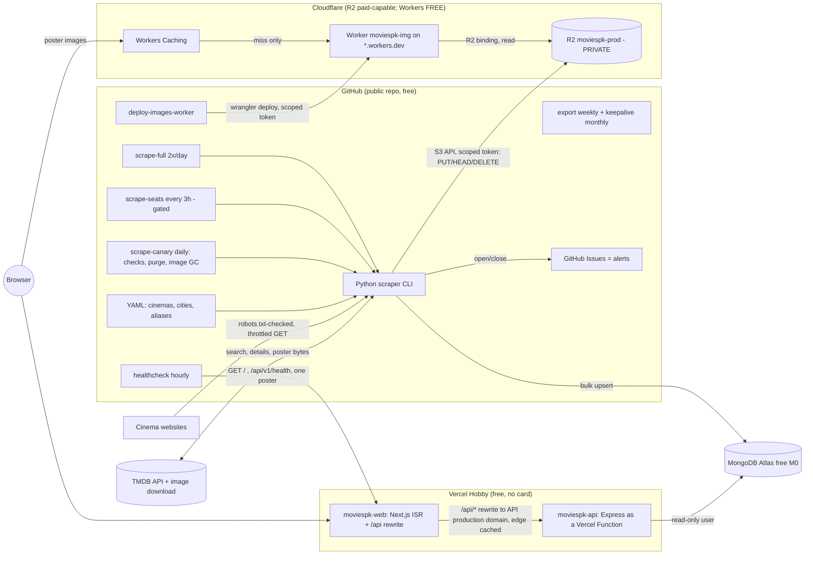
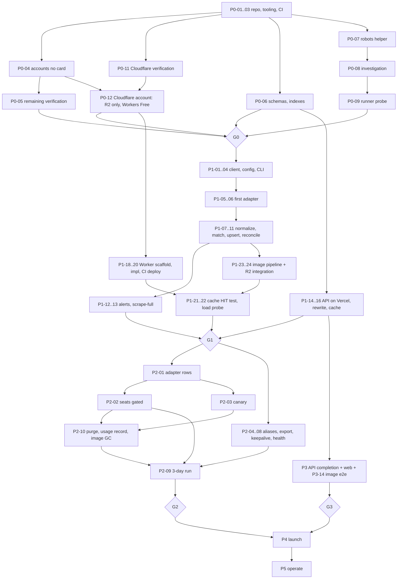

# MoviesPK — Implementation Plan (v2.1, $0 target with an R2-only exception)

> **Status:** Draft v2.1 · **Date:** 2026-11-23 · **Supersedes:** plan v2.0 (archived unchanged at `docs/archive/plan-v2.0.md`; v1.2 at `docs/archive/plan-v1.2.md`).
> **Reference documents:**
> - `project_statement.md` (not edited);
> - `architecture.md` (**Draft v1.2**, ADR-01…ADR-18; brought in line with this plan in the same revision);
> - `docs/adr/0001-respect-robots-txt.md` (Accepted);
> - `docs/adr/0007-no-custom-domain-v1-delivery.md` (Proposed, never approved; superseded, see §4);
> - `docs/adr/0009-reinstate-r2-and-worker-image-delivery.md` (Accepted, OD9/OD10);
> - `docs/free-tier-verification.md` (Cloudflare evidence, 2026-11-23);
> - `docs/infrastructure-and-legal-audit.md` and `docs/cinema-viability-audit.md` (2026-11-23).
>
> **Precedence:** where this plan and `architecture.md` disagree, this plan wins, because it records owner decisions (§3.3). Architecture v1.2 was rewritten to match this plan. Any remaining disagreement is a defect to fix.
> **Estimates are planning estimates, not guarantees.**

## Revision history

| Version | Date | Summary |
|---|---|---|
| 2.1 | 2026-11-23 | **Owner decisions OD9 and OD10.** Cloudflare R2 is reinstated, with a payment method on the Cloudflare account for R2 only. Posters are served by a Worker on its free `*.workers.dev` URL from a **private** bucket, fronted by Workers Caching. OD4 and Z1–Z3 are revised for the single R2 exception. A new §7.4 adds R2 billing controls and usage forecasts. §11.3 is rewritten for image delivery, with a per-page image budget, the TMDB 6-month rule (purge N = 90 days) and failure behaviour. TMDB hotlinking and its flags are removed. Stale items are fixed: the architecture reference; facts verified by the 2026-11-23 audit, which also reduce P0-05 and P0-08; the keepalive mechanism; `API_ORIGIN` on the production domain; `Vercel-CDN-Cache-Control`; TMDB at 5 req/s; `/takedown` removed from R1; `maxIdleTimeMS`; and seats queuing behaviour. New tasks: P0-11, P0-12, P1-18…P1-24, P2-10, P3-14 (Appendix A). Effort 78.5 d → **85.5 d**. One developer about 24.9 weeks → **about 26.9 weeks**. |
| 2.1 (readiness corrections) | 2026-11-23 | **Implementation readiness audit (READY WITH MINOR CHANGES, 88/100) resolved; no architecture change.** Clarified: `cinemas.phone` is optional (§8.1); the API returns `location: {lat, lng}` while MongoDB stores GeoJSON (§8.1, §9.1); null-hall normalization in the showtime ID (§8.1); the four-value seat vocabulary as an intentional extension (§4.2 D18, §10.6); static routes vs `/[city]` (§9.3); `/cities` source of truth (§9.1, §9.2); PKT date grouping around midnight (§9.1, §10.3); the cross-language contract test mechanism (§13, P0-06). Added deliverables: `scripts/purge_cinema.py` (P2-07), `scripts/restore_export.py` acceptance (P2-05), `docs/performance.md` (P0-02), `docs/capacity.md` (P0-12), `docs/security.md` (P4-01), the `images-approval` environment (P0-04), custom error pages and dark-mode acceptance (P3-04). Effort 85.5 d → **86.5 d** (P2-07 +0.5, P3-04 +0.5). One developer about 26.9 weeks → **about 27.1 weeks**. |
| 2.1 (owner clarification) | 2026-11-23 | **OD11**: the owner accepts the R2 free allowances and the residual spend risk, and approves the R2 + Worker design. Changes: §7.4 now separates platform limits, expected usage and accepted risk; the controls are simplified (the automatic 2 GB upload stop is removed and replaced by a usage record; write protection and upload caps are kept); Referer protection is decided as not built; no paid plan or provider by default; new §11.3.9 on configurability. Effort unchanged at 85.5 d. |
| 2.0 | 2026-11-22 | Full rewrite after an audit against an absolute $0 budget (archived at `docs/archive/plan-v2.0.md`). |
| 1.2 and earlier | 2026-11-22 | See `docs/archive/plan-v1.2.md`. |

## Table of contents

1. [Executive summary](#1-executive-summary)
2. [Product objectives and non-goals](#2-product-objectives-and-non-goals)
3. [Requirements, constraints and owner decisions](#3-requirements-constraints-and-owner-decisions)
4. [Audit findings and deviations from the source documents](#4-audit-findings-and-deviations-from-the-source-documents)
5. [Final architecture](#5-final-architecture)
6. [Technology and dependency inventory](#6-technology-and-dependency-inventory)
7. [Cost model: $0 target, R2 the only billable exception](#7-cost-model-0-target-r2-the-only-billable-exception)
8. [Data model and data flows](#8-data-model-and-data-flows)
9. [API and frontend design](#9-api-and-frontend-design)
10. [Scraping and data collection](#10-scraping-and-data-collection)
11. [Caching and image delivery](#11-caching-and-image-delivery)
12. [Security and privacy](#12-security-and-privacy)
13. [Testing strategy](#13-testing-strategy)
14. [Implementation phases](#14-implementation-phases)
15. [Task-level execution checklist](#15-task-level-execution-checklist)
16. [Dependencies, parallelization and timeline](#16-dependencies-parallelization-and-timeline)
17. [Deployment and rollback](#17-deployment-and-rollback)
18. [Monitoring and operations](#18-monitoring-and-operations)
19. [Backup and recovery](#19-backup-and-recovery)
20. [Risk register](#20-risk-register)
21. [Acceptance criteria and launch readiness checklist](#21-acceptance-criteria-and-launch-readiness-checklist)
22. [Open questions and items still to verify](#22-open-questions-and-items-still-to-verify)
- [Appendix A: task mappings (v2.0 → v2.1, v1.2 → v2.0)](#appendix-a-task-mappings-v20--v21-v12--v20)

---

## 1. Executive summary

MoviesPK is a **non-commercial** website that shows which movies are playing at cinemas near the user in Pakistan. It covers showtimes (PKT) and, where a cinema publishes it cheaply and allows it, a seat-status category. Data is collected automatically from cinema websites twice a day.

**The design, in one paragraph.**
- A Python scraper runs on **GitHub Actions** in a public repository. It respects each site's robots.txt, normalizes data, matches movies to **TMDB**, and writes to **MongoDB Atlas (free M0)**.
- A read-only **Express** REST API runs as a Vercel Function (zero-config Express) in one **Vercel Hobby** project. A **Next.js** site runs in a second Vercel Hobby project and reaches the API through a same-origin `/api/*` rewrite to the API's production domain. Responses are cached at Vercel's edge with a deliberately small set of cache keys.
- **Posters:** the scraper downloads TMDB posters, resizes them to three WebP widths and stores them in a **private Cloudflare R2 bucket**. A small **Cloudflare Worker on its free `*.workers.dev` URL** serves them, fronted by **Workers Caching**. The database stores only image keys.
- The user's location never leaves the browser: the site downloads the cinema list (100 or fewer cinemas) and computes distances on the device.
- Alerts are **GitHub Issues** opened by the workflows.
- Human-curated data (cinema list, coordinates, manual movie aliases) lives in **YAML in the repo**.

**Required external services:** GitHub, MongoDB Atlas (free), Vercel (Hobby), TMDB API, Cloudflare R2, and Cloudflare Workers (Free plan).
- **Cost: $0 expected; R2 is the only service with a payment method; target spend $0.** $0 is not guaranteed: the owner accepts the residual R2 risk (OD11).
- Every other service is hard-stop: exceeding a quota pauses or degrades a feature and never creates a charge.
- R2 is billed only above its free allowance and has **no hard spend cap** [V, `docs/free-tier-verification.md` R2-8]. It is therefore under explicit controls (§7.4). The forecast stays under 1% of its storage and write allowances.
- Reads from R2 go through the Workers Free plan, which fails at 100,000 requests/day instead of billing. That caps R2 reads at about 31% of the Class B allowance.

**Effort.** 86.5 working days of tasks, 103.8 d with a 20% contingency (§16).
- **About 27.1 weeks for one developer** at about 4 productive days per week (watch week included).
- **About 21.7 weeks for two developers.**
- A 5-cinema minimum viable launch takes about 24.7 weeks for one developer.

**Verdict: CONDITIONAL GO.** Implementation can start. The conditions are met at gate G0 (§14):
1. The remaining platform checks pass (P0-05): the cache-HIT test through the cross-project rewrite on throwaway projects, and an Atlas sign-up with no card. The Vercel Hobby quotas and abuse controls were already verified on 2026-11-23 (architecture §10.7).
2. At least 5 cinemas are viable under robots.txt and reachable from GitHub runners (P0-08, P0-09). The cinema viability audit lists 21 desk-verified venues.
3. **Cloudflare (P0-11, P0-12):** the account is created; R2 is enabled; a billing alert is configured, or its absence is recorded and the monthly manual check is scheduled; only R2 is subscribed; the Worker is on the Free plan; the `workers.dev` subdomain is created; and the usage forecast is under 25% of the free allowances.
4. The owner confirms the project stays non-commercial: **done 2026-11-23**.

**Owner approval (OD11, 2026-11-23):** proceed with the R2 + Worker image architecture. The owner accepts the R2 free allowances and the residual spend risk, subject to the remaining verification items (§22.2).

---

## 2. Product objectives and non-goals

### 2.1 Objectives (from `project_statement.md` §3 and `architecture.md` §2.1)

| ID | Objective | v2.1 delivery |
|---|---|---|
| O1 | Unified site showing movies at cinemas near the user | Browser geolocation or city picker; distance computed client-side; nearest-first lists |
| O2 | Movie details: title, poster, genre, duration, language, rating, synopsis | TMDB metadata (cinema data as fallback); poster from the image Worker (R2) or placeholder |
| O3 | Schedules (date, time, cinema, hall) and seat availability | Showtimes for every enabled cinema; seat status **only where cheap and allowed** (ADR-0001), otherwise "Seat status not available" |
| O4 | Automatic collection, no manual entry of showtimes | Scraper on GitHub Actions; humans maintain only the cinema list, coordinates and alias corrections (YAML) |
| O5 | Current data through scheduled autonomous updates | `full` 2x/day, `seats` every 3 h for seat-enabled cinemas, daily `canary` |
| O6 | Fast, responsive, mobile-first | ISR pages, edge-cached API, pre-sized WebP posters with immutable caching, JS budget under 200 KB |
| F5 | Search and filters (genre, language, cinema, time, date, format) | City/date list from the API; filters applied in the browser; `/search` endpoint for title search |
| F8 | Booking deep link per showtime | `bookingUrl` link to the cinema's own page |
| F9 | Public `/status` page | Per-cinema health and "data as of" |

### 2.2 Non-goals (v1)

Ticket booking or payments · user accounts, favorites, recommendations · notifications · Urdu i18n · interactive map (replaced by a "Directions" external link, §4.2 D6) · travel-time routing · admin UI · any monetization (ads, affiliate links, paid features). **Monetization is a hard re-plan gate** (§20 R14): Vercel Hobby and the TMDB API are free only for non-commercial use.

The account and notification seams of architecture ADR-04 are kept as **names only** (reserved collections `users`, `favorites`, `alert_subscriptions`; an inert `req.user?` type). Nothing is built.

---

## 3. Requirements, constraints and owner decisions

### 3.1 Functional requirements

F1–F9 of `architecture.md` §2.1 apply, with these changes:
- **F2:** trailer link only if TMDB provides one.
- **F4:** seat status is optional per cinema.
- **F7:** images are stored in R2 and delivered by a Worker on `*.workers.dev` with Workers Caching. There is no custom domain or CDN zone.
- **F1:** distance is computed client-side.

### 3.2 Non-functional requirements (re-based for a $0-target stack)

| Category | Target | How it is measured |
|---|---|---|
| Cost | **$0/month expected, $0 one-off; target spend $0** (expected, not guaranteed; OD11). R2 is the only service with a payment method (Cloudflare account, R2 only), and its use is kept under 25% of the free allowances (§7.4). No other account has a payment method. | §7 inventory; §7.4 forecast; P4-01 account audit; monthly check (§18.2) |
| Performance | Edge-cache hit p95 under 300 ms (from Pakistan or the nearest test location). Cache miss p95 under 1,500 ms including a cold function start. LCP under 2.5 s on a mid-range phone over 4G. Landing JS under 200 KB gzipped. | P3-13 Lighthouse CI, P4-03 load test. The architecture's 800 ms miss target assumed an always-on host and is replaced. |
| Availability | Best effort. Stale data is acceptable; downtime is not. The site keeps serving the last good data when the scraper fails. Missing images degrade to placeholders, never to a broken page. | Hourly health check (P2-08) |
| Freshness | Showtimes: nominal 12 h or less; alert at 18 h. Seats (seat-enabled cinemas only): nominal 4 h or less for shows in the next 48 h; alert at 6 h. Always shown with "as of". | `scrape_runs`, canary (P2-03) |
| Scale | v1: 10–25 cinemas, up to 15 cities, about 50k page views/month within Hobby quotas and the Workers Free daily limit. Up to about 100 cinemas without redesign. | P4-03 quota projection |
| Maintainability | New cinema in about 1 day (target, not the estimate basis). Breakage alerted within one scrape cycle. One developer can operate it. | §18 runbook, drill P4-05 |
| Privacy | User coordinates never reach the server from the website. The API's `/cinemas/nearby` accepts only coordinates snapped to a 0.05° grid. No coordinates are stored or logged. | P3-12 e2e network assertion, P1-14 log test |

### 3.3 Constraints and owner decisions (binding)

| # | Decision | Date | Source |
|---|---|---|---|
| OD1 | Product name **MoviesPK** ("CineNear" dropped) | 2026-11-22 | plan v1.2 U1 |
| OD2 | **No custom domain**, and no subdomain of any domain the owner owns. The site runs on `*.vercel.app`; images run on `*.workers.dev`. | 2026-11-22 (extended by OD10, 2026-11-23) | ADR-0007 Part A |
| OD3 | **Respect robots.txt** per endpoint; `robots_policy: ignore` is rejected | 2026-11-22 | ADR-0001 |
| OD4 | **$0 budget for everything except Cloudflare R2.** R2's cost is expected to stay $0 inside the free allowance, but it is **not guaranteed to be capped** (no hard spend cap exists, [V] R2-8). **No paid fallback** for any other service. *(Revised 2026-11-23 by OD9; it was "absolute $0 budget, no exceptions".)* | 2026-11-22 (revised 2026-11-23) | this audit; owner decision OD9 |
| OD5 | **PERSONAL / NON-COMMERCIAL project**: no ads, affiliate fees, paid features, revenue or commercial services. **Confirmed again by the owner on 2026-11-23.** The intended platforms are Vercel Hobby and the free non-commercial TMDB API with the required attribution. The project is not assumed to become commercial; a change of purpose is a re-plan gate (R14). | 2026-11-22 (confirmed 2026-11-23) | this audit; owner confirmation |
| OD6 | ~~Drop Cloudflare R2; posters from the TMDB image CDN, placeholder if unmatched~~ **Superseded by OD9 and OD10 (2026-11-23).** | 2026-11-22 | this audit |
| OD7 | **Express API on Vercel** (zero-config Express, separate Hobby project) | 2026-11-22 | this audit |
| OD8 | **No formal legal assessment is required** for implementation or launch: no counsel consult, no legal log, no legal launch gate, no legal-review task. The owner has confirmed the non-commercial purpose (OD5) and accepts proceeding on that basis (re-confirmed 2026-11-23). No legal assessment has been carried out, and none is claimed. The operational safeguards stay mandatory: OD3 robots.txt compliance, the per-cinema kill switch, and a simple contact and data-removal process on `/about`. R1 is recorded proportionately (§20). | 2026-11-22 (re-confirmed 2026-11-23) | this audit; owner confirmation |
| OD9 | **Cloudflare R2 is reinstated for image storage.** The owner adds a payment method to the Cloudflare account **for R2 only**. No other paid service, plan or product anywhere: Vercel stays Hobby, Atlas stays Free, GitHub stays a public repo, TMDB stays the free API. The project stays personal and non-commercial (OD5); robots.txt is respected (OD3); no legal steps are added (OD8), and no legal clearance is claimed. No custom domain (OD2). | 2026-11-23 | owner decision; ADR-0009 |
| OD10 | **Posters are served by a small Cloudflare Worker on its free `*.workers.dev` URL.** It reads the private images bucket through an R2 binding and is fronted by **Workers Caching** (the `cache` block in the Wrangler configuration). Not allowed: a custom domain; Cloudflare DNS, CDN, WAF or cache rules for any zone; a Vercel rewrite or function for images; public `r2.dev` access on any bucket. The image bucket stays **private**. The old Cache API (`caches.default`, `cache.match`, `cache.put`) is **not** used. The Worker stays on **Workers Free**; Workers Paid and every Cloudflare product other than R2 are Forbidden. OD10 supersedes OD6, the v2.0 §7.2 row "Cloudflare Workers / `r2.dev` … Rejected", and every statement that Workers are not used. | 2026-11-23 | owner decision; ADR-0009 |
| OD11 | **R2 free allowances accepted; keep it simple.** The owner accepts the R2 free-tier allowances (storage, Class A, Class B) as sufficient for expected personal use, and accepts the residual risk that usage above them would be billed (R2 has no hard spend cap). The rules:<br>- Keep the R2 + Worker design unless a concrete technical problem is found.<br>- Keep basic usage monitoring (storage, reads, writes) and reasonable write protection: scoped tokens, no credentials in frontend code, upload caps.<br>- No Referer-based hotlink protection as a security mechanism.<br>- No additional providers, databases, storage architectures or paid services to avoid a limit that is not expected to be reached.<br>- No paid plan or alternative provider unless measured usage or a concrete technical requirement justifies it.<br>- No claim of guaranteed $0.<br>- Image base URL and storage settings stay configurable.<br>This is the owner's approval to proceed with R2 + Worker, subject to the remaining verification items (§22.2). | 2026-11-23 | owner clarification; ADR-0009 |

Fixed technical constraints: MERN (Next.js as the React framework, Express API, MongoDB) and a Python scraper (statement §5, architecture ADR-07). Public monorepo (ADR-15). GitHub Actions as the scheduler (ADR-05). Store UTC, display PKT (UTC+5, no DST).

---

## 4. Audit findings and deviations from the source documents

### 4.1 Audit findings

Severity key: **P0** = must fix before implementation, **P1** = before production, **P2** = should fix, **P3** = optional.

Evidence key:
- **[V]** = verified against provider documentation or an official changelog. The date is 2026-11-22, or 2026-11-23 where the source is architecture §10.7 or `docs/free-tier-verification.md`.
- **[S]** = statement in a source document.
- **[I]** = technical inference.
- **[U]** = unverified; each [U] item names its verification task.

| # | Sev | Finding | Evidence | Resolution |
|---|---|---|---|---|
| A1 | P0 | Cloudflare R2 requires a payment method on the account before a bucket can be created. Usage above the free allowance (10 GB-month, 1M Class A, 10M Class B ops each month) is billed automatically, rounded up to the next billing unit, with no hard cap. This fails an absolute $0 rule. | [V] R2-1, R2-4, R2-7, R2-8 in `docs/free-tier-verification.md` (2026-11-23) | v2.0: R2 removed (OD6). **v2.1: superseded by OD9.** R2 is accepted as the single billable exception, with the controls in §7.4. The Worker's Free-plan request limit caps R2 reads. |
| A2 | P0 | v1.2 builds in paid items: API host "$0–7", a "$5 VPS/proxy" fallback (U4, D3c), Atlas M10 (about $57), Workers paid plan, Vercel Pro as contingency, and a paid counsel consult. | [S] plan v1.2 §11, §10.2, §4.1 | All removed and still Forbidden. Rule Z3: the contingency for any quota or blocking problem is **degrade, defer or drop**, never pay. |
| A3 | P0 | API host shortlist: Fly.io needs a card after a short trial; Railway's free plan is $1 of usage per month. Render free needs no card, but sleeps after 15 min idle with up to about 1 min to wake, has 750 instance-hours/month per workspace, and suspends at the cap. Keeping it awake with a pinger burns nearly all hours (744 h/month) and is a fair-use grey area. | [V] Fly.io trial docs; Railway free-plan docs; Render free-tier docs | API moves to Vercel (OD7): zero-config Express runs as a Vercel Function [V Vercel docs]. One fewer provider, no sleep-fighting, and no cross-provider proxy. |
| A4 | P0 | `express-rate-limit` keeps counters in process memory. On serverless instances each instance has its own counter, so it does not limit anything reliably. In v1.2 it was also keyed behind a proxy (N14). | [I] | Abuse control moves to: (1) a bounded cache-key design (§11.2), so almost all reads are edge hits; (2) strict parameter validation that rejects unknown or non-canonical parameters before any DB call; (3) a Vercel Firewall rate-limit rule. Hobby allows **1 rate-limit rule within 3 custom rules** [V, architecture §10.7]. In-memory limiting is not used. |
| A5 | P0 | Vercel Hobby has no overage billing. When a limit is exceeded, the feature (or the team) is paused, usually for up to 30 days. That is $0-safe but an availability risk. Hobby is for non-commercial personal use only. | [V] Vercel Hobby plan and fair-use docs, Vercel Blob pricing page | OD5 keeps the project compliant. Quota protection: §11.2 cache-key bounding, no Vercel Image Optimization, images not served through Vercel (§11.3), analytics off, weekly usage check (§18). Risk R7. |
| A6 | P0 | The v1.2 cache key space was effectively unbounded: raw `lat`/`lng` at 2 decimals × `radiusKm` × filters × dates. That means millions of keys, so the edge cache cannot protect the free API or the M0 database. | [I] | The website never sends coordinates. Showtime and movie lists are fetched per city and date (about 15 × 8 keys per endpoint); filters run client-side. `/cinemas/nearby` accepts only 0.05°-snapped coordinates and an enumerated radius. |
| A7 | P1 | Privacy: v1.2 sent rounded user coordinates through Vercel, where request logs may keep query strings (N12, unresolved). | [S] plan v1.2 N12 | Resolved by design. The website computes distance on the device (§9.3). |
| A8 | P1 | Paid legal counsel was a gate at G0 and at launch, which is incompatible with $0. | [S] plan v1.2 P0-16, P4-10 | Dropped (OD8). The residual risk is stated plainly in R1. |
| A9 | P1 | Nominatim geocoding, caching and bounding-box logic is extra code and an extra dependency for 10–25 fixed locations. OSM geocoding accuracy in Pakistan was already flagged as variable. | [S] architecture ADR-10 | Coordinates are entered by hand in `cinemas.yml` and checked on a map (P0-08). Nominatim is removed. |
| A10 | P1 | The map needed a tile provider whose free quota and policy were unverified (U9), and the map is not a statement requirement. | [S] architecture §18.2 item 9 | Map deferred. Each cinema gets a "Directions" external link (OpenStreetMap or Google Maps URL with coordinates). No tiles, no key. |
| A11 | P1 | Monitoring had too many parts: Telegram bot, UptimeRobot (free-plan commercial terms contested in public sources), Sentry, Vercel Analytics. | [V] UptimeRobot help center vs secondary sources disagree | Alerts become GitHub Issues created by the workflows with the built-in `GITHUB_TOKEN`, plus an hourly Actions health check. Sentry and analytics are optional and off by default. |
| A12 | P1 | Backups targeted a private R2 bucket. | [S] architecture §6.3 | Human input lives in YAML in git. The DB is rebuildable by re-scraping. A weekly `mongoexport` is kept as an Actions artifact (60-day retention, §19). **v2.1: unchanged.** R2 is used only for images, and no backup bucket is created. All data is public; there is no personal data. |
| A13 | P1 | Atlas free tier facts: 500 connections; one free cluster per project; 100 ops/s cap (excess is queued); 10 GB in and 10 GB out per rolling 7 days; **paused after 30 days without connections** (the 2026 changelog reduced this from 60 days). Network access must be `0.0.0.0/0` because GitHub runners and Vercel use dynamic IPs. | [V] Atlas free-cluster limits page and changelog (architecture §10.7, 2026-11-23) | Daily scraper connections prevent the pause. Long random passwords and separate least-privilege users. A cached `MongoClient` in the function with `maxPoolSize: 5` and `maxIdleTimeMS: 60000` (§9.2). Bulk writes. |
| A14 | P1 | Scheduled workflows in a public repo are disabled after 60 days without repository activity. GitHub does not define "repository activity". | [V] GitHub docs; definition UNRESOLVED (architecture §10.7) | Layered keepalive (P2-06): a monthly REST `enable` call for each scheduled workflow, a monthly maintenance issue, and a monthly **human** maintenance commit. **No bot commits.** The staleness alert is the safety net. |
| A15 | P1 | TMDB API: free for non-commercial use with attribution; commercial use needs a separate agreement; TMDB content may not be cached for longer than 6 months. | [V] TMDB developer FAQ and API terms (architecture §10.7) | OD5 keeps the project compliant. Attribution in the footer and `/about` (logo plus notice). **v2.1:** posters are downloaded and cached in R2. They are therefore subject to the 6-month limit, enforced by the 7-day refresh and the N = 90-day purge (§11.3.5). Hotlinking is no longer used. |
| A16 | P1 | v1.2 effort (111 d, 34 weeks for one developer) was inflated by work that only existed to support paid or extra services. | [S] plan v1.2 §7 | 78.5 d in v2.0; 85.5 d in v2.1 after adding image delivery; **86.5 d** after the implementation-readiness corrections (§16). |
| A17 | P2 | ADR-0007 (Proposed) is obsolete: it offered a Worker, `r2.dev` and TMDB-direct options for images, plus a proxy to an external host. | [S] | Superseded. ADR-0008 (written in P0-10) records the zero-cost architecture. ADR-0009 (Accepted) records the image design, which adopts the substance of ADR-0007 option (a) with Workers Caching instead of the Cache API. ADR-0007's status becomes "Superseded" (owner approval, Q7). |
| A18 | P2 | The architecture's contradictions are carried forward: backups inside the prod bucket vs a separate bucket (C11), `location_override` vs `locationOverride` (C12), "CineNear" in the statement body. | [S] | C11: no backup bucket exists; backups are Actions artifacts. C12: coordinates are now a required YAML field `location: [lng, lat]`. The name fix is a proposal only (§4.3). |
| A19 | P2 | `/takedown` page, `legal-log.md` and legal questions are not needed after OD8. | [S] | A "Contact and data removal" section on `/about` with the project email, plus a runbook procedure (§18.4). |
| A20 | P2 | Showtime TTL of 7 days after start keeps unneeded data, but costs nothing at this scale (about 13k documents, well under 512 MB). | [S] architecture §6.3 | Kept as written, to avoid a needless deviation. |
| A21 | P3 | v1.2 has a progress tracker, two Gantt charts and a budget tracker that duplicate one another. | [S] | Replaced by one timeline table (§16) and the cost model (§7). |
| A22 | P2 | Vercel Image Optimization on Hobby has its own monthly quota and would pause images when exceeded. | [I] (Hobby limits apply to all features [V]; exact image quota [U]) | Not used. Plain `` with the scraper's pre-sized WebP variants (`w185`, `w342`, `w780`) and `srcset` (§11.3). |
| A23 | P2 | Third-party GitHub Actions referenced by tag in a public repo with secrets are a supply-chain risk. | [I] | Pin every action to a full commit SHA; Dependabot updates them (P0-03). |

### 4.2 Deviations from `project_statement.md` and `architecture.md` (v1.0 baseline)

| # | Source says | v2.1 does | Why |
|---|---|---|---|
| D1 | Statement §5.2, §6 item 7, §7: Cloudflare R2 stores images; "fast image delivery through R2" | **R2 stores the posters** (as in the statement). A Worker on `*.workers.dev` with Workers Caching delivers them. Only TMDB posters are stored; unmatched movies get a static placeholder. The DB stores keys only. | OD9, OD10. **Consequence:** cinema-supplied images are not mirrored by default (open decision Q12), which also avoids copying cinema artwork. |
| D2 | Architecture ADR-09: API on Render/Railway/Fly behind Cloudflare | API on Vercel Hobby (zero-config Express) | A3, OD7 |
| D3 | ADR-12, §7.5: Cloudflare CDN, purge API, Cloudflare and `express-rate-limit` rate limiting | Vercel edge cache with bounded keys; no purge (short TTLs); one Vercel Firewall rate-limit rule | A4, A6 |
| D4 | ADR-13: R2 on a custom domain behind the Cloudflare CDN, WebP variants, hashed keys | R2 **private** bucket, Worker on `workers.dev` with Workers Caching, no domain; WebP variants and hashed immutable keys kept | OD2, OD10 |
| D5 | ADR-10, §9.7: Nominatim geocoding with override | Hand-entered `location: [lng, lat]` in `cinemas.yml`, map-checked | A9 |
| D6 | §8.1–8.3: MapLibre/Leaflet map on `/near-me` and cinema pages | No map in v1; "Directions" external link | A10 |
| D7 | ADR-14, §11: Telegram/Discord webhook, Sentry, UptimeRobot | GitHub Issues alerts, hourly Actions health check, `/status`; Sentry optional | A11 |
| D8 | §6.3: weekly `mongodump` to a private R2 bucket | YAML source of truth + weekly `mongoexport` artifact | A12 (kept in v2.1) |
| D9 | §9, §7.3: the frontend sends rounded coordinates to the API | The website computes distance client-side; the API's `/cinemas/nearby` still exists (statement §5.2 geospatial requirement) with snapped input | A6, A7 |
| D10 | ADR-08, §2.2: cost $0–10/month; domain is the main cost | $0 expected and targeted; R2 is the only service with a payment method; no domain | OD2, OD4, OD9 |
| D11 | ADR-11 (ignore robots.txt) | Respect robots.txt (already superseded by ADR-0001) | OD3 |
| D12 | §12.3, §18.2 item 3, plan v1.2: counsel consult, legal gates, `/takedown` page | No legal steps. Contact and removal on `/about`; removal procedure in the runbook. | OD8 |
| D13 | Statement §6 item 4, ADR-03: seat availability for every cinema | Seat status optional per cinema; showtimes-only is an accepted outcome | ADR-0001 |
| D14 | Statement body: "CineNear" | MoviesPK | OD1 |
| D15 | ADR-0007 (Proposed): Worker or `r2.dev` for images; rewrite to an external API host | Superseded by ADR-0009 (Worker + Workers Caching, private bucket) and this plan (API on Vercel) | A17, OD10 |
| D16 | §2.2: API p95 under 800 ms on a cache miss | Under 1,500 ms on a miss including a cold start (§3.2) | Serverless cold starts on a free plan [I]; to be measured in P1-16 and P4-03 |
| D17 | §15, §16 R3: proxy or VPS for blocked IPs | Blocked cinema is dropped (or retried later with polite changes) | OD4 |
| D18 | Statement §6 item 4: seat status "available or sold out" (two values) | Four values: `available`, `filling`, `sold_out`, `unknown` (§10.6), as in architecture F4 and §6.1.3 | **Intentional extension, not a contradiction.** `filling` reports limited availability that a cinema publishes (counts or its own category). `unknown` is needed because seat data is optional per cinema (D13, ADR-0001) and can be missing or unparseable; it must never be shown or counted as `sold_out`. The statement's two values are kept unchanged. |

### 4.3 Edits to the reference documents

- **`architecture.md`:** brought in line with this plan as **v1.2** in this revision (2026-11-23). This was the documentation part of task P0-10, which now covers only ADR-0008 and gate G0.
- **`project_statement.md`:** not edited (the owner's document).
  - **Proposal for the owner:** replace "CineNear" with "MoviesPK" (§1, §10).
  - Change "seat availability" to "seat availability where the cinema publishes it".
  - The R2 statements (§4, §5.2, §6 item 7, §7) already match OD9 and need no change.
- **`docs/adr/0007-*`:** set Status to "Superseded by ADR-0009", with owner approval (Q7).

---

## 5. Final architecture

### 5.1 Diagram



### 5.2 Components and responsibilities

| Component | Technology | Responsibility | Boundary / contract |
|---|---|---|---|
| Scraper | Python 3.12, httpx, tenacity, selectolax/BeautifulSoup, Pydantic v2, rapidfuzz, pymongo, PyYAML, structlog, Pillow, boto3; Playwright only for `fetch_mode: browser` adapters | Fetch (robots-checked), parse, normalize, validate, match to TMDB, upsert, process and upload posters, reconcile, health, alerts, TMDB purge and image cleanup | Writes only to MongoDB, R2 (`moviespk-prod` through a bucket-scoped token) and GitHub Issues. Reads YAML config. |
| Scheduler | GitHub Actions cron + `workflow_dispatch` | Runs jobs; keeps logs; failure emails | Workflows in `.github/workflows/` |
| Database | MongoDB Atlas free cluster (MongoDB 7/8) | System of record for scraped data; cache of YAML-sourced data | Collections in §8.1. Only coupling between scraper and API. |
| API | Node 20+ (LTS), Express 4 or 5, Zod, native `mongodb` driver, helmet, pino | Read-only REST `/api/v1/*`; validation; cache headers | Separate Vercel project; JSON shapes in `shared/schemas`. Receives no Cloudflare credentials. |
| Web | Next.js (App Router), React, TypeScript, Tailwind CSS, TanStack Query | Pages, location flow, client-side distance and filters, SEO, image URLs | Separate Vercel project; calls `/api/v1/*` same-origin (rewrite). Receives no Cloudflare credentials. |
| Image storage | Cloudflare R2, bucket `moviespk-prod` (dev: `moviespk-dev`), **private** | Poster objects (3 WebP widths, immutable hashed names) | Written only by the scraper; read only by the Worker binding |
| Image delivery | Cloudflare Worker `moviespk-img` on `moviespk-img.<account>.workers.dev`, Workers Free, Workers Caching | Serves allow-listed poster paths with immutable headers | URL = `NEXT_PUBLIC_IMAGE_BASE` + `/` + key + `-w{185\|342\|780}.webp` (§11.3) |
| Alerts | GitHub Issues via REST and `GITHUB_TOKEN` | One open issue per (cinema, alert type); GitHub emails watchers | Labels `alert`, `alert:<type>` |

### 5.3 Main data flows

1. **Collection (`full`).**
   1. Load YAML, then upsert `cinemas` from YAML.
   2. For each enabled cinema (bounded concurrency across cinemas, sequential within one): fetch, parse, normalize and validate.
   3. Match movies (aliases YAML/DB → TMDB).
   4. Bulk upsert movies and showtimes.
   5. Process and upload images (§10.3 step 5a).
   6. Reconcile, write `scrape_runs`, evaluate alerts and set the exit code.
2. **Seats.** For seat-enabled cinemas: active showtimes starting within 48 h → fetch seat status → update only `showtimes.seats`.
3. **Read (website).**
   - The browser loads an ISR page.
   - The page fetches `/api/v1/cinemas` (all, cached 1 h) and computes distances locally.
   - It fetches `/api/v1/movies?city=…&date=…` or `/api/v1/movies/:slug/showtimes?city=…&date=…` (cached 5 min) and filters and sorts locally.
   - Posters load from the Worker URL. Normally they are served by Workers Caching or the browser cache, and R2 is read only on a cache miss.
4. **Read (API consumers).** `/api/v1/cinemas/nearby?lat&lng&radiusKm` with snapped parameters uses the 2dsphere index.
5. **Maintenance (`canary`, daily).** Robots and terms re-check, probes, staleness, storage (Atlas and R2), the TMDB 6-month purge, and, on day 1 of each month, the orphan-image cleanup (§11.3.5).

### 5.4 Failure behavior

| Failure | Effect | Handling |
|---|---|---|
| A cinema site changes layout | That cinema's data goes stale | `SchemaDriftError` → run `drift`, no reconcile, issue opened, last good data shown with "as of" |
| Site blocks GitHub IPs (403/429/challenge) | Same | Circuit breaker → `blocked` → issue. Polite fixes or drop (no paid proxy). |
| robots.txt newly disallows a needed path | Same | Client refuses → `blocked` with `RobotsDisallowedError` → issue. Owner excludes the cinema or asks it for written permission. |
| TMDB down or rate limited | New titles unmatched; new posters missing | Alias cache; titles become `provisional`; re-matched and images retried next run |
| Image download or upload fails | That movie has no new poster | The movie is saved without (or with its previous) poster; retried next run; the cinema run does not fail (§10.3) |
| Worker daily request limit reached (100,000/day, Workers Free [V W-1]) | Image requests get Error 1027 until 00:00 UTC | `onError` shows the local placeholder; the site works; **no billing**; the health check opens `[alert] images: down`; R21 |
| R2 or Worker outage, Workers Caching or `workers.dev` policy change | Images fail | Placeholders; `NEXT_PUBLIC_IMAGES_ENABLED=false` if prolonged; escape hatch evaluated (§11.3.7) |
| Atlas unavailable or paused | API 5xx on cache misses | Edge `stale-while-revalidate`/`stale-if-error` keeps serving for a while; health check opens an issue; resume the cluster in the Atlas UI |
| Vercel Hobby quota exceeded | Feature or team paused (up to about 30 days) | Prevention §11.2; weekly usage review; if it happens: §18.4 runbook (no paid upgrade) |
| GitHub cron delayed or disabled | Data older than nominal | "As of" labels; staleness issue; keepalive; manual dispatch |
| Bad scraper deploy writes wrong data | Wrong showtimes | Revert the commit; `purge_cinema.py` + re-run (§17.3) |

---

## 6. Technology and dependency inventory

### 6.1 External services (complete list)

| Service | Required? | Used for | Payment method on the account? |
|---|---|---|---|
| GitHub (public repo, Actions standard runners, Issues) | **Required** | Code, CI, scheduling, alerts, artifacts | **No** (Z1) |
| MongoDB Atlas free cluster | **Required** | Database | **No** ("No credit cards are required to provision a cluster" [V]; registration [U: confirm at sign-up in P0-04]) |
| Vercel Hobby (2 projects in one Hobby account) | **Required** | Web and API hosting, edge cache, Firewall rate-limit rule | **No** |
| TMDB API | **Required** | Movie matching, metadata, poster source files (downloaded by the scraper) | **No** (free API key, non-commercial) |
| **Cloudflare R2** (Standard storage) | **Required** | Private poster storage | **Yes, Cloudflare account only, for R2 only** (OD9). Free each month: 10 GB-month, 1M Class A, 10M Class B; no hard cap [V R2-1, R2-8]; controls §7.4 |
| **Cloudflare Workers Free** (`*.workers.dev`, Workers Caching) | **Required for images** | Worker `moviespk-img` (prod) and `moviespk-img-dev` (dev) | Same Cloudflare account; **Workers stays on Free**, no paid plan [V W-1–W-3; U-CF2] |
| Cinema websites | Data source | Showtimes, seats | n/a |
| Sentry Developer plan | Optional, off by default | Error tracking | Must be none [U] |
| Free email inbox for project contact (owner's choice) | Required for the contact line | `/about` contact, User-Agent contact | No |

**Not used / Forbidden:**
- Cloudflare DNS, zones, CDN or cache rules, WAF, Workers Paid, Images, Stream, Argo, Cache Reserve, `r2.dev` public access, and every other Cloudflare product not listed above.
- Render, Railway, Fly.io, UptimeRobot, Telegram/Discord, Nominatim, map tile providers, Vercel Analytics and Vercel Image Optimization.
- VPS or proxy, paid counsel, custom domain.
- *(v2.0 listed "Cloudflare (R2, Workers, DNS, WAF)" as removed. R2 and Workers Free are reinstated by OD9/OD10; DNS and WAF stay removed.)*

### 6.2 Libraries (all open source, $0)

- **Scraper:** `httpx[http2]`, `tenacity`, `selectolax`, `beautifulsoup4`, `pydantic>=2`, `rapidfuzz`, `pymongo`, `PyYAML`, `structlog`, **`Pillow`** (resize, WebP), **`boto3`** (S3-compatible client for R2). Optional extra `[browser]`: `playwright`. Dev: `ruff`, `mypy`, `pytest`, `pytest-cov`, `respx` (httpx mocking), `mongomock`, `pip-audit`, `jsonschema` (contract fixtures against `shared/schemas`, §13); `botocore.stub.Stubber` for S3 unit tests (ships with boto3). Robots parsing: an in-house RFC 9309 matcher in `core/robots.py` (stdlib `urllib.robotparser` is not used: Python 3.12 applies the first matching rule instead of the most specific one, so its results depend on the interpreter version).
- **API:** `express`, `zod`, `mongodb`, `helmet`, `pino`, `pino-http`. Dev: `typescript`, `eslint`, `vitest` or `jest`, `supertest`, `mongodb-memory-server`.
- **Web:** `next`, `react`, `react-dom`, `tailwindcss`, `@tanstack/react-query`. Dev: `@playwright/test`, `@lhci/cli`, `vitest` or `jest`, `@testing-library/react`.
- **Images Worker (`images-worker/`):** dev-only: `wrangler` **≥ 4.107.0** (needed for `cross_version_cache`; `cache.enabled` alone needs ≥ 4.69.0 [V C-3, C-4]), `typescript`, `@cloudflare/workers-types`, `vitest`, `@cloudflare/vitest-pool-workers`, `eslint`. No runtime dependencies.
- **Tooling:** `pre-commit`, `gitleaks`, Dependabot.
- **Local dev:** MongoDB Community via Docker or a native install. Docker Desktop is free for personal and educational use [U: confirm the licence fits the owner]; otherwise use a native MongoDB install or Podman.

**Removed:** Leaflet/MapLibre, `express-rate-limit` (A4), Sentry SDKs as required dependencies. *(Pillow and boto3, removed in v2.0, are restored.)*

### 6.3 Configuration and secrets inventory (names only; values never in git)

| Name | Where stored | Used by | Secret? |
|---|---|---|---|
| `MONGODB_URI_SCRAPER` | GitHub environment `production` (and `dev`) | scraper workflows | Yes |
| `MONGODB_URI_API` | Vercel project `moviespk-api` | API | Yes |
| `MONGODB_DB` | GitHub env variable; Vercel env | scraper, API | No |
| `TMDB_API_KEY` | GitHub environment `production` (and `dev`) | scraper only | Yes |
| `SCRAPER_USER_AGENT` | GitHub variable | scraper | No (e.g. `MoviesPKBot/1.0 (+<repo URL>; <project email>)`) |
| `GITHUB_TOKEN` | built-in per workflow run | alerts, keepalive | Yes (automatic, scoped per workflow `permissions:`) |
| `R2_ACCOUNT_ID` | GitHub environment variable (`production`, `dev`) | scraper (S3 endpoint `https://<id>.r2.cloudflarestorage.com`); `deploy-images-worker.yml` (exported as `CLOUDFLARE_ACCOUNT_ID` inside the Wrangler step only) | No |
| `R2_ACCESS_KEY_ID`, `R2_SECRET_ACCESS_KEY` | GitHub environment `production` (token: Object Read & Write on `moviespk-prod` only); environment `dev` (a separate token on `moviespk-dev` only) | scraper `full` and `canary` jobs only | Yes |
| `R2_BUCKET` | GitHub environment variable: `moviespk-prod` (`production`), `moviespk-dev` (`dev`) | scraper | No |
| `CF_WORKERS_DEPLOY_TOKEN` | GitHub environment `production` only | `deploy-images-worker.yml` only (exported as `CLOUDFLARE_API_TOKEN` inside the Wrangler step); never in `pull_request` workflows | Yes |
| `API_ORIGIN` | Vercel project `moviespk-web` (server-side), **all environments** | `/api/*` rewrite target and server fetches; always the API project's **production** domain `https://moviespk-api.vercel.app` (§17.1) | No |
| `NEXT_PUBLIC_SITE_URL` | Vercel `moviespk-web` | canonical URLs, sitemap | No |
| `NEXT_PUBLIC_IMAGE_BASE` | Vercel `moviespk-web` | image URL builder (`web/src/lib/images.ts`) and CSP `img-src` (`next.config.js`). Value: `https://moviespk-img.<account>.workers.dev/img`, recorded after the first deploy (P1-20); dev/preview may use the `moviespk-img-dev` URL. | No |
| `NEXT_PUBLIC_IMAGES_ENABLED` | Vercel `moviespk-web` | image kill switch (`false` → placeholders, zero image requests) | No |
| `CORS_ALLOWED_ORIGINS` | Vercel `moviespk-api` | direct cross-origin calls (site origin only) | No |
| `LOG_LEVEL`, `NODE_ENV` | Vercel | API | No |
| `SENTRY_DSN_*` | Vercel (only if Sentry is enabled) | API, web | Low |

Not used (do not create):
- `CDN_BASE_URL`, `NEXT_PUBLIC_CDN_BASE_URL`;
- `CLOUDFLARE_ZONE_ID` and any zone or purge token (the names `CLOUDFLARE_API_TOKEN` and `CLOUDFLARE_ACCOUNT_ID` exist only as step-local exports for Wrangler, as described above);
- `R2_BACKUP_BUCKET`, `ALERT_WEBHOOK_URL`, `NOMINATIM_USER_AGENT`, `NEXT_PUBLIC_MAP_TILE_URL`, `NEXT_PUBLIC_TMDB_IMAGE_BASE`, `NEXT_PUBLIC_POSTERS_ENABLED` (renamed `NEXT_PUBLIC_IMAGES_ENABLED`), `PORT` (Vercel sets it).

The Worker needs no environment variables or secrets. Its bucket binding is declared in `images-worker/wrangler.jsonc`. **The Vercel projects receive no Cloudflare credentials.**

The city list is **not** configuration in this table. It lives in `scraper/config/cities.yml` (git) and reaches the API and web as the generated, committed `shared/constants/cities.json`, bundled at build (§9.2). No environment variable, secret or database collection holds it.

---

## 7. Cost model: $0 target, R2 the only billable exception

### 7.1 Rules

- **Z1 — Payment method only on Cloudflare, only for R2.**
  - A payment method (card, PayPal or wallet) is allowed on the **Cloudflare** account only, and only so that R2 can be subscribed (OD9).
  - No other Cloudflare product may be subscribed. **Workers stays on the Free plan.**
  - No payment method is ever added to GitHub, Atlas, Vercel, TMDB or any other account used by MoviesPK. A provider that demands one is out of scope.
  - P0-12 and P4-01 audit this, and §18.2 repeats it monthly.
- **Z2 — Hard-stop services, one controlled exception.**
  - Every required service other than R2 either has no billing relationship or pauses or rejects usage at its limit. This includes Workers Free, which returns Error 1027 at its daily limit [V W-1–W-3].
  - R2 is the single controlled exception, with its own controls (§7.4).
- **Z3 — Degrade, never pay.**
  - This applies to every service other than R2 usage that stays inside the §7.4 budget controls.
  - Quota pressure → lengthen TTLs, reduce scrape frequency, drop seat refresh, drop a cinema, tighten the per-page image budget, set `NEXT_PUBLIC_IMAGES_ENABLED=false`, or pause a feature.
  - Blocked site → polite changes or drop.
  - No paid upgrade or paid plan (Workers Paid, Vercel Pro, Atlas dedicated) is a contingency in this plan.
- **Z4 — Non-commercial.** No ads, affiliate links, sponsorships or paid features (R14). Starting any of them requires a new plan.
- **Z5 — Re-verify quarterly** (P5 routine). Free tiers change; nothing here is assumed permanent.
- **Z6 — Public repo stays public.** Actions minutes are free for public repos; a private repo would have a capped free allowance [U].

### 7.2 Service inventory with free-tier limits

| Service / component | Purpose | Free-tier limits that matter | Evidence | Charge risk | Decision |
|---|---|---|---|---|---|
| GitHub public repo + Actions (standard runners) | Code, CI, schedules, artifacts | Minutes free for public repos; 6 h per job; cron can be delayed or dropped; schedules disabled after 60 days without repo activity; artifact retention 1–90 days (default 90) | [V] architecture §10.7 | None without a payment method (Z1) | **Use** |
| GitHub Issues | Alerts | `GITHUB_TOKEN` 1,000 REST requests per hour per repo | [V] architecture §10.7 / audit §4 | None | **Use** |
| MongoDB Atlas free cluster (M0) | Database | 512 MB storage; 500 connections; 100 ops/s (excess queued); 10 GB in / 10 GB out per rolling 7 days; one free cluster per project; paused after 30 days without connections; backups private preview only | [V] architecture §10.7 | None if no card and no upgrade (Z1) | **Use** |
| Vercel Hobby, project `moviespk-web` | Next.js site, ISR, edge cache, rewrite | Non-commercial only; 1,000,000 function invocations/month; Active CPU 4 CPU-hrs; Fast Data Transfer 100 GB; CDN requests 1,000,000; ISR reads 1M / writes 200k; max duration 300 s; exceeding a limit pauses the feature, usually until 30 days pass | [V] architecture §10.7 | None: Hobby has no overage billing | **Use** |
| Vercel Hobby, project `moviespk-api` | Express as a Vercel Function | Shares the Hobby account's quotas with the web project | [V] Express zero-config docs | None | **Use** |
| Vercel Firewall rules | Abuse protection | 3 custom rules per project, of which 1 can be a rate-limit rule; 1,000,000 allowed rate-limit requests/month | [V] architecture §10.7 | None (no billing on Hobby) | **Use** (one rule, P3-03) |
| Vercel Image Optimization, Analytics, Blob | — | Separate Hobby quotas | [V] Blob is paused at the limit | None, but pausing hurts UX | **Not used** |
| TMDB API | Matching, metadata, poster source | Free for non-commercial use with attribution; commercial needs an agreement; upper limit "in the 40 requests per second range"; no caching beyond 6 months | [V] architecture §10.7 | None (no billing) | **Use** (OD5); throttle 5 req/s |
| Cloudflare R2 (Standard) | Private poster storage | Each month free: 10 GB-month, 1M Class A, 10M Class B; egress free; then $0.015/GB-month, $4.50/M Class A, $0.36/M Class B, rounded up to the next unit; **no hard cap**; payment method required | [V] R2-1…R2-8 | **Yes, above the allowance** | **Use** (OD9) with §7.4 controls |
| Cloudflare Workers Free + Workers Caching | Image delivery on `*.workers.dev` | 100,000 requests/day (00:00 UTC reset), Error 1027 beyond, no billing; 10 ms CPU; cache HITs count as requests, use no CPU and do not run the Worker | [V] W-1–W-4, C-1–C-14; HIT toward the Free quota [I/U-CF6]; GA label [U-CF1] | None on Free (fails, does not bill) [V W-3 / I] | **Use** (OD10) |
| `r2.dev` public URL | — | Development only, rate-limited, no cache | [V] R2-16 | — | **Not used** (escape hatch (b) only) |
| Cloudflare DNS, zones, CDN/cache rules, WAF, Workers Paid, Images, Stream, Argo, Cache Reserve, "Usage Based Billing" notification (needs a Pro zone plan) | — | Paid, or needs a zone or domain | [V] R2-10, D-4 | Yes | **Forbidden** (Z1, OD2, OD10) |
| Cinema websites | Data | robots.txt and terms per site | ADR-0001 | None | **Use** where Allowed |
| Free email inbox | Contact | Provider terms | — | None | **Use** (owner chooses) |
| Sentry Developer plan | Errors | Event quota; card requirement [U] | — | Must be none (Z1) | **Optional, off by default** |
| Docker Desktop (local only) | Dev convenience | Licence scope [U] | — | None for personal/education [U] | Optional; native MongoDB is the fallback |
| Render / Railway / Fly.io | (was API host) | Render sleep; Railway $1/month credit; Fly card | [V] (A3) | Render none, but UX risk; Fly yes | **Rejected** |
| UptimeRobot, Telegram, Nominatim, map tiles | (various) | Not needed | — | — | **Removed** |
| VPS / proxy / Atlas M10 / Vercel Pro / Workers Paid / counsel / domain | (contingencies) | Paid | [S] | Yes | **Forbidden** (Z1, Z3) |

**Monthly operating cost: $0 expected; R2 is the only service with a payment method; target spend $0.** R2 charges arise only above the free allowance (§7.4). The owner accepts that residual risk (OD11). One-off cost: $0.00. Developer time is not money spent, but it is the real cost (§16).

### 7.3 Expected usage vs limits (planning estimate; re-checked in P4-03)

| Resource | Estimate at 50k page views/month | Basis |
|---|---|---|
| Vercel function invocations (API + web SSR/ISR) | At least about 75k/month in steady state (7.5% of 1M). It rises with edge-cache misses and with each separate edge location keeping its own cache [U]. Must be measured in P4-03. | 2 Actions health checks/hour plus ISR revalidations of about 200 pages every 5 min only when visited, plus misses |
| Atlas operations | Peak under 20 ops/s during the `full` run (bulk writes); reads only on edge misses | 25 cinemas × about 300 showtimes/run, `bulk_write` batches |
| Atlas storage | Under 30 MB | About 13k showtimes, under 1k movies, `scrape_runs` 30-day TTL |
| Actions minutes | About 1,500–3,000 min/month (free for public repos) | full 2 × 15 min (+ about 2 min of image processing on days with new titles), seats 8 × 5 min, canary 10 min, health 24 × 1 min, per day |
| Worker requests, R2 storage, Class A, Class B | §7.4.2 | §7.4.2 |

If P4-03 projects any Vercel quota above **50%** at 50k page views/month, apply Z3 before launch: raise `s-maxage`, lengthen ISR, drop the hourly health check to every 3 h.

### 7.4 R2 and Worker: platform limits, expected usage and accepted risk

The owner accepted the R2 free allowances on 2026-11-23 (OD11). This section keeps three things apart:

| Category | What it is | Where |
|---|---|---|
| **Technical platform limits** | What Cloudflare documents: R2 free allowances and prices, no hard spend cap, the Workers Free daily limit and its failure mode | [V] rows in `docs/free-tier-verification.md`; summarized in §7.2 and §7.4.1 |
| **Expected MoviesPK usage** | Planning estimates with arithmetic, to be replaced by measured values | §7.4.2 (forecast); measured monthly (§7.4.3 item 6) |
| **Owner-accepted residual financial risk** | R2 has no hard cap, so usage above the free allowance would be billed. The owner accepts this for a personal project and does not want extra providers, storage tiers or paid services to avoid a limit that is not expected to be reached. | OD11 (§3.3); risk R20 |

**Spend is expected to be $0, but $0 is not guaranteed.** The controls below are deliberately basic (OD11).

#### 7.4.1 What can create a charge

- R2 is the only service that can bill (Z2). It has **no hard spend cap** [V R2-8]: spending limits cover Workers and Durable Objects, not R2.
- **Reads (Class B) are bounded by the Workers Free plan** [I from V W-1, W-3, C-11]:
  - every read reaches R2 only through the Worker, and the Worker stops at 100,000 requests/day;
  - so at most 100,000 × 31 = **3.1M Class B per month**, which is **31%** of the 10M allowance, even if every request missed the cache;
  - a scraper HEAD adds at most a few hundred more.
- **Writes (Class A) and storage can only come from the scraper's R2 token.** A bug or a leaked token is the realistic path to a charge. The controls below target exactly that.
- Egress is free [V R2-5].

#### 7.4.2 Forecast (planning estimate; arithmetic shown; re-measured in P4-03)

The per-page image budget used here is defined once, in §11.3.4: at most **18 poster requests per page view**, and w780 only on the movie hero.

**Assumptions** (planning estimates):

| # | Assumption | Value |
|---|---|---|
| a1 | Page views | 50,000 per month (§3.2) |
| a2 | Page mix | 40% `/` and `/[city]` (18 posters); 35% `/movies/[slug]` (1); 10% `/cinemas/[id]` (12); 10% `/near-me` and `/search` (18); 5% other (0) |
| a3 | Average poster requests per page view | 0.40×18 + 0.35×1 + 0.10×12 + 0.10×18 + 0.05×0 = 7.2 + 0.35 + 1.2 + 1.8 + 0 = **10.55 → 11** (rounded up) |
| a4 | Share of poster requests **not** served from the browser cache | 50%. Names are immutable and cached for 1 year, and returning visitors and in-site navigation reuse the same posters. Worst case: 100%. |
| a5 | Workers Caching miss ratio | **25%.** Conservative: the cache may be filled separately per Cloudflare location [U]; rarely viewed posters may be evicted; at most about 900 objects exist. Even 3 locations × 900 objects = 2,700 fills/month would be about 1% of a4's traffic. Worst case: 100%. |
| a6 | Movies with posters retained | **300.** About 60 now showing + 8 new titles/week × 13 weeks (N = 90-day purge) ≈ 165, doubled for margin and rounded up. |
| a7 | Bytes per movie (3 WebP variants, q80) | w185 ≈ 15 KB + w342 ≈ 40 KB + w780 ≈ 145 KB = **200 KB** (planning estimate; measured in P1-23) |
| a8 | New or changed posters | **60 per month** (about 40 new titles + 20 changed posters) |
| a9 | Every request counts toward the Workers Free daily limit, HIT or MISS | Conservative, per [V C-12] and [I/U-CF6] |

**Worker requests per day** (limit 100,000/day, [V W-1]):

| Case | Arithmetic | Requests/day | % of limit |
|---|---|---|---|
| Planning, average day | 50,000 × 11 × 0.50 ÷ 30 = 275,000 ÷ 30 | **9,167** | **9.2%** |
| Planning, peak day (3× average) | 9,167 × 3 | 27,500 | 27.5% |
| Worst case, average day (every view at the 18 maximum, no browser cache) | 50,000 × 18 × 1.00 ÷ 30 = 900,000 ÷ 30 | 30,000 | 30.0% |
| Worst case, peak day (3×) | 30,000 × 3 | 90,000 | 90.0% |
| Health check | 24 polls/day × 1 poster | 24 | < 0.1% |

**Rule:** if the planning average-day forecast exceeds **50%**, tighten the §11.3.4 budget before launch. The planning forecast is 9.2% and the worst case is 30%, so no tightening is needed. In the worst-case peak, images would fail with placeholders for the rest of that UTC day, and **nothing is billed** (R21).

**R2** (free each month: 10 GB-month, 1,000,000 Class A, 10,000,000 Class B [V R2-1]):

| Item | Arithmetic | Monthly | % of free allowance |
|---|---|---|---|
| Storage | 300 movies × 200 KB = 60 MB; + 50% for orphans between monthly clean-ups = 90 MB; + dev bucket ≈ 10 MB | ≈ 100 MB = 0.1 GB | **1.0%** |
| Class A (writes) | 60 posters × 3 PUTs = 180; + dev runs ≈ 300; + orphan listing ≈ 10; + daily size check ≈ 31; rounded up for margin | ≤ 1,000 | **0.1%** |
| Class B (reads), planning | 50,000 × 11 × 0.50 = 275,000 Cloudflare requests × 25% miss = 68,750; + scraper HEADs ≈ 1,000 | ≈ 70,000 | **0.7%** |
| Class B, worst case | 900,000 requests × 100% miss + 1,000 | ≈ 901,000 | 9.0% |
| Class B, hard bound (Worker limit) | 100,000 × 31 + 1,000 | 3,101,000 | 31.0% |

Every planning figure is under **25%** of its allowance, which is the G0 condition. The illustrative cost of an R2 overrun is computed from [V R2-3, R2-4]: 1 GB above the storage allowance costs $0.015/month; 1M Class A above the allowance costs $4.50.

#### 7.4.3 Controls (basic by design, OD11)

These controls protect write access and observe real usage. Nothing here adds a provider, a database, a storage tier or a paid service.

1. **Billing alert (convenience, if available).**
   - Configure a Cloudflare **budget alert** at **$1** of usage-based spend, emailed to the owner's account email (Q13). Budget alerts are informational and account-wide, and may cover R2 [V R2-9 / U-CF3].
   - If none is available, or it excludes R2, record that in `docs/infrastructure.md` (P0-12). The monthly usage record (item 6) is then the only spend signal, which the owner accepts.
   - The "Usage Based Billing" notification needs a Pro zone plan, which is Forbidden [V R2-10].
2. **Scoped tokens.**
   - Scraper: one R2 token with **Object Read & Write on `moviespk-prod` only** (dev: a separate token on `moviespk-dev` only) [V R2-13]. No account-wide token, and no admin R2 token in CI.
   - Deploy: a separate Cloudflare token with Workers Scripts Write only, no zones and no R2 [V CI-1 / U-CF8].
3. **Buckets never public.** No `r2.dev`, no custom domain and no CORS policy. Verified in P0-12 and P4-01, and checked monthly.
4. **Immutable hashed names.** An image is uploaded once. Re-runs upload nothing new (P1-24).
5. **Upload caps (prevent accidental bulk uploads).**
   - Any single object over **1 MB** is refused.
   - Downloads from TMDB over **5 MB** are aborted.
   - At most **200 uploads per run**; above that the image step stops and opens `[alert] images: upload-cap`.
6. **Usage record (observe actual usage).**
   - **Writes:** every run records `imagesUploaded` in `scrape_runs` (§8.1).
   - **Storage:** the daily canary records the bucket size (ListObjects, about 1 Class A per 1,000 keys) in its `scrape_runs` doc, and opens one `[alert] r2: storage` issue above **1 GB** (10% of the allowance). It is an observation only; uploads are **not** stopped automatically.
   - **Storage, Class A and Class B for the month:** read from the Cloudflare dashboard (R2 metrics) once a month and appended to the usage log in `docs/capacity.md` as actual vs §7.4.2 forecast (§18.2). Class B is visible only in the dashboard.
7. **Monthly check (§18.2).** In the same visit: Billing (charges, if any; only the R2 subscription active; Workers plan = Free). Record it in the monthly maintenance issue.
8. **Launch checklist (§21)** repeats checks 1–7.
9. **Credentials stay out of frontend code.** The Vercel projects receive no Cloudflare credentials (§11.3.8); `NEXT_PUBLIC_*` variables hold only the public image base URL and the kill switch.

If measured usage ever approaches a free allowance, first apply Z3 (tighten the §11.3.4 budget, shorten N, set the kill switch). A paid plan or another provider is considered only if measured usage or a concrete technical requirement justifies it, and only through a new owner decision (OD11).

**Kill procedure** (§18.4; rehearsed once in P4-05):
1. Set `NEXT_PUBLIC_IMAGES_ENABLED=false` and redeploy `moviespk-web`. Placeholders are shown and zero image requests are made.
2. Disable the Worker's `workers.dev` route (`workers_dev = false` and redeploy, or the dashboard toggle [V D-3]). Optionally remove the `IMAGES` binding. This stops all R2 reads.
3. Revoke the scraper R2 tokens and the deploy token in the Cloudflare dashboard. This stops all writes.
4. If storage must go: delete objects (DeleteObject is free [V R2-6]) or the bucket. Re-uploading later needs only a normal `full` run with `--rebuild-images`.

#### 7.4.4 Forbidden on the Cloudflare account

Workers Paid · Cloudflare Images · Stream · any zone plan (Pro, Business, Enterprise) or any zone at all · paid WAF or rate limiting · Argo · Cache Reserve · Load Balancing · Workers KV, D1, Durable Objects, Queues or AI · R2 Infrequent Access · any other product that is not R2 Standard or Workers Free.

---

## 8. Data model and data flows

### 8.1 Collections (database `moviespk`; dev `moviespk_dev`)

Field names follow `architecture.md` §6.1 except where marked **(v2)**.

**`cinemas`** (upserted from `scraper/config/cinemas.yml` at the start of every `full` run; YAML wins)
`_id` (slug) · `chain` · `name` · `city` (slug) · `address` · `location` GeoJSON Point `{type: "Point", coordinates: [lng, lat]}` **(v2: from YAML `location: [lng, lat]`, required, validated inside Pakistan's bounding box lng 60.8–77.9, lat 23.6–37.1; storage format only — the API returns `{lat, lng}`, §9.1)** · `phone?: string` (optional; included when the cinema provides a reliable phone number; from the optional YAML field `phone`, §8.3; omitted otherwise, never an empty string) · `websiteUrl` · `bookingUrlTemplate?` · `facilities[]` · `enabled` · `seatsEnabled` **(v2)** · `lastScrapedAt` · `health {status, lastSuccessAt, lastRunAt}` · `createdAt`, `updatedAt`. Removed: `image` (restored only if the owner decides to keep cinema images, Q12; default no), `locationSource`.

**`movies`**
`_id` ObjectId · `tmdbId?` (unique, partial index on existence) · `localKey` (unique: slug of normalized title + year) · `slug` (unique) · `title`, `originalTitle` · `year` · `synopsis` (plain text, at most 2,000 chars) · `genres[]` · `runtimeMin` · `languages[]` · `rating {certification?, tmdbScore?}` · **`poster {key, width, height}` or null (v2.1)**. `key` is the stem `movies/{movieId}/poster-{hash8}`; the stored `width` and `height` are the w780 variant's intrinsic size, used for the aspect ratio. This replaces v2.0's `poster {source: "tmdb", path}`. · `trailerUrl?` · `releaseDate?` · `matchStatus` (`matched|provisional|unmatched`) · `nowShowing` · `lastShowingAt` **(v2.1: last date with an active showtime; drives the §11.3.5 purge)** · `tmdbRefreshedAt?` **(v2.1)** · `createdAt`, `updatedAt`.

**`showtimes`**
`_id` = `sha1(cinemaId|movieKey|startsAtUtcISO|hall|format)`, where **`movieKey` = `tmdbId` or `localKey` (v2, not the ObjectId, so the key survives a movie being re-created)**. **Canonical hash input** (one function, `pipeline/ids.py`, used by every caller including `seed_dev.py` and tests):
  - always exactly **five** components in this order, joined by `|` (four separators), UTF-8 encoded, lowercase hex digest;
  - `cinemaId` as stored; `movieKey` = `tmdbId` as a decimal string, else `localKey`; `startsAtUtcISO` = `YYYY-MM-DDTHH:MM:SSZ` (UTC, seconds precision, literal `Z`); `format` = the enum value;
  - **`hall`:** the value after the §10.3 step 2 text normalization (NFKC, trim, collapse whitespace). A missing hall, a `null` hall, an empty string and a whitespace-only string **all become `""`**, so the input keeps its empty slot (for example `…|2026-12-01T18:30:00Z||2D`). The stored `hall` field is omitted when the canonical value is `""`.

Further fields: `cinemaId` · `movieId` · `startsAt` (UTC) · `endsAt?` · `hall?` · `format` (`2D|3D|IMAX|4DX|OTHER`) · `language` · `seats {status: available|filling|sold_out|unknown, available?, total?, asOf?}` · `bookingUrl?` · `status` (`active|cancelled`) · `missCount` · `lastSeenAt` · `cinema {name, city}` (denormalized; **v2: location not denormalized**, the client has it) · `movie {title, slug, posterKey, genres, runtimeMin}` (denormalized; **v2.1: `posterKey` replaces `posterPath`**) · `expireAt` = `startsAt + 7 d`.

**`movie_aliases`**
`_id` (normalized alias) · `movieKey` · `source` (`auto|manual|pending`) · `confidence` · `cinemaId?` · `createdAt`. **(v2) `manual` entries are loaded from `scraper/config/aliases.yml` every run; YAML is the source of truth for manual corrections.**

**`scrape_runs`**
`_id` · `job` (`full|seats|canary`) · `cinemaId` · `startedAt`, `finishedAt` · `status` (`ok|partial|failed|blocked|drift`) · `counts {movies, showtimes, upserted, invalid, cancelled, imagesUploaded, imagesFailed}` **(v2.1: image counts)** · `errors [{type, message (≤300 chars, no headers/cookies), url}]` (at most 20) · `githubRunId` · `expireAt` = now + 30 d.

**Reserved, not created:** `users`, `favorites`, `alert_subscriptions`.

### 8.2 Indexes (`scripts/create_indexes.js`, idempotent)

| Collection | Index | Purpose |
|---|---|---|
| cinemas | `{location: "2dsphere"}` | `/cinemas/nearby` |
| cinemas | `{city: 1, enabled: 1}` | city list |
| movies | `{tmdbId: 1}` unique, partial `{tmdbId: {$exists: true}}`; `{localKey: 1}` unique; `{slug: 1}` unique | matching, lookup |
| movies | text index `{title: "text", originalTitle: "text"}` | `/search` |
| movies | `{lastShowingAt: 1}` **(v2.1)** | §11.3.5 purge query |
| showtimes | `{"cinema.city": 1, startsAt: 1, status: 1}` | city/date lists |
| showtimes | `{movieId: 1, startsAt: 1}` | movie showtimes |
| showtimes | `{cinemaId: 1, startsAt: 1}` | cinema schedule, seats job, reconcile |
| showtimes | `{expireAt: 1}`, `expireAfterSeconds: 0` | TTL delete |
| scrape_runs | `{cinemaId: 1, startedAt: -1}`; `{expireAt: 1}` TTL | status, median |

### 8.3 Repository configuration files (source of truth for human input)

- `scraper/config/cinemas.yml`: `id`, `chain`, `adapter`, `branch?`, `fetch_mode` (`json|html|browser`), `base_url`, `name`, `address`, `city`, `location: [lng, lat]`, `phone?` (only when the cinema publishes a reliable number), `booking_url_template?`, `min_delay_ms` (default 1500), `max_concurrency: 1`, `enabled`, `seats_allowed` (true only if seat data is cheap and its endpoint is robots-Allowed), `robots_policy` (`respect` | `permission_granted`), `permission_ref?` (required with `permission_granted`), `evidence {checked_at, robots_sha256, terms_url, terms_sha256, endpoints: [{path, allowed}]}`. Validation rejects `robots_policy: ignore`, a missing location, coordinates outside the bounding box, and `seats_allowed: true` without an evidence endpoint row for the seat path.
- `scraper/config/cities.yml`: `slug`, `name`, `center: [lng, lat]`, `default_radius_km`. **The single source of truth for cities**, used by the scraper (config validation) and, through the generated `shared/constants/cities.json`, by the API and web (§9.2). Validation rejects a slug that collides with a reserved top-level web path: `about`, `privacy`, `status`, `search`, `near-me`, `movies`, `cinemas`, `api` (§9.3). Every `cinemas.yml` `city` must be a slug in this file.
- `scraper/config/aliases.yml`: `- alias: "<normalized title>"`, `tmdb_id: 123` or `local_key: "..."`, `cinema_id?`, `note`.

### 8.4 Write semantics (idempotency and safety)

- All writes are upserts keyed by deterministic IDs. Re-running a job produces the same state.
- Per cinema, writes happen only after that cinema's fetch and validation succeeded. A failed cinema writes nothing except its `scrape_runs` doc.
- **Reconcile** runs only for a cinema whose `full` run is `ok`. Showtimes in the scraped date range that were not seen get `missCount += 1`; at 2 they become `cancelled`.
- **Zero-result guard:** if a cinema returns 0 showtimes, or fewer than 50% of its 7-run median (after warm-up), the run is `failed` and reconcile is skipped.
- **Invalid-rate guard:** more than 20% invalid rows → `failed`, nothing written for that cinema.
- The seats job updates only `seats.*` fields and never creates or deletes showtimes.
- Denormalized `movie`/`cinema` fields are refreshed by the upsert of each seen showtime. A movie or cinema edit propagates on the next `full` run (12 h at most).
- **(v2.1) Images:** `movies.poster` is written only after all three variants exist in R2. Objects are content-addressed, so re-running the image step never creates duplicates.

---

## 9. API and frontend design

### 9.1 Endpoints (`/api/v1`, read-only, JSON envelope `{data, meta}`, errors `{error: {code, message, details?}}`)

| Method and path | Parameters (all validated with Zod; unknown parameters → 400) | Edge cache (`Vercel-CDN-Cache-Control`; browsers get `Cache-Control: public, max-age=60`) | Notes |
|---|---|---|---|
| `GET /health` | none | `no-store` | `{status, db: "ok"/"down", version}`; DB ping with a 2 s timeout |
| `GET /cities` | none | 3600 s, SWR 86400 | From `shared/constants/cities.json`, generated from `scraper/config/cities.yml` and bundled into the API at build; **no DB read**. A city change goes live with the next API deployment (§9.2). Each city: `{slug, name, center: {lat, lng}, defaultRadiusKm}`. |
| `GET /cinemas` | `city?` (enum) | 3600 s, SWR 86400 | All enabled cinemas with `location: {lat, lng}`, `health`, `lastScrapedAt` (and `phone` when present). The website loads all of them once (about 100 or fewer docs). |
| `GET /cinemas/nearby` | `lat`, `lng`: decimals with at most 2 places, multiples of 0.05, inside the bounding box; `radiusKm` ∈ {5, 10, 25, 50}; `limit` ≤ 50 | 3600 s | `$geoNear` on `cinemas`; for API consumers (statement §5.2). The website does not use it. Each item: the `/cinemas` item fields plus `distanceKm`, with `location: {lat, lng}`. |
| `GET /cinemas/:id` | id slug (≤80 chars, `[a-z0-9-]`) | 3600 s | |
| `GET /cinemas/:id/showtimes` | `date` (YYYY-MM-DD PKT, today…today+7) | 300 s, SWR 600, stale-if-error 86400 | Grouped by movie |
| `GET /movies` | `city` (enum, required), `date` (as above) | 300 s, SWR 600, SIE 86400 | Now-showing movies in the city on that date, each with genres, languages, formats, cinema IDs and `poster {key, width, height}`. Filters are applied client-side. |
| `GET /movies/:slug` | slug | 3600 s | Movie detail |
| `GET /movies/:slug/showtimes` | `city` (required), `date` | 300 s, SWR 600, SIE 86400 | Showtimes grouped by cinema (unsorted by distance; the client sorts) |
| `GET /search` | `q`: 2–40 chars, normalized lowercase and trimmed; `city?` | 600 s | Text index on movies plus a name prefix match on cinemas; at most 20 results |
| `GET /status` | none | 300 s | Per-cinema status and last 7 runs (type and summary only) |

Common rules:
- `date` defaults to "today in PKT". For today, the lower bound is "now" so past shows are hidden.
- **PKT date grouping.** `date=D` selects showtimes whose normalized `startsAt` falls on the PKT calendar day D: `D 00:00 PKT ≤ startsAt < D+1 00:00 PKT`, which is `[D−1 19:00Z, D 19:00Z)`. A show at `2026-12-02 00:15 PKT` (`2026-12-01T19:15Z`) is returned for `date=2026-12-02` and **not** for `date=2026-12-01`, even if the cinema's website lists it under the evening of 1 December. The cinema's own grouping never overrides the normalized PKT start date (§10.3 step 2). The same rule groups showtimes inside every response.
- **Location format.** MongoDB stores `location` as GeoJSON `{type: "Point", coordinates: [lng, lat]}` (§8.1) for the 2dsphere index. **Every API response returns `location: {lat: number, lng: number}`** (and city centers as `center: {lat, lng}`), converted by one mapper in `api/src/lib/geo.ts`. GeoJSON is never exposed to clients. The web, `shared/schemas` and the contract fixtures use the `{lat, lng}` form.
- Each response includes `meta.generatedAt` and, where relevant, `meta.dataAsOf`.
- Payload caps: `/movies/:slug/showtimes` at most about 300 showtimes per city and day (a city-wide day is far below this).
- No query value is ever passed into MongoDB as an object. Only parsed primitives are used.
- The API returns image **keys**, never image URLs. API consumers build URLs with the public image base documented on `/about`.

### 9.2 API implementation notes

- **Layout:** `api/src/app.ts` exports the Express app as the default export (Vercel zero-config entry). `api/src/server.ts` calls `app.listen` for local dev only.
- **Cities (source of truth):** `scraper/config/cities.yml` is the only human-edited city list. `scripts/gen_constants.py` (P0-06) writes `shared/constants/cities.json` from it; the generated file is committed, and CI fails if it is stale (`--check`). The scraper validates against the YAML; the API (`/cities` and the `city` enums) and the web (`generateStaticParams`, city picker) import the JSON at build. The bundled copy becomes active only on the next deployment of each Vercel project, which a merge to `main` triggers (§17.2). Both projects must be able to read `shared/` during their build (Vercel's option to include files outside the root directory [U, confirmed in P1-15]). There is no `cities` collection.
- **DB:** one module-level `MongoClient` promise reused across invocations (`maxPoolSize: 5`, `minPoolSize: 0`, **`maxIdleTimeMS: 60000`**, `serverSelectionTimeoutMS: 5000`), using the read-only user (architecture §10.6.1).
- **Middleware:** `helmet()`, JSON body disabled (read-only API), `validate(schema)` per route, `cacheHeaders(policy)`, central `errorHandler`, `notFound`. CORS allows only `CORS_ALLOWED_ORIGINS` (the site origin); browser traffic is same-origin through the rewrite anyway.
- **Logging:** pino with a request ID. Log the path only (no query string). Never log `lat`/`lng`.
- **Cache headers** (architecture §10.7):
  - Every GET except `/health` sends `Vercel-CDN-Cache-Control: max-age=<edge TTL>, stale-while-revalidate=<SWR>[, stale-if-error=<SIE>]`, with values per §9.1. This header has the highest priority on Vercel [V].
  - It also sends `Cache-Control: public, max-age=60` for browsers.
  - It also sends `x-vercel-enable-rewrite-caching: 1` as a safeguard. Rewrite caching is on by default for projects created on or after 2026-04-06 [V]; whether Vercel reads the header from the upstream response is confirmed in P1-16 [U].
  - `/health` sends `Cache-Control: no-store`.

### 9.3 Frontend

- **Routes:**

  | Route | Rendering | Content |
  |---|---|---|
  | `/` | ISR 300 s | Location prompt, now showing in the default city (Lahore) |
  | `/[city]` | ISR 300 s, `generateStaticParams` from cities, `dynamicParams = false` | City landing (only slugs in `cities.yml`) |
  | `/movies/[slug]` | ISR 3600 s | Details. Showtimes load client-side for the chosen city and date, sorted by the user's distance. |
  | `/cinemas/[id]` | ISR 300 s | Info, "Directions" link, today's showtimes with a date switcher |
  | `/near-me` | Client-rendered, `noindex` | Nearest cinemas and their showtimes |
  | `/search` | Client-rendered | Title search plus filters in the URL |
  | `/status` | ISR 300 s | Scraper health |
  | `/about` | Static | Data sources; robots policy; TMDB attribution; the public image base URL for API consumers; "Contact and data removal" with the project email |
  | `/privacy` | Static | Location is processed only on your device; saved location stays in your browser; no trackers or cookies; poster images are loaded from Cloudflare (`workers.dev`), which receives your IP address and the page origin as for any web request |
  | Not found / error | Static `app/not-found.tsx` (HTTP 404); client error boundaries `app/error.tsx` and `app/global-error.tsx` (HTTP 500) | Custom MoviesPK pages with a link back to `/`; no posters (§11.3.4); `noindex` (P3-04) |

  **Static routes vs `/[city]`.** In the Next.js App Router a static segment always takes priority over a dynamic segment at the same level, so `app/about`, `app/privacy`, `app/status`, `app/search` and `app/near-me` are matched before `app/[city]`. The URL design is kept (no `/city/[slug]`). To keep it unambiguous:
  - each reserved path is an explicit folder with its own `page.tsx`;
  - `app/[city]/page.tsx` sets `dynamicParams = false`, so only slugs from `generateStaticParams` (the cities list) render and any other single-segment path returns the custom 404;
  - `cities.yml` validation rejects reserved slugs (§8.3);
  - P3-06 tests the reserved paths and an unknown slug.

- **Location flow:**
  1. Saved location in `localStorage` (wrapped in try/catch) → use it, with a "Change" link.
  2. Otherwise show the default city and a "Use my location" button.
  3. `navigator.geolocation` is called only after the click.
  4. Denied or timed out → city picker.
  5. Coordinates stay in memory and `localStorage`. They are **never sent in any request**. A test asserts this (P3-12).
  6. Nearest city = the minimum haversine distance to the city centers. The data city is the nearest city's slug. Cinemas are sorted by haversine distance to the user, labelled "approx. straight-line distance".
- **Filters:** genre, language, format, cinema, time window and date in the URL query string, applied in the browser to the cached city/date payload. Date changes trigger a new fetch.
- **Images:** per §11.3.3 and the per-page budget in §11.3.4. Plain `` with `srcset`, a local placeholder SVG and an `onError` fallback. **Never `next/image` optimization.**
- **Seat badge:** `available | filling | sold_out` show text plus color plus "as of HH:MM PKT". `unknown`, or a cinema without seats, shows no badge, and the cinema row shows "Seat status not available". `unknown` is never rendered or filtered as sold out (§10.6).
- **Theme:** light and dark styling follow the system `prefers-color-scheme` (Tailwind `darkMode: "media"`, design tokens for both schemes). There is no theme toggle or stored theme preference (P3-04).
- **Booking link:** `bookingUrl` opens in a new tab with `rel="noopener noreferrer"`.
- **SEO:**
  - Metadata and canonical URLs from `NEXT_PUBLIC_SITE_URL`.
  - JSON-LD: `Movie`, `MovieTheater`, `ScreeningEvent`. Serialize with `JSON.stringify` and escape `<` as `<`.
  - `sitemap.ts` (cities, movies, cinemas) and `robots.ts`.
  - `/near-me` and `/search` are `noindex`.
- **Accessibility:** keyboard navigation, labels on all controls, never color-only status.

---

## 10. Scraping and data collection

### 10.1 Adapter contract

```python
class CinemaAdapter(Protocol):
    adapter_id: str
    fetch_mode: Literal["json", "html", "browser"]
    def list_showtimes(self, ctx: RunContext, cinema: CinemaConfig, days: int = 7) -> list[RawShowtime]: ...
    def list_movies(self, ctx: RunContext, cinema: CinemaConfig) -> list[RawMovie]: ...      # may return [] if movie info comes with showtimes
    def fetch_seat_status(self, ctx: RunContext, cinema: CinemaConfig, show: ShowRef) -> RawSeats | None: ...  # only if seats_allowed
```

Adapters only parse. Fetching goes through `ctx.http`, which owns robots checks, throttling, retries, the circuit breaker and logging. Chains share one adapter, parameterized by `branch`.

### 10.2 HTTP client rules (`scraper/src/moviespk_scraper/core/`)

- **robots.txt:**
  - Fetched once per host per run through the same client and parsed by the RFC 9309 matcher in `core/robots.py` (longest match wins, `Allow` on ties, `*` and `$` wildcards; not `urllib.robotparser`, see §6.2).
  - Every URL is checked against the group for `SCRAPER_USER_AGENT`. A disallowed URL raises `RobotsDisallowedError` before any request.
  - Per RFC 9309: a 4xx on robots.txt = allow all; a 5xx or network failure = treat as disallowed for this run (fail safe), run status `blocked`.
  - `Crawl-delay` is honored when larger than `min_delay_ms`.
  - `robots_policy: permission_granted` skips the check only when `permission_ref` is set.
- **Throttle:** at least `min_delay_ms` (default 1500) plus 0–500 ms of jitter between requests to the same host; `max_concurrency: 1` per host; at most 3 cinemas in parallel across hosts.
- **Timeouts:** connect 10 s, read 30 s; whole-cinema budget 10 min (then `failed`).
- **Retries:** `tenacity`, 3 attempts on timeouts, connection errors, 502/503/504, with exponential backoff (2 s, 4 s, 8 s) plus jitter. A 429 honors `Retry-After` up to 120 s, then counts as a failure. No retry on other 4xx.
- **Circuit breaker:** 5 consecutive failures for a host → open for the rest of the run → `blocked` if they were 403/429, otherwise `failed`.
- **Conditional requests:** send `If-None-Match`/`If-Modified-Since` only within a run (runners are ephemeral).
- **Identity:** the descriptive User-Agent with the repo URL and contact email. No browser UA spoofing. No CAPTCHA solving. No login, cookie-wall or paywall bypass. A site that needs any of these is excluded.

### 10.3 Pipeline steps (per cinema, `full` job)

1. **Fetch and parse** via the adapter. On a parse failure the raw payload goes to `debug/` as an Actions artifact (retention 7 days, only on failure, at most 2 MB per cinema, after cookie and token stripping, never from a disallowed path).
2. **Normalize:**
   - NFKC, trim and collapse whitespace.
   - Strip format and language markers ("(2D)", "[Urdu]", "IMAX", "3D") into fields.
   - Normalize `hall` with the same text rules; a missing, empty or whitespace-only hall becomes `""` for the showtime ID (§8.1).
   - Parse local times as `Asia/Karachi` → UTC.
   - Shows after midnight keep their real calendar date: **a show's date is the PKT calendar date of its normalized `startsAt`**. If a site lists an after-midnight show under the previous evening's schedule (for example 00:15 listed under 1 December), the adapter assigns the next calendar date (00:15 on 2 December PKT = `2026-12-01T19:15Z`). Each adapter documents how its site groups late shows in its investigation doc and covers it with a fixture case where one exists. The API groups by the same rule (§9.1).
   - Map genres and languages to `shared/constants` vocabularies (unknown → `OTHER`, logged).
3. **Validate (Pydantic):**
   - Required fields; `startsAt` between now−2 h and now+14 d; runtime 30–300 min if present; `endsAt > startsAt`.
   - Text stripped of HTML; title at most 200 chars; synopsis at most 2,000.
   - Invalid rows are counted. Above a 20% invalid rate → `failed`.
4. **Match movies (§10.4).**
5. **Upsert:** bulk, unordered, by deterministic IDs. Set `movies.lastShowingAt`.

   **5a. Images (v2.1; `services/images.py`).** This step runs for each matched movie touched in this run, at most once per run, and only when the movie has no poster or its TMDB refresh is due (§10.4 step 8):
   1. **Download** the TMDB `w780` poster: `secure_base_url` from `/configuration` (refreshed weekly; fallback `https://image.tmdb.org/t/p/`) + `w780` + `poster_path`.
      - Use the TMDB throttle (≤ 5 req/s) and a 10 s timeout.
      - Require `Content-Type` ∈ {`image/jpeg`, `image/png`, `image/webp`}.
      - Abort above **5 MB** (Content-Length check plus streaming cap).
   2. **Process** with Pillow:
      - set the pixel limit (`Image.MAX_IMAGE_PIXELS`), decode, convert to RGB and strip metadata;
      - resize to widths **185, 342 and 780**, keeping the aspect ratio and never upscaling;
      - encode WebP at quality 80.
   3. **Hash:** `hash8` = first 8 hex chars of SHA-256 of the **w780 WebP bytes**. Key stem `movies/{movieId}/poster-{hash8}`.
   4. **If the stem equals `movies.poster.key`, stop** (no R2 call). Otherwise, for each variant:
      - `HEAD` the object (Class B);
      - if it is absent, `PUT` it with `ContentType: image/webp` and `CacheControl: public, max-age=31536000, immutable`;
      - refuse objects over **1 MB**;
      - respect the 200-uploads-per-run cap (§7.4.3).
   5. **Store:** only after all three variants exist, set `movies.poster = {key, width, height}` and the denormalized `showtimes.movie.posterKey`. The old objects become orphans for the monthly cleanup (§11.3.5).
   6. **Failure** (download, decode, cap or upload): log it, increment `counts.imagesFailed`, keep the previous `poster` value (or null), and retry on the next run. **An image failure never fails the cinema run** or changes its status.
   7. `--rebuild-images` (manual dispatch only) ignores step 4's shortcut and re-checks every matched movie. It is used for recovery (§19).
6. **Reconcile:** only on `ok` (§8.4).
7. **Health:** a `scrape_runs` doc per cinema; update `cinemas.health`.
8. **Alerts:** §18.1.
9. **Exit code:** non-zero if any cinema `failed`, `blocked` or `drift` (so GitHub's failure email also fires). Image failures alone do not change the exit code.

### 10.4 Movie matching (TMDB)

1. Normalize the title: lowercase, strip punctuation and markers, collapse spaces.
2. Look up `movie_aliases` (manual entries from YAML first). On a hit, use it with no TMDB call.
3. Otherwise call TMDB `search/movie` with the query, `year` if known, and `region=PK`. Score candidates with `rapidfuzz.fuzz.token_set_ratio`, +5 if the year matches, −10 if the runtime differs by more than 15 min.
4. Score of 90 or more → `matched`: fetch details (genres, runtime, poster path, overview); alias `auto`. The poster path is used only by step 5a and is not stored.
5. Score 70–89 → `provisional`: the movie is built from cinema data; alias `pending`; listed in the daily digest issue.
6. Below 70, or no result → `unmatched` local movie; listed in the digest.
7. TMDB errors, timeouts or 429 → keep the alias cache; unknown titles become `provisional` and are retried next run. **TMDB calls (API and image downloads) are throttled to at most 5 requests per second, with exponential backoff on 429** (architecture §5.6, §10.7; the upper limit is "in the 40 requests per second range" [V]).
8. Each unique normalized title costs at most one search per run. `matched` movies that are **now showing** are refreshed from TMDB details (and step 5a) **at least every 7 days** (`tmdbRefreshedAt`). This keeps TMDB-derived data well inside the 6-month cache limit (§11.3.5).

### 10.5 Jobs and schedules (UTC; PKT = UTC+5)

| Workflow | Cron | Scope | `timeout-minutes` | Concurrency group |
|---|---|---|---|---|
| `scrape-full.yml` | `7 2,14 * * *` (07:07 and 19:07 PKT; off the hour to reduce cron congestion) | all enabled cinemas, 7 days ahead, image step 5a | 60 | `scrape` (shared with seats, so they never overlap) |
| `scrape-seats.yml` | `37 */3 * * *` | cinemas with `seatsEnabled`, shows in the next 48 h | 30 | `scrape` |
| `scrape-canary.yml` | `23 4 * * *` | robots/terms re-check, structural probe, staleness, storage (Atlas and R2), digest, **TMDB 6-month purge (daily) and orphan-image cleanup (day 1 of each month)** (§11.3.5) | 20 | `canary` |
| `healthcheck.yml` | `17 * * * *` | GET site `/` and `/api/v1/health` (bypassing the cache with a `no-store` request), and **one current poster URL from the Worker** | 5 | `health` |
| `export.yml` | `41 3 * * 0` | weekly `mongoexport` → artifact (retention 60 days, §19) | 20 | `export` |
| `keepalive.yml` | `53 5 1 * *` (monthly) + `workflow_dispatch` | REST `enable` for every scheduled workflow + monthly maintenance issue (P2-06) | 5 | `keepalive` |
| `deploy-images-worker.yml` | push to `main` with path filter `images-worker/**`, plus `workflow_dispatch` | Wrangler deploy: dev first, then production after manual approval (§17.2) | 10 | `images-deploy` |

All scheduled workflows:
- also have `workflow_dispatch` (scrape workflows take an optional `cinema` input);
- run only on the main repo (`if: github.repository == '<owner>/moviespk'`);
- use `environment: production` for secrets;
- set minimal `permissions:` (`contents: read`, plus `issues: write` where alerts are posted, plus `actions: write` for keepalive).

**Queued `seats` runs and the shared `scrape` group.** Both scrape workflows use `concurrency: {group: scrape, cancel-in-progress: false}`.
- A `seats` run that fires while `full` is running waits as *pending*, and starts when `full` finishes.
- GitHub keeps at most one pending run per group: a newer pending run cancels the older pending one [U, P0-05].
- With the schedules above, `seats` fires every 3 h and `full` runs at most 60 min. Two runs can therefore only be pending at once through a manual dispatch. Do not dispatch a scrape while another scrape is pending.
- A `seats` run computes its 48-hour window when it starts, so a delayed run is still correct. Its `asOf` labels show the delay.

### 10.6 Seats (optional per cinema)

Seats are enabled only when the investigation shows all of the following:
- (a) seat data exists as counts or a category;
- (b) it costs at most one request per show, or one per cinema-day;
- (c) the seat endpoint is robots-Allowed;
- (d) the number of requests per run per site is at most 150.

Vocabulary (`shared/constants`, used unchanged by Pydantic, Zod, the API schemas and the web). It intentionally extends the statement's two values (§4.2 D18):
- `available`: seats are available;
- `filling`: limited availability, computed from counts or taken from a cinema-provided intermediate category;
- `sold_out`: no seats are available;
- `unknown`: status is unavailable, unsupported or cannot be determined reliably. **`unknown` is never treated as `sold_out`** (not in the badge, filters or tests).

Mapping:
- `sold_out` when `available == 0`;
- `filling` when `available/total ≤ 0.30`;
- `available` otherwise;
- a category-only site maps directly;
- anything else → `unknown`.

### 10.7 Data correctness checks

- **Canary structural probe:** one known page per adapter must yield at least 1 showtime and all required fields.
- **Count check:** after 7 `ok` runs (warm-up), fewer than 50% of the median → alert.
- **Cross-field checks in validation:** times, runtime, future window.
- **Daily digest issue:** new `provisional` and `unmatched` titles.
- **Coordinates:** a bounding-box check at config load and a manual map check when adding a cinema.
- **PKT boundary tests** in both scraper and API (23:30, 00:15 and midnight cases). The 00:15 case asserts that a show at `2026-12-02 00:15 PKT` belongs to `date=2026-12-02` only, including when the source lists it under 1 December (§9.1).

---

## 11. Caching and image delivery

### 11.1 Layers

1. **Vercel edge cache** for API GETs, via `Vercel-CDN-Cache-Control`, through the rewrite from the web project to the API project's production domain (tested in P0-05 and P1-16).
2. **ISR** for pages (300 s or 3600 s).
3. **TanStack Query** in the browser (stale time 120 s).
4. **Workers Caching** in front of the image Worker on `*.workers.dev`. Hits are served without running the Worker [V C-11]; R2 is read only on a miss.
5. **Browser cache** for posters (`Cache-Control: public, max-age=31536000, immutable`).

### 11.2 Cache-key bounding (abuse and quota protection, A4/A6)

- The website requests only:
  - `/cities`;
  - `/cinemas` (one key per city plus one for all);
  - `/movies?city&date`;
  - `/movies/:slug/showtimes?city&date`;
  - `/cinemas/:id/showtimes?date`;
  - `/status`;
  - `/search?q`.
- Key count, roughly: 15 cities × 8 dates × (1 + number of now-showing movies) ≈ under 20k keys. These are filled only when visited and expire in 5 min.
- Parameters are enums or canonical values. Unknown parameters, non-canonical coordinates, out-of-range dates and oversized `q` get **400 without touching MongoDB**. A random cache-busting parameter therefore costs one function invocation and no DB operation.
- `/search` is the only free-text key. `q` is normalized, at most 40 chars, at least 2. The web debounces at 300 ms and searches client-side first over the loaded movies list; `/search` runs only on submit.
- Vercel Firewall (Hobby: 1 rate-limit rule within 3 custom rules [V]): one rule of about 300 requests per 60 s per IP on `/api/*` (exact value set in P3-03). The residual risk is a distributed invocation-exhaustion attack, which would pause the Hobby account. That is accepted (R7) and mitigated by monitoring and the §18.4 runbook.

### 11.3 Image delivery (OD9, OD10, ADR-0009)

#### 11.3.1 Storage

- **Bucket `moviespk-prod`: PRIVATE.** No `r2.dev`, no custom domain, no public access of any kind [V R2-15].
- Objects: `movies/{movieId}/poster-{hash8}-w185.webp`, `…-w342.webp`, `…-w780.webp`. `movieId` is the 24-hex ObjectId; `hash8` is defined in §10.3 step 5a. Names are immutable.
- Each object has HTTP metadata `Content-Type: image/webp` and `Cache-Control: public, max-age=31536000, immutable`, set at upload [V R2-12].
- Cinema images are **not** stored (Q12, default no). If they are ever kept, the key pattern `cinemas/{cinemaId}/cover-{hash8}-w{342|780}.webp` and a matching Worker pattern would be added.
- **Backups are not stored in R2** (§19, Q11). If that ever changes, a **separate** private bucket that is **never** bound to the image Worker is required.
- **Dev:** bucket `moviespk-dev` and Worker `moviespk-img-dev` (Wrangler environment `dev` [V CI-2]). Dev tokens and bindings never reach `moviespk-prod`.

#### 11.3.2 Worker `moviespk-img` (folder `images-worker/`; specified here, built in P1-18/P1-19)

| Aspect | Specification |
|---|---|
| Plan and URL | Workers Free. `workers_dev = true`, `preview_urls = false`, no `routes`. URL `https://moviespk-img.<account-subdomain>.workers.dev` [V D-2, D-3]. |
| Bindings | Exactly one: `IMAGES` → `moviespk-prod` (env `dev`: `moviespk-dev`). Never a backups bucket or any other bucket. No secrets, no environment variables, no KV/D1. |
| Methods | `GET` and `HEAD`. Anything else → **405** with `Allow: GET, HEAD`, without touching R2. |
| Path allow-list | Only `^/img/movies/[a-f0-9]{24}/poster-[a-f0-9]{8}-w(185\|342\|780)\.webp$`. Anything else → **404** without touching R2. No listing, no index. The `/img` prefix maps to the object key by dropping `/img/`. |
| Query strings | **Rejected.** Any non-empty query string → **404** without touching R2. The cache key includes the query [V C-7], so this stops cache-busting from reaching R2. |
| Read | `env.IMAGES.get(key)` (or `head(key)` for HEAD). `null` → **404**. The body streams straight from `object.body` [V B-2, B-3]. An R2 exception → **503** with `Cache-Control: no-store`. |
| 200 headers | `Content-Type: image/webp`; `Cache-Control: public, max-age=31536000, immutable`; `ETag: object.httpEtag`; `Content-Length`; `X-Content-Type-Options: nosniff`. No `Set-Cookie` (it would bypass the cache [V C-8]). |
| 404 headers | `Cache-Control: public, max-age=60`, so a missing key cannot hammer R2 (Workers Caching caches it [V C-8; U-CF7]); short plain-text body. |
| Hotlink (Referer/Origin) check | **Not built (OD11; Q9 decided).** It is not a security mechanism here. A cache HIT is served **without running the Worker** [V C-11], so the check would only run on misses, and checking would mean varying the cache by Referer. It would also break no-referrer clients and privacy browsers. Hotlinking is handled by the daily limit's failure mode and monitoring (R25). |
| Data | No user data, no logging of IPs or Referers in code, no cookies. |
| Tests | Vitest with `@cloudflare/vitest-pool-workers`: allow-list (valid, invalid widths, traversal `..`, encoded slashes, uppercase hex, extra segments), 405, query-string 404, missing object 404, R2 throw → 503, headers on 200/404, and no R2 call on rejected paths (binding spy). Workers Caching is not exercised locally [V C-16], so P1-21 tests it on the deployed dev Worker. |

#### 11.3.3 Caching

- **Workers Caching** is turned on in `images-worker/wrangler.jsonc` with `"cache": { "enabled": true, "cross_version_cache": true }` (Wrangler ≥ 4.107.0) [V C-3, C-4].
- **`cross_version_cache: true`** (Q8; recommended):
  - Object names are immutable, so a cached response can never go stale across Worker versions.
  - Without it, every deploy starts a cold cache [V C-5]: each poster is read from R2 again (Class B) and the hit ratio drops for a while.
  - **Consequence:** a deploy that changes headers or status codes does not affect entries already cached; they keep the old behaviour until they expire. 200 responses are effectively permanent, and 404 responses last at most 60 s.
  - A header change for existing objects therefore needs a purge from code (`ctx.cache.purge`, [V C-15]; never needed in v1) or new keys.
- Cache hits are the normal path. R2 is read only on a miss. The old Cache API is **not** used [V CA-1, CA-2].
- **Test:** `Cf-Cache-Status: HIT` on the second request (P1-21); values HIT/MISS/EXPIRED/… [V C-9].

#### 11.3.4 Data model, frontend and the per-page image budget

- **Database:** `movies.poster = {key, width, height}` (key = stem) and `showtimes.movie.posterKey` (§8.1).
- **URL builder** (`web/src/lib/images.ts`, the only file that reads the image base):
  - `url(key, w) = NEXT_PUBLIC_IMAGE_BASE + "/" + key + "-w" + w + ".webp"`, for w ∈ {185, 342, 780}.
  - `NEXT_PUBLIC_IMAGE_BASE` = `https://moviespk-img.<account>.workers.dev/img` (recorded after deployment). No other file contains the host.
  - `next.config.js` derives the CSP origin from the same variable.
- **Kill switch:** `NEXT_PUBLIC_IMAGES_ENABLED` (renamed from v2.0's `NEXT_PUBLIC_POSTERS_ENABLED`). With `false`, every poster renders the placeholder and **no image request is made**. `NEXT_PUBLIC_TMDB_IMAGE_BASE` and all TMDB hotlinking logic are removed.
- **Markup:**
  - Plain ``. The width and height come from the stored aspect ratio.
  - `loading="lazy"` below the fold; `decoding="async"`.
  - `fetchpriority="high"` **only** on the single hero poster of `/movies/[slug]`.
  - `onError` → the local `/placeholder-poster.svg`. The placeholder is also used, with no request, for movies with `poster: null`.
  - **No Vercel Image Optimization, no `next/image` loader.**
- **CSP:** `img-src 'self' https://<worker host> data:`, with the host taken from `NEXT_PUBLIC_IMAGE_BASE` at build time (§12.3, P4-02).
- **Per-page image budget.** This is the single statement of the budget. The forecast (§7.4.2), CSP and tests (P3-14) refer to it.

  | Page | Max poster requests per page view | Allowed widths in `srcset` |
  |---|---|---|
  | `/`, `/[city]` | **18**; more only through a "Show more" button (18 per click) | w185, w342 |
  | `/cinemas/[id]` | **12** | w185, w342 |
  | `/near-me`, `/search` | **18** | w185 |
  | `/movies/[slug]` | **1** (hero) | w342, w780 |
  | `/status`, `/about`, `/privacy`, error pages | **0** | — |

  The maximum on any page is **18**. **w780 appears only on the movie hero.** There is no prefetching or preloading of off-screen posters: no `<link rel=preload>` except the hero, and route prefetching does not load images.

#### 11.3.5 Image sources and the TMDB rule

- **Primary and only poster source: TMDB.** The scraper downloads, resizes, converts, hashes and uploads (§10.3 step 5a). Unmatched and provisional movies show the placeholder.
- **TMDB 6-month cache limit** ("do not cache … for longer than 6 months" [V architecture §10.7]). TMDB data and images are cached, so:
  - matched, now-showing movies are refreshed **at least every 7 days** (§10.4 step 8);
  - **purge:** for movies with no active showtime for **N = 90 days** (`lastShowingAt` older than 90 days; Q13). The brief caps N at 150. With the 60-day export retention, the binding limit is lower: 8 + N + 60 ≤ 180 gives **N ≤ 112**, and a larger N requires a shorter export retention. The daily canary:
    - deletes the R2 poster objects (DeleteObject is free [V R2-6]);
    - clears the TMDB-derived fields: `poster`, `synopsis`, `genres`, `runtimeMin`, `rating.tmdbScore`, `trailerUrl`, `releaseDate`, and `originalTitle` when it came from TMDB.
    - `tmdbId` and the alias are kept as identifiers [I: an ID reference is not cached TMDB content; re-checked under Z5]. A movie that starts showing again is simply re-matched and refreshed.
  - **Worst-case age of TMDB-derived data in the database or R2:** 7 days (refresh interval) + 90 days (N) + 1 day (daily purge) = **98 days**, under 180.
  - **In the weekly export artifact:** 98 days + 60 days artifact retention (§19) = **158 days**, under 180. This is why the export retention is 60 days, not 90.
- **Orphan cleanup** (canary, day 1 of each month):
  - list `movies/` objects (Class A, about 1 per 1,000 keys);
  - delete objects whose stem is not referenced by any `movies.poster.key` and that are older than 7 days (a grace period for in-flight runs).
- **TMDB attribution** stays in the footer and on `/about` (logo plus notice).
- **Cinema-supplied images are NOT copied** by default (copyright; the plan already avoids mirroring cinema artwork). This is open decision Q12.
- **An image upload failure never fails the cinema run.** The movie is saved without an image and retried next run (§10.3 step 5a.6).

#### 11.3.6 Failure behaviour

| Event | What users see | Billing | Response |
|---|---|---|---|
| Worker daily limit reached (Workers Free **100,000 requests/day** [V W-1]) | Image requests return Error 1027; `onError` shows placeholders; the rest of the site works | **None**: Workers Free fails instead of billing [V W-3 / I] | The limit resets at **00:00 UTC** (05:00 PKT). The health-check issue `[alert] images: down` opens. Review traffic (R21, R25) and tighten §11.3.4 if organic. |
| R2 unavailable, or a failed Cloudflare payment makes buckets inaccessible [V R2-11] | Placeholders (Worker 503 → `onError`) | — | Fix the cause; set the kill switch if prolonged |
| Workers Caching or `workers.dev` policy change, or the feature is withdrawn or restricted | Images slow, failing or billed differently | Must stay $0 on Workers | Set `NEXT_PUBLIC_IMAGES_ENABLED=false` (placeholders), then evaluate the escape hatch (§11.3.7) with an ADR |
| Poster missing for a movie | Placeholder | — | Retried next run |

#### 11.3.7 Escape hatch (documented only; not built)

- **(a) Same-origin Vercel external rewrite** `/img/:path*` → the Worker URL, so that Vercel's CDN caches images.
  - Cost: it consumes the Hobby **CDN requests** (1M/month) and **Fast Data Transfer** (100 GB/month) quotas [V architecture §10.7]. A pause there takes down the whole site (R7).
  - It must first be verified on a throwaway project.
  - It is **Forbidden in v1** (OD10).
- **(b) Public `r2.dev`** on a **dedicated images-only bucket**.
  - Cloudflare treats `r2.dev` as development-only and rate-limited, with no cache [V R2-16]. That is an accepted risk only if this hatch is ever used.
  - It is **Forbidden in v1** (OD10).
- Neither needs a data migration, because the DB stores keys only. Changing `NEXT_PUBLIC_IMAGE_BASE` is enough.

#### 11.3.8 Security

- **Scraper R2 token:**
  - Object Read & Write on `moviespk-prod` only, stored only in GitHub environment `production`.
  - The dev token covers `moviespk-dev` only and is stored in environment `dev`.
  - Used only by the `full` and `canary` jobs.
  - The Worker uses its **binding**, not a token.
- **Cloudflare deploy token:**
  - Separate and scoped: one account, Workers Scripts Write only, no zones, no R2 [V CI-1; U-CF8].
  - Stored only in GitHub environment `production`.
  - Used only by `deploy-images-worker.yml` and never exposed to `pull_request` workflows. CI for the Worker (`ci-images-worker.yml`) uses no secrets.
  - Third-party actions are pinned by SHA (P0-03).
- **The Vercel projects receive NO Cloudflare credentials.**
- Leak response: revoke in the Cloudflare dashboard first, then rotate (§12.1, §18.4).

#### 11.3.9 Configurability (OD11)

Delivery and storage are kept easy to change, and nothing is added in advance:
- **Image base URL:** one variable, `NEXT_PUBLIC_IMAGE_BASE`, read only by `web/src/lib/images.ts` and `next.config.js` (CSP). The database stores keys, never URLs.
- **Worker storage:** the bucket name lives only in the `r2_buckets` binding in `images-worker/wrangler.jsonc`, one per environment.
- **Scraper storage:** all object-store access goes through one module (`services/r2.py`, an S3-compatible client). It is configured only by `R2_ACCOUNT_ID`, `R2_BUCKET` and the token variables.
- **Key layout:** defined once, in `shared/constants` (key pattern and widths), and used by the scraper, the Worker allow-list and the web builder.
- Changing host or storage later is a configuration change plus, at most, that one module. No data migration is needed.

### 11.4 Freshness after a scrape

No purge. The worst case is the edge TTL plus SWR (5 + 10 min), plus ISR at most 5 min. Seat badges always show `asOf`, so a cached older value is labelled honestly. A changed poster gets a new key, so it appears as soon as the API and page caches refresh. Old poster objects are never served for new keys.

---

## 12. Security and privacy

### 12.1 Secrets and repository

- [ ] GitHub secret scanning and push protection on; `gitleaks` in pre-commit and in every CI workflow; `.env.example` with names only.
- [ ] Secrets only in GitHub environment `production` (restricted to the `main` branch) and `dev`, and in Vercel project settings. Cloudflare credentials exist only in GitHub environments (§11.3.8). A separate environment `images-approval` (no secrets; required reviewer = owner [U, P0-05]) gates the production Worker deploy.
- [ ] `pull_request` workflows never reference secrets; forks get none (GitHub default).
- [ ] Every third-party action pinned to a commit SHA; Dependabot for `pip`, `npm` and `github-actions`; `pip-audit` and `npm audit --omit=dev` in CI (fail on high or critical).
- [ ] Workflow `permissions:` minimal per job; `GITHUB_TOKEN` default set to read-only at repo level.
- [ ] Leak response: rotate the credential first (Atlas password, TMDB key, R2 token, Cloudflare deploy token), then clean up; record it in a GitHub issue (no secret values).

### 12.2 Database

- [ ] Two Atlas users: `moviespk_scraper` (`readWrite` on `moviespk`) and `moviespk_api` (`read` on `moviespk`). Separate dev user on `moviespk_dev`.
- [ ] 32+ character random passwords; TLS (Atlas default); network access `0.0.0.0/0` (unavoidable with Actions and Vercel dynamic IPs; accepted and documented).
- [ ] The API cannot write (tested in P4-01).

### 12.3 API and web

- [ ] Zod validation on every route; unknown parameters rejected; parsed primitives only in queries (NoSQL-injection safe; test `lat[$ne]=1` → 400).
- [ ] `helmet`; CORS allow-list; no request bodies accepted; errors never expose stack traces (500 → generic message plus request ID).
- [ ] Web CSP: `default-src 'self'; img-src 'self' https://<worker host from NEXT_PUBLIC_IMAGE_BASE> data:; script-src 'self'` (plus nonces if Next.js needs them); `frame-ancestors 'none'`; `Referrer-Policy: strict-origin-when-cross-origin`. Header tests assert the Worker host is the only external `img-src` origin (P4-02).
- [ ] Scraped text is untrusted: stripped of HTML and length-capped at ingestion; React escaping at render; no `dangerouslySetInnerHTML` except JSON-LD with `<` escaped.
- [ ] Images Worker: allow-list, GET/HEAD only, no secrets, private bucket (§11.3.2).

### 12.4 Privacy

- [ ] The website never sends user coordinates (e2e network assertion). `/cinemas/nearby` for API consumers accepts only 0.05°-snapped values (about 5 km), and the API logs no query strings.
- [ ] Geolocation only on explicit user action; the saved location stays in the user's browser; no cookies; no analytics or trackers by default.
- [ ] No personal data is collected, stored or exported. Backups and alerts contain only public cinema data.
- [ ] Image requests go to Cloudflare (`workers.dev`); this is disclosed on `/privacy`. The Worker logs nothing and sets no cookies.

### 12.5 Scraping conduct and public-repo hygiene

- [ ] ADR-0001 enforced in code (P1-01) and rechecked daily (P2-03).
- [ ] Fixtures: only the fields the adapter parses; no images; no cookies or tokens; never from disallowed paths; reviewed in each PR (template checkbox).
- [ ] Debug artifacts: failure-only, size-capped, token-stripped, 7-day retention.
- [ ] Kill switch: `enabled: false` in `cinemas.yml` plus `scripts/purge_cinema.py` (built in P2-07; procedure §18.4).
- [ ] No poster images are committed to the repo (they live only in R2).

---

## 13. Testing strategy

| Layer | Tools | What is tested | Where it runs |
|---|---|---|---|
| Scraper unit | pytest, respx, `botocore` Stubber | HTTP client: retry/backoff, 429 `Retry-After`, throttle spacing, robots (allow, disallow, 4xx = allow, 5xx = block, Crawl-delay), circuit breaker; config validation (rejects `ignore`, bad coordinates, seats without evidence); normalizer PKT table (23:30, 00:15, midnight, markers, Unicode); **showtime ID: missing, `null`, `""` and whitespace-only hall give the same ID, always five components (§8.1)**; validator thresholds; matcher (≥90, 70–89, <70, alias hit = no TMDB call, TMDB outage); seat mapping; alert dedupe; canary rules (median, warm-up, staleness); **image step: content-type and 5 MB caps, three widths, no upscaling, hash8 stability, unchanged key = zero S3 calls, 1 MB object cap, 200-per-run cap, failure does not fail the cinema; purge selection (N = 90) and orphan selection** | `ci-scraper.yml` on PRs |
| Adapter fixture | pytest, saved fixtures in `scraper/tests/fixtures/<adapter>/<YYYY-MM-DD>/` | Each adapter → expected normalized output (snapshot); a drift fixture → `SchemaDriftError`; a midnight-crossing case where one exists | `ci-scraper.yml` |
| Scraper integration | pytest + MongoDB service container (`mongo:7`) in Actions | Idempotency (run twice → identical collection hashes); reconcile (1 miss keeps, 2 misses cancel, failed run changes nothing); zero-result guard; seats job touches only `seats.*`; alias YAML re-link; index script | `ci-scraper.yml` |
| Image integration (R2 dev) | pytest against `moviespk-dev` | Re-running the image step creates no duplicate objects; objects carry `Content-Type: image/webp` and the immutable `Cache-Control` (P1-24) | `workflow_dispatch` with `environment: dev` (never on PRs) |
| Images Worker unit | Vitest + `@cloudflare/vitest-pool-workers` | §11.3.2 test list | `ci-images-worker.yml` (no secrets) |
| Images Worker live | curl script | `Cf-Cache-Status` MISS→HIT, immutable headers, 404/405 behaviour, load probe (P1-21, P1-22) | manual against `moviespk-img-dev`, evidence in `docs/performance.md` |
| Live canary | scheduled workflow | Real structural probe per adapter plus robots/terms re-check | `scrape-canary.yml` (never in PR CI) |
| API | Vitest/Jest + Supertest + `mongodb-memory-server` | Every route: validation (400 cases incl. unknown parameters, `lat[$ne]`), envelope shape, `$geoNear` order and radius, PKT day boundaries, cache headers per route (`Vercel-CDN-Cache-Control`, `Cache-Control`), 404/500 format, no query string in logs | `ci-api.yml` |
| Contract | `shared/schemas/*.json` (JSON Schema) + shared fixtures in `shared/fixtures/contract/{valid,invalid}/<Type>/*.json`; `jsonschema` (Python), Pydantic, Zod | The same valid fixtures pass, and the same invalid fixtures fail, in JSON Schema, Pydantic and Zod; vocabularies identical to `shared/constants` (mechanism below) | `ci-scraper.yml` (JSON Schema + Pydantic) and `ci-api.yml` (Zod) |
| Frontend unit | Vitest + Testing Library | Location provider branches (granted, denied, timeout, saved, storage throws), haversine sort, nearest-city mapping, filters ↔ URL, `SeatBadge`, PKT formatting, poster fallback, **image URL builder (only `NEXT_PUBLIC_IMAGE_BASE`), kill switch** | `ci-web.yml` |
| E2E | Playwright against `next build` + a mocked API (route interception) | Flow 1: grant geolocation → nearest cinemas and showtimes. Flow 2: deny → pick a city → open a movie → showtimes. Flow 3: filters → URL and results. Assertion: **no request URL contains the mocked coordinates**. 15:30Z shows as 20:30. **Image checks (P3-14):** per-page budget of §11.3.4 (no w780 on landing, at most 18 poster requests), `onError` placeholder, kill switch = zero image requests, every image URL starts with `NEXT_PUBLIC_IMAGE_BASE`. | `ci-web.yml` |
| Non-functional | Lighthouse CI; `autocannon` | LCP under 2.5 s (mobile, simulated 4G), JS under 200 KB; edge-hit vs miss latency; quota projection | `ci-web.yml` (Lighthouse); P4-03 manual |
| Deployment and rollback | manual drill with recorded evidence | Vercel rollback, scraper revert plus purge plus re-run, restore from export, image kill procedure | P4-05 |

**Quality gates:** required checks on `main` (`ci-*`, gitleaks). Coverage at least 80% lines on `scraper/src/moviespk_scraper/{core,pipeline,services/images.py}`, `api/src` and `images-worker/src` (reported, enforced from P2 on). Path filters: `scraper/**`, `shared/**` → `ci-scraper`; `api/**`, `shared/**` → `ci-api`; `web/**`, `shared/**` → `ci-web`; `images-worker/**` → `ci-images-worker`.

**Cross-language contract mechanism (P0-06).** Pydantic and Zod schemas are **written by hand**; there is no code generation from JSON Schema.
- **Canonical contract:** `shared/schemas/*.json` (JSON Schema) for structure, `shared/constants/*.json` for vocabularies, and the fixture set `shared/fixtures/contract/` (at least one valid and one invalid payload per schema, including the §8.1 samples, `location: {lat, lng}` responses, all four seat statuses and an unknown seat status).
- **Python (`ci-scraper.yml`):** a pytest module validates every fixture against its JSON Schema (`jsonschema`, dev-only) and against the matching Pydantic model. Valid fixtures must pass both and invalid fixtures must fail both. It also asserts that each Pydantic enum equals the list in `shared/constants`.
- **TypeScript (`ci-api.yml`):** a Vitest/Jest suite parses the same fixtures with the matching Zod schemas (same pass/fail expectations) and asserts that each Zod enum equals `shared/constants`.
- **Synchronization:** a schema or vocabulary change edits `shared/` and both language models in the same PR. Because `shared/**` triggers both CI workflows, the PR cannot merge until both sides agree. A new field needs a valid and an invalid fixture. `scripts/gen_constants.py --check` also fails CI when `cities.json` is stale (§9.2).

---

## 14. Implementation phases

| Phase | Goal | Effort (task sum) | Exit gate |
|---|---|---|---|
| **P0 Foundations and investigation** | Safe repo; accounts (no payment method except Cloudflare for R2 only); verified free tiers; shared schemas; a cinema list with robots evidence and runner reachability | 10.0 d | **G0** below |
| **P1 One cinema end to end** | One real cinema flows through the full pipeline on a schedule into Atlas, with its posters in R2 served by the Worker, and is served by the API on Vercel through the web rewrite with edge caching | 26.0 d | G1 |
| **P2 Multi-cinema and operations** | All approved cinemas, gated seats, canary, alerts, alias review, export, keepalive, TMDB purge and image cleanup, 3 clean unattended days | 27.0 d (16 d adapter placeholder + 11.0 d) | G2 |
| **P3 API completion and frontend** | All endpoints, the full website (including error pages and dark mode), SEO, e2e (including image checks), performance budgets | 18.0 d | G3 |
| **P4 Launch** | Production audit, security headers, load and quota test, runbook, drill (including the image kill procedure), soft launch, watch week | 5.5 d + 1 watch week | §21 launch checklist |
| **P5 Operate** | Maintenance routine (§18.2) | ongoing | — |

**G0 — go/no-go before P1 (owner records the decision in `docs/adr/0008-zero-cost-architecture.md`):**
- [x] At least 5 viable cinemas (target 10+): robots/terms verdict Allowed (or written permission recorded), technical verdict Go, coordinates entered.
- [x] At least 5 of them reachable from a GitHub Actions runner (P0-09).
- [x] P0-05 finished with no blocker: rewrite caching between projects tested on a throwaway pair of projects (`x-vercel-cache: HIT`); Atlas sign-up confirmed with no card. Vercel Hobby quotas and Firewall availability are already verified (architecture §10.7).
- [x] **Cloudflare (P0-11, P0-12):**
  - account created;
  - R2 enabled;
  - billing alert configured (or its absence recorded and the monthly manual check scheduled);
  - **only R2 subscribed**;
  - Worker on the **Free** plan;
  - `workers.dev` subdomain created;
  - buckets private;
  - scoped tokens created;
  - usage forecast under **25%** of the free allowances (§7.4.2: Worker 9.2% of the daily limit; R2 storage 1.0%, Class A 0.1%, Class B 0.7%).
- [x] Payment method **only on Cloudflare (R2 only)**; none on GitHub, Atlas, Vercel or TMDB (screenshot or note in `docs/infrastructure.md`).
- [x] Owner confirms non-commercial status (OD5): **done 2026-11-23**.
- G0 is a **technical and practical** gate only. The criteria are viable cinemas, reliable extraction, hosting limits, database capacity, caching and workflow reliability. A formal legal consultation is **not** a G0 condition (OD8).
- [x] CI green on the skeleton; push protection demonstrably blocks a fake secret.

**If G0 fails:**
- Fewer than 5 viable or reachable cinemas → widen the candidate list (one more 2 d investigation batch), or ask cinemas for written permission. If still under 5, **NO-GO**: the product goal cannot be met within the rules.
- A Vercel quota or terms blocker → re-plan with an ADR (the only $0 candidates are other no-card hosts; no paid option).
- A Cloudflare blocker → if Cloudflare requires anything beyond the R2 subscription (for example Workers Paid), or a budget alert cannot be set and the owner does not accept the monthly manual check: launch with `NEXT_PUBLIC_IMAGES_ENABLED=false` (placeholders) and re-plan images with an ADR. **No other paid product.**

**G1:** the `scrape-full` schedule ran unattended at least twice; idempotency test green; a forced failure and a forced zero-result each open exactly one issue and change no data; `/api/v1/movies/:slug/showtimes` returns correct PKT-day data via `https://<web>.vercel.app/api/v1/...` with an edge cache HIT on the second request; **a first-cinema poster loads from the Worker URL with `Cf-Cache-Status: HIT` on the second request (P1-21).**

**G2:** approved cinemas enabled; 3 consecutive unattended days with every run `ok` or explained; freshness targets met (§3.2); every alert type fired in a test; export restore verified; keepalive recorded; purge and orphan cleanup ran on dev (P2-10).

**G3:** every endpoint covered by API tests; all routes live on a Vercel preview with real data; e2e (including P3-14 image checks) and Lighthouse green; network assertion of no coordinates passes.

---

## 15. Task-level execution checklist

Format: **ID — title** · Priority (Must / Should / Could) · Estimate in working days (d) · Depends on. Every task's Definition of Done: code, tests and docs updated in the same PR, CI green, checkbox ticked here. A task over 2 d is split before it starts. **(v2.1)** marks a new task; "re-estimated" marks a touched task.

### Phase 0 — Foundations and investigation (10.0 d)

- [x] **P0-01 — Repository, licence and secret hygiene** · Must · 0.5 d · deps: none
  - Objective: a public monorepo that cannot accidentally leak secrets.
  - Details: create the `moviespk` public repo with folders `scraper/`, `api/`, `web/`, `images-worker/`, `shared/`, `scripts/`, `docs/`, `.github/`. Add a `LICENSE` (owner choice, Q3), `README.md` (purpose, non-commercial note, no-secrets rule), `.gitignore` (`.env*` except `.env.example`, `node_modules`, `.venv`, `__pycache__`, `.next`, `.wrangler`), `.env.example` (names from §6.3), `.pre-commit-config.yaml` (gitleaks, ruff, eslint, prettier), `.gitleaks.toml`, a PR template with the fixture-review checkbox. Enable secret scanning and push protection; set the default `GITHUB_TOKEN` permission to read-only; protect `main` (PR + required checks). Copy `architecture.md`, `project_statement.md`, `plan.md` and `docs/` into the repo.
  - Accept: pushing a fake token on a scratch branch is blocked (evidence in the PR); `pre-commit run --all-files` passes.
  - Tests: manual negative test, recorded.

- [x] **P0-02 — Tooling for the three packages and local Mongo** · Must · 1.5 d · deps: P0-01
  - Details: `scraper/pyproject.toml` (Python 3.12, deps per §6.2, `[browser]` extra, ruff, mypy strict for `core/` `pipeline/` `models/`, pytest config); `api/` (TypeScript strict, ESLint, test runner, `src/app.ts` default-exporting an Express app with a placeholder `/api/v1/health`, `src/server.ts` for local); `web/` (Next.js App Router, Tailwind, TS strict, ESLint); `.nvmrc` (Node 20 LTS or newer LTS); `docker-compose.yml` with `mongo:7` only (dev DB `moviespk_dev`); `docs/dev-setup.md` (Docker or native MongoDB). The `images-worker/` package is scaffolded separately in P1-18.
    - **`docs/performance.md` template:** the single place for performance evidence. One section per measurement, each with date, environment (dev/preview/prod), method or command, raw numbers, the §3.2 target and a verdict: API cold start (P1-14); edge HIT vs MISS latency through the rewrite (P1-16); Worker cache and header test (P1-21); Worker load probe (P1-22); Lighthouse LCP and JS size (P3-13); load test p95 hit/miss (P4-03).
  - Accept: on a clean checkout, `ruff check && mypy && pytest` (scraper), `npm run lint && npm run typecheck && npm test` (api, web) all pass; `docker compose up mongo` works; `python -m moviespk_scraper --help` prints usage; `docs/performance.md` exists with the six empty sections.
  - Tests: one smoke test per package.

- [x] **P0-03 — CI workflows, path filters, Dependabot** · Must · 1.0 d · deps: P0-02
  - Details: `ci-scraper.yml` (ruff, mypy, pytest with a `mongo:7` service, pip-audit, gitleaks), `ci-api.yml`, `ci-web.yml` (lint, typecheck, test, build; e2e and Lighthouse added in P3), path filters per §13, pip and npm caches, all actions pinned by SHA, `.github/dependabot.yml` (pip, npm ×2, github-actions; weekly; npm for `images-worker/` added in P1-18). Required status checks on `main`.
  - Accept: a PR touching only `scraper/**` runs only `ci-scraper`; all three pass on the skeleton; no workflow on `pull_request` references `secrets.`.
  - Tests: CI itself; `grep -R "secrets\." .github/workflows/ci-*.yml` returns nothing.

- [x] **P0-04 — Accounts and credentials with no payment method** · Must · 1.0 d · deps: P0-01
  - Details:
    - Atlas: project `moviespk`, free cluster (region nearest Pakistan offered for free, e.g. Mumbai if available), DB users per §12.2, network access `0.0.0.0/0`.
    - Vercel Hobby: projects `moviespk-web` (root `web/`) and `moviespk-api` (root `api/`, Express preset), Git integration on `main` plus previews.
    - TMDB: account and API key (non-commercial).
    - GitHub: environments `production` and `dev` with secrets per §6.3 (Cloudflare values are added in P0-12).
    - GitHub: environment **`images-approval`** for the production Worker deploy gate (§12.1, used by P1-20): **no secrets or variables**; protection rule **required reviewer = owner**; deployment branches limited to `main`. It is not created automatically by any workflow.
    - A project contact email (owner).
    - Record non-secret facts in `docs/infrastructure.md`: account names, regions, project URLs, "payment method: none" per account with the date checked, and the three GitHub environments with their protection rules. The Cloudflare account is P0-12.
  - Accept: the scraper user can write to `moviespk_dev` from a throwaway Actions run; the API user's write is rejected; both Vercel projects deploy the skeleton; GitHub, Atlas, Vercel and TMDB show no payment method; a throwaway `workflow_dispatch` job with `environment: images-approval` waits for the owner's approval and runs after it. If required reviewers are not available for this public repository (P0-05 item 4), this is recorded and escalated before P1-20.
  - Tests: `scripts/check_db_access.py` (prints OK or FAIL, never the URI).

- [x] **P0-05 — Free-tier and platform verification (remaining items)** · Must · **0.5 d (re-estimated from 1.0 d)** · deps: P0-04
  - Already verified on 2026-11-23 (architecture §10.7; **not repeated**):
    - Vercel Hobby quotas (1,000,000 invocations/month, Active CPU, Fast Data Transfer, CDN requests, ISR) and what is paused;
    - Firewall (1 rate-limit rule within 3 custom rules);
    - the instant rollback scope (previous deployment only);
    - Atlas 500 connections and 100 ops/s;
    - artifact retention up to 90 days;
    - TMDB rate limits and image URL rules.
  - Details: for each remaining item, record source link, date, finding and verdict (OK / Risk / Blocker) in `docs/free-tier-verification.md`:
    1. **Empirical:** edge caching of `Vercel-CDN-Cache-Control` responses from an Express function, through a rewrite from another Vercel project to its production domain, tested with two throwaway projects (`x-vercel-cache` HIT evidence). Include whether `x-vercel-enable-rewrite-caching` is read from the upstream response.
    2. Whether Vercel request logs store query strings, and their retention.
    3. The Atlas card question at registration (confirmed during P0-04 sign-up).
    4. GitHub: required reviewers on environments in a public repository; pending-run replacement in a concurrency group (§10.5).
    5. "Repository activity" for the 60-day rule: confirm it is still undefined. The keepalive mechanism is already fixed (P2-06) and is not re-decided here.
    6. Firewall configuration rollback on Hobby (medium confidence).
    7. Whether the Sentry free plan needs a card (only if Sentry is wanted); Docker Desktop licence fit.
  - Accept: every item has a verdict; any Blocker is escalated before G0.
  - Tests: none (evidence document).

- [x] **P0-06 — Shared schemas, constants and index script** · Must · 1.5 d · deps: P0-02
  - Details: `shared/schemas/*.json` (JSON Schema for `Cinema` (stored document: GeoJSON `location`, optional `phone`) and `CinemaResponse` (API item: `location: {lat, lng}`, optional `phone`, `distanceKm` on nearby), `City` (`center: {lat, lng}`), `Movie` with `poster {key, width, height}`, `Showtime` (optional `hall`), `SeatStatus` (the four values of §10.6), `ScrapeRun`, response envelopes and `Error`) as the single contract; `shared/constants/*.json` (formats, seat statuses, genres, languages, match statuses, run statuses, poster widths `[185, 342, 780]` and the poster key pattern, §11.3.9; and `cities.json` generated from `cities.yml` by **`scripts/gen_constants.py`** with a `--check` mode, §9.2); Pydantic models in `scraper/src/moviespk_scraper/models/` and Zod schemas in `api/src/schemas/` written by hand to match; the contract fixtures `shared/fixtures/contract/` and the two contract suites per the §13 mechanism; the showtime ID function `pipeline/ids.py` (§8.1 canonical input); `scripts/create_indexes.js` (§8.2, idempotent, prints the index list); `scripts/seed_dev.py` (2 cinemas, 3 movies, about 30 showtimes across PKT midnight, at least one without a hall; IDs from `pipeline/ids.py`).
  - Accept: §8.1 sample documents validate on both sides; every valid contract fixture passes and every invalid one fails in JSON Schema, Pydantic and Zod; an enum mismatch between either language and `shared/constants` fails CI; `gen_constants.py --check` fails after an uncommitted `cities.yml` edit; the hall cases of §8.1 give one ID; running the index script twice shows no errors and includes the TTL index with `expireAfterSeconds: 0`.
  - Tests: Contract; scraper unit; integration (index script against the service container).

- [x] **P0-07 — Robots and evidence helper** · Must · 0.5 d · deps: P0-02
  - Details: `scraper/src/moviespk_scraper/core/robots.py` (parse, per-path check, normalized-text SHA-256) and CLI `scripts/snapshot_evidence.py --cinema <id> --paths ...`. It prints per-path Allowed/Disallowed and the robots and terms hashes as a YAML snippet for `cinemas.yml`. It stores no copies of third-party pages in the repo (hashes and short notes only).
  - Accept: two runs on unchanged pages give the same hashes; a sample robots.txt yields the expected per-path verdicts.
  - Tests: scraper unit.

- [x] **P0-08 — Cinema investigation and final list** · Must · **1.5 d (re-estimated from 3.0 d)** · deps: P0-07
  - Scope reduced: `docs/cinema-viability-audit.md` (2026-11-23) already evaluated 29 venues. It found **21 VERIFIED VIABLE** venues on 3 adapters (A Cinepax JSON, B Vista HTML, C Arena/CineGold), with the data source, robots status, terms note, showtime window and recommended first five.
  - Details:
    - Convert the audit into one `docs/cinema-investigation/<chain>.md` per adapter group (A, B, C, plus D/E only if conditional venues are pursued), using the template below.
    - For each venue to enable: run `snapshot_evidence.py` (P0-07) for the exact endpoints; take coordinates from a map by hand; confirm the inferred cities (Amanah Mall, Ocean Mall, Jinnah Park); re-check that showtimes are still published (the audit asks for a re-check within 7 days of implementation); note seat data (Cinepax `seatsAvailable`).

    | Field | Content |
    |---|---|
    | Data source | type (json / html / browser) and endpoints |
    | Login or CAPTCHA? | yes → exclude |
    | Showtime horizon | days ahead |
    | Seat data | none / category / counts; requests per show |
    | Branches | |
    | Booking link | pattern |
    | Branch coordinates | taken from a map by hand, `[lng, lat]` |
    | Robots evidence | per endpoint (from P0-07) |
    | Terms | URL and a 2–5 line factual note |
    | Verdict | Allowed / Unclear / Disallowed |
    | Technical verdict | Go / Caveats / No-go |
    | Effort | S / M / L |

    **Unclear or Disallowed → excluded**, unless the owner obtains written permission (`permission_granted`, `permission_ref`). Produce `docs/cinema-investigation/README.md` (summary and rollout order, starting with the audit's first five) and draft `scraper/config/cinemas.yml` (`enabled: false`) plus `cities.yml`. Fill the P2-01 adapter table.
  - Accept: every venue to be enabled has both verdicts, evidence and coordinates; the first adapter is named.
  - Tests: config validation passes once P1-03 exists (re-run then).

- [x] **P0-09 — GitHub runner reachability probe** · Must · 0.5 d · deps: P0-07, P0-08
  - Details: a temporary `probe-reachability.yml` (`workflow_dispatch` only, scratch branch, no secrets) that, for each Allowed candidate, checks robots.txt and then makes one GET to its main endpoint with the real User-Agent. Records status, challenge page yes/no and the date in each investigation doc. Delete the workflow afterwards.
  - Accept: every Allowed candidate has a reachability result; the reachable count is in the README.
  - Tests: the run is the evidence.

- [x] **P0-10 — ADR-0008 and gate G0** · Must · 0.5 d (re-estimated, unchanged) · deps: P0-03, P0-05, P0-06, P0-08, P0-09, P0-12
  - Details: write `docs/adr/0008-zero-cost-architecture.md` (decisions OD4–OD10, the §4.2 deviations, the G0 outcome; it refers to ADR-0009 for images). Set ADR-0007's status to Superseded (with owner approval, Q7). The `architecture.md` amendments were completed in plan v2.1 (architecture v1.2) and are no longer part of this task. Present the `project_statement.md` name proposal (§4.3) to the owner; it is non-blocking. Run the G0 checklist (§14).
  - Accept: G0 decision and date recorded; scope chosen (full vs 5-cinema launch, Q1).
  - Tests: none.

- [x] **P0-11 — Cloudflare R2 / Workers / Workers Caching verification (v2.1)** · Must · 0.5 d · deps: P0-01
  - Objective: confirm the facts in `docs/free-tier-verification.md` (items 1–6 of the v2.1 verification brief) before money-relevant setup.
  - Details:
    - Re-open each source URL in `docs/free-tier-verification.md`.
    - Re-copy every "~" quote word for word.
    - Re-check the Workers Caching status label (U-CF1), the Wrangler minimum versions (4.69.0 / 4.107.0), the R2 prices and allowances, Workers Free limits and the `workers.dev` rules.
    - Add any change as a dated row.
    - Fill the "monthly R2 check" template for §18.2.
  - Accept: no row changed in a way that breaks §7.4 or §11.3, or the change is escalated before P0-12; all "~" quotes are replaced with exact quotes.
  - Tests: none (evidence document).

- [x] **P0-12 — Cloudflare account setup: R2 only, Workers Free (v2.1)** · Must · 0.5 d · deps: P0-04, P0-11
  - Details:
    1. Create a Cloudflare account with the owner's email (no zone, no domain added).
    2. Add a payment method and subscribe to **R2 only** (checkout flow [V R2-7]).
    3. Confirm the Workers plan still shows **Free** and that no other subscription exists. Take screenshots of Billing → Subscriptions and Workers & Pages → Plans (resolves U-CF2).
    4. Create or confirm the account `workers.dev` subdomain (resolves U-CF5) and record `<account-subdomain>`.
    5. Create the private buckets `moviespk-prod` and `moviespk-dev`. Confirm public access is disabled (no `r2.dev`, no custom domain) and set no CORS policy.
    6. Create a **budget alert** at $1 to the owner's email if available. Record whether it includes R2 (resolves U-CF3); if it is unavailable, record that.
    7. Create the R2 API tokens: `moviespk-scraper-prod` (Object Read & Write, bucket `moviespk-prod`) and `moviespk-scraper-dev` (bucket `moviespk-dev`). Store them in the GitHub environments `production` / `dev` as `R2_ACCESS_KEY_ID` / `R2_SECRET_ACCESS_KEY`, with `R2_ACCOUNT_ID` and `R2_BUCKET`.
    8. Create the deploy token (Workers Scripts Write, this account only, no zones, no R2) → `CF_WORKERS_DEPLOY_TOKEN` in `production`.
    9. Record every non-secret fact in `docs/infrastructure.md`.
    10. Run the §7.4.2 forecast check (under 25%).
    11. Create **`docs/capacity.md`**, the usage log used by §7.4.3 item 6, §18.2 and P4-03: one table row per observation with date, period, resource (R2 storage, Class A, Class B, Worker requests on the peak day, Vercel invocations and other Hobby quotas, Atlas storage and ops), limit, forecast (§7.3 / §7.4.2), actual, % of limit, source (dashboard page or run link), observations, and follow-up action with owner. Pre-fill the forecast column; the first actual values are recorded in P4-03.
  - Accept: screenshots show only the R2 subscription and Workers Free; both buckets private; tokens bucket-scoped; alert recorded (or its absence recorded with the monthly check scheduled); forecast under 25%; `docs/capacity.md` exists with the forecast rows filled.
  - Tests: a throwaway script with the dev token lists `moviespk-dev` successfully and gets AccessDenied on `moviespk-prod`.

### Phase 1 — One cinema end to end (26.0 d)

- [x] **P1-01 — HTTP client: robots, throttle, retries, timeouts** · Must · 1.5 d · deps: P0-07
  - Details: `core/http.py`, `core/throttle.py`, `core/retry.py`, `core/logging.py` implementing §10.2 exactly (robots via `core/robots.py`). structlog JSON fields: `job`, `cinemaId`, `phase`, `url_path`, `status`, `durationMs`.
  - Accept: against respx mocks: 503×2 then 200 succeeds after backoff; 429 with `Retry-After: 3` waits at least 3 s; requests to one host are spaced at least `min_delay_ms`; a disallowed path raises `RobotsDisallowedError` with zero requests to that path; robots.txt is fetched once per host per run; robots 404 → allowed; robots 503 → blocked.
  - Tests: scraper unit.

- [ ] **P1-02 — Circuit breaker and typed errors** · Must · 0.5 d · deps: P1-01
  - Details: `core/circuit_breaker.py`; errors `SchemaDriftError`, `BlockedError`, `RobotsDisallowedError`, `ParseError`, `BudgetExceededError` in `core/errors.py`; per-cinema 10-minute budget.
  - Accept: after 5 failures the next call raises without network I/O; a 403/429 pattern maps to `blocked`.
  - Tests: scraper unit.

- [ ] **P1-03 — Config loading and adapter registry** · Must · 1.0 d · deps: P0-06
  - Details: `core/config.py` loads and validates `cinemas.yml`, `cities.yml`, `aliases.yml` with the §8.3 rules; `adapters/base.py` (the §10.1 protocol); `adapters/registry.py`.
  - Accept: `robots_policy: ignore` fails with a message citing ADR-0001; `permission_granted` without `permission_ref` fails; coordinates outside the bounding box fail; `seats_allowed: true` without a seat evidence row fails; an unknown adapter fails at load; a `cities.yml` slug that is a reserved web path (§8.3) fails; a cinema whose `city` is not in `cities.yml` fails; an optional `phone` is accepted and absent is valid.
  - Tests: scraper unit.

- [ ] **P1-04 — CLI** · Must · 1.0 d · deps: P1-03
  - Details: `python -m moviespk_scraper run --job {full|seats|canary|export} [--cinema ID] [--dry-run] [--offline FIXTURE_DIR] [--rebuild-images]` (argparse). `--dry-run` runs everything except DB writes, R2 writes and issue posting, and prints counts and 5 sample rows. Exit codes: 0 = all ok, 1 = any failed/blocked/drift, 2 = config error. Concurrency: at most 3 cinemas in parallel (threads), sequential within one.
  - Accept: `run --job full --cinema <id> --dry-run --offline tests/fixtures/<id>/<date>` exits 0.
  - Tests: scraper unit.

- [ ] **P1-05 — Fixture capture tool and first fixtures** · Must · 0.5 d · deps: P1-01, P0-08
  - Details: `scripts/capture_fixture.py --cinema <id>` fetches through the real client (robots enforced), keeps only the needed responses, strips cookies and tokens, and writes `manifest.json` (URL path → file).
  - Accept: first-cinema fixtures include at least 2 movies and several showtimes (a midnight-crossing show if one exists).
  - Tests: fixture refresh (process).

- [ ] **P1-06 — First adapter** · Must · 2.0 d · deps: P1-03, P1-05
  - Details: `adapters/<chain>.py` → `RawMovie`/`RawShowtime`; raise `SchemaDriftError` on missing keys or selectors; build `bookingUrl` from the template; branch parameterization; debug artifact on parse failure (§10.3).
  - Accept: fixture output equals the snapshot; a drift fixture (key removed) raises `SchemaDriftError`; if the site lists after-midnight shows under the previous evening, a fixture case maps such a show to the next PKT calendar date (§10.3 step 2).
  - Tests: adapter fixture.

- [ ] **P1-07 — Normalizer** · Must · 1.0 d · deps: P0-06
  - Details: `pipeline/normalize.py` per §10.3 step 2.
  - Accept: table tests: "Dune (IMAX) [Urdu]" → title "Dune", format IMAX, language Urdu; 23:30 PKT on 2026-12-01 → `2026-12-01T18:30Z`; 00:15 PKT on 2026-12-02 → `2026-12-01T19:15Z` (PKT date 2026-12-02); NFKC and Urdu titles kept; hall `" Screen  2 "` → `"Screen 2"`, and a missing, `null`, empty or whitespace-only hall → `""` for the ID.
  - Tests: scraper unit.

- [ ] **P1-08 — Validator and sanitizer** · Must · 0.5 d · deps: P1-07
  - Details: `pipeline/validate.py` per §10.3 step 3 (20% threshold configurable).
  - Accept: invalid rows counted; a 21% invalid fixture fails the cinema; HTML in a synopsis is stripped; lengths are capped.
  - Tests: scraper unit.

- [ ] **P1-09 — TMDB client and matcher** · Must · 2.0 d (re-estimated, unchanged) · deps: P1-07, P0-04
  - Details: `services/tmdb.py` (httpx; key from env; **at most 5 req/s** shared by API calls and image downloads; exponential backoff on 429 and retries on 5xx; timeout 10 s; `/configuration` read weekly) and `pipeline/match.py` per §10.4. Load YAML manual aliases before DB aliases. Pass `poster_path` to the image step (P1-23); it is not stored. Maintain `tmdbRefreshedAt`.
  - Accept: with mocked TMDB: score ≥90 → matched with a poster path handed to the image step; 75 → provisional, alias pending; no results → unmatched; alias hit → zero TMDB calls; TMDB 503 → provisional with no crash; one search per unique title per run; request spacing ≥ 200 ms.
  - Tests: scraper unit.

- [ ] **P1-10 — Repositories, cinema sync and upsert** · Must · 1.5 d · deps: P1-08, P1-09, P0-06
  - Details: `db/client.py` (pymongo, `maxPoolSize=5`, `serverSelectionTimeoutMS=5000`, fail fast); `db/repositories.py`; `pipeline/sync_cinemas.py` (YAML → `cinemas` upsert; a disabled cinema gets `enabled: false` but is not deleted); `pipeline/upsert.py` (§8.1 IDs via `pipeline/ids.py`, including the null-hall rule; denormalized fields; `expireAt`, `lastSeenAt`, `missCount: 0`, `lastShowingAt`, `bulk_write(ordered=False)`).
  - Accept: running the fixture pipeline twice against the service container leaves identical collection contents (hash of sorted documents without `updatedAt`); a movie re-created with the same `tmdbId` keeps the same showtime IDs; a showtime scraped once without a hall and once with `hall: "  "` is stored once (same ID, `hall` omitted).
  - Tests: scraper integration.

- [ ] **P1-11 — Reconcile and guards** · Must · 1.0 d · deps: P1-10
  - Details: `pipeline/reconcile.py` and the zero-result and invalid-rate guards (§8.4).
  - Accept: 1 miss keeps `active`; 2 misses → `cancelled`; a `failed` or zero-result run changes no showtime; past shows are left to the TTL.
  - Tests: scraper integration.

- [ ] **P1-12 — Run health and GitHub Issues alerts** · Must · 1.5 d · deps: P1-10
  - Details:
    - `services/health.py`: `scrape_runs` documents and `cinemas.health`.
    - `services/alerts.py`, using the GitHub REST API with `GITHUB_TOKEN` and `GITHUB_REPOSITORY`. Issue title: `[alert] <cinemaId>: <type>`, labels `alert`, `alert:<type>`. If an open issue with the same title exists, comment only when the state changes or 24 h have passed; otherwise create one.
    - The body holds the cinema, error type and summary, the run link `${GITHUB_SERVER_URL}/${GITHUB_REPOSITORY}/actions/runs/${GITHUB_RUN_ID}`, and the last success time. It never includes headers, cookies or secrets.
    - Auto-close with a comment on the next `ok` run.
    - Alert posting failures are logged and never fail the job.
    - `--dry-run` prints instead of posting.
  - Accept: a forced failure creates exactly 1 issue; a repeat within 24 h adds no comment; recovery closes it.
  - Tests: scraper unit (mocked GitHub API).

- [ ] **P1-13 — `scrape-full` workflow** · Must · 1.0 d · deps: P1-04, P1-12, P0-04
  - Details: `.github/workflows/scrape-full.yml` per §10.5: `setup-python` with cache, `pip install ./scraper`, run `--job full`, upload `debug/` on failure. `permissions: contents: read, issues: write`. First runs use `environment: dev` with the dev DB and dev bucket, then switch to `production`. Playwright install only in a separate job for `fetch_mode: browser` adapters (added in P2 if needed).
  - Accept: a manual dispatch writes to dev; a scheduled run fires on its own (allow for cron delay); a forced adapter failure gives a non-zero exit, an issue and GitHub's failure email.
  - Tests: live observation recorded in `docs/runbook.md`.

- [ ] **P1-14 — API skeleton on Vercel** · Must · 1.5 d (re-estimated, unchanged) · deps: P0-06, P0-04
  - Details: `api/src/app.ts` (default export), `src/db.ts` (cached client, §9.2: `maxPoolSize: 5`, `minPoolSize: 0`, `maxIdleTimeMS: 60000`, `serverSelectionTimeoutMS: 5000`), `src/middleware/{validate,cacheHeaders,errorHandler,notFound}.ts`, `src/lib/{dates,errors}.ts` (PKT helpers), pino logger with a path-only serializer, helmet and CORS. Deploy to `moviespk-api`.
  - Accept: `/api/v1/health` returns 200 with `db: "ok"` on the deployed URL; an unknown route gives the standard 404; log lines contain no query string (test); the client options include `maxIdleTimeMS: 60000` (unit test); a cold-start timing is recorded in `docs/performance.md`.
  - Tests: API.

- [ ] **P1-15 — First endpoints** · Must · 2.0 d · deps: P1-14
  - Details: `/cities` (from the bundled `shared/constants/cities.json`, no DB read), `/cinemas`, `/movies?city&date`, `/movies/:slug/showtimes?city&date` per §9.1, with cache headers; `lib/geo.ts` (GeoJSON → `{lat, lng}`); the PKT day window of §9.1.
  - Accept: seeded data returns the documented shapes (contract test); `/cinemas` items carry `location: {lat, lng}` and no `type`/`coordinates` field; `/cities` makes no DB call (spy); 23:30 and 00:15 PKT shows land on the correct PKT date (a show at `2026-12-02 00:15 PKT` is in `date=2026-12-02` and not in `date=2026-12-01`); `date` beyond today+7 → 400; an unknown parameter → 400 with no DB call (spy); the deployed `moviespk-api` build can read `shared/` (resolves the §9.2 [U]).
  - Tests: API, Contract.

- [ ] **P1-16 — Web shell, rewrite and edge-cache verification** · Must · 1.0 d (re-estimated, unchanged) · deps: P1-15, P0-05
  - Details: `web/next.config.js` rewrite `/api/:path*` → `${API_ORIGIN}/api/:path*`, with `API_ORIGIN` = the API project's **production** domain in every environment (§17.1); a placeholder page listing cities from the API; deploy to `moviespk-web`. The API sends `Vercel-CDN-Cache-Control` + `Cache-Control: public, max-age=60` + `x-vercel-enable-rewrite-caching: 1` (§9.2).
  - Accept: the second identical request to `https://<web>.vercel.app/api/v1/cities` shows `x-vercel-cache: HIT`; a web **preview** deployment also reaches the API (no Deployment Protection page); a miss vs hit latency table is in `docs/performance.md`; if caching through the rewrite fails, apply the P0-05 fallback (the browser calls the API project origin directly with CORS) and record it.
  - Tests: non-functional (curl evidence).

- [ ] **P1-17 — End-to-end demo and quickstart** · Should · 0.5 d (re-estimated, unchanged) · deps: P1-13, P1-16, P1-21
  - Details: README quickstart (local Mongo, seed, scraper dry run, API, web, `wrangler dev` for the Worker); runbook stub.
  - Accept: a real first-cinema showtime is visible via the production `/api/v1/movies/...` URL, and its poster key loads from the Worker URL in a browser.
  - Tests: manual.

- [ ] **P1-18 — images-worker scaffold (v2.1)** · Must · 0.5 d · deps: P0-02, P0-12
  - Details: `images-worker/` with `package.json` (dev deps per §6.2; `wrangler` pinned ≥ 4.107.0), `tsconfig.json`, `wrangler.jsonc` (`name: moviespk-img`, `main: src/index.ts`, a recent `compatibility_date`, `workers_dev: true`, `preview_urls: false`, `cache: {enabled: true, cross_version_cache: true}`, `r2_buckets: [{binding: "IMAGES", bucket_name: "moviespk-prod"}]`, `env.dev.r2_buckets: [{binding: "IMAGES", bucket_name: "moviespk-dev"}]`, no `routes`, no `vars`), `vitest.config.ts` (Workers pool), ESLint, `README.md`. Add npm for `images-worker/` to Dependabot.
  - Accept: `npm ci && npm run lint && npm run typecheck && npm test` pass on a hello-world handler; `npx wrangler deploy --dry-run` and `--env dev --dry-run` both succeed; the config contains exactly one bucket binding per environment and no zone settings.
  - Tests: Images Worker unit (smoke).

- [ ] **P1-19 — images-worker implementation and unit tests (v2.1)** · Must · 1.5 d · deps: P1-18
  - Details: implement §11.3.2 exactly: method check (405), path allow-list (404 without R2), query-string rejection, `get`/`head`, streaming body, headers on 200 and 404, 503 on R2 exceptions; no logging of IPs or Referers.
  - Accept: every case in the §11.3.2 test list passes; a binding spy shows **zero** R2 calls for rejected methods, paths and query strings; coverage ≥ 80%.
  - Tests: Images Worker unit.

- [ ] **P1-20 — CI and deploy workflows for the Worker (v2.1)** · Must · 0.5 d · deps: P1-19, P0-03, P0-04 (`images-approval` environment), P0-12
  - Details:
    - `ci-images-worker.yml`: on PRs, path filter `images-worker/**`; lint, typecheck, test; no secrets.
    - `deploy-images-worker.yml`: on push to `main` with path filter `images-worker/**`, plus `workflow_dispatch`.
      - Job `deploy-dev` (`environment: production`): `wrangler deploy --env dev`, then a smoke `curl` of one dev poster and one rejected path.
      - Job `approve` (`environment: images-approval`, created and protected in P0-04; required reviewer = owner, no secrets).
      - Job `deploy-prod` (`environment: production`, `needs: approve`): `wrangler deploy`.
      - `CF_WORKERS_DEPLOY_TOKEN` and `R2_ACCOUNT_ID` are exported to Wrangler only inside the deploy steps.
      - Actions are pinned by SHA.
    - Record the production `workers.dev` URL as `NEXT_PUBLIC_IMAGE_BASE` in `docs/infrastructure.md` and in the Vercel `moviespk-web` settings.
  - Accept: a PR touching `images-worker/**` runs only `ci-images-worker`; a merge deploys dev automatically and prod only after approval; the token works without zone or R2 permissions (resolves U-CF8); `grep secrets. ci-images-worker.yml` returns nothing.
  - Tests: CI itself; live deploy evidence.

- [ ] **P1-21 — Cache HIT and immutable-header test against dev (v2.1)** · Must · 0.5 d · deps: P1-20, P1-23
  - Details: `scripts/check_image_cache.sh <worker-url> <key>`: request a poster twice and record `Cf-Cache-Status` (MISS then HIT [V C-9]), `Cache-Control`, `Content-Type`, `ETag`. Also check a missing allow-listed key twice (404, `max-age=60`, HIT on the second request: resolves U-CF7), a rejected path (404), a query string (404), and POST (405). Redeploy the dev Worker with no code change and confirm the poster is still a HIT (`cross_version_cache`).
  - Accept: all expectations met, evidence in `docs/performance.md`; a failure blocks G1.
  - Tests: Images Worker live.

- [ ] **P1-22 — Worker load probe (v2.1)** · Should · 0.5 d · deps: P1-21
  - Details: 300 sequential requests over 60 s spread over 5 dev poster URLs (one client, no parallelism); record the status codes, `Cf-Cache-Status` distribution, p50/p95 latency and any 429 or 1027. Compare the Cloudflare dashboard request count for `moviespk-img-dev` (resolves U-CF6: do HITs count?) and the R2 Class B count for the window (resolves U-CF4). Write down the planned peak rate (§7.4.2: 27,500/day ≈ 0.32 req/s average on a peak day) next to the measured result.
  - Accept: no throttling (no 429/1027), hit ratio ≥ 95% after the first request per URL, results and the HIT-counting conclusion recorded in `docs/performance.md` and `docs/free-tier-verification.md`.
  - Tests: Images Worker live.

- [ ] **P1-23 — Scraper image pipeline (v2.1)** · Must · 2.0 d · deps: P1-09, P1-10, P0-12
  - Details: `services/images.py` and `services/r2.py` (boto3 S3 client, endpoint from `R2_ACCOUNT_ID`, region `auto`, credentials from env, bucket from `R2_BUCKET`) implementing §10.3 step 5a: download caps, Pillow processing, `hash8`, HEAD-then-PUT with metadata, 1 MB and 200-per-run caps, DB update only after all three variants exist, `counts.imagesUploaded/imagesFailed`, never failing the cinema. Add `--rebuild-images`. Measure the real average bytes per movie and update §7.4.2 a7 if it is off by more than 50%.
  - Accept: unit tests per §13 (Stubber); a dry run makes zero S3 calls; a dev run uploads three WebP objects for each matched first-cinema movie.
  - Tests: scraper unit.

- [ ] **P1-24 — Image step integration test against the dev bucket (v2.1)** · Must · 0.5 d · deps: P1-23
  - Details: `scraper/tests/integration_r2/` run by a `workflow_dispatch` workflow with `environment: dev` (never on PRs): run the image step twice for 2 fixture movies; list `movies/<id>/`; HEAD each object.
  - Accept: the second run creates **no** new objects (same keys, Class A count unchanged per the run's counters); every object has `Content-Type: image/webp` and `Cache-Control: public, max-age=31536000, immutable`; a changed source image creates a new key and leaves the old objects for cleanup.
  - Tests: image integration.

### Phase 2 — Multi-cinema and operations (27.0 d)

- [ ] **P2-01 — Adapter table rows (one task per row)** · Must · Σ rows (placeholder 16.0 d = 8 rows × 2 d) · deps: P1-13 (each row also depends on its P0-08 evidence)
  - Details per row: adapter (or branch config for an existing chain), fixtures, tests, config entry with evidence and coordinates; enable after a clean `--dry-run` and one dev run; Playwright rows use a separate workflow job with `pip install ./scraper[browser]` and `playwright install --with-deps chromium`.
  - Accept per row: fixture tests green; dry run valid; robots check passes for every path; coordinates checked on a map; `enabled: true` merged.
  - Tests: adapter fixture; integration on the first run of each chain.

  | Row | Cinema / chain (branches) | Source | Effort | Robots verdict | Seats allowed | Est. d | Status |
  |---|---|---|---|---|---|---|---|
  | A01 | Cinepax Packages Mall (`0000000014`), first cinema (P1-06) | json (adapter A) | S | Allowed (robots 404) | candidate (`seatsAvailable`, §10.6) | 0 | done in P1 |
  | A02 | Cinepax World Trade Center (`0000000011`), branch of A | json (A) | S | Allowed (robots 404) | candidate | 0.5 | not started |
  | A03 | Cinepax Ocean Mall (`0000000002`), branch of A | json (A) | S | Allowed (robots 404) | candidate | 0.5 | not started |
  | A04 | Universal Cinemas Emporium Mall (`8888`), new Vista adapter B | html (B) | M | Allowed (robots soft 404) | no | 2.0 | not started |
  | A05 | CineStar Township (`0005`), branch of B (other operator) | html (B) | S | Allowed (robots soft 404) | no | 0.5 | not started |
  | | **Σ (from P0-08, 2026-11-25)** | | | | | **3.5** | |

  Replace the placeholder with the real sum at G0 and update §16. A branch of an existing chain is usually 0.5 d.

- [ ] **P2-02 — Seat pipeline, `seats` job and workflow (gated)** · Should · 2.5 d · deps: P2-01 (at least one row with seats allowed), P1-11
  - Details: `fetch_seat_status` in the eligible adapters; `pipeline/seats.py` (active shows in the next 48 h of `seatsEnabled` cinemas; mapping per §10.6; updates only `seats.*` with `asOf`); a request budget of at most 150 per site per run (fall back to 24 h if exceeded, and record it); `scrape-seats.yml` per §10.5, including the queuing rule. **If no cinema qualifies, drop this task (−2.5 d) and record it.**
  - Accept: a mapping table test (0/120 → sold_out, 30/120 → filling, 31/100 → available, an unrecognized category or missing counts → unknown, never sold_out); a cinema with `seats_allowed: false` makes zero seat requests; an integration test shows only `seats` fields change.
  - Tests: unit, integration, live observation.

- [ ] **P2-03 — Canary: robots/terms re-check, structural probe, staleness, storage, digest** · Must · 2.5 d (re-estimated, unchanged) · deps: P2-01 (first rows), P1-12
  - Details: `pipeline/canary.py` and `scrape-canary.yml`:
    1. Per enabled cinema, re-check robots per evidence path and the terms hash. A newly disallowed path → alert `robots` (the client already refuses it). A changed terms hash → alert `terms-changed` (scraping continues until the owner reviews, unless the owner sets `enabled: false`). A robots hash change without a verdict change is logged only.
    2. Structural probe: one known page per adapter must parse.
    3. Count rule: below 50% of the 7-run median → alert, **only after 7 `ok` runs** (warm-up).
    4. Staleness: `lastSuccessAt` older than 18 h (full) or 6 h (seats) → alert.
    5. Atlas `dbStats` storage above 70% of 512 MB → alert.
    6. Daily digest issue `[digest] unmatched titles YYYY-MM-DD` listing new provisional and unmatched titles (closed automatically after 7 days).
    7. Hooks for P2-10 (TMDB purge, R2 usage record, monthly orphan cleanup); the workflow gets the R2 secrets from `environment: production`.
  - Accept: unit tests for each rule including warm-up (runs 1–7 no count alert, run 8 alerts); a mocked robots change fires once and is deduplicated; a mocked terms change fires once.
  - Tests: unit, live canary.

- [ ] **P2-04 — Alias review tool** · Must · 1.0 d · deps: P1-09
  - Details: `scripts/review_aliases.py` lists pending and unmatched titles from the DB with TMDB candidates; the reviewer picks one; the tool appends to `scraper/config/aliases.yml`, then the reviewer opens a PR. The next `full` run re-links the showtimes. Runbook section "Alias review" (weekly).
  - Accept: an integration test shows that an alias added to the YAML re-links a provisional movie's showtimes on the next run, with no duplicate showtimes.
  - Tests: scraper integration.

- [ ] **P2-05 — Weekly export and restore** · Should · 1.0 d (re-estimated, unchanged) · deps: P1-10
  - Details: `--job export` writes gzip JSON of `movies`, `movie_aliases` and `cinemas` to `export/`, plus a `manifest.json` (collection names, document counts, export time, schema version); `export.yml` uploads it as an artifact with **`retention-days: 60`** (the TMDB 6-month rule, §11.3.5; the maximum would be 90 [V]). Not stored in R2 (§19).
    - **Deliverable: `scripts/restore_export.py --input <export dir> --target-db <name> [--force]`.** It refuses `moviespk` without `--force`. It validates the **whole** export before the first write: manifest present, all three collection files present and readable, gzip and JSON valid, document counts equal to the manifest, and the schema version known. Any failure exits non-zero with a clear message and **writes nothing**. It then restores the three collections and runs `create_indexes.js` (or prints the command). It never prints the connection string.
    - Runbook section "Restore from export" with the exact invocation (§17.3, §19).
  - Accept: restoring a valid export into `moviespk_restore_test` reproduces the document counts; restore + one `full` run gives a working API; a truncated gzip, a missing collection file, a count mismatch and a missing manifest are each rejected with zero documents written; `--target-db moviespk` without `--force` is refused; §17.3 and the runbook cite `scripts/restore_export.py` with the same arguments.
  - Tests: scraper integration (service container: valid and invalid exports); manual drill recorded in the runbook (and repeated in P4-05).

- [ ] **P2-06 — Keepalive** · Must · 0.5 d (re-estimated, unchanged) · deps: P0-05
  - Details: the mechanism is fixed (architecture §10.5); it is no longer chosen in P0-05:
    1. `keepalive.yml` (monthly cron plus `workflow_dispatch`, `permissions: actions: write, issues: write`) calls `PUT /repos/{owner}/{repo}/actions/workflows/{id}/enable` [V] for each scheduled workflow (idempotent).
    2. It opens or updates the monthly **maintenance issue** assigned to the owner. The issue also holds the §18.2 monthly checklist (Z1, R2 usage, Worker graph).
    3. The owner makes a monthly **human maintenance commit** (Dependabot merges, fixture refresh or the maintenance-log line) and closes the issue.
    - **No bot commits**: they are not documented as "repository activity", and `GITHUB_TOKEN` events do not trigger workflows.
    - Safety nets: the staleness alert, `/status`, and GitHub's notification to the last editor of the cron.
  - Accept: a manual dispatch enables every scheduled workflow and opens the issue; the mechanism and evidence link are in `docs/free-tier-verification.md`.
  - Tests: manual dispatch.

- [ ] **P2-07 — Blocked-site handling (no paid fallback) and `purge_cinema.py`** · Must · **1.0 d (re-estimated from 0.5 d: +0.5 d for the purge script)** · deps: P2-01, P1-10
  - Details: for any `blocked` cinema, try a slower delay, a different allowed endpoint and fewer requests. If still blocked after 3 runs, set `enabled: false`, record it in its investigation doc, and remove it from scope. **Never a proxy, VPS or IP rotation.** A robots refusal is never routed around.
  - **Subtask P2-07a — `scripts/purge_cinema.py` (0.5 d).** Used by §12.5, §17.3, §18.4 and the P4-05 drill.
    - Usage: `python scripts/purge_cinema.py --cinema <id> (--showtimes | --all) [--dry-run] [--yes]`. Reads `MONGODB_URI_SCRAPER` and `MONGODB_DB` from the environment and never prints the URI.
    - **Input validation:** `<id>` must match the cinema slug pattern (`[a-z0-9-]`, at most 80 chars) and exist in the `cinemas` collection. An invalid or unknown ID exits with code 2 and writes nothing. Exactly one of `--showtimes` or `--all` is required.
    - **Scope:**
      - `--showtimes`: deletes the cinema's `showtimes` (`cinemaId = <id>`). Used for rollback (§17.3) before a re-run.
      - `--all`: also deletes the `cinemas` document, that cinema's `scrape_runs`, and its cinema-specific `auto`/`pending` `movie_aliases` (`cinemaId = <id>`). Used for removal requests (§18.4). It is **refused while `cinemas.yml` still has `enabled: true`** for that cinema, because the next `full` run would bring it back. (A disabled YAML entry is re-synced as `enabled: false`, which the API never lists.)
      - Never touched: `movies` (shared across cinemas; `nowShowing` and `lastShowingAt` are recomputed by the next `full` run), `manual` aliases (YAML is their source), R2 objects (movie-level, cleaned by §11.3.5), other cinemas' data.
    - **Preview and confirmation:** every run first prints the per-collection counts it would delete. `--dry-run` stops there. Otherwise the operator must re-type the cinema ID at the prompt, or pass `--yes` for non-interactive use; anything else aborts with no writes.
    - **Logging:** one structured log line per run with `cinemaId`, mode, dry-run flag, per-collection deleted counts and the target DB name. Procedures record the run in the related GitHub issue (§18.4).
  - Accept: every cinema is Enabled or Dropped with a recorded reason; `purge_cinema.py` passes the tests below; §17.3 and §18.4 use the same invocation as the script.
  - Tests: a live run per affected cinema; scraper integration for the purge script (service container): `--dry-run` deletes nothing; `--showtimes` removes only that cinema's showtimes and leaves other cinemas untouched; `--all` removes the cinema document, its `scrape_runs` and its non-manual cinema-specific aliases while `movies` stay; an unknown or malformed ID exits 2 with no writes; a wrong confirmation aborts with no writes; `--all` is refused while the YAML entry is enabled.

- [ ] **P2-08 — Health-check workflow and `/status` data** · Must · 0.5 d (re-estimated, unchanged) · deps: P1-16, P1-12, P1-21
  - Details: `healthcheck.yml` (hourly) GETs the site home page and `/api/v1/health`. It also GETs **one current poster** (the first `poster.key` from `/api/v1/movies?city=<default>&date=<today>`, built with the production image base) and expects 200 `image/webp`.
    - On 2 consecutive failures it opens `[alert] site: down` or `[alert] images: down`, and closes it on recovery (state kept as the open issue).
    - A 1027 response is reported as "Workers Free daily limit reached, resets 00:00 UTC".
    - Make sure `cinemas.health` and the `scrape_runs` index serve the status query.
  - Accept: pointing either check at a non-existent path in a test dispatch opens the matching issue; restoring it closes the issue.
  - Tests: manual dispatch.

- [ ] **P2-09 — 3-day unattended operations run** · Must · 1.0 d (spread over 3 calendar days) · deps: P2-01…P2-08, P2-10
  - Details: run all schedules on production for 3 days; review every run doc and issue; fix or explain each one.
  - Accept: G2 criteria (§14).
  - Tests: observation log in `docs/runbook.md`.

- [ ] **P2-10 — TMDB 6-month purge, R2 usage record and orphan-image cleanup (v2.1)** · Must · 1.0 d (re-estimated after OD11, unchanged) · deps: P1-23, P2-03
  - Details: inside the existing canary job (no new workflow), implement §11.3.5 and §7.4.3 item 6:
    - **Daily:** purge movies with `lastShowingAt` older than `PURGE_AFTER_DAYS` (a constant in `core/config.py`, default 90; validation rejects > 112 while the export retention is 60 days (§11.3.5), and never allows > 150; not an environment variable) — delete their R2 objects and clear their TMDB-derived fields.
    - **Daily:** sum bucket object sizes, record the total in the canary `scrape_runs` doc, and alert once above 1 GB. There is no automatic upload stop (OD11).
    - **On UTC day 1:** delete unreferenced objects older than 7 days under `movies/`.
    - Log counts in the canary `scrape_runs` doc.
  - Accept: integration test against the dev bucket and a seeded DB: a movie last shown 91 days ago loses its poster objects and TMDB fields, a movie last shown 89 days ago is untouched; an orphan older than 7 days is deleted, a referenced object and a 1-day-old orphan are kept; a simulated 1.1 GB size opens exactly one `r2: storage` issue and does not block uploads; `PURGE_AFTER_DAYS = 113` fails config validation (with 60-day export retention).
  - Tests: scraper unit, image integration (dev).

### Phase 3 — API completion and frontend (18.0 d)

- [ ] **P3-01 — Remaining endpoints** · Must · 2.0 d · deps: P1-15
  - Details: `/cinemas/nearby` (snapped input, `$geoNear`, `distanceKm`), `/cinemas/:id`, `/cinemas/:id/showtimes`, `/movies/:slug`, `/search`, `/status` per §9.1.
  - Accept: each route matches its schema; nearby is ordered and radius-limited; non-canonical `lat=31.523` → 400; `/status` exposes no raw error text beyond type and summary.
  - Tests: API, Contract.

- [ ] **P3-02 — Parameter bounding and cache policy hardening** · Must · 1.5 d · deps: P3-01
  - Details: one central `policies.ts` table route → `{schema, cdnTtl, swr, sie}`, emitted as `Vercel-CDN-Cache-Control` (§9.2); reject unknown parameters everywhere; payload caps; `ETag`.
  - Accept: a table test asserts the headers of every route; 100 randomized invalid requests make zero DB calls (spy).
  - Tests: API.

- [ ] **P3-03 — Abuse protection** · Should · 0.5 d · deps: P0-05, P3-02
  - Details: a Vercel Firewall rate-limit rule on `/api/*` (Hobby allows 1 within 3 custom rules [V]; about 300 req/60 s/IP; tune after P4-03) and documented "attack challenge mode" steps.
  - Accept: the rule is visible in project settings (screenshot in `docs/infrastructure.md`).
  - Tests: a burst test from one IP in P4-03.

- [ ] **P3-04 — Web foundation** · Must · **2.0 d (re-estimated from 1.5 d: +0.5 d for error pages and the light/dark verification)** · deps: P1-16, P0-06
  - Details: `app/layout.tsx`, Header and Footer (TMDB logo and notice, links to `/about`, `/privacy`, `/status`), Tailwind tokens, `lib/api.ts` (typed client; server-side uses `API_ORIGIN`, client-side uses relative `/api/v1`), **`lib/images.ts` (the §11.3.4 URL builder using only `NEXT_PUBLIC_IMAGE_BASE`, the `NEXT_PUBLIC_IMAGES_ENABLED` kill switch, a `Poster` component with placeholder and `onError`)**, `lib/time.ts` (PKT formatting), TanStack Query provider.
    - **Dark mode:** Tailwind `darkMode: "media"` with light and dark values for every design token (background, surface, text, muted text, border, link, focus ring, seat-badge colors), applied across the layout and shared components. It follows the system `prefers-color-scheme` only; no toggle, no stored preference (§9.3).
    - **Error pages:** `app/not-found.tsx` (custom 404, returned with HTTP 404, also used by `/[city]` for unknown slugs), `app/error.tsx` (route error boundary with "Try again" and a link to `/`), `app/global-error.tsx` (root-layout failure; its own `<html>`/`<body>` with the same tokens, since the layout is not rendered). All use MoviesPK styling, work at mobile width, link back to `/` (and the city picker where the layout is available), are `noindex`, show no stack trace, and load **no posters** (§11.3.4).
  - Accept: renders at 360 px and 1280 px widths in **both** light and dark schemes (Playwright `colorScheme` emulation; screenshots attached to the PR); with no emulation the page follows the system preference; body text, links and seat badges meet WCAG AA contrast (4.5:1) in both schemes (Lighthouse/axe contrast check recorded); footer content present; a repo search finds the Worker host in no source file (only in env configuration); an unknown route returns HTTP 404 with the custom page; a forced render error shows the error page with working "Try again" and home links; error pages make zero image requests.
  - Tests: frontend unit; E2E specs for the 404, the error boundary and both color schemes (Playwright; added to CI with P3-12).

- [ ] **P3-05 — Location provider and client-side distance** · Must · 1.5 d · deps: P3-04
  - Details: `features/location/{LocationProvider.tsx, useLocation.ts, CityPicker.tsx, distance.ts}` per §9.3: haversine (on cinema `location: {lat, lng}` from `/cinemas` and city `center: {lat, lng}` from `/cities`, §9.1), nearest city, sorting; the geolocation prompt only on click; storage wrapped in try/catch.
  - Accept: unit tests cover granted, denied, timeout, saved and storage-throws; sorting is correct for known coordinates.
  - Tests: frontend unit.

- [ ] **P3-06 — Home and city pages** · Must · 1.5 d (re-estimated, unchanged) · deps: P3-05
  - Details: `app/page.tsx`, `app/[city]/page.tsx` (ISR 300 s, `generateStaticParams` from the bundled cities list, `dynamicParams = false`; route priority per §9.3), `MovieGrid` and `MovieCard` (srcset w185/w342 only, width and height, lazy loading below the fold, placeholder; at most 18 posters with a "Show more" button per §11.3.4), client-side filters bar (genre, language, format) bound to the URL.
  - Accept: real data renders; filters update the URL and the results; reload keeps the state; `/about`, `/privacy`, `/status`, `/search` and `/near-me` each render their own page (not the city page) in a production build; `/lahore` renders the city page; an unknown single-segment path (for example `/not-a-city`) returns the custom 404.
  - Tests: frontend unit; E2E route check against `next build` (added to CI with P3-12).

- [ ] **P3-07 — Movie page** · Must · 2.0 d (re-estimated, unchanged) · deps: P3-05, P3-01
  - Details: `app/movies/[slug]/page.tsx` (ISR 3600 s details; hero poster w342/w780 with `fetchpriority="high"`) with client showtimes for city and date, sorted by distance; `CinemaShowtimeList`, `ShowtimeChip` (PKT time, booking link), `SeatBadge` per §9.3; date, format, language and time-window filters in the URL.
  - Accept: seat-less cinemas show "Seat status not available"; badges have text and an "as of" time; a showtime with `seats.status: unknown` shows no badge and is never labelled or filtered as sold out.
  - Tests: frontend unit.

- [ ] **P3-08 — Cinema page and `/near-me`** · Must · 1.0 d · deps: P3-05
  - Details: `app/cinemas/[id]/page.tsx` (info, "Directions" link `https://www.openstreetmap.org/?mlat=<lat>&mlon=<lng>#map=17/<lat>/<lng>`, "data as of", date switcher); `app/near-me/page.tsx` (nearest cinemas with today's showtimes; `noindex`).
  - Accept: the pages render; the directions link opens the right location.
  - Tests: frontend unit.

- [ ] **P3-09 — Search page** · Should · 1.0 d · deps: P3-04, P3-01
  - Details: `app/search/page.tsx`: client-side filtering of the loaded city list first, `/search` on submit; `noindex`.
  - Accept: matching titles and cinemas show; `q` shorter than 2 chars does not call the API.
  - Tests: frontend unit.

- [ ] **P3-10 — SEO** · Should · 1.0 d · deps: P3-06, P3-07, P3-08
  - Details: per-page metadata, canonical URLs from `NEXT_PUBLIC_SITE_URL`, JSON-LD (`Movie`, `MovieTheater`, `ScreeningEvent`) with escaping, `sitemap.ts`, `robots.ts`.
  - Accept: the JSON-LD snapshot test passes; the sitemap lists all cities, now-showing movies and cinemas with absolute URLs.
  - Tests: frontend unit (snapshot).

- [ ] **P3-11 — `/status`, `/about`, `/privacy`** · Must · 1.0 d · deps: P3-01, P3-04
  - Details: content per §9.3. `/about` states: data comes from the cinemas' public sites within their robots.txt rules; times can change, so check the cinema's booking page; seat status only where available; TMDB attribution; the public image base for API consumers; non-commercial; contact and data-removal email. `/privacy` discloses that posters load from Cloudflare.
  - Accept: the pages are live and linked; the privacy text matches the actual behavior (no coordinates sent).
  - Tests: frontend unit (render).

- [ ] **P3-12 — Playwright e2e** · Must · 2.0 d · deps: P3-06…P3-11
  - Details: `web/e2e/` with the 3 flows of §13, a mocked API via route interception, the no-coordinates network assertion and the PKT display assertion; add to `ci-web.yml`. Image requests are intercepted and served from a local fixture image (no real Worker traffic in CI).
  - Accept: all pass in CI.
  - Tests: E2E.

- [ ] **P3-13 — Lighthouse CI budgets** · Should · 0.5 d · deps: P3-12
  - Details: `web/lighthouserc.json` (mobile, LCP under 2.5 s, total JS under 200 KB gzipped on `/`); a CI step that fails on a breach.
  - Accept: CI fails on an injected oversize bundle; current numbers are in `docs/performance.md`.
  - Tests: non-functional.

- [ ] **P3-14 — Image e2e checks (v2.1)** · Must · 0.5 d · deps: P3-12, P1-21
  - Details: Playwright specs that assert the §11.3.4 budget and rules:
    - on `/` and `/[city]`: no request for `-w780.webp`, and at most 18 poster requests before "Show more";
    - `/movies/[slug]`: exactly one w342/w780 hero request with `fetchpriority=high`;
    - a poster request answered with 404/1027 shows the placeholder;
    - a build with `NEXT_PUBLIC_IMAGES_ENABLED=false` makes **zero** requests to the image host;
    - every image request URL starts with `NEXT_PUBLIC_IMAGE_BASE`;
    - the CSP `img-src` contains the image host and no other external origin.
  - Accept: all pass in CI.
  - Tests: E2E.

### Phase 4 — Launch (5.5 d + watch week)

- [ ] **P4-01 — Production configuration and cost audit (Z1)** · Must · 1.0 d (re-estimated, unchanged) · deps: G3
  - Details:
    - Set production env values on both Vercel projects and in the GitHub `production` environment, and rotate every credential used during development (Atlas, TMDB, R2 tokens, deploy token).
    - Confirm the API DB user cannot write (a test write fails), and run a full-history gitleaks scan.
    - **Confirm the new Z1:**
      - no payment method on GitHub, Atlas, Vercel or TMDB;
      - on Cloudflare, a payment method with **only the R2 subscription** and **Workers on the Free plan**;
      - no zone, no other product;
      - both buckets private (no `r2.dev`, no custom domain);
      - tokens bucket-scoped;
      - the billing alert, or its recorded absence.
    - **Create `docs/security.md`**: the §12.1–§12.5 checklist as a dated audit record (one row per item: status, evidence link or screenshot, date, notes), followed by the Z1 audit result above and the credential-rotation log (names and dates only, never values). It is re-ticked at each quarterly review (§18.2).
  - Accept: `docs/security.md` exists and every checklist item is ticked or has a recorded, owner-approved explanation, with Cloudflare screenshots.
  - Tests: manual audit.

- [ ] **P4-02 — Security headers and CSP** · Must · 0.5 d (re-estimated, unchanged) · deps: P4-01
  - Details: `web/next.config.js` headers per §12.3, with `img-src` derived from `NEXT_PUBLIC_IMAGE_BASE`; helmet settings on the API.
  - Accept: all routes load with no CSP violations in the console; posters load from the Worker; header tests assert the image host is the only external `img-src` origin; `securityheaders`-style manual check recorded.
  - Tests: E2E smoke against the preview; header unit test.

- [ ] **P4-03 — Load and quota test** · Must · 1.0 d (re-estimated, unchanged) · deps: P4-01
  - Details:
    - Run `autocannon` against the edge-cached routes and a miss path (unique valid dates or cities); measure p95 hit and miss.
    - Read the Vercel usage dashboard, Atlas metrics, the Worker request graph and R2 metrics.
    - Project monthly usage at 50k page views (§7.3, §7.4.2, with measured posters per page and measured bytes per movie).
    - Tune TTLs or the image budget if a projection exceeds 50% of a quota (Worker: of the daily limit).
    - Test the P3-03 rule.
    - Run a 50-request sanity subset of the P1-22 probe against the production Worker.
  - Accept: §3.2 performance targets met or adjusted with the owner's sign-off; quota projections under 50%; R2 forecasts under 25%; results in `docs/performance.md` and `docs/capacity.md`.
  - Tests: non-functional.

- [ ] **P4-04 — Runbook and "adding a cinema" guide** · Must · 1.0 d · deps: P2-09
  - Details: `docs/runbook.md` (all §18.3 and §18.4 procedures, including image delivery) and `docs/adding-a-cinema.md` (§18.5).
  - Accept: someone else can follow it in the P4-05 drill without help.
  - Tests: drill.

- [ ] **P4-05 — Incident and rollback drill** · Must · **1.5 d (re-estimated from 1.0 d)** · deps: P4-04
  - Details:
    1. Break one adapter on a branch and dispatch it → a drift issue, last good data still shown, `/status` degraded, fix, re-run, issue closed.
    2. Vercel rollback of the web and API projects to the previous deployment and back.
    3. Scraper revert plus `purge_cinema.py --cinema <id> --showtimes` (P2-07) plus re-run on dev.
    4. Restore an export into a scratch DB with `scripts/restore_export.py` (P2-05).
    5. The kill switch: disable a cinema and confirm it disappears from the site within 20 min.
    6. **The image kill procedure (§18.4)** on dev/preview: set `NEXT_PUBLIC_IMAGES_ENABLED=false` (zero image requests, placeholders); disable the dev Worker's `workers.dev` route; revoke and re-issue the dev R2 token; restore everything; and `--rebuild-images` on dev.
  - Accept: all six recorded with timings.
  - Tests: drill.

- [ ] **P4-06 — Soft launch and watch week** · Must · 0.5 d (+ 7 calendar days, about 15 min/day) (re-estimated, unchanged) · deps: P4-02, P4-03, P4-05
  - Details: production live on `*.vercel.app`, shared with a few testers, not announced; log freshness, issues, the unmatched queue, Vercel usage, Atlas metrics, the Worker request graph and R2 metrics each day; test on a real phone over mobile data.
  - Accept: §21 checklist complete; owner records GO.
  - Tests: observation.

### Phase 5 — Operate (ongoing, not in totals)

See §18.2 for the routine. Adding cinemas after launch follows §18.5 (about 1 d each).

---

## 16. Dependencies, parallelization and timeline

### 16.1 Critical path

P0-01 → P0-02 → (P0-06, P0-07 → P0-08 → P0-09) and (P0-04, P0-11 → P0-12) → P0-10/**G0** → P1-01 → P1-03 → P1-05 → P1-06 → (P1-07 → P1-08), (P1-09) → P1-10 → P1-11/P1-12 and P1-23 → P1-24 → P1-13 → **G1** → P2-01 rows → P2-03 → P2-10 → P2-09 → **G2** → P4 → launch.

Off the critical path for one developer, but parallelizable with two:
- the API track P1-14 → P1-15 → P1-16 (only needs P0-04, P0-06);
- the Worker track P1-18 → P1-19 → P1-20 → P1-21 → P1-22 (needs P0-12; P1-21 also needs P1-23's first dev objects);
- all of Phase 3 (needs P1-15 and P1-16; web work can use `seed_dev.py` data before real cinemas arrive);
- P2-04, P2-05, P2-06 (any time after P1).



### 16.2 Effort by phase and category (working days)

Categories attribute each task's estimate to its dominant activity; each task already includes its own tests and docs (Definition of Done).

| Phase | Development | Testing | Integration | Deployment / setup | Documentation / research | **Task sum** | Contingency 20% | **With contingency** |
|---|---|---|---|---|---|---|---|---|
| P0 | 3.0 | 0.5 | 0.0 | 3.0 | 3.5 | **10.0** | 2.0 | 12.0 |
| P1 | 17.0 | 5.5 | 1.5 | 1.5 | 0.5 | **26.0** | 5.2 | 31.2 |
| P2 | 17.5 | 5.0 | 2.0 | 1.0 | 1.5 | **27.0** | 5.4 | 32.4 |
| P3 | 12.0 | 4.0 | 1.0 | 0.5 | 0.5 | **18.0** | 3.6 | 21.6 |
| P4 | 0.5 | 2.5 | 0.0 | 1.5 | 1.0 | **5.5** | 1.1 | 6.6 |
| **Total** | **50.0** | **17.5** | **4.5** | **7.5** | **7.0** | **86.5** | **17.3** | **103.8** |

Category changes from v2.0:
- **P0:** Documentation −0.5 (P0-05) −1.5 (P0-08) +0.5 (P0-11) = 3.5; Deployment/setup +0.5 (P0-12) = 3.0.
- **P1:** Development +0.5 (P1-18) +1.5 (P1-19) +2.0 (P1-23) = 17.0; Testing +0.5 (P1-21) +0.5 (P1-22) +0.5 (P1-24) = 5.5; Deployment +0.5 (P1-20) = 1.5.
- **P2:** Development +1.0 (P2-10) = 17.0; readiness corrections +0.5 (P2-07 `purge_cinema.py`) = **17.5**.
- **P3:** Testing +0.5 (P3-14) = 4.0; readiness corrections Development +0.5 (P3-04 error pages and light/dark verification) = **12.0**.
- **P4:** Testing +0.5 (P4-05) = 2.5.

Task sums check:
- P0 = 0.5+1.5+1+1+0.5+1.5+0.5+1.5+0.5+0.5+0.5+0.5 = 10.0 (P0-01…P0-12).
- P1 = 1.5+0.5+1+1+0.5+2+1+0.5+2+1.5+1+1.5+1+1.5+2+1+0.5 (P1-01…P1-17 = 20.0) + 0.5+1.5+0.5+0.5+0.5+2+0.5 (P1-18…P1-24 = 6.0) = 26.0.
- P2 = 16+2.5+2.5+1+1+0.5+1.0+0.5+1+1 = 27.0 (P2-07 1.0).
- P3 = 2+1.5+0.5+2.0+1.5+1.5+2+1+1+1+1+2+0.5+0.5 = 18.0 (P3-04 2.0).
- P4 = 1+0.5+1+1+1.5+0.5 = 5.5.
- Total = 10.0+26.0+27.0+18.0+5.5 = 86.5. Contingency 86.5 × 0.2 = 17.3 (per phase 2.0+5.2+5.4+3.6+1.1 = 17.3). With contingency 103.8.

### 16.3 Calendar (start 2026-11-30; about 4 productive days per week, 25–30 h/week; calendar days = effort with contingency ÷ 4 × 7, rounded up per phase; no holidays assumed)

Per-phase calendar days: P0 12.0 × 7 ÷ 4 = 21.0 → **21** · P1 31.2 × 7 ÷ 4 = 54.6 → **55** · P2 32.4 × 7 ÷ 4 = 56.7 → **57** · P3 21.6 × 7 ÷ 4 = 37.8 → **38** · P4 6.6 × 7 ÷ 4 = 11.55 → **12** · watch week **7**. For the 5-cinema scope, P2 = 27.0 − 8 (4 fewer adapter rows) = 19.0 d → 22.8 with contingency → 22.8 × 7 ÷ 4 = 39.9 → **40**.

| Scenario | P0 | P1 | P2 | P3 | P4 | Watch | **Total** | **Finish** |
|---|---|---|---|---|---|---|---|---|
| **A: one developer, full scope** (sequential) | 21 d | 55 d | 57 d | 38 d | 12 d | 7 d | **190 days ≈ 27.1 weeks** (21+55+57+38+12+7) | **2027-06-08** |
| **B: two developers, full scope** (P3 runs in parallel with P2; Dev B starts P3 right after G1) | 21 d | 55 d | 57 d (Dev A) | 38 d (Dev B, inside P2) | 12 d | 7 d | **152 days ≈ 21.7 weeks** (21+55+57+12+7) | **2027-05-01** |
| **C: one developer, 5-cinema minimum viable launch** (P2 adapters 4 rows × 2 d = 8 d → P2 19.0 d) | 21 d | 55 d | 40 d | 38 d | 12 d | 7 d | **173 days ≈ 24.7 weeks** (21+55+40+38+12+7) | **2027-05-22** |
| **D: two developers, 5-cinema launch** | 21 d | 55 d | 40 d (Dev A) | 38 d (Dev B, inside P2) | 12 d | 7 d | **135 days ≈ 19.3 weeks** (21+55+40+12+7) | **2027-04-14** |

Date arithmetic: 2026-11-30 is day 334 of 2026; the finish date is that day plus the total. Example: A = 334 + 190 = 524 = day 159 of 2027 (524 − 365) = 2027-06-08.

Notes:
- In B and D, Dev B could also take the P1 API track (P1-14…P1-16, 4.5 d) and the Worker track (P1-18…P1-22, 3.5 d) during P1. That is 8.0 d × 1.2 = 9.6 d ≈ 17 calendar days. The saving is **not** counted, because it depends on early account and schema work being finished.
- P0 and P4 do not parallelize meaningfully: decisions, verification and sign-off are serial.
- v2.0: 78.5 d / 24.9 weeks (A). v2.1 adds image delivery: +9.0 d of new or extended tasks (P0-11 0.5 + P0-12 0.5 + P1-18…P1-24 6.0 + P2-10 1.0 + P3-14 0.5 + P4-05 +0.5 = 9.0) and saves 2.0 d through reduced scope (P0-05 −0.5, P0-08 −1.5). The net is +9.0 − 2.0 = **+7.0 d**, and 78.5 + 7.0 = 85.5 d. The implementation-readiness corrections add +1.0 d (P2-07 +0.5 for `purge_cinema.py`, P3-04 +0.5 for error pages and dark-mode verification): **86.5 d**. The other corrections are clarifications or small deliverables inside existing estimates.
- The adapter placeholder (16 d) is the largest uncertainty. Each extra L-sized cinema adds about 2 d effort (about 4 calendar days in A).

### 16.4 Milestones (scenario A; scenario B in brackets)

| # | Milestone | Day | Date |
|---|---|---|---|
| M0 | G0 passed | 21 | 2026-12-21 [same] |
| M1 | G1: first cinema end to end on production, posters served by the Worker | 76 (21+55) | 2027-02-14 [same] |
| M2 | G2: all cinemas and operations | 133 (76+57) | 2027-04-12 [same] |
| M3 | G3: site complete on preview | 171 (133+38) | 2027-05-20 [day 114 = 76+38, 2027-03-24] |
| M4 | Production live (private) | 183 (171+12) | 2027-06-01 [day 145 = 133+12, 2027-04-24] |
| M5 | Watch week done, launch decision | 190 | 2027-06-08 [day 152, 2027-05-01] |

---

## 17. Deployment and rollback

### 17.1 Environments

| Env | Web | API | Images | DB | Scraper |
|---|---|---|---|---|---|
| Local | `next dev` | `npm run dev` (`server.ts`) | `wrangler dev` against `moviespk-dev` (local unit tests use the Workers pool) | Docker or native `mongo` (`moviespk_dev`) | CLI with `--dry-run`/`--offline` |
| Preview | Vercel preview per PR (`moviespk-web`). **`API_ORIGIN` is the API project's production domain** (`https://moviespk-api.vercel.app`), because Standard Deployment Protection covers non-production URLs [V architecture §10.7]. Web previews therefore read the production API (read-only) and never break on a protected API preview. | Vercel preview (`moviespk-api`), protected; tested by its own CI and by authenticated direct calls, not through web previews | `NEXT_PUBLIC_IMAGE_BASE` may point at `moviespk-img-dev` | prod (read-only) | not run |
| Dev data | — | — | `moviespk-dev` bucket + `moviespk-img-dev` Worker | Atlas `moviespk_dev` on the same free cluster (a separate database, separate user) | `environment: dev`, manual dispatch only |
| Production | Vercel production (`moviespk-web`, `*.vercel.app`) | Vercel production (`moviespk-api`) | `moviespk-prod` + `moviespk-img` on `*.workers.dev` | Atlas `moviespk` | scheduled workflows, `environment: production` |

Consequence for API changes: a web PR that needs a new API field must wait until the API change is merged and in production. API changes are **additive only** (§17.2), so this order is always safe.

### 17.2 Deploy procedures

- **Web and API:** merge to `main` → Vercel builds and deploys each project automatically. A post-deploy smoke test (`healthcheck.yml` dispatched by a `deployment_status` event, or a manual dispatch) checks `/`, `/api/v1/health`, `/api/v1/cities` and one poster.
- **Images Worker:** merge to `main` touching `images-worker/**` → `deploy-images-worker.yml` deploys `moviespk-img-dev`, smoke-tests it, waits for the owner's approval (`images-approval` environment), then deploys `moviespk-img`. With `cross_version_cache: true`, a redeploy keeps the warm cache.
- **Scraper:** merge to `main` → the next scheduled run uses the new code. For risky changes: dispatch `scrape-full` with `cinema=<id>` against `environment: dev` first.
- **Indexes:** `node scripts/create_indexes.js` (idempotent), run manually against dev, then prod, after any index change. Schema changes in v1 are **additive only** (new optional fields). No destructive migrations.
- **Config (cinemas, aliases):** a PR to the YAML → merged → applied on the next `full` run (or dispatch).
- **Cities:** a PR that edits `scraper/config/cities.yml` **and** the regenerated `shared/constants/cities.json` (CI rejects a stale file, §9.2) → merged → the scraper uses it on its next run; the API (`/cities`, `city` enums) and the web (city pages) use it once their production deployments triggered by the merge finish. If either project skipped the build, redeploy it manually. Verify with `/api/v1/cities` and the new city page (edge cache up to 1 h).

### 17.3 Rollback

| What broke | Rollback | Time |
|---|---|---|
| Web or API deploy | Vercel dashboard → Instant Rollback (on Hobby: **only to the immediately previous deployment** [V]); for anything older, `git revert` + automatic redeploy | Minutes |
| Images Worker deploy | `wrangler rollback` to the previous version (or `git revert` + redeploy); if serving is wrong, set `NEXT_PUBLIC_IMAGES_ENABLED=false` first | Minutes |
| Scraper code writing bad data | `git revert`; then `python scripts/purge_cinema.py --cinema <id> --showtimes` (P2-07; deletes that cinema's showtimes after a preview and confirmation) and dispatch `scrape-full --cinema <id>`; for all cinemas, run the script once per affected cinema and re-run `full` (idempotent rebuild) | Under 1 h |
| Scraper wrote bad images | Revert; dispatch `full --rebuild-images`; old objects are removed by the monthly cleanup | Under 1 h |
| Bad alias or movie merge | Fix `aliases.yml` via PR; dispatch `full` | Under 1 h |
| Bad cinema config | Revert the YAML PR or set `enabled: false`; dispatch `full` | Minutes |
| Lost or corrupted DB | Create indexes; download the latest export artifact and run `python scripts/restore_export.py --input <export dir> --target-db moviespk --force` (P2-05); dispatch `full` | Under 2 h |

Rollback is tested in P4-05.

---

## 18. Monitoring and operations

### 18.1 Signals and alerts

| Signal | Source | Rule | Channel |
|---|---|---|---|
| Adapter failed / blocked / drift / robots refusal | `scrape_runs` | any occurrence | Issue `[alert] <cinema>: <type>` |
| Low results | canary | below 50% of the 7-run median, after 7-run warm-up | Issue |
| robots path newly disallowed / terms changed | canary | any | Issue |
| Staleness | canary | full over 18 h; seats over 6 h | Issue |
| Workflow failure | GitHub | non-zero exit | GitHub email (to the user who last modified the cron syntax [V]) |
| Site or API down | `healthcheck.yml` | 2 consecutive failures | Issue `[alert] site: down` |
| **Images down** (including Error 1027 = **Worker Free daily limit of 100,000 requests reached**, resets 00:00 UTC) | `healthcheck.yml` (one poster per hour) | 2 consecutive failures | Issue `[alert] images: down` |
| Image uploads failing or capped | `scrape_runs.counts.imagesFailed`; the 200-per-run cap | failures in 2 consecutive runs; cap hit | Issue `[alert] images: upload` / `upload-cap` |
| R2 bucket size | canary (P2-10), recorded daily | over 1 GB (alert only; no automatic stop) | Issue `[alert] r2: storage` |
| R2 spend | Cloudflare budget alert (if available, U-CF3) | over $1 | Cloudflare email to the owner |
| Worker requests near the limit | Cloudflare dashboard (no automated signal on Free [U]) | weekly review; act if a day exceeds 50,000 | manual |
| Unmatched or provisional titles | canary | new ones in 24 h | Daily digest issue |
| Atlas storage | canary | over 70% of 512 MB | Issue |
| Vercel quota | Vercel dashboard and emails | approaching or exceeded | Vercel email + weekly manual check |
| Free-tier changes | provider emails | any | Owner inbox; quarterly review |

Deduplication: one open issue per (cinema, type); a comment only on state change or after 24 h; auto-close on recovery.

### 18.2 Routine (owner or maintainer; about 1–2 h/week for 10 cinemas)

- **Weekly:** open alert issues; the `/status` page; the alias digest → review with `review_aliases.py`; the Vercel usage page; **the Worker request graph (peak day vs 100,000/day)**; Actions failures.
- **Monthly** (driven by the keepalive maintenance issue, P2-06):
  - the human maintenance commit;
  - fixture refresh for adapters that changed;
  - Dependabot PRs;
  - check the keepalive ran;
  - **Z1 check:** a payment method only on Cloudflare; only the R2 subscription; Workers plan = Free; no zone; no other product; nothing on GitHub, Atlas, Vercel or TMDB;
  - **R2 usage record:** append storage, Class A and Class B for the month to the usage log in `docs/capacity.md` (actual vs §7.4.2); note any charge on the invoice; buckets still private;
  - the Worker request graph for the month;
  - read provider notices.
- **Quarterly:** redo the free-tier verification (P0-05 and P0-11 checklists, Z5); an export restore drill; review adapter maintenance hours (R16).
- **SLA targets** (best effort, single maintainer): acknowledge an alert within 1 day; fix an adapter within 3 days; a cinema broken twice in 30 days → reduce it to `full` once a day or drop it.

### 18.3 Standard procedures (detailed in `docs/runbook.md`)

1. **Adapter drift:** download the debug artifact → capture a new fixture → fix the adapter → PR → dispatch `full --cinema <id>`.
2. **Blocked:** follow P2-07; never a proxy.
3. **robots or terms alert:** if a used path is disallowed → the cinema is already refused; set `enabled: false` unless an alternative allowed path exists; record it. Terms changed → read them; continue or disable; refresh the evidence hashes with `snapshot_evidence.py`.
4. **Staleness across all cinemas:** check whether the workflows are disabled (re-enable), whether the cron is delayed (dispatch manually), and whether the Atlas cluster is paused (resume).
5. **Atlas paused or unavailable:** resume in the Atlas UI; dispatch `full`.
6. **Credential rotation:** Atlas user password → update GitHub environment or Vercel → redeploy the API → verify `/health`. R2 token → create the new bucket-scoped token, update the GitHub environment, revoke the old one, dispatch `full --cinema <id>` on dev. Deploy token → same, then `workflow_dispatch` of `deploy-images-worker.yml`.
7. **Images down:**
   - Error 1027 → the daily limit was reached; wait for 00:00 UTC (05:00 PKT); check the request graph for hotlinking or a bot (R25); tighten §11.3.4 if traffic is organic.
   - 5xx → check R2 status and Cloudflare billing (R2-11).
   - Prolonged → kill switch.

### 18.4 Emergencies

- **Vercel Hobby quota exceeded or paused:**
  1. Read the Vercel email to see which feature is paused and until when.
  2. Raise the TTLs, disable the hourly health check, check for abuse (Vercel logs).
  3. If the whole account is paused, the site is down until it is restored. **No paid upgrade (Z3).** Post a note in the repo README.
  4. Review the cache-key design before re-enabling.
- **Image delivery emergency** (unexpected R2 charges or usage, token leak, abuse, or a Workers Caching or `workers.dev` policy change). This is the kill procedure of §7.4.3, in this order:
  1. Set `NEXT_PUBLIC_IMAGES_ENABLED=false` in `moviespk-web` and redeploy. Placeholders are shown, zero image requests are made, and the site keeps working.
  2. Disable the Worker route: `workers_dev = false` and redeploy, or the dashboard toggle (a dashboard-only change is undone by the next deploy, so also commit the config). Optionally remove the `IMAGES` binding.
  3. Revoke the scraper R2 tokens (prod and dev) and the Cloudflare deploy token. Set `R2_*` to empty in GitHub so the image step is skipped (logged, not failing).
  4. Check Cloudflare Billing and R2 metrics; if storage must go, delete the objects (free) or the bucket.
  5. Record it in an issue labelled `incident`.
  6. Recover: new scoped tokens, `workers_dev = true`, `NEXT_PUBLIC_IMAGES_ENABLED=true`, and dispatch `full --rebuild-images` if objects were deleted. Re-plan with an ADR if the cause was a policy change (§11.3.7).
- **Removal or contact request from a cinema:**
  1. Set `enabled: false` in `cinemas.yml` (PR or direct commit by the owner).
  2. Once that change is merged, run `python scripts/purge_cinema.py --cinema <id> --all` (P2-07: showtimes, the cinema document, its run history and cinema-specific auto aliases; preview first, then confirm).
  3. Wait at most 20 min for edge and ISR expiry; confirm on the live site.
  4. Reply from the project email.
  5. Record it in a closed GitHub issue labelled `removal`.
- **Suspected secret leak:** rotate immediately → revoke the old value → check gitleaks and GitHub alerts → record it. For Cloudflare tokens, follow the image delivery emergency steps 3–6.

### 18.5 Adding a cinema (about 1 d target; 0.5 d for a new branch of an existing chain)

1. Investigate per the P0-08 template, including robots evidence (`snapshot_evidence.py`) and map coordinates. Unclear or Disallowed → stop.
2. Run one reachability check from Actions.
3. Capture fixtures (`capture_fixture.py`).
4. Write the adapter, or add the branch config.
5. Add tests (fixture, drift, PKT case).
6. Run `--dry-run`, then a dev run.
7. Set `enabled: true` via PR.
8. Monitor for 3 days (count alerts are muted during the 7-run warm-up).

---

## 19. Backup and recovery

**Decision (Q11): backups stay a GitHub Actions artifact; no R2 backup bucket.**
- It is the simpler option: no second bucket, no second token, no extra Class A writes, and no bucket that must be kept away from the Worker binding.
- It meets the recovery goals below. Every backed-up item is public data that is also re-derivable.

| Data | Source of truth | Backup | Recovery |
|---|---|---|---|
| Cinema list, coordinates, evidence | `scraper/config/cinemas.yml` (git) | Git history | Automatic on the next `full` run |
| Cities | `cities.yml` (git) | Git | Bundled into the API and web at build as `shared/constants/cities.json` (§9.2) |
| Manual movie corrections | `aliases.yml` (git) | Git | Loaded every run |
| Showtimes, seats | Cinema websites | None needed (rebuilt by scraping; TTL-managed) | `full` run (at most 7 days ahead) |
| Auto-matched movies, auto aliases, TMDB metadata | Derived from TMDB plus scraping | Weekly `mongoexport` artifact, **retention 60 days** (the maximum is 90 [V]; 60 keeps exported TMDB data under 6 months old, §11.3.5) | Restore the export, or re-scrape (TMDB calls re-made, about 1 per unique title) |
| Poster images | Derived from TMDB | None (R2 is the only copy; re-derivable) | Dispatch `full --rebuild-images`; missing objects show placeholders meanwhile |
| `scrape_runs` history | Derived | None (30-day TTL; loss only resets the canary medians, and warm-up then applies) | — |
| Secrets | Provider stores | Not backed up; rotate and re-issue | Rotation procedure |

- **Recovery point:** at most 12 h for showtimes (the next run), 7 days for auto metadata (re-derivable anyway), and the next `full` run for posters.
- **Recovery time:** under 2 h (§17.3).
- **Security of backups:** artifacts on a public repo are downloadable by signed-in GitHub users. Acceptable, because they contain only public cinema and movie data, no personal data and no secrets (the export job exports only the three listed collections). Tested in P2-05 and P4-05.

---

## 20. Risk register

L = likelihood, I = impact (H/M/L).

| # | Risk | L / I | Trigger | Mitigation | Contingency |
|---|---|---|---|---|---|
| R1 | **Third-party website policy / terms exposure** (acknowledged operational and policy risk for a non-commercial project). A cinema could object, change its robots.txt or terms, or ask for removal. Posters are third-party artwork obtained via the TMDB API and stored in R2 (at most about 6 months, §11.3.5). **Treatment: ACCEPTED.** The owner has confirmed the non-commercial purpose and proceeds on that basis (OD5, OD8). No formal legal assessment has been carried out or is required, and no legal clearance is claimed. Background references for information only: `docs/infrastructure-and-legal-audit.md` §7. Not a reason to stop development. | L / M | Contact or removal request, notice, terms change | robots.txt respected per endpoint; Unclear or Disallowed sites excluded; factual data only; no cinema artwork copied (TMDB posters only); every showtime links to the cinema's booking page; low request rates (concurrency 1 per cinema, backoff, `Retry-After`); no login, CAPTCHA or paywall bypass; no personal data; "Contact and data removal" on `/about`; kill switch and purge (§18.4); image kill switch; non-commercial | Disable the cinema within 1 day of any request; remove the data; if challenged broadly, take the site offline. This plan is not legal advice. |
| R2 | Scraper breakage from site redesigns | H / H | drift or failed runs, canary | Adapter isolation, fixtures, canary, alerts, last-good data with "as of" | Fix within 3 days; repeated breakage → lower frequency or drop the cinema |
| R3 | Blocking of GitHub runner IPs | M / H | 403/429, challenge pages | P0-09 probe, throttling, JSON endpoints, circuit breaker | Polite changes; otherwise drop the cinema (no proxy or VPS) |
| R4 | Seat data stale or unavailable | H / M | `asOf` over 6 h | Seats optional; "as of" labels; booking link is the source of truth | Show "Seat status not available" |
| R5 | Silent data errors (wrong match, wrong day, wrong coordinates) | M / M | digest growth, user reports | Thresholds, alias YAML, PKT tests, map check, bounding box | Fix the alias or YAML; re-run; add a regression test |
| R6 | Free-tier terms or limits change | M / H | provider notice, quarterly review | Z5 quarterly re-verification; minimal dependency count | Degrade (Z3) or move to another no-card provider with an ADR. Never pay for anything other than R2 within §7.4; any new paid item needs an owner decision. |
| R7 | **Vercel Hobby quota exhaustion** (organic or a deliberate invocation flood) pauses the site | M / H | Vercel usage emails, 429/402-like pause pages | Bounded cache keys; 400 without a DB call; one Firewall rate-limit rule; no image optimization or analytics; images not served through Vercel; weekly usage check | Longer TTLs; wait out the pause; README notice; no paid upgrade |
| R8 | GitHub schedules disabled or delayed | M / M | staleness alert, GitHub warning email | Keepalive (REST enable + maintenance issue + human commit); staleness alert; off-the-hour crons | Manual dispatch; re-enable |
| R9 | Atlas free-cluster limits (ops/s, transfer cap, connections) or pause | L / M | throttling, connection errors, pause email | Edge caching; bulk writes; small pools with `maxIdleTimeMS`; daily connections prevent the pause | Lengthen TTLs; reduce seat frequency; resume the cluster |
| R10 | Secret leak in the public repo | L / H | push-protection or gitleaks alert | Push protection, gitleaks, a small env-scoped secret set (§6.3), read-only API user | Rotate immediately |
| R11 | TMDB terms or coverage gaps for Pakistani and regional films | M / L | rising unmatched count | Provisional and local movies, alias YAML, attribution | Cinema-provided metadata; placeholder posters |
| R12 | **TMDB image terms change, or TMDB-derived data is kept longer than 6 months** (replaces v2.0's "TMDB hotlink refused"; hotlinking is no longer used) | L / M | TMDB notice; quarterly review; purge job failing | 7-day refresh; N = 90 purge (worst-case age 98 days); export retention 60 days (158 days); purge alerts on failure | `NEXT_PUBLIC_IMAGES_ENABLED=false`; delete the poster objects; re-plan the source |
| R13 | **A payment method is added to any account other than Cloudflare, or a Cloudflare product other than R2 is subscribed** (including Workers Paid) | L / H | monthly Z1 check | Z1 rule; P0-12 and P4-01 audits; monthly check; §7.4.4 forbidden list | Remove the payment method or cancel the product immediately; review usage and invoices |
| R14 | Scope drift toward monetization breaks the Vercel Hobby and TMDB free terms | L / H | any ad, affiliate or sponsor proposal | OD5; gate in §2.2 | Re-plan before any monetization |
| R15 | Fixtures or debug artifacts expose third-party content or tokens in the public repo | M / M | PR review | Trimmed fixtures, token stripping, failure-only 7-day artifacts, PR checkbox; no images in the repo | Delete the artifact; rewrite the fixture |
| R16 | Single-maintainer capacity (bus factor) | M / H | alert backlog over 3 days | Runbook, small dependency set, YAML config, adding-a-cinema guide | Shrink the cinema list; pause seats |
| R17 | Fewer viable cinemas than the 10+ goal after robots and reachability filtering | M / M | G0 count | Wide candidate list (21 desk-verified venues); permission requests | 5-cinema launch; below 5 → NO-GO |
| R18 | robots.txt or terms change after approval | M / M | canary alert | Daily re-check; client refuses disallowed paths | Disable or seek written permission |
| R19 | Edge caching through the cross-project rewrite does not work as expected | M / M | P0-05 / P1-16 shows MISS | Test early (P0-05) | The browser calls the API project directly (CORS allow-list); the API project's own edge cache still applies |
| R20 | **R2 unexpected charges** (no hard spend cap [V R2-8]) | L / M | budget alert (if available), monthly check, canary size alert | Reads bounded by Workers Free (≤ 3.1M Class B/month, 31% of free); writes only through the bucket-scoped scraper token; 1 MB object cap; 200 uploads/run; usage record with a 1 GB alert; immutable names; forecast ≤ 1% | **Residual risk accepted by the owner (OD11).** Kill procedure (§18.4); delete objects (free); the owner pays any overrun, which would typically be cents (§7.4.2). No paid plan or other provider unless measured usage justifies it. |
| R21 | **Worker Free daily request limit exhausted** (100,000/day [V W-1]): images fail with Error 1027, placeholders are shown | L / M | `[alert] images: down`; weekly graph | §11.3.4 budget; immutable browser caching; forecast 9.2% (peak 27.5%); query strings and unknown paths rejected | Wait for the 00:00 UTC reset (05:00 PKT); tighten the budget; kill switch. **No Workers Paid.** No billing occurs. |
| R22 | **Workers Caching feature maturity or policy change** (no GA label found [U-CF1]; limits held at Free-tier levels "at launch" [V C-10]) | M / M | P0-11/Z5 re-check; behaviour change in P1-21 or the health check | Immutable keys; the Worker works correctly without the cache (every request reads R2, still bounded by the daily limit) | If misses rise, accept more Class B (still ≤ 31%); if the feature is withdrawn or becomes paid, use the kill switch and evaluate the escape hatch (§11.3.7) with an ADR |
| R23 | **`workers.dev` policy change** (Cloudflare recommends a route or custom domain for production [V D-4]; Browser Integrity Check always on [V D-5]) | L / M | Cloudflare notice; health check | Keys only in the DB; one variable holds the host | Kill switch; escape hatch (a) or (b) via ADR; a custom domain stays forbidden unless the owner changes OD2 |
| R24 | **R2 token or Cloudflare deploy token leak** | L / H | push protection, gitleaks, an unexpected deploy or objects | Tokens only in GitHub environments; bucket-scoped R2 token; deploy token with Workers Scripts Write only; never in PR workflows; SHA-pinned actions; no Cloudflare credentials in Vercel | Revoke in the Cloudflare dashboard; §18.4 steps 3–6; review R2 metrics and Worker versions |
| R25 | **Hotlinking raises requests** (other sites embed the poster URLs) | M / L | Worker graph rises without matching page views | No Referer check (HITs bypass the Worker; §11.3.2); every hotlinked request counts toward 100,000/day but cannot bill | Tighten nothing for small levels; if it causes R21 repeatedly, consider (with an ADR) a key rotation (new hash namespace) or the escape hatch |

---

## 21. Acceptance criteria and launch readiness checklist

Every box marked (must) is required for GO. The owner records the decision and date in `docs/adr/0008-zero-cost-architecture.md`.

**Cost and accounts**
- [ ] (must) **Payment method only on Cloudflare; only R2 subscribed; Worker on the Free plan**; no payment method on GitHub, Atlas, Vercel or TMDB (checked within the last 7 days, with screenshots); no other paid plan or product active.
- [ ] (must) Billing alert verified (an email test or the alert visible in the dashboard), **or** its absence recorded with the monthly manual check scheduled in the maintenance issue.
- [ ] (must) Usage under **25%** of the R2 free allowances and of the Worker daily limit (P4-03 measured values and §7.4.2 forecast).
- [ ] (must) Usage log started in `docs/capacity.md`, with the first recorded storage, Class A and Class B values (§7.4.3 item 6).
- [ ] (must) §7.2 inventory matches reality; no other service in use; buckets private; tokens scoped.
- [ ] (must) Quota projections at 50k page views/month under 50% (P4-03).

**Data and operations**
- [ ] (must) 7 consecutive days: showtimes under 12 h nominal for every enabled cinema with no staleness alert unexplained; seats under 4 h for seat-enabled cinemas.
- [ ] (must) The scope chosen at G0 is met (≥10 cinemas full scope, or ≥5 for the minimum launch), each with fixtures, robots evidence (Allowed or written permission) and map-checked coordinates.
- [ ] (must) Each enabled cinema shows either working seat status or "Seat status not available"; no false seat claims.
- [ ] (must) Every §18.1 alert type fired in a test and deduplicated; the canary robots/terms re-check is running with no unreviewed alert.
- [ ] (must) Export restore verified; keepalive verified; rollback drill done (P4-05).
- [ ] (must) The 6-month purge rule tested (P2-10) and running daily; the export artifact retention is 60 days.
- [ ] Unmatched queue reviewed within 7 days.

**Images**
- [ ] (must) Posters load from the Worker URL (`NEXT_PUBLIC_IMAGE_BASE`) on production.
- [ ] (must) `Cf-Cache-Status: HIT` on the second request for a production poster.
- [ ] (must) 200 responses carry `Content-Type: image/webp`, `Cache-Control: public, max-age=31536000, immutable` and an ETag; 404s carry `max-age=60`; POST gets 405; query strings and unknown paths get 404.
- [ ] (must) CSP `img-src` allows only `'self'`, the Worker host and `data:`; no CSP violations.
- [ ] (must) The placeholder appears for movies with no poster and on image errors.
- [ ] (must) The kill switch (`NEXT_PUBLIC_IMAGES_ENABLED=false`) causes **zero** image requests (P3-14).
- [ ] (must) The image kill procedure (§18.4) rehearsed once (P4-05).
- [ ] (must) Verified on a real phone over mobile data (P4-06).

**Product and performance**
- [ ] (must) All §9.3 routes live on the production `*.vercel.app` address over HTTPS with real data.
- [ ] (must) LCP under 2.5 s (Lighthouse mobile); landing JS under 200 KB; edge-hit p95 under 300 ms; miss p95 under 1,500 ms (or owner-approved adjusted values).
- [ ] (must) Edge cache HIT verified on every API route family.
- [ ] (must) Three e2e flows green, including the no-coordinates network assertion, plus the P3-14 image checks.
- [ ] Accessibility checks.

**Security and privacy**
- [ ] (must) Secrets rotated since development (including R2 and deploy tokens); gitleaks clean on full history; push protection on; `production` environment restricted to `main`; the Worker deploy gated by `images-approval`.
- [ ] (must) The API DB user is read-only (tested); CSP and security headers active; unknown parameters → 400.
- [ ] (must) `/about` (sources, attribution, image base, contact and removal) and `/privacy` (including the Cloudflare image disclosure) live and accurate.
- [ ] (must) Removal procedure (§18.4) rehearsed once.

**Documentation and ownership**
- [ ] (must) `docs/runbook.md` and `docs/adding-a-cinema.md` validated by the drill.
- [ ] (must) Named owners for alias review and adapter maintenance (Q4, Q5).
- [ ] Free-tier verification (including `docs/free-tier-verification.md` Cloudflare rows) refreshed within the last 30 days.

---

## 22. Open questions and items still to verify

### 22.1 Owner decisions still needed (work proceeds on the default)

| # | Question | Default | Needed by |
|---|---|---|---|
| Q1 | Full scope (10+ cinemas) or 5-cinema minimum viable launch? | Decide at G0 from the real viable count | G0 |
| Q2 | Default city | Lahore | P3-06 |
| Q3 | Repository licence | MIT for the code; a README note that scraped data is not covered by the licence | P0-01 |
| Q4 | Who reviews aliases, and how often | Owner, weekly | P2-04 |
| Q5 | Adapter maintenance hours available per month | At least 4 h per 3 cinemas; fewer → shrink the list | G0 |
| Q6 | Project contact email address (free inbox) | Owner creates a dedicated address | P0-04 |
| Q7 | Approve the `project_statement.md` name proposal (§4.3) and setting ADR-0007 to Superseded | Proposed in P0-10 | P0-10 (non-blocking) |
| Q8 | `cross_version_cache` true or false | **true** (§11.3.3) | P1-18 |
| Q9 | Hotlink (Referer) check in the Worker | **Decided: not built** (OD11, §11.3.2) | — |
| Q10 | Enable optional Sentry? | No (off) | P4-01 |
| Q11 | Backups: private R2 bucket or GitHub Actions artifact | **Artifact** (§19) | P2-05 |
| Q12 | Copy cinema-supplied images to R2? | **No**: TMDB posters only, placeholder for unmatched movies | P1-23 |
| Q13 | Billing-alert threshold and recipient; purge threshold N | **$1**, owner's Cloudflare account email; **N = 90 days** (maximum 112 with 60-day export retention; never above 150) | P0-12; P2-10 |
| Q14 | Worker name and `workers.dev` account subdomain | Worker `moviespk-img` (dev `moviespk-img-dev`); subdomain a neutral project handle such as `moviespk` if available (no personal name) | P0-12 |
| Q15 | Seat "filling" threshold | 30% of seats or fewer left | P2-02 |

### 22.2 Unverified facts (the plan does not rely on them silently)

1. Edge caching via `Vercel-CDN-Cache-Control` through a cross-project rewrite, and whether `x-vercel-enable-rewrite-caching` is read from the upstream response (P0-05 empirical test, P1-16).
2. Vercel request-log query-string retention (low impact: the website sends no coordinates) (P0-05).
3. Atlas: whether registration asks for a card (P0-04).
4. GitHub: what counts as "repository activity" (undefined; mitigated by the layered keepalive); required reviewers on environments in a public repo; pending-run replacement in a concurrency group (P0-05).
5. Firewall configuration rollback on Hobby (P0-05).
6. Sentry free card requirement (only if enabled); Docker Desktop licence fit (P0-05).
7. Real cinema data formats, seat availability and runner reachability (P0-08, P0-09).
8. **Cloudflare** (`docs/free-tier-verification.md` §7):
   - U-CF1 Workers Caching GA/beta (P0-11);
   - U-CF2 Workers Free needs no card, and the card does not switch the account to Workers Paid (P0-12);
   - U-CF3 the budget alert covers R2 (P0-12);
   - U-CF4 binding reads are Class B (P1-22);
   - U-CF5 creation of the `workers.dev` subdomain (P0-12);
   - U-CF6 HITs count toward the Free daily limit (P1-22);
   - U-CF7 404 caching for 60 s (P1-21);
   - U-CF8 the zone-less deploy token works (P1-20);
   - U-CF9 R2 free allowance permanence (Z5);
   - whether Cloudflare offers any automated signal near the Workers Free daily limit (P0-12).
9. Workers Caching may be per Cloudflare location (affects the miss ratio only; the forecast assumes a conservative 25%) (P1-22, P4-03).

Resolved since v2.0 (by the 2026-11-23 audit, architecture §10.7):
- Vercel Hobby numeric quotas;
- Firewall rules on Hobby;
- instant rollback scope;
- Atlas connection and transfer caps;
- artifact retention maximum;
- the scheduled-workflow failure email recipient;
- TMDB rate limits.

TMDB hotlinking is no longer relevant (not used).

### 22.3 Verified sources

Verified on 2026-11-22 (plan v2.0):
- Cloudflare R2 requires a payment method; free allowance 10 GB-month, 1M Class A, 10M Class B; overage billed. Re-verified on 2026-11-23 with official sources only (`docs/free-tier-verification.md` R2-1…R2-8). The Community threads cited in v2.0 are no longer relied on.
- Render free: 750 h/workspace/month, 15-min idle spin-down, about 1 min wake, suspension at the cap: render.com/docs/free.
- Railway: $0 plan with $1 usage per month: docs.railway.com/pricing/free-plan.
- Fly.io: trial only; card to continue: fly.io/docs/about/free-trial.
- Vercel Hobby: non-commercial only; paused, not billed, when limits are exceeded; Blob free within limits: vercel.com/docs/plans/hobby, vercel.com/docs/limits/fair-use-guidelines, vercel.com/docs/vercel-blob/usage-and-pricing.
- Vercel zero-config Express (single Vercel Function): vercel.com/docs/frameworks/backend/express.
- UptimeRobot free-plan commercial terms: contradictory sources (removed from the plan, so not relied on).

Verified on 2026-11-23:
- **Vercel, Atlas, GitHub, TMDB:** `architecture.md` §10.7 and `docs/infrastructure-and-legal-audit.md` §2–§5. This includes:
  - Vercel: 1,000,000 invocations/month; 1 rate-limit rule within 3 custom rules; Instant Rollback only to the previous deployment; rewrite targets on the production domain; `Vercel-CDN-Cache-Control` priority;
  - Atlas: 500 connections, 100 ops/s, 10 GB/7 days, 30-day pause; `maxIdleTimeMS` 60000 guidance;
  - GitHub: artifact retention 1–90 days; the 60-day rule; the REST enable endpoint;
  - TMDB: about 40 req/s upper limit; 6-month cache limit; attribution.
- **Cloudflare R2, R2 binding, Workers Caching, Workers Free, `workers.dev`, CI tokens:** `docs/free-tier-verification.md` §1–§6 (sources on developers.cloudflare.com and blog.cloudflare.com).

---

## Appendix A: task mappings (v2.0 → v2.1, v1.2 → v2.0)

### A.1 v2.0 → v2.1

All v2.0 task IDs are **kept with the same meaning**. Nothing is renumbered. New tasks use new IDs at the end of their phase.

| v2.0 task | v2.1 | Change |
|---|---|---|
| P0-01 | P0-01 | `images-worker/` folder and `.wrangler` ignore added; estimate unchanged |
| P0-02, P0-03, P0-06, P0-07, P0-09 | same | minor text (Worker scaffold in P1-18; poster widths constant); estimates unchanged |
| P0-04 | P0-04 | Cloudflare moved to P0-12; estimate unchanged |
| P0-05 | P0-05 | **scope reduced** (items verified 2026-11-23); 1.0 → **0.5 d** |
| P0-08 | P0-08 | **scope reduced** (cinema viability audit); 3.0 → **1.5 d** |
| P0-10 | P0-10 | architecture amendments done in v2.1; ADR-0008 + G0 only; depends on P0-12; 0.5 d |
| — | **P0-11** (new) | Cloudflare verification re-check; 0.5 d |
| — | **P0-12** (new) | Cloudflare account setup (R2 only, Workers Free); 0.5 d |
| P1-01…P1-08, P1-10…P1-13, P1-15 | same | minor text (R2 dev bucket, `lastShowingAt`, `--rebuild-images`); estimates unchanged |
| P1-09 | P1-09 | TMDB 5 req/s; poster path handed to the image step; 2.0 d |
| P1-14 | P1-14 | `maxIdleTimeMS: 60000`; 1.5 d |
| P1-16 | P1-16 | `API_ORIGIN` production domain; `Vercel-CDN-Cache-Control`; 1.0 d |
| P1-17 | P1-17 | poster from the Worker; depends on P1-21; 0.5 d |
| — | **P1-18…P1-24** (new) | Worker scaffold (0.5), implementation (1.5), CI deploy (0.5), cache-HIT test (0.5), load probe (0.5), scraper image pipeline (2.0), image integration test (0.5) |
| P2-01, P2-02, P2-04, P2-07 | same | P2-02 adds the queuing rule; estimates unchanged |
| P2-03 | P2-03 | hooks for P2-10; 2.5 d |
| P2-05 | P2-05 | artifact retention 60 days; 1.0 d |
| P2-06 | P2-06 | keepalive mechanism fixed (REST enable + maintenance issue + human commit; no bot commits); 0.5 d |
| P2-08 | P2-08 | adds the poster health check; 0.5 d |
| P2-09 | P2-09 | depends also on P2-10; 1.0 d |
| — | **P2-10** (new) | TMDB purge, R2 usage record, orphan cleanup; 1.0 d |
| P3-01…P3-03, P3-05, P3-08…P3-10, P3-13 | same | P3-02 emits `Vercel-CDN-Cache-Control`; P3-03 the Firewall rule is now required; estimates unchanged |
| P3-04, P3-06, P3-07, P3-11, P3-12 | same | image builder and budget, `/about`/`/privacy` image text, image interception in e2e; estimates unchanged |
| — | **P3-14** (new) | image e2e checks; 0.5 d |
| P4-01 | P4-01 | new Z1 audit (Cloudflare R2 only, Workers Free); 1.0 d |
| P4-02, P4-03, P4-04, P4-06 | same | Worker host in CSP, Worker/R2 in the quota test, image runbook, phone test; estimates unchanged |
| P4-05 | P4-05 | adds the image kill-procedure drill; 1.0 → **1.5 d** |

**Removed in v2.1:** no v2.0 task is removed. The TMDB-hotlink logic, `NEXT_PUBLIC_TMDB_IMAGE_BASE` and the poster-only flag lived inside the details of P1-09, P3-04 and §11.3. They were rewritten in place, not deleted as tasks. The v2.0 keepalive option (a), a scheduled bot commit, is removed from P0-05 and P2-06.

**Implementation-readiness corrections (2026-11-23).** No task is added, removed or renumbered; the rows above keep their v2.0 → v2.1 meaning. Changes within v2.1:

| Task | Change | Estimate |
|---|---|---|
| P0-02 | creates the `docs/performance.md` template (M3) | unchanged 1.5 d |
| P0-04 | creates and protects the `images-approval` environment (M7) | unchanged 1.0 d |
| P0-06 | `Cinema`/`CinemaResponse`/`City` schemas with `{lat, lng}` (ISSUE-02); `scripts/gen_constants.py` for `cities.json` (ISSUE-06); contract fixtures and the §13 mechanism (M9); `pipeline/ids.py` with the null-hall rule (ISSUE-05) | unchanged 1.5 d (all were already implied by "cities enum generated", "contract test" and §8.1 IDs) |
| P0-12 | creates the `docs/capacity.md` usage-log template (M1) | unchanged 0.5 d |
| P1-03, P1-06, P1-07, P1-10, P1-15 | acceptance cases for reserved city slugs, `phone`, late-show grouping, hall normalization, `{lat, lng}`, the PKT day window | unchanged |
| P1-20 | depends also on P0-04 (`images-approval`) | unchanged 0.5 d |
| P2-02, P3-07 | `unknown` is never sold out (ISSUE-03) | unchanged |
| P2-05 | `scripts/restore_export.py` made an explicit deliverable with a manifest, validation and tests (M6) | unchanged 1.0 d |
| P2-07 | adds subtask **P2-07a `scripts/purge_cinema.py`** (M5); depends also on P1-10 | **0.5 → 1.0 d** |
| P3-04 | custom 404/500 pages (M4); explicit dark mode with acceptance (M8) | **1.5 → 2.0 d** |
| P3-05, P3-06 | `{lat, lng}` input; `dynamicParams = false` and the reserved-route test (ISSUE-04) | unchanged |
| P4-01 | creates `docs/security.md` (M2) | unchanged 1.0 d |
| P4-05 | cites the P2-07 and P2-05 scripts | unchanged 1.5 d |

Net: +1.0 d, 85.5 → **86.5 d**.

### A.2 v1.2 → v2.0

v1.2 task IDs are **retired**. Do not reuse them; refer to `docs/archive/plan-v1.2.md` for their text. (The v2.x IDs are a separate namespace; for example, v2.1 P1-24 is unrelated to v1.2 P1-24.)

| v1.2 tasks | v2.0 | Note |
|---|---|---|
| P0-01, P0-02 | P0-01 | merged |
| P0-03, P0-04, P0-05 | P0-02 | merged; MinIO removed |
| P0-06 | P0-03 | + SHA pinning |
| P0-07 | P0-04 | + Vercel/TMDB accounts, no card |
| P0-08 (R2 buckets) | — | **removed** in v2.0 (R2 dropped); buckets return in v2.1 P0-12 |
| P0-09 | P0-05 | re-scoped to the $0 stack |
| P0-10, P0-11 | P0-08 | merged; coordinates added |
| P0-12, P0-13 | P0-06 | merged |
| P0-14 | P0-09 | |
| P0-15 | P0-07 | |
| P0-16 (counsel) | — | **removed** (OD8) |
| P0-17, P0-18 | P0-10 | ADR-0007 spike removed |
| P1-01…P1-04 | P1-01…P1-04 | same scope |
| P1-05, P1-06 | P1-05, P1-06 | |
| P1-07, P1-08 | P1-07, P1-08 | |
| P1-09, P1-12 | P1-10 | merged |
| P1-10 | P1-09 | |
| P1-11 (Nominatim) | — | **removed** (coordinates in YAML) |
| P1-13 | P1-11 | |
| P1-14 (image pipeline to R2) | — | **removed** in v2.0; its scope returns as v2.1 P1-23 |
| P1-15, P1-16 | P1-12 | GitHub Issues instead of Telegram |
| P1-17 | P1-13 | |
| P1-18 | P1-14 | on Vercel |
| P1-19, P1-20 | P1-15 | |
| P1-21 | P1-17 | |
| P1-22 (external API host) | — | **removed** (OD7) |
| P1-23 | P1-16 | |
| P1-24 (Worker image delivery) | — | **removed** in v2.0; its scope returns as v2.1 P1-18…P1-22 |
| P2-01 (+ retired P2-02…P2-08) | P2-01 | |
| P2-09, P2-10 | P2-02 | |
| P2-11, P2-12, P2-19 | P2-03 | merged |
| P2-13 | P2-07 | no paid fallback |
| P2-14 | P2-04 | YAML-based |
| P2-15 | P2-05 | Actions artifact instead of R2 |
| P2-16 | P2-06 | |
| P2-17 | P2-08 | + health-check workflow |
| P2-18 | P2-09 | |
| P2-20 (orphan images) | — | **removed** in v2.0; its scope returns as v2.1 P2-10 |
| P3-01 | P3-01 | |
| P3-02, P3-03 | P3-02 | |
| P3-04 (`express-rate-limit`) | P3-03 | replaced by bounding + Firewall |
| P3-05 (Sentry, seam) | — | Sentry optional; seam = names only |
| P3-06…P3-10 | P3-04…P3-08 | map removed from P3-11 |
| P3-11 | P3-08, P3-09 | |
| P3-12 | P3-10 | |
| P3-13 | P3-11 | `/takedown` → `/about` contact |
| P3-14 | — | analytics off; Sentry optional |
| P3-15, P3-16 | P3-12, P3-13 | |
| P4-01, P4-02, P4-04 | P4-01 | single production audit |
| P4-03 (UptimeRobot) | — | replaced by `healthcheck.yml` (P2-08) |
| P4-05, P4-06 | P4-01, P4-02 | |
| P4-07 | P4-03 | + quota projection |
| P4-08 | P4-04 | |
| P4-09 | P4-05 | + rollback drill |
| P4-10 (legal) | — | **removed** (OD8) |
| P4-11, P4-12 | P4-06 | |
| P5-01…P5-08 | §18.2, §18.5 | paid upgrade triggers removed; custom domain out of scope |
